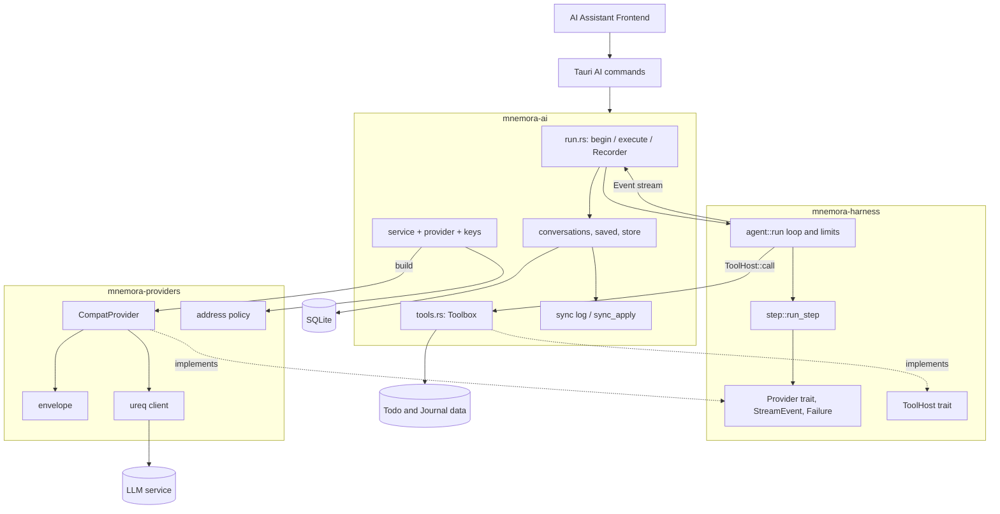
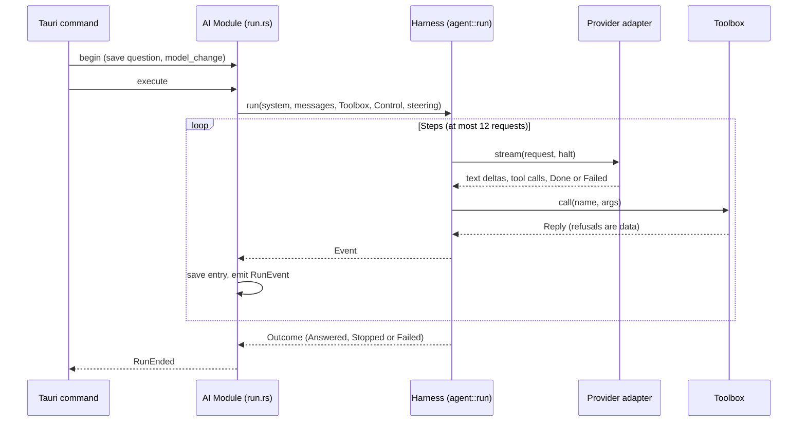

# AI Assistant Backend

The AI Assistant Backend is the Rust side of Mnemora's AI assistant. It answers a person's question by running an agent loop. The Model can call read-only **Tools** over Todo and Journal data, and the reply is streamed back and saved as part of a **Conversation**. It is split into three crates:

| Crate | Role | Documentation |
|---|---|---|
| `mnemora-ai` (`crates/ai`) | Owns Conversations, entries, Branches, Saved questions, Providers and API keys. It also owns the Run orchestration, the Tools, and the sync of conversation data. | [AI Module](AI_Assistant_Backend/AI_Module.md) |
| `mnemora-harness` (`crates/harness`) | Holds the dependency-light agent loop, the `Provider` contract, the `ToolHost` contract and the Run limits. It knows nothing about HTTP or SQLite. | [Agent Harness](AI_Assistant_Backend/Agent_Harness.md) |
| `mnemora-providers` (`crates/providers`) | Holds the wire adapters. These cover the OpenAI-compatible format (also used for OpenRouter), the JSON envelope for Models without native Tool calls, the address policy and the HTTP client. | [LLM Providers](AI_Assistant_Backend/LLM_Providers.md) |

The AI Module never writes Journal or Task data. It is off by default (`default_enabled = false`). Only Conversations, entries and Saved questions are synced. Providers, keys, usage and the visible Branch stay on the device.

## Architecture

### Run flow

## How the pieces fit

- **Run orchestration.** `mnemora-ai` writes the question in one transaction, then drives the harness. It saves each harness `Event` as an insert-only entry in a tree, which gives Branches for Try again and Edit. The database lock is never held while streaming or running a Tool.
- **Agent loop.** The harness chains Steps and Tool calls. It enforces limits on requests, calls per Step, prompt size, repeated calls and invalid replies. Mistakes the Model can fix become correction turns instead of failures. A stop ends the Run, and "Send now" ends only the current Step.
- **Provider isolation.** Each Step runs on its own thread, so stopping does not wait on the network. Adapters turn HTTP status and transport errors into harness `Failure` kinds. The AI Module then turns those into one plain sentence for the person, and provider error text is never shown.
- **Providers and keys.** The Provider kinds are Local AI Wrapper, OpenAI-compatible, Anthropic and OpenRouter. Keys are kept in an owner-only file outside the database. Plain `http` is allowed only for local and private addresses, so a key never crosses the internet unencrypted. Paid OpenRouter models need `allow_paid`.
- **Citations.** `Toolbox::check_answer` rejects any citation of an id that no Tool returned. This triggers a correction turn.

## Related documentation

- Commands that call this backend: [AI Assistant Commands](Tauri_Host_and_Command_Layer/AI_Assistant_Commands.md)
- UI: [AI Assistant Frontend](AI_Assistant_Frontend.md)
- Sync of conversation data: [Sync Replication Engine](Sync_Replication_Engine.md)
- Tests: [AI Run Engine Tests](Backend_Integration_Test_Suites/AI_Run_Engine_Tests.md), [AI Data and Provider Tests](Backend_Integration_Test_Suites/AI_Data_and_Provider_Tests.md)