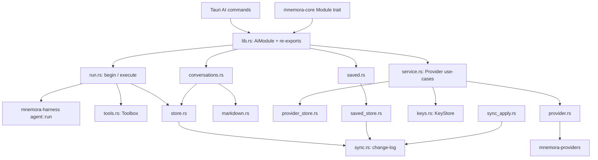
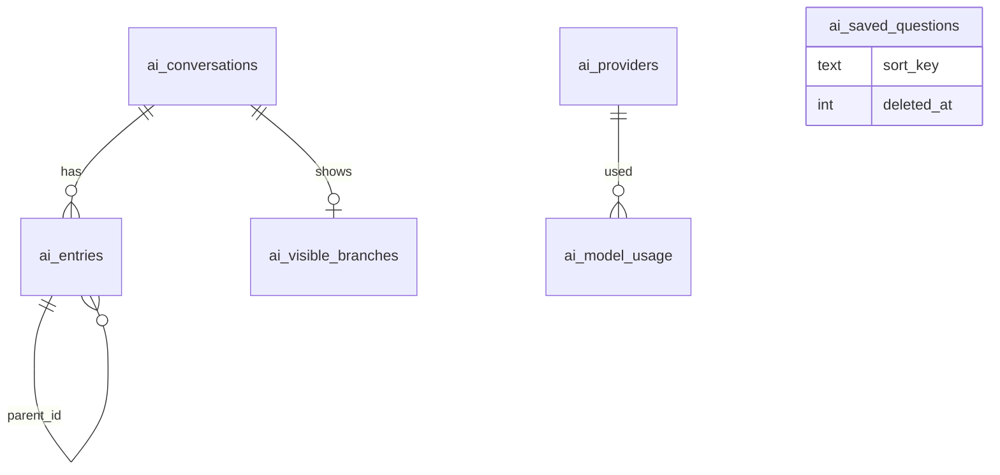
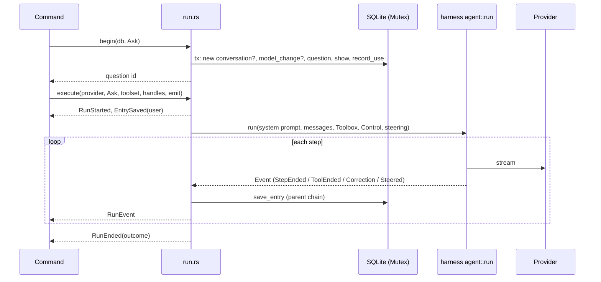

# AI Module (`mnemora-ai`)

The AI Module is the Rust crate (`crates/ai`, package `mnemora-ai`) that owns **Conversations**, their **entries**, **Saved questions**, **Providers** and the **Run** that answers a question. It is *read-only* with respect to other modules: it never changes Journal or Task data. It only reads them through Tools. The agent loop and the Provider contract live in the [Agent Harness](Agent_Harness.md); the concrete LLM adapters live in [LLM Providers](LLM_Providers.md). The Tauri commands that call this crate are in [AI Assistant Commands](../Tauri_Host_and_Command_Layer/AI_Assistant_Commands.md). The UI is in [AI Assistant Frontend](../AI_Assistant_Frontend.md).

Manifest: `crates/ai/Cargo.toml` depends on `mnemora-core`, `mnemora-harness`, `mnemora-providers`, `rusqlite`, `rusqlite_migration`, `serde`, `serde_json`, `specta`, `thiserror` and `tracing`. `lib.rs` uses `#![forbid(unsafe_code)]`.

## Architecture

The crate follows a strict split: *rule files* (`conversations`, `saved`, `provider`, `service`) validate and decide; *store files* (`store`, `saved_store`, `provider_store`) only move rows.

## Module contract (`lib.rs`)

`AiModule` implements `mnemora_core::module::Module`:

| Method | Behaviour |
|---|---|
| `id` | `"ai"` (`MODULE_ID`, the migration namespace) |
| `default_enabled` | `false` – off until the person turns it on |
| `migrations` | `migrations::all()` |
| `register_settings` | none |
| `sync_entities` | `CONVERSATION_SCHEMA`, `ENTRY_SCHEMA`, `SAVED_SCHEMA` only |
| `apply_remote` | `sync_apply::apply` |
| `backfill_log` | `sync::backfill` |

Providers, keys, usage and the visible branch are **never synced**; they stay on the device. See [Sync Replication Engine](../Sync_Replication_Engine.md) and [Core Foundation](../Core_Foundation.md) for `SyncEntity`/`RemoteChange`.

`lib.rs` also exposes `ensure_conversation` and `conversation`, which builds a `ConversationView` containing only the entries of the Branch shown on this device, with each question's `sibling_index`/`sibling_count`.

## Data model (`migrations.rs`)

Append-only migrations:

1. `ai_conversations`, `ai_entries` – entries are **insert-only** (ADR 0019): a tree via `parent_id`, no `updated_at`/`deleted_at`. Conversations are soft-deleted and renamable.
2. `ai_providers`, `ai_model_usage`, plus `provider_id/provider_name/model` columns on conversations.
3. `ai_saved_questions` with a fractional-index `sort_key` (ADR 0012).
4. `allow_paid` on providers.
5. `ai_visible_branches` – device-local, not logged.
6. Index `ai_entries_parent`.

## Conversations and Branches (`conversations.rs`, `store.rs`, `markdown.rs`)

- `list` – newest first, paged (`PAGE_MAX = 100`), matching **titles only**, using the core `fold` (case/accent-insensitive).
- `rename`, `delete` (soft, `set_deleted`), `restore` – each logs a change via `sync::log_conversation`.
- `set_leaf` / `show_branch` – choose which Branch is visible on this device (`store::show`, never synced). `show_branch` is the pager: it picks the *n*-th sibling question and shows the newest descendant (`newest_under`).
- `question_text` – supports Try again; only user questions qualify.
- `markdown` – whole shown Branch or a single tool-free answer. `markdown::strip_citations` removes bracketed 36-character ids so a copy matches what the screen shows.

Siblings (`store::question_groups`) are questions sharing the same non-`model_change` ancestor, so Try again and Edit create sibling branches. Entry kinds: `user`, `assistant`, `tool_result`, `correction`, `model_change` (`kind_text`). `store::branch_messages` converts a Branch into harness `Message`s, skipping empty stopped assistant steps and model-change markers.

## Runs (`run.rs`)

Key points:
- `begin` writes the question (and a `ModelChange` entry if the Provider/Model differs from the Conversation's) in one transaction; the Conversation therefore exists when the command returns.
- `execute` never throws; a failure is the last event (`RunOutcome::Failed { kind, message }`). The DB lock is held only for each row read/write, never while streaming or running a Tool.
- `Recorder` saves each entry after its parent, collects Tool items by id for **Sources**, and flags `broken` if saving fails (outcome `Unexpected`).
- `Handles` bundles `Control` (stop / send now) and `Steering` (queued notes). On end, unsent notes are announced with `QueueChanged`; an interrupted stop maps to `Failure::Interrupted`.
- `failure_message` maps each harness `Failure` to one plain sentence; provider text is never shown. `budget_note` annotates answers forced by the request budget (`MAX_REQUESTS`).

## Tools (`tools.rs`)

`Toolbox` implements the harness `ToolHost`. Each call: look up the Tool, parse JSON, validate against its spec (`check`), number the result as an observation `e<N>`, run it under the DB lock, remember returned items, and cap oversized results (`RESULT_LIMIT`). Refusals reach the model as data (`Reply::refused`, `invalid`). A provider without native tools is offered none. `check_answer` rejects citations of ids no Tool returned (`UNSEEN_CITATION`), producing a correction turn. `cited_ids` extracts distinct lowercase-hex UUIDs from text.

## Providers (`provider.rs`, `provider_store.rs`, `service.rs`, `keys.rs`)

| Kind | Key policy | Address |
|---|---|---|
| `Wrapper` (Local AI Wrapper) | NotNeeded | user-given |
| `OpenAiCompatible` | Optional | user-given |
| `Anthropic` | Required | fixed (`anthropic::ADDRESS`) |
| `OpenRouter` | Required | fixed (`OPENROUTER_ADDRESS`) |

- Validation: name ≤ 40 chars, key ≤ 512 bytes, model id ≤ 200 chars without control characters, address via `mnemora_providers::address::check` mapped to `AiError::Validation`.
- `ProviderView` never carries the key; `KeyState` is `NotNeeded | Saved | Missing`. Keys live in an owner-only file handled by `KeyStore`, outside the database; changing an address clears the key (a key is bound to its address).
- OpenRouter: free routes end in `:free` and are sent with a zero `max_price` cap; paid models need `allow_paid`. `may_send` is re-checked on every send in `prepare_run`.
- `build` creates the harness `Provider` adapter; `build_models` lists models; `connection_test` and `matching_models` ask the Provider (read under the lock, used without it since asking can take minutes).
- Providers are soft-deleted so Conversations naming them still read. `usage` returns the 5 most recent and 5 most used models among live Providers.

## Saved questions (`saved.rs`, `saved_store.rs`)

One-tap questions kept in manual order using `key_after` / `key_between`. Deleted ones keep their key so Undo restores the position; `last_key` includes deleted rows for that reason. Every write is logged through `sync::log_saved`.

## Sync (`sync_apply.rs`)

Applies records received from other devices straight to the tables without re-logging. Each field is validated as local writes are (`validate_title`, `validate_saved`); invalid fields are skipped. Records that cannot be created yet (missing Conversation, parent entry or creation fields) are "relayed only": snapshot returned, `changed: false`. Entries use `INSERT OR IGNORE`, and an arriving entry advances the Conversation's `updated_at`. `Sent<T>` distinguishes an explicit null (clears a column) from an absent field. The provider group (`provider_id`, `provider_name`, `model`) arrives whole or not at all. Conversation text must never reach a log line.

## Errors (`error.rs`)

`AiError` – `Validation(&'static str)`, `NotFound`, `ProviderNotFound`, `Payload(serde_json::Error)` – converts to `AppError` with codes `Validation`, `NotFound`, `Internal` (the source goes in `details`).

## Tests

Behaviour is exercised by the integration suites in [AI Run Engine Tests](../Backend_Integration_Test_Suites/AI_Run_Engine_Tests.md) and [AI Data and Provider Tests](../Backend_Integration_Test_Suites/AI_Data_and_Provider_Tests.md).
