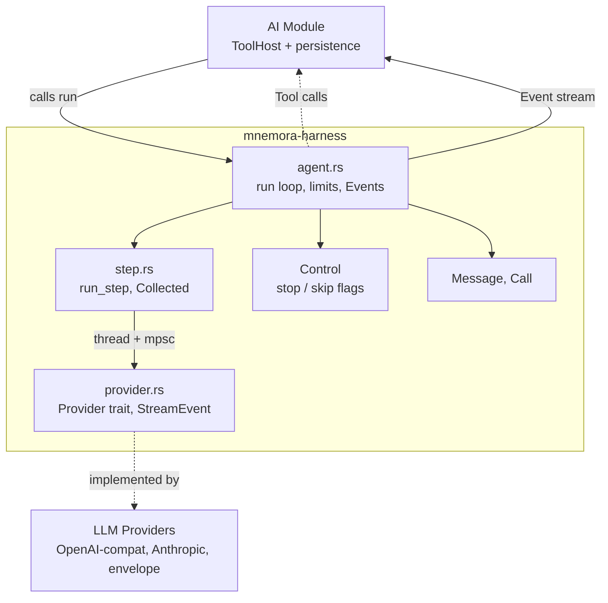
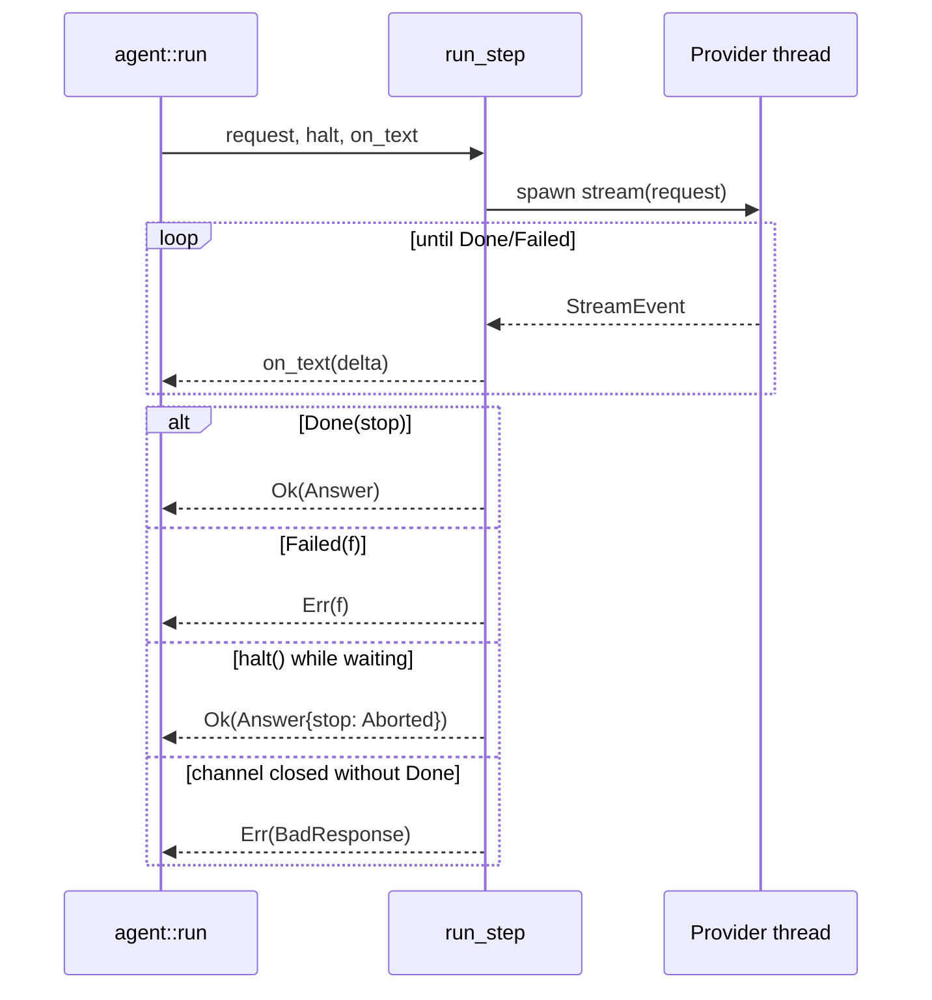
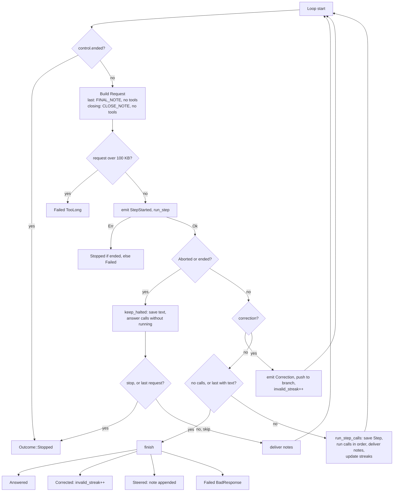
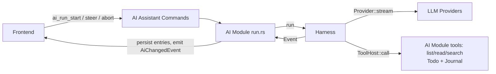

# Agent Harness

The Agent Harness (`crates/harness`, package `mnemora-harness`) is the small, dependency-light Rust crate that runs the AI assistant's **agent loop**. It defines the typed messages, the `Provider` contract that every AI-service adapter implements, one **Step** (a single request to the Model) and the loop that chains Steps together with Tool calls. It is inspired by *pi* (ADR 0018).

It knows nothing about HTTP, SQLite or Mnemora's data. Those are supplied from outside:

- Wire formats come from [LLM Providers](LLM_Providers.md), which implement `Provider`.
- Tools and answer checking come from the [AI Module](AI_Module.md), which implements `ToolHost` over the Todo/Journal data.
- The Tauri commands that start, stop and steer a Run live in [AI Assistant Commands](../Tauri_Host_and_Command_Layer/AI_Assistant_Commands.md).

The crate depends only on `serde` and `specta` (see `crates/harness/Cargo.toml`). Other files in the crate (`message.rs`, `control.rs`, `scripted.rs`) are referenced by the code below but were not part of the core components documented here.

## Architecture

| File | Responsibility |
|---|---|
| `provider.rs` | `Provider` trait, `Request`, `ToolDef`, `ToolProtocol`, `StreamEvent`, `StopReason`, `Failure` |
| `step.rs` | `run_step` (one Provider request on its own thread), `Answer`, private `Collected` accumulator |
| `agent.rs` | `run` loop, `ToolHost`, `Reply`, `Cited`, `Event`, `Outcome`, `StepRecord`, private `Finished`/`Tally`, limits and fixed notes |

## The Provider contract (`provider.rs`)

A Provider is an adapter: wire format lives inside it, the loop does not care. It **never throws**; each Step ends with exactly one `StreamEvent::Done` or `StreamEvent::Failed`, and raw error text stays inside the Provider.

`StreamEvent` variants:

- `TextDelta(String)` – a piece of reply text, in order.
- `Call(Call)` – a complete Tool call.
- `Sources(Vec<String>)` – ids the answer lists as sources (envelope Providers only).
- `Correction(String)` – the reply broke the protocol; this is what the Model is told. It precedes `Done` and the text is not an answer.
- `Done(StopReason)` – `Stop`, `Length` (output limit hit) or `Aborted`.
- `Failed(Failure)` – the Step failed.

`Failure` is a snake_case serialisable (specta `Type`) enum: `NoProvider`, `Unreachable`, `Timeout`, `KeyRejected`, `RateLimited`, `ModelUnavailable`, `ModelCannotUseTools`, `BadResponse`, `TooLong`, `Interrupted`, `Offline`, `Unexpected`. The AI Module turns these into one plain sentence for the person.

`ToolProtocol` says how Tools reach the Model: `None` (no Tools), `Native` (service tool calls: OpenAI-compatible, Anthropic, OpenRouter) or `Envelope` (every reply is a JSON envelope, used by the Local AI Wrapper). `Provider::stream` receives a `halt` callback, checked between pieces; once true it ends with `Done(Aborted)` keeping the text so far.

## One Step (`step.rs`)

`run_step(provider, request, halt, on_text)` spawns the Provider on a **detached thread** and reads its events from an `mpsc` channel, polling every 25 ms so it can notice `halt`.

Key behaviours (all covered by the unit tests in the file):

- Deltas are accumulated by `Collected` into `Answer { text, stop, calls, sources, correction }`.
- A blocking Provider (one long HTTP call) cannot hold the Run: when `halt` fires the Step ends `Aborted` with what it has, and anything the thread sends later is dropped with the channel.
- A failure drops partial text and returns `Err(Failure)`.
- A stream that ends without `Done` is `BadResponse`, so an early stop cannot pass for an answer.

## The agent loop (`agent.rs`)

`run(provider, system, messages, host, control, steer, emit) -> Outcome` loops Step by Step. A Step whose reply makes Tool calls runs them one by one and the next Step follows; the Step with no calls is the answer. Mistakes the Model can fix are sent back as **correction turns**, never shown as failures.

### Collaborators

- `ToolHost` (implemented by the AI Module): `specs()` lists Tools (empty if the Provider cannot call Tools), `call(name, args) -> Reply` never fails (a refusal is a `Reply` with `is_error`), and `check_answer(text, sources)` validates citations, returning `Err(correction)` if the answer cites something no Tool returned.
- `Control` (stop/skip flags): `ended()`, `skipped()`, `begin_step()`, `halts_step()`. A *stop* ends the Run; a *skip* ("Send now") only ends the current Step.
- `steer` hands over notes the person queued during the Run; `emit` receives every `Event` in order.

### Limits

| Constant | Value | Effect |
|---|---|---|
| `MAX_REQUESTS` | 12 | Model requests per Run; the last gets no Tools and `FINAL_NOTE` |
| `MAX_CALLS_PER_STEP` | 8 | Extra calls are refused with `TOO_MANY` |
| `MAX_PROMPT_BYTES` | 100 000 | Larger request ends the Run as `Failure::TooLong` |
| `MAX_REPEATS` | 3 | Steps in a row where every call repeats an earlier one; then Tools are withheld and `CLOSE_NOTE` is appended |
| `MAX_INVALID_STEPS` | 3 | Steps in a row with unknown/badly-formed calls, invalid replies or rejected citations; then `Failure::BadResponse` |

### Control flow

### Events and outcomes

`Event` is the loop's only output channel: `StepStarted`, `TextDelta`, `StepEnded(StepRecord)`, `ToolStarted`, `ToolEnded { arguments, reply }`, `Correction`, and `Steered` (a person's note became a question in the branch). `StepRecord` carries text, calls, stop reason, `budget_forced` (the last Step, so the answer gets a budget note) and listed `sources`.

`Outcome` is `Answered`, `Stopped` (what was written is kept) or `Failed(Failure)`. The private `Finished` enum (`Answered`, `Corrected`, `Steered`, `Failed`) records where an answer-shaped Step went.

### How calls are run (`run_calls`)

For each call the loop emits `ToolStarted`, then picks a result:

1. **Blocked** – `CUT_OFF` (reply hit `Length`), `NO_TOOLS_NOW` (Tools withheld), `NOT_RUN_STOPPED` or `NOT_RUN_SKIPPED`.
2. **Over the cap** – index ≥ 8 gets `TOO_MANY`.
3. **Repeat** – same name and arguments as an earlier call gets a refusal naming the earlier observation id (e.g. `e2`) and counts toward `repeats`.
4. **Otherwise** `host.call(...)`. Valid results are remembered in `ran`; invalid ones set `Tally.invalid`.

Every result is pushed as `Message::Tool` and emitted as `ToolEnded`, so the Model always sees a result for each call it made.

### Answer acceptance (`finish`)

- Empty/whitespace text → `Failed(BadResponse)`.
- `host.check_answer` failing → on the last request a failure; otherwise the Step is kept, a correction is sent and the loop continues (`Corrected`).
- A queued note → the answer is kept as an ordinary Step, the note is added as a user message and the Model is asked again (`Steered`).
- Otherwise the final `StepEnded` is emitted (with `budget_forced` if it was the last request) and the Run is `Answered`.

### Steering and stopping

Notes are delivered after a Step's Tools finish, or after a skipped/non-answer Step (`deliver`). A stopped Step is saved even when empty so the thread can show it was stopped; a skipped Step is saved as a normal finished Step and the Run continues. On the answer-only request a skip also ends the Run since no request is left for the note.

## Integration

The AI Module persists each `Event` as conversation entries and tool-call activity; see [AI Module](AI_Module.md). Behavioural tests of the loop with a real database are described in [AI Run Engine Tests](../Backend_Integration_Test_Suites/AI_Run_Engine_Tests.md). The frontend consumes the results in [AI Conversation and Runs](../AI_Assistant_Frontend/AI_Conversation_and_Runs.md).

## Design notes

- **Provider isolation:** a thread plus channel per Step makes stop latency independent of the network call.
- **Determinism:** limits and notes are constants, so the same scripted replies produce the same Run (a `ScriptedProvider` is used in tests).
- **Model-fixable errors stay private:** bad arguments, repeats, over-long batches and uncited sources become Tool results or correction turns; only exhausted budgets or persistent invalid replies surface as `Failure`.
