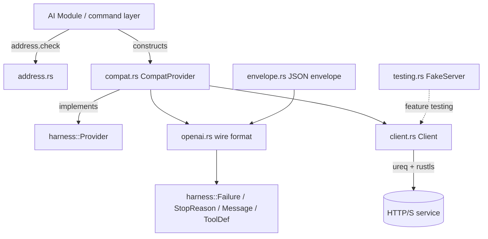
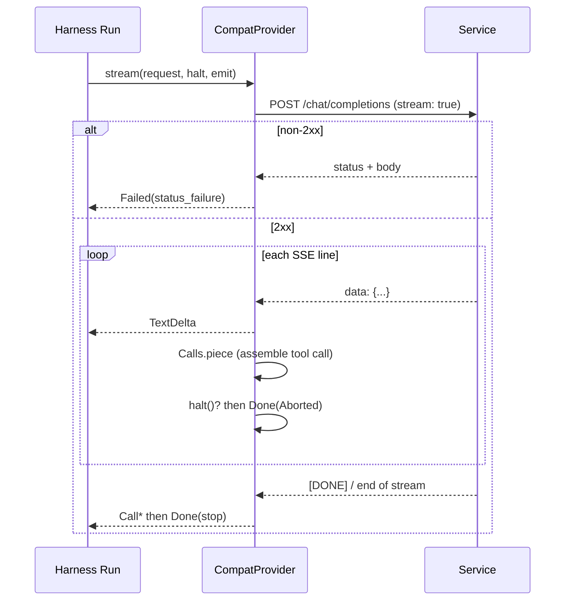
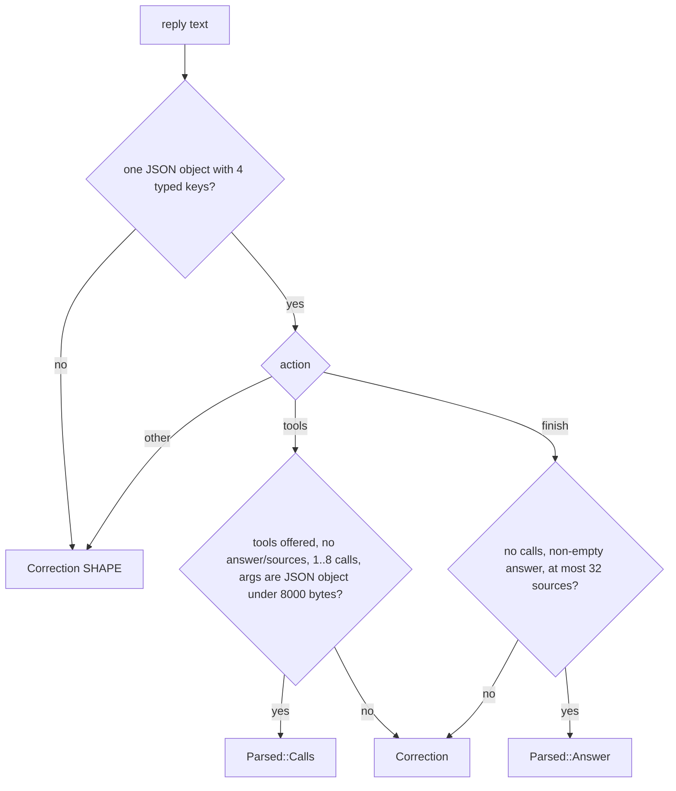
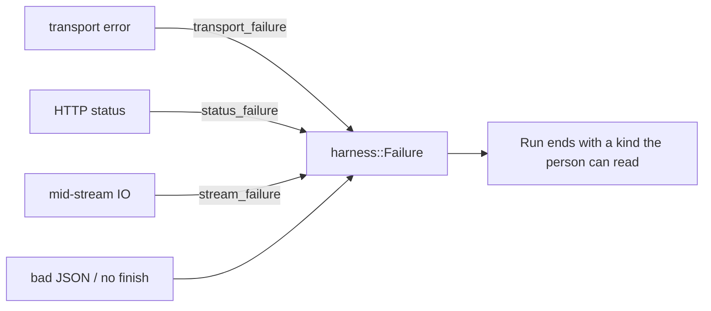

# LLM_Providers

The `mnemora-providers` crate (`crates/providers`) holds the wire adapters that let the AI Module talk to real language-model services. It speaks the OpenAI-compatible chat format over HTTP(S), turns replies and errors into the vocabulary of the [Agent Harness](Agent_Harness.md) (`Provider`, `StreamEvent`, `Failure`, `StopReason`), and enforces which addresses a Provider may use. The crate only depends on `mnemora-harness`, `serde_json` and `ureq` (`crates/providers/Cargo.toml`).

Real Providers are never called from tests (ADR 0018). The `testing` cargo feature exposes an in-process fake HTTP server so command-layer tests run a real adapter against the real wire protocol.

Related modules: [AI_Module](AI_Module.md) (stores providers, keys and runs), [Agent_Harness](Agent_Harness.md) (the Run loop that drives a `Provider`), and [AI_Assistant_Commands](../Tauri_Host_and_Command_Layer/AI_Assistant_Commands.md) (the `ai_provider_*` and `ai_run_*` commands). Tests: [AI_Data_and_Provider_Tests](../Backend_Integration_Test_Suites/AI_Data_and_Provider_Tests.md) and [AI_Run_Engine_Tests](../Backend_Integration_Test_Suites/AI_Run_Engine_Tests.md).

## Architecture

| File | Role |
|---|---|
| `address.rs` | Validates a Provider address. |
| `client.rs` | Shared blocking `ureq` client, timeouts, transport-error mapping. |
| `openai.rs` | Pure functions for the OpenAI chat format: request body, SSE parsing, model list, status mapping. |
| `compat.rs` | `CompatProvider`, the streaming native-tool-call adapter. |
| `envelope.rs` | The JSON envelope protocol for Models without native Tool calls. |
| `testing.rs` | Loopback fake server (feature `testing`). |

## Address policy (`address.rs`)

`check(raw)` trims the text and any trailing `/`, parses it as a URI and returns the cleaned string or an `AddressError`:

- `Invalid`: no host or scheme, or the address carries a query.
- `UnsupportedScheme`: anything but `http`/`https`.
- `PlainHttpNotAllowed`: `http` to a host that is not local.

`https` is accepted anywhere. Plain `http` is accepted only for loopback, private and link-local IPv4, Tailscale's CGNAT `100.64.0.0/10`, IPv6 loopback, unique-local `fc00::/7` and link-local `fe80::/10`, plus `localhost`, `.local` and `.ts.net` names. This guarantees an API key is never sent unencrypted across the internet. The tests also assert shared fixture behaviour with the browser mock (see [IPC_Bridge_and_Core_Mocks](../IPC_Bridge_and_Browser_Mocks/IPC_Bridge_and_Core_Mocks.md)).

## HTTP client (`client.rs`)

`Client` wraps a `ureq::Agent` on the rustls stack (no OpenSSL). `Options` sets the reply timeout (default `REPLY_TIMEOUT` 120 s; connect timeout fixed at 10 s) and optional custom roots (tests only, for a self-signed server). HTTP statuses are not errors (`http_status_as_error(false)`), so adapters can read the body to classify them.

Methods: `post_json` (bearer key), `post_with` (custom headers, e.g. a vendor's key and version headers), `get`, `get_with`. `read_body` reads a reply up to 16 MiB. `transport_failure` maps transport errors to a harness `Failure` and drops the error text:

| ureq error | Failure |
|---|---|
| Timeout | `Timeout` |
| HostNotFound | `Offline` |
| ConnectionFailed, Io, Tls, Rustls | `Unreachable` |
| Protocol, LargeResponseHeader | `BadResponse` |
| other | `Unexpected` |

## OpenAI wire format (`openai.rs`)

- `chat_body(request, stream)` builds the request. The system prompt goes first when non-empty; assistant tool calls become `tool_calls` (Gemini's `thought_signature` is echoed back under `extra_content.google`); tool results become `role: tool`. No `tools` key is sent when none are offered, and no output limit is sent. `function_tool` converts a `ToolDef` into a function schema.
- `sse_events(line)` parses one `data:` line into `SseEvent`s: `Text`, `ToolDelta` (with an optional `index`, since Gemini's parallel calls have none), `Finish(StopReason)`, `Done`. An `error` object in the stream is `Failure::Unexpected`; its text is discarded.
- `parse_answer` reads a whole (non-streamed) reply. A reply that finished with tool calls is rejected as `BadResponse`.
- `parse_model_ids` reads `GET /models`.
- `status_failure(status, body, Endpoint)` maps HTTP statuses. `Endpoint` (`Chat` or `Models`) matters because a 404 means `ModelUnavailable` only on chat.

| Status | Failure |
|---|---|
| 400 mentioning "tool" | `ModelCannotUseTools` |
| 400 mentioning context / too long, 413 | `TooLong` |
| 401, 403 | `KeyRejected` |
| 404 (chat) | `ModelUnavailable` |
| 408, 504 | `Timeout` |
| 429, 500, 502, 503, 529 | `RateLimited` |
| other | `Unexpected` |

Finish reasons `stop`, `tool_calls` and `function_call` all map to `StopReason::Stop`; `length` maps to `Length`; anything else (content filters) is `BadResponse`.

## CompatProvider (`compat.rs`)

`CompatProvider` implements `harness::Provider` with `ToolProtocol::Native`. It serves OpenAI-compatible endpoints (custom address, key optional) and OpenRouter (fixed address, key, and a price cap supplied through `with_extra`, which merges fields into each chat body). `list_models()` calls `GET {address}/models`, which also serves as the connection test.

Key behaviours:

- **Halting.** `halt()` is checked before the request and on every line; when set, the stream ends with `Done(Aborted)` and partially read calls are dropped.
- **Tool-call assembly.** `Calls::piece` joins chunks: an indexed piece continues the call that index is filling; a piece without an index continues the latest call only if it has no id, or repeats the latest call's id. This handles Gemini sending parallel calls with ids but no indexes.
- **Finish.** An answer counts only once a finish reason arrived (otherwise `BadResponse`). Each call must have a name; a missing id becomes `call-{n}` and empty arguments become `{}`. Calls are emitted only at the end, followed by `Done`.
- **Mid-stream read errors.** `stream_failure` maps `TimedOut` to `Timeout` and anything else to `Interrupted`.
- Neither raw replies nor service error text are kept.

## JSON envelope (`envelope.rs`)

For Providers without native Tool calls, every Step is one JSON object with exactly four keys: `action` (`tools` or `finish`), `calls` (up to 8, each `{name, arguments}` with `arguments` as JSON text), `answer`, and `sources` (up to 32 ids). `response_format(finish_only)` produces the strict `json_schema` sent with the request; with no Tools only `finish` is allowed and `maxItems` for calls is 0. `instructions(tools)` produces the system-prompt tail, and `turns(messages)` renders history as plain user/assistant turns, with tool results rendered as `Result of <name>:` user messages.

`parse(content, tools_offered, next_id)` strips a BOM or code fence, validates the shape, and returns `Parsed`:

A protocol violation is not an error: `Correction(&'static str)` is a message the Model reads before answering again, so the Run continues. The Run loop that counts consecutive invalid replies lives in the [Agent_Harness](Agent_Harness.md).

## Testing support (`testing.rs`)

`FakeServer::start(respond)` binds a loopback port, records every request as a `Seen` (method, path, authorization, headers, body), and answers with a `Canned` reply built by `Canned::json`, `Canned::sse` or `.delayed(..)`. `address()` returns `http://127.0.0.1:port/v1`, which passes the address policy. `closed_address()` returns an address with nothing listening, to test `Unreachable`. The `reason` helper supplies HTTP status phrases for the raw response. Unit tests in `openai.rs` use fixtures under `crates/providers/tests/fixtures/`.

## Error flow summary

Failure kinds are surfaced to the user through the [AI_Module](AI_Module.md) and the frontend ([AI_Providers_and_Models](../AI_Assistant_Frontend/AI_Providers_and_Models.md)).
