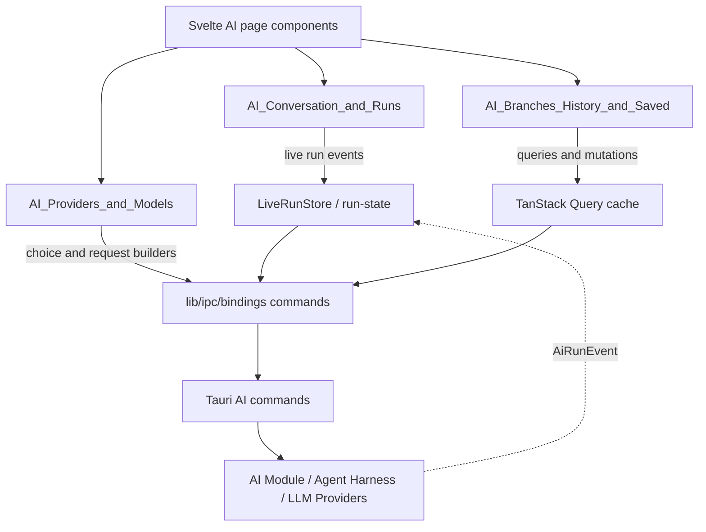
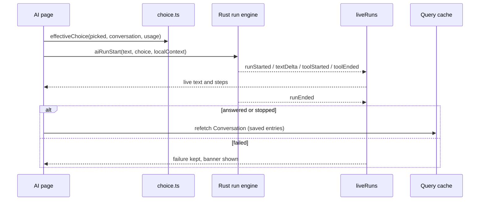

# AI_Assistant_Frontend

## Purpose

`AI_Assistant_Frontend` (`src/modules/ai/`) is the client side of Mnemora's AI assistant. It is a thin TypeScript layer between the Svelte AI page and the Rust backend. It does three things:

- **Folds the run stream into screen state.** It turns the live run events streamed from Rust into in-memory Run state: streamed text, tool steps, failures and queued notes.
- **Derives thread view data from saved Conversations.** This covers activity lines, source previews, the "Branch from earlier" choices, failure banners and the end-of-run announcement.
- **Handles everything around a Conversation.** That means which Branch is shown, the history list, Saved questions, and which Provider and Model answer a question.

It keeps no persistent state of its own. Conversations, Branches, Saved questions and Providers all live in the backend and are read through the generated IPC `commands`. The only local state is the in-memory live Run store. Server data is cached with TanStack Query and invalidated after each mutation. Most of the logic is pure functions, so it can be unit tested without a DOM.

## Architecture



The three sub-modules divide the work like this:

```mermaid
flowchart LR
    subgraph Conversation and Runs
      A1[run-state, live, queue-state]
      A2[activity, answers, earlier-answers]
      A3[failure-banner, announce, source-excerpt]
    end
    subgraph Branches, History and Saved
      B1[queries, branch-actions, branch-pager]
      B2[history, saved-actions]
      B3[focus, long-press]
    end
    subgraph Providers and Models
      C1[choice]
      C2[model-picker]
      C3[provider-kinds]
    end
    C1 -->|Choice for the question| A1
    B1 -->|Conversation query| A2
    A3 -->|Branch from earlier| B1
```

### Question flow



## Core component documentation

| Sub-module | Scope | Documentation |
|---|---|---|
| **AI Conversation and Runs** | Run event reducer and the `liveRuns` store, the queued-notes helpers, activity lines, answer and earlier-answer derivations, failure banners, end-of-run announcements, cited-source previews, copy as Markdown, and the local context sent with a question | [AI_Conversation_and_Runs](AI_Assistant_Frontend/AI_Conversation_and_Runs.md) |
| **AI Branches, History and Saved** | TanStack Query keys and options, Branch switching and branching from an earlier answer, pager maths, date-grouped history, Saved question mutations with Undo, focus return, phone long-press, and the bare-key guard test | [AI_Branches_History_and_Saved](AI_Assistant_Frontend/AI_Branches_History_and_Saved.md) |
| **AI Providers and Models** | `effectiveChoice` for the default Provider and Model, model picker search and paid/free row state, and the four Provider kinds with their create and update request builders | [AI_Providers_and_Models](AI_Assistant_Frontend/AI_Providers_and_Models.md) |

## Design principles

- **Backend is the source of truth.** The frontend caches and derives data but never stores a Branch, Saved question or Conversation itself.
- **Pure, testable logic.** Reducers, selectors, pager arithmetic, grouping and request builders are pure functions with Vitest coverage. Svelte components only render their results.
- **Live state is ephemeral.** A reload drops live Runs. The saved Conversation is the record.
- **Device-local settings.** Providers, usage and the shown Branch stay on the device. Only Conversations sync, so `effectiveChoice` handles a Conversation that names a Provider this device lacks.
- **Wording from Rust.** Failure sentences come from the backend, and the TypeScript side supplies only short titles, tones and actions.

## Related modules

- Backend: [AI Module](AI_Assistant_Backend/AI_Module.md), [Agent Harness](AI_Assistant_Backend/Agent_Harness.md), [LLM Providers](AI_Assistant_Backend/LLM_Providers.md)
- Host commands: [AI Assistant Commands](Tauri_Host_and_Command_Layer/AI_Assistant_Commands.md)
- IPC and browser mocks: [IPC Bridge and Core Mocks](IPC_Bridge_and_Browser_Mocks/IPC_Bridge_and_Core_Mocks.md)
- Behaviour tests: [AI Data and Provider Tests](Backend_Integration_Test_Suites/AI_Data_and_Provider_Tests.md)