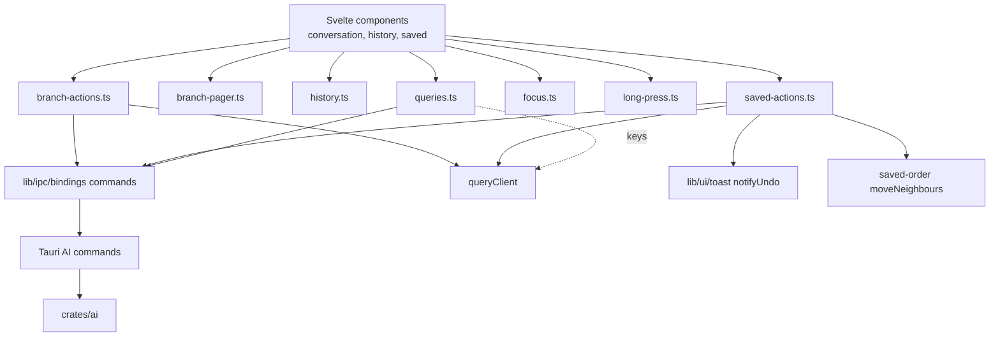
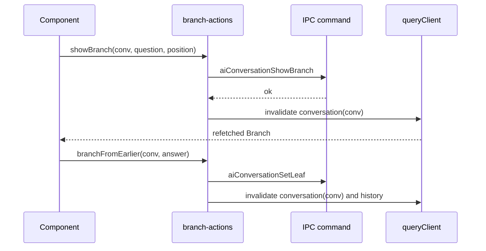
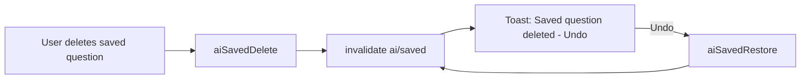

# AI Branches, History and Saved

This module is the part of the AI frontend (`src/modules/ai/`) that handles everything around a Conversation other than the live Run: choosing which **Branch** is shown, browsing the **history** of Conversations, managing **Saved questions**, and the small accessibility and touch helpers those screens share. It is a thin, mostly pure layer: it calls the generated Tauri IPC commands, keeps the TanStack Query cache fresh, and holds the testable logic (grouping, pager arithmetic, focus return) away from the Svelte components.

For the live run, answers, and activity, see [AI Conversation and Runs](AI_Conversation_and_Runs.md). For providers and the model picker, see [AI Providers and Models](AI_Providers_and_Models.md). The backend that stores this data is described in [AI Module](../AI_Assistant_Backend/AI_Module.md) and the command wrappers in [AI Assistant Commands](../Tauri_Host_and_Command_Layer/AI_Assistant_Commands.md).

## Components at a glance

| File | Exports | Role |
|---|---|---|
| `branch-actions.ts` | `branchFromEarlier`, `showBranch` | IPC calls that change which Branch is shown |
| `branch-pager.ts` | `pagerLabel`, `pagerStep`, `pagerFocusAfterShow` | Pure pager maths and focus rules |
| `queries.ts` | `aiKeys`, `conversationOptions`, `historyOptions`, `modelsOptions`, `savedOptions`, `providersOptions`, `usageOptions` | TanStack Query definitions and cache keys |
| `history.ts` | `groupConversations`, `groupOf`, `shortDate`, `updatedAt` | Date grouping of the history list |
| `saved-actions.ts` | `saveQuestion`, `renameSaved`, `moveSaved`, `deleteSaved` | Saved question mutations with refresh and Undo |
| `focus.ts` | `returnFocus` | Restores focus when an overlay closes |
| `long-press.ts` | `pressMovedTooFar`, `LONG_PRESS_MS` | Phone long-press detection on a question |
| `keys.test.ts` | – | Guards the AI Module's bare-key claims against other Modules |

## Architecture

All server state lives in the backend; the frontend never stores a Branch or a Saved question locally. After each mutation the relevant query keys are invalidated and the components re-render from the cache.

## Query keys and options (`queries.ts`)

Every AI query key starts with `'ai'`, so one invalidation can refresh everything. `aiKeys` defines:

- `all` – `['ai']`
- `history` – `['ai','conversations']`; the infinite history queries append the search text, so invalidating this prefix refreshes every search together
- `saved`, `providers`, `usage`
- `conversation(id)` and `models(providerId)`

Notable behaviour:

- `conversationOptions(id)` loads a Conversation with its entries (`aiConversationGet`). It is refreshed when a Run saves an entry or ends.
- `historyOptions(query)` is an infinite query over `aiConversationList(query, offset, HISTORY_PAGE)`. `HISTORY_PAGE` is 30. The next offset is the sum of items loaded so far, and only exists while the server reports `more`. Search matches titles only (the backend decides this; see [AI Data and Provider Tests](../Backend_Integration_Test_Suites/AI_Data_and_Provider_Tests.md)).
- `savedOptions` lists Saved questions in their stored order.
- `modelsOptions(providerId)` fetches the full model list once, with infinite `staleTime`/`gcTime` and no retry; a `failure` in the reply is thrown as an `Error` with the backend's one-sentence message. It is used by the provider UI.

## Branches

A Conversation is a tree of questions and answers. Editing a question or trying again adds a sibling question; the shown **Branch** is the path through the tree that the screen displays and that the next question continues. The shown Branch is device-local and writes nothing to the change log, so it is never synced (verified in `ai_branching_tests`).

- `branchFromEarlier(conversationId, answerId)` sets the leaf to an earlier answer. The next question continues from it, and the later Branch stays in the Conversation. It invalidates both the Conversation and the history (the order and `updated_at` may change). The invalidations are fire-and-forget (`void`), only the command is awaited.
- `showBranch(conversationId, questionId, position)` shows the Branch of the question at a 1-based `position` among the siblings of `questionId`. Only the Conversation query is invalidated.

Both use `unwrap`, so a failed command rejects with a typed error for the caller to surface.

### Pager (`branch-pager.ts`)

Pure functions, so they can be tested without a DOM:

- `pagerLabel(index, count)` → `"Question 2 of 3"` (1-based).
- `pagerStep(index, count, 'previous'|'next')` → the new 1-based position, or `null` at either end or with no siblings.
- `pagerFocusAfterShow(pressed, enabled)` → keeps focus on the pressed arrow while it is still enabled, otherwise moves it to the other arrow, otherwise `null`. This prevents focus falling to the body when the user pages to an end.

The usual flow is: `pagerStep` computes the target, `showBranch` applies it, then `pagerFocusAfterShow` decides where focus lands after the refetch.

## History (`history.ts`)

`groupConversations(items, now)` splits a newest-first list of `ConversationSummary` into labelled sections, keeping their order and dropping empty ones.

| Group | Label | Rule (whole local days before `now`) |
|---|---|---|
| `today` | Today | ≤ 0 (a time ahead of now counts as today) |
| `yesterday` | Yesterday | 1 |
| `previous7` | Previous 7 days | 2–7 |
| `earlier` | Earlier | > 7 |

Day differences use local midnight and `Math.round`, which absorbs the 23- and 25-hour days around a clock change. `updatedAt` treats the nullable `updated_at` binding as `0`. `shortDate` formats a row's date as `Oct 18` (en-US). `history.test.ts` uses local noon to stay clear of clock changes.

## Saved questions (`saved-actions.ts`)

Every action awaits the IPC command, then invalidates `aiKeys.saved`.

| Function | Command | Notes |
|---|---|---|
| `saveQuestion(text)` | `aiSavedCreate` | Appends to the end; returns the `SavedQuestion` |
| `renameSaved(id, text)` | `aiSavedUpdate` | Changes the text |
| `moveSaved(list, id, direction)` | `aiSavedReorder(id, afterId, beforeId)` | `moveNeighbours` (from `saved-order`) computes the two neighbours; returns early when the move is impossible at an end |
| `deleteSaved(saved)` | `aiSavedDelete` | Deletes at once and shows an Undo toast (`notifyUndo`) that calls `aiSavedRestore` and refreshes; restore puts it back in its place |

Reordering sends neighbour ids rather than an index, which lets the backend place the item between two keys and converge across devices (see [AI Module](../AI_Assistant_Backend/AI_Module.md) and the `ai_sync_tests` cases on saved-question order).

## Accessibility and touch helpers

- `returnFocus(opener, fallback?)` focuses the opener if it is still connected, else the fallback (the question box). A closed Sheet, Popover or Dialog must never leave focus on the body. The `Focusable` interface keeps it testable without a DOM (`focus.test.ts`).
- `pressMovedTooFar(from, to)` is true when a press drifted more than 10 px, so it is a scroll or swipe and not a hold. `LONG_PRESS_MS` (500 ms) is how long a finger rests on a question before its Edit control shows on phones.

## Key-claim guard (`keys.test.ts`)

The test builds the enabled-module registry with only `aiManifest` and checks that:

- `A` opens AI everywhere except `/todo`, where `G` then `A` is the All view;
- `C` and `/` are AI keys only on `/ai`, keeping their Journal and search meanings elsewhere;
- no other Module uses those keys on the AI page.

The list of other Modules' keys is hard-coded in the test (the registry needs the router), so it must be updated when another manifest changes its bare keys. See [Shell and Navigation](../Frontend_Platform_and_Shell/Shell_and_Navigation.md) for `bareKeyFor`.

## Integration summary

- **Upstream:** generated `commands` from `lib/ipc/bindings`, `unwrap`, the shared `queryClient`, and `notifyUndo` from `lib/ui/toast` (see [IPC Bridge and Core Mocks](../IPC_Bridge_and_Browser_Mocks/IPC_Bridge_and_Core_Mocks.md) for browser mocks of these commands).
- **Downstream:** the AI Svelte screens, which also use [AI Conversation and Runs](AI_Conversation_and_Runs.md) for live state.
- **Behaviour tests:** branching, history, and saved behaviour is verified end to end in [AI Data and Provider Tests](../Backend_Integration_Test_Suites/AI_Data_and_Provider_Tests.md).
