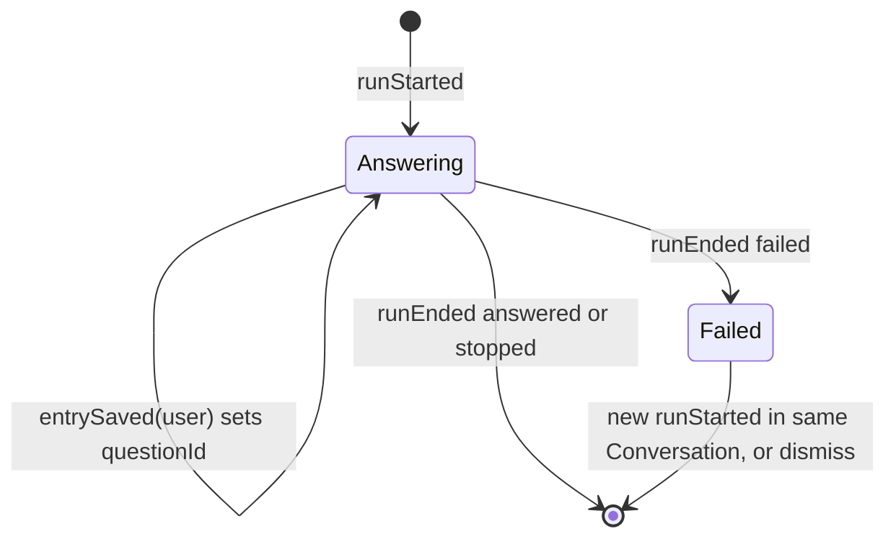
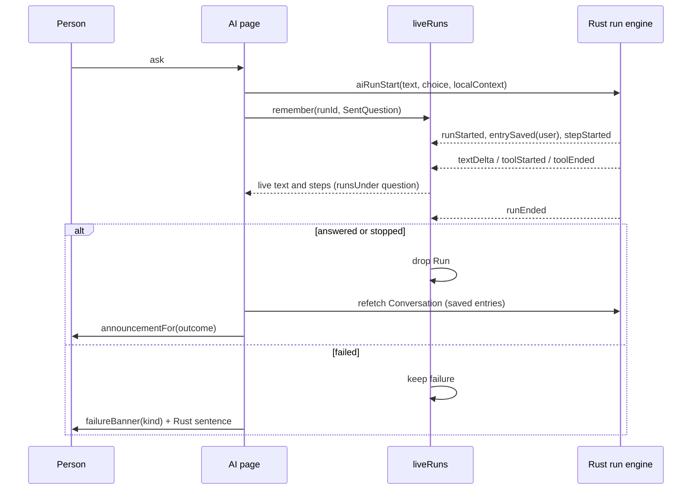

# AI_Conversation_and_Runs

The pure-TypeScript logic behind the AI page's conversation thread. It turns the run events streamed from the Rust backend into live, in-memory Run state. It also turns saved conversation entries into the things the thread shows: activity lines, failure banners, "branch from earlier" choices, source previews, queued notes and the end-of-run announcement. All files are under `src/modules/ai/`.

The module holds no persistence of its own. Saved Conversations come from Rust through the IPC `commands` in `src/lib/ipc/bindings`. This module only folds events and derives view data from them. Svelte components elsewhere in the AI frontend render the results.

Related pages:
- [AI_Assistant_Frontend](../AI_Assistant_Frontend.md) is the parent module.
- [AI_Branches_History_and_Saved](AI_Branches_History_and_Saved.md) covers branch pager, history and saved questions.
- [AI_Providers_and_Models](AI_Providers_and_Models.md) covers `Choice`, which `SentQuestion` extends.
- [AI_Assistant_Commands](../Tauri_Host_and_Command_Layer/AI_Assistant_Commands.md) covers the Tauri commands and the run events they emit.
- [Agent_Harness](../AI_Assistant_Backend/Agent_Harness.md) and [AI_Module](../AI_Assistant_Backend/AI_Module.md) cover the backend that produces the events.
- [IPC_Bridge_and_Core_Mocks](../IPC_Bridge_and_Browser_Mocks/IPC_Bridge_and_Core_Mocks.md) covers the event bridge and the browser mocks.

## Architecture

```mermaid
graph TD
  Rust[Rust AI run engine] -- AiRunEvent --> Bridge[IPC event bridge]
  Bridge --> Live[LiveRunStore: liveRuns]
  Live --> RS[run-state.ts: applyRunEvent]
  Live --> QS[queue-state.ts]
  RS --> UI[AI page components]
  QS --> UI
  Saved[(Saved Conversation: EntryView[])] --> Act[activity.ts]
  Saved --> Ans[answers.ts]
  Ans --> Earlier[earlier-answers.ts]
  Act --> Earlier
  Saved --> RS
  Act --> UI
  Earlier --> UI
  Fail[failure-banner.ts] --> UI
  Ann[announce.ts] --> UI
  Src[source-excerpt.ts] -- journalPages / todoTask --> Rust
  Copy[copy.ts] -- aiConversationMarkdown --> Rust
  Req[ai-requests.svelte.ts] --> UI
  Ctx[local-context.ts] --> UI
```

## Components

### Live Run state

| Component | File | Role |
|---|---|---|
| `applyRunEvent` and selectors | `run-state.ts` | Pure reducer from `AiRunEvent` into `LiveRuns` (keyed by run id). It has selectors: `answeringIn`, `failedIn`, `bannerRuns`, `lastQuestionId`, `runsUnder`, `unplacedRuns`. |
| `LiveRunStore` / `liveRuns` | `live.svelte.ts` | A Svelte 5 `$state` singleton holding `runs`, `sent` (the questions this page sent, kept for "Try again") and `queued` (notes per Conversation). Methods: `apply`, `remember`, `dismiss`, `dropNote`, `clear`. |
| queue helpers | `queue-state.ts` | `setQueued`, `dropQueued` and `recalledText`. Notes taken back are joined one per line. |
| `announcementFor` | `announce.ts` | One sentence for the polite live region when a Run ends: complete, stopped, or failed with a message. Streamed text is never announced token by token. |
| `failureBanner` | `failure-banner.ts` | Maps each `Failure` kind to a tone (`danger` or `warning`), a short title and an ordered list of actions (`retry`, `change_model`, `change_provider`, `branch_from_earlier`, `new_conversation`). The sentence under the title comes from Rust. |

`applyRunEvent` rules:
- `runStarted` creates the Run and drops that Conversation's earlier failed Runs, so stale banners go away.
- `textDelta` appends to the current Step's text.
- `stepStarted` resets the text, because each Step's text starts afresh.
- `toolStarted` appends a step with a null summary; `toolEnded` fills in the summary and error flag by call id.
- `entrySaved` with kind `user` records `questionId`, which places the Run under its question.
- `runEnded` with `answered` or `stopped` removes the Run, because the saved Conversation now holds the text. `runEnded` with `failed` keeps the Run with its `{kind, message}`.
- `queueChanged` is handled by `LiveRunStore.apply` before it reaches the reducer, so it is not a Run.



A failed Run's banner shows only while its `questionId` equals the last question of the shown Branch (`bannerRuns` with `lastQuestionId`). Moving to another question or Branch hides it.

### Thread derivations from saved entries

| Function | File | Purpose |
|---|---|---|
| `stepsByQuestion` | `activity.ts` | Groups `tool_result` entries under the question they follow, as `ActivityStep` (`name`, `summary`, `isError`). |
| `runningLabel` / `completedLabel` | `activity.ts` | Activity line text, for example "Reading your journal and tasks… · 2 steps done" and "Completed 3 steps". |
| `openHref` / `sourceModule` | `activity.ts` | Deep link for a cited `Source` (`/todo?task=<id>` or `/journal/<date>`) and the label "Todo" or "Journal". |
| `withoutCitations` | `activity.ts` | Strips `[uuid]` markers from answer text. The Sources chips stand for them. |
| `questionOfAnswers` / `questionsByAnswer` | `answers.ts` | Maps each answer to the last question before it. Try again, Edit and Save this question use it. |
| `earlierAnswers` / `excerpt` | `earlier-answers.ts` | Rows for the "Branch from earlier" picker. Tool-calling Steps are skipped. A stopped answer is marked `stopped`. Answers are cut to 120 characters and questions to 160. |
| `loadSource` / `firstLines` | `source-excerpt.ts` | Preview of a cited item (3 lines, 240 characters) through the existing Journal page read and Todo task read. A missing item rejects with "That Entry no longer exists", or with the Todo module's own error. A `SourceReader` can be injected for tests. |

### Page-level helpers

- `AiRequests` / `aiRequests` (`ai-requests.svelte.ts`) holds one pending request (`'composer' | 'history' | 'new'`) from keys or palette actions. `request` sets it and `take` returns and clears it. An action that navigates to the AI page first still lands after the page mounts.
- `copyAsMarkdown` (`copy.ts`) calls `commands.aiConversationMarkdown` and writes the result to the clipboard. The Rust side builds the text. It toasts success or failure.
- `localContext` (`local-context.ts`) builds the `LocalContext` sent with a question: local date, weekday, time zone and week start. The backend tells the model the date and time zone from it.

## Data flow of a question



## Design notes

- Live state is kept in memory only. A reload forgets Runs, and the saved Conversation is the record.
- Reducers and selectors are pure functions, which makes them easy to unit test. The `*.test.ts` files cover `run-state`, `queue-state`, `answers`, `earlier-answers` and `source-excerpt`. One `source-excerpt` test runs against the browser mocks `createJournalMock` and `createTodoMock`.
- User-facing wording for failures comes from Rust. The TypeScript titles are short labels that must not repeat the start of that sentence.
