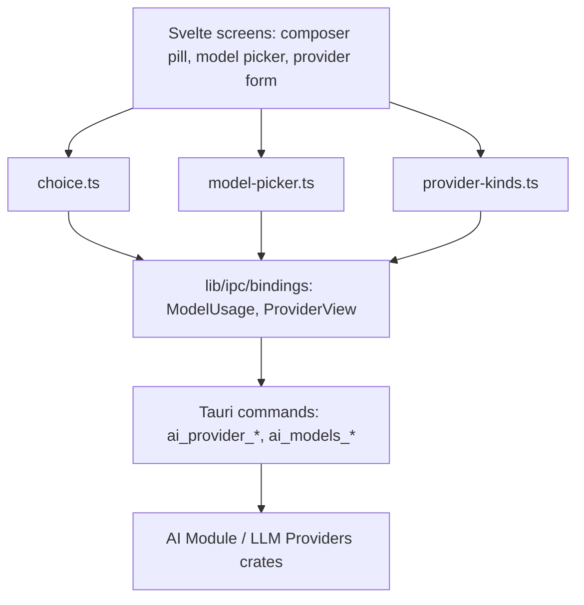
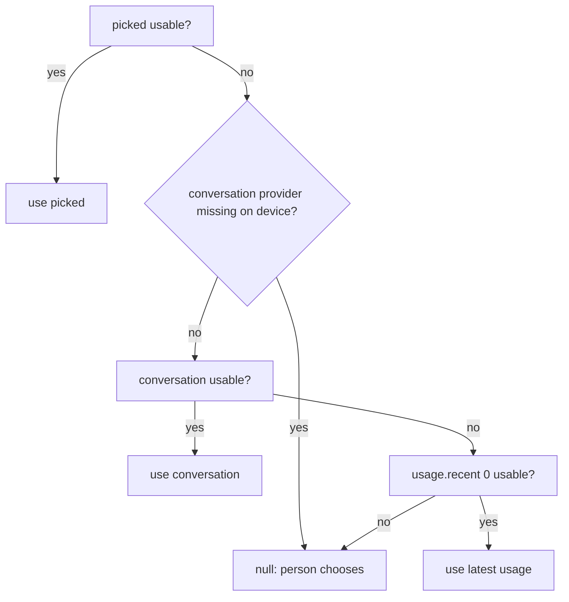
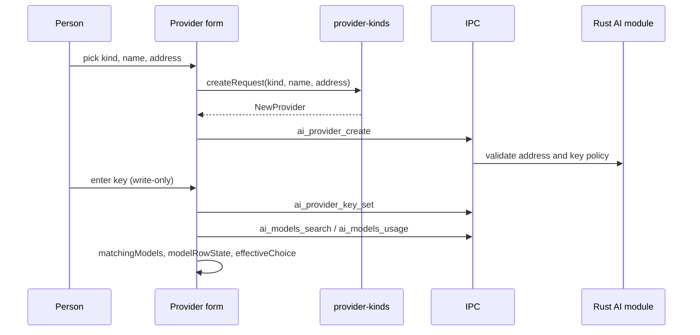

# AI Providers and Models

The **AI_Providers_and_Models** module is the part of the [AI Assistant Frontend](../AI_Assistant_Frontend.md) that decides *which Provider and Model answer a question* and *how a Provider is described, created and edited*. It is a set of small, pure TypeScript helpers with no UI or IPC of their own. The Svelte screens call them, and they shape the requests sent to the Rust backend ([LLM Providers](../AI_Assistant_Backend/LLM_Providers.md), [AI Module](../AI_Assistant_Backend/AI_Module.md)).

| File | Responsibility |
|---|---|
| `src/modules/ai/choice.ts` | `effectiveChoice`: resolves the default Provider + Model for a question |
| `src/modules/ai/model-picker.ts` | Model search, "Use" row/Enter behaviour, per-Provider usage, paid/free row state |
| `src/modules/ai/provider-kinds.ts` | Static description of the four Provider kinds; create/update request builders; key chip and hints |
| `src/modules/ai/choice.test.ts` | Vitest cases pinning the fallback order of `effectiveChoice` |

## Architecture

The types (`ProviderView`, `ProviderKind`, `KeyState`, `NewProvider`, `ProviderUpdate`, `ModelUsage`, `ModelUse`) come from the generated IPC bindings (see [IPC Bridge and Core Mocks](../IPC_Bridge_and_Browser_Mocks/IPC_Bridge_and_Core_Mocks.md)). The matching commands live in [AI Assistant Commands](../Tauri_Host_and_Command_Layer/AI_Assistant_Commands.md) (`ai_provider_create`, `ai_provider_update`, `ai_provider_key_set`, `ai_models_search`, `ai_models_usage`, …).

## Choosing the Model: `choice.ts`

`effectiveChoice(sources)` returns `Choice { providerId, model } | null`. `null` means the person must choose, and the pill says so.

Priority order:
1. **picked**: the choice made on this page since it opened.
2. **conversation**: the Provider/Model the open Conversation last used.
3. **usage**: the most recent entry in `usage.recent[0]` (this device's history).

Rules:
- A candidate is *usable* only if its Provider still exists in `providers` and its model is not empty. Unusable candidates are skipped, so the next source is tried.
- If the open Conversation names a Provider this device lacks (for example it synced from another device), `lacksProvider` is true. The Conversation *and* the usage fallback are then both ignored, so the device's usual Model is not silently substituted. Only an explicit `picked` choice still works. This avoids sending a question to a Model the person did not expect.

`choice.test.ts` covers each branch: picked wins, then the conversation, then usage, null when nothing is known, null for a missing conversation Provider, picked still winning in that case, and skipping a picked Provider that was deleted.

## Model picker helpers: `model-picker.ts`

- `typedModelId(query)` trims the query. Any id is accepted, even one the Provider did not list.
- `choiceOnEnter(key, query)` returns the typed id only for `Enter`, matching the "Use" row.
- `matchingModels(models, query)` does a case-insensitive substring filter and keeps the Provider's order.
- `usesOf(uses, providerId)` filters recent or most-used `ModelUse` rows to one Provider.
- `isFreeModel(model)` is true when the id ends in `:free` (OpenRouter's convention, mirrored from the Rust rule).
- `modelRowState(model, { paidKind, paidIds, allowPaid })` returns `{ paid, disabled, reason }`.
  - A row is *paid* only for kinds with paid Models, and only if the Provider's list marks it paid or its id is not a free route. Recent and most-used rows are not in the Provider's list, so the id decides for them.
  - A paid row is *disabled* while the Provider's `allow_paid` switch is off. The reason is `PAID_MODEL_REASON`.

## Provider kinds: `provider-kinds.ts`

`KINDS` lists the four kinds in the order the kind step shows them. `kindOf(id)` looks one up (falling back to the wrapper, which should never happen).

| Kind | Address | Key | Paid Models |
|---|---|---|---|
| `wrapper` (Local AI Wrapper) | default `http://127.0.0.1:8080/v1`, editable | none | no |
| `openai_compatible` | typed by the person, editable | optional | no |
| `anthropic` | fixed `https://api.anthropic.com/v1` | required | no |
| `openrouter` | fixed `https://openrouter.ai/api/v1` | required | yes |

Helpers:
- `addressFor(kind, typed)` returns the fixed address for fixed kinds, else the trimmed typed address.
- `createRequest(kind, name, typedAddress)` builds `NewProvider`. Paid Models are not part of creation.
- `updateRequest(kind, name, typedAddress, allowPaid)` builds `ProviderUpdate`. `allow_paid` is forced to `false` for kinds without paid Models.
- `keyChip(state)` gives "Needs a key" (warn) or "Key saved" (ok), and `null` when no key is needed.
- `freeOnlyNote(provider)` gives "Free Models only" for an OpenRouter Provider with the paid switch off.
- `keyHint(rule)` gives the text under the key field. Keys are write-only and stored on this device only.
- `PAID_SWITCH` holds the label and hint of the paid switch.

The comment in the source says "the Rust side agrees". Address and key rules are enforced again in the backend (see [LLM Providers](../AI_Assistant_Backend/LLM_Providers.md) address checks and `KeyPolicy` in [AI Module](../AI_Assistant_Backend/AI_Module.md)), so these helpers only guide the form.

## Data flow

## Notes for maintainers

- Adding a new Provider kind needs a new `KindInfo` in `provider-kinds.ts` and matching support in the Rust crates and bindings.
- Provider records, usage and the visible branch stay on the device. Only Conversations sync, which is why `effectiveChoice` must handle a Provider that is absent locally.
- Related frontend pages: [AI Conversation and Runs](AI_Conversation_and_Runs.md), [AI Branches, History and Saved](AI_Branches_History_and_Saved.md).
