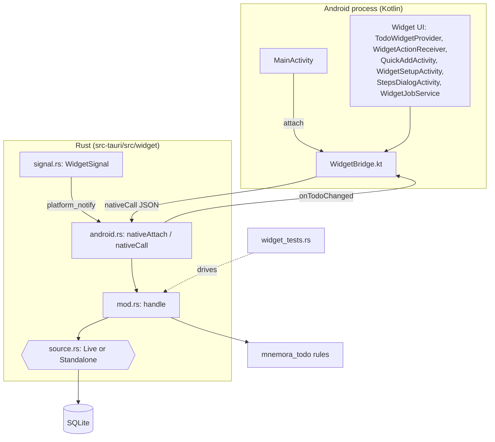
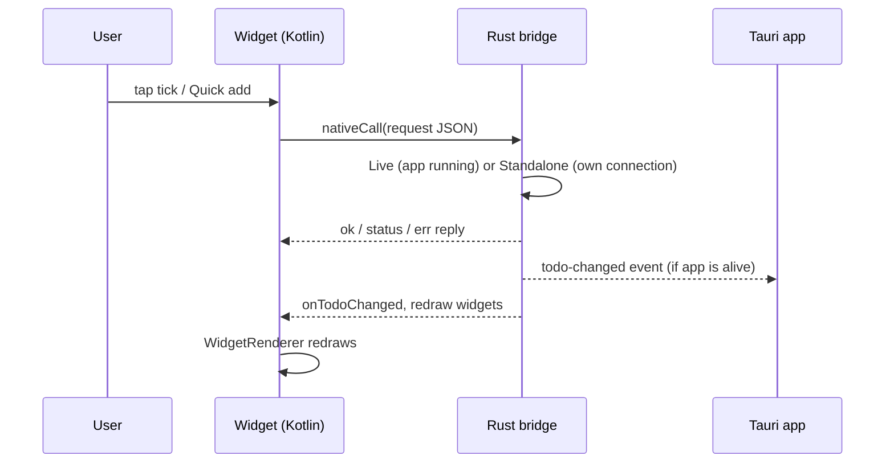

# Android and Home-Screen Widget Platform

## Purpose

This module covers everything Mnemora needs to run on Android and to show a Todo home-screen widget. It has three parts:

- **Android host layer (Kotlin).** `MainActivity` hosts the Tauri WebView. It adds system-bar styling, back-to-background, the Wi-Fi multicast lock for mDNS sync discovery, the Android 17 local-network permission, and lifecycle hooks for Sync and the widget. The widget itself is native UI: a provider, a setup screen, a Quick add sheet, a steps dialog, a tap receiver and `JobScheduler` jobs for timed redraws. It is offered on Android 12+ only.
- **Rust widget bridge.** One JSON-in, JSON-out entry point, `widget::handle`, reached from Kotlin over JNI. It reads and writes Todo data through the same `mnemora_todo` rules the app uses, so Kotlin holds no business logic. In the other direction, Rust signals Android to redraw the widgets after Todo data changes.
- **Bridge test suite.** `widget_tests.rs` drives the bridge as Kotlin does and pins its behaviour: the not-set-up and needs-update states, view snapshots, ticking and undo, Quick add, error handling and redraw signalling.

Design rules shared by all three parts:

- The widget never migrates a database and never creates files.
- Widget actions behave exactly like the app's own commands.
- Every write sends exactly one redraw signal.
- Failures come back as data, never as panics.

## Architecture

### Request and redraw flow

How the layers cooperate:

- **Two ways to reach the database.** If the app is alive in the process, the bridge answers from the app's own connection (`Live`) and the UI updates at once. Otherwise it opens the existing database read-only-in-spirit (`Standalone`). It reports `not_set_up` or `needs_update` rather than creating or migrating anything.
- **Kotlin stays thin.** It builds requests, parses replies and draws. Parsing, ordering, completion and undo semantics all live in Rust.
- **Threading and process survival.** Bridge calls run off the main thread. Work that must finish is handed to a `goAsync` receiver or a `JobScheduler` job.

## Core components

| Component | Responsibility | Documentation |
|---|---|---|
| Android Integration | `MainActivity` (JS bridge `window.MnemoraAndroid`, multicast lock, local-network permission, lifecycle) and the native Todo widget UI (provider, tap receiver, setup, Quick add, steps dialog, timed jobs) | [Android_Integration](Android_and_Home-Screen_Widget_Platform/Android_Integration.md) |
| widget_bridge | Rust side of the widget: JSON protocol, `Live` and `Standalone` sources, redraw signal and JNI entry points | [widget_bridge](Android_and_Home-Screen_Widget_Platform/widget_bridge.md) |
| widget_tests | Rust test suite that pins the bridge's behaviour using temporary databases and an in-memory `TestApp` | [widget_tests](Android_and_Home-Screen_Widget_Platform/widget_tests.md) |

## Related modules

- Todo rules used by the bridge: [Todo_Widget](Domain_Modules_(Todo_and_Journal)/Todo_Widget.md) and [Todo_Tasks_and_Lists](Domain_Modules_(Todo_and_Journal)/Todo_Tasks_and_Lists.md)
- Sync power and network JNI entry points: [Sync_Connectivity_and_Pairing](Tauri_Host_and_Command_Layer/Sync_Connectivity_and_Pairing.md)
- Build and packaging of the Android library: [Build_and_Packaging](Build,_Tooling_and_Packaging/Build_and_Packaging.md)