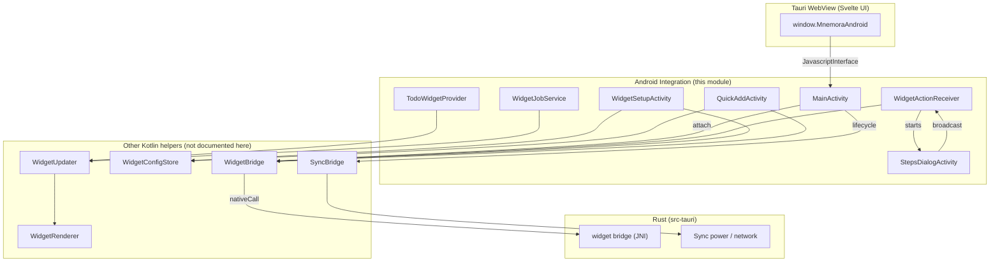
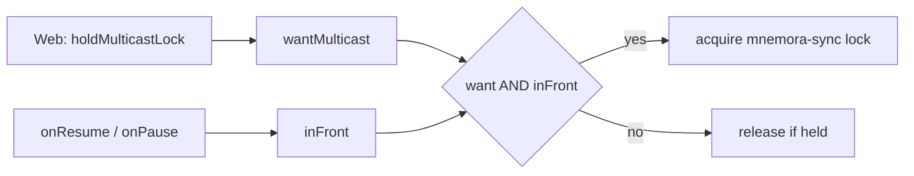
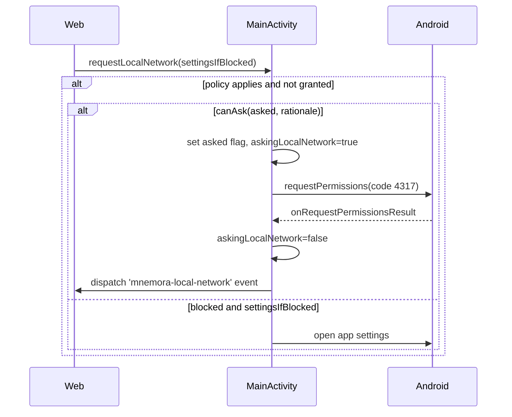
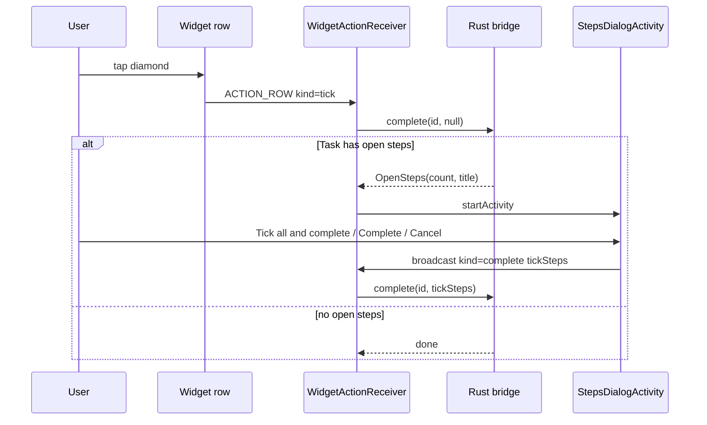
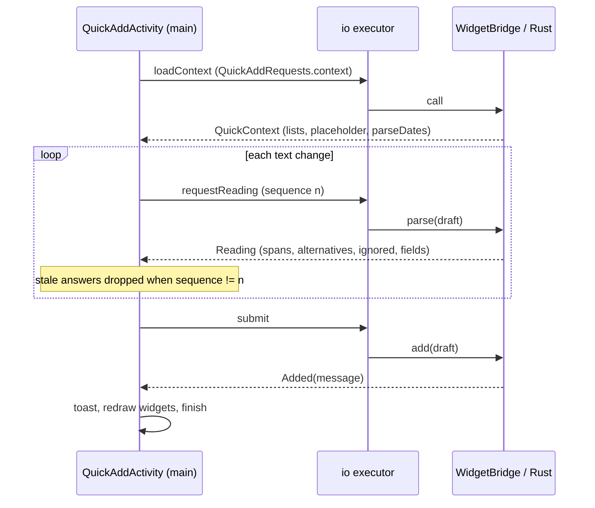
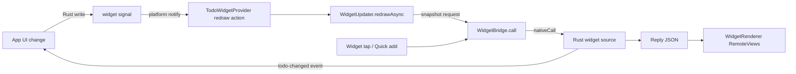

# Android Integration

The Android Integration module is the Kotlin side of Mnemora on Android. It has two parts:

1. **`MainActivity`**: the Tauri host activity. It adds the native services the web UI and the Rust sync engine need: system-bar styling, back-to-background, the Wi-Fi multicast lock for mDNS, the Android 17 "local network" permission, and lifecycle hooks for Sync and the widget bridge.
2. **The Todo home-screen widget**: a provider, a setup screen, a Quick add sheet, a steps dialog, a tap receiver and framework jobs. All of it is native Android UI. It has no business rules of its own, because every read and write goes through the Rust widget bridge.

All files live under `src-tauri/gen/android/app/src/main/java/com/hemang/mnemora/`. The widget is offered on Android 12+ only (ADR 0015). The activities that draw native UI are annotated `@RequiresApi(31)`.

The Rust side of the widget is documented in [widget_bridge](widget_bridge.md). Its behaviour is pinned by [widget_tests](widget_tests.md). The parent overview is [Android and Home-Screen Widget Platform](../Android_and_Home-Screen_Widget_Platform.md).

Source of truth: this page describes the Kotlin files in this module. Helper types they call (`WidgetBridge`, `WidgetUpdater`, `WidgetRenderer`, `WidgetConfigStore`, `Palette`, `WidgetTheme`, `UndoBar`, `LocalNetworkPolicy`, `SyncBridge`, `CaptureRules` and others) are referenced by name only. They were not among the provided core components, so their internals are not described here.

## Component overview

| Component | Kind | Role |
|---|---|---|
| `MainActivity` | `TauriActivity` | Hosts the WebView. Exposes `window.MnemoraAndroid`, manages the multicast lock and the local-network permission, and forwards lifecycle to `SyncBridge` and `WidgetBridge`. |
| `TodoWidgetProvider` | `AppWidgetProvider` | Receives system and redraw broadcasts and delegates drawing to `WidgetUpdater`. Cleans up per-widget config. |
| `WidgetActionReceiver` | `BroadcastReceiver` | Handles taps that change Tasks (tick, Undo, open). Runs on a single-thread executor under `goAsync`. |
| `StepsDialogActivity` | `Activity` | Asks "N steps are still open" when a tick hits a Task with unticked checklist items. |
| `WidgetSetupActivity` | `Activity` | Configure screen: View, Theme and Background, with a live preview. |
| `QuickAddActivity` | `Activity` | Native Quick add bottom sheet, opened by the widget's + and "Add a task…" pill. |
| `WidgetJobService` / `WidgetJobs` | `JobService` | Timed redraws: the midnight rollover and the Undo bar's expiry. |

## Architecture

The widget UI is a thin native client. Reading words, ordering Tasks, completing, undoing and adding all happen in Rust via `WidgetBridge.call(...)`. The Kotlin layer builds requests, parses replies and draws.

## MainActivity

### Lifecycle responsibilities

| Callback | Action |
|---|---|
| `onCreate` | Enables edge-to-edge. Calls `SyncBridge.watch(this)` **before** `super.onCreate`, so Rust starts knowing about the mobile-data policy. Then calls `WidgetBridge.attach(this)` so Rust can redraw the Todo widgets after the app changes data. |
| `onResume` | Applies the multicast lock (if wanted) and calls `SyncBridge.foreground(true)`. Rust starts or keeps Sync's network and runs a round. |
| `onPause` | Releases the lock and calls `SyncBridge.foreground(false)`. Rust flushes pending changes for up to 5 s on its own timer, then stops everything. This is best effort: there is no wake lock. |
| `onDestroy` | Clears the multicast want, releases the lock and calls `SyncBridge.unwatch(this)`. |

The Rust counterparts are the `Java_com_hemang_mnemora_SyncBridge_*` JNI entry points in `sync_power/android.rs`. They are covered in [Sync Connectivity and Pairing](../Tauri_Host_and_Command_Layer/Sync_Connectivity_and_Pairing.md).

### JavaScript bridge: `window.MnemoraAndroid`

`onWebViewCreate` stores the WebView and registers the inner `MnemoraBridge` as `MnemoraAndroid`. `@JavascriptInterface` methods run on a WebView thread, so every one that touches windows or activity state hops to the UI thread with `runOnUiThread`.

| Method | Purpose |
|---|---|
| `moveTaskToBack()` | Back at the app root leaves like any Android app and keeps the process alive. |
| `holdMulticastLock(hold)` | The web side says Sync is on and the page is visible. The lock is acquired only if that is true **and** the activity is at least `RESUMED`. |
| `localNetworkState()` | Returns `"unneeded"` before Android 17, otherwise `"granted"` or `"denied"`. |
| `requestLocalNetwork(settingsIfBlocked)` | Shows the system dialog, or opens app settings if the system will no longer show it. |
| `requestLocalNetworkOnce()` | If Sync was already on and the permission was never requested (for example after updating to Android 17), asks once. It never asks again. |
| `openAppSettings()` | Opens `ACTION_APPLICATION_DETAILS_SETTINGS`. |
| `setSystemBars(dark, colorHex)` | Sets light or dark bar icons and the status and navigation bar colours. An unparsable colour is ignored. |

The web counterparts are `multicast.ts` and `local-network.ts`, in [Sync Devices and Pairing](../Sync_Frontend/Sync_Devices_and_Pairing.md). `system-bars.ts` is in [Theme](../Frontend_Platform_and_Shell/Theme.md).

### Multicast lock

Without a multicast lock the Wi-Fi chip drops multicast packets, so mDNS discovery of the other device hears nothing. The activity lifecycle is the authority: the lock cannot outlive the screen even if the WebView never reports the page as hidden.

The lock is non-reference-counted, which makes acquire and release idempotent.

### Local-network permission flow (Android 17+)

`LocalNetworkPolicy` decides `applies`, `canAsk`, `state` and `shouldAskUnprompted`. `MainActivity` supplies the facts: the SDK level, whether the permission is granted, and an `asked_local_network` flag in the `sync` SharedPreferences.

While the dialog is up (`askingLocalNetwork`), a missing grant is not reported as a refusal yet. `currentLocalNetworkState()` passes `asked && !askingLocalNetwork`.

## Todo widget

### Provider: `TodoWidgetProvider`

- `onReceive`: if `WidgetUpdater.isRedrawAction(action)`, it redraws asynchronously under `goAsync()`. Otherwise it falls through to the default dispatch.
- `onUpdate`: redraws.
- `onAppWidgetOptionsChanged`: `redrawOnResize`. The responsive RemoteViews already handle the new size.
- `onDeleted`: `WidgetConfigStore.remove` (a removed widget takes its settings with it).
- `onRestored`: `WidgetConfigStore.move(old, new)`, because widgets come back under new ids after a backup restore.
- `onDisabled`: `WidgetUpdater.cancelMidnight`.

The Rust side signals the widget after Task writes through the platform notifier in `widget/signal.rs`. See [widget_bridge](widget_bridge.md).

### Tap handling: `WidgetActionReceiver`

The receiver is not exported. Only this app's own PendingIntents reach it. The work runs off the main thread on a single-thread executor, kept alive by `goAsync`. Failures are logged (tag `TodoWidget`) and never crash.

| Action | Extra `kind` | Behaviour |
|---|---|---|
| `ACTION_UNDO` | n/a | `WidgetActions.undo(app)`. |
| `ACTION_ROW` | `tick` | `WidgetActions.complete(id, null)`. If the reply is `TickReply.OpenSteps`, it starts `StepsDialogActivity`. |
| `ACTION_ROW` | `complete` | Completes with the dialog's answer (`tick_steps` true or false). |
| `ACTION_ROW` | other (`open`) | Opens the Task through `WidgetLinks.intent` if the link is valid. Otherwise it launches `MainActivity`. |

### Steps dialog: `StepsDialogActivity`

A translucent card dressed in the tapped widget's theme. It resolves `WidgetConfigStore.get(widgetId)`, then `WidgetTheme.resolve`, then `Palette.from`. It finishes immediately if the Task id is missing or the count is 0. A tap outside is Cancel.

The answer is **not** processed in the activity. `answer()` finishes with no transition and then sends an explicit broadcast to `WidgetActionReceiver`. Once the activity is gone the process is cached and its threads are held back for seconds, while a receiver's `goAsync` keeps the process running. In that case a tick from the dialog took 3.4 s. A `busy` flag prevents double answers.

### Setup screen: `WidgetSetupActivity`

This is the configure activity, shown when a widget is dropped and again from the launcher's reconfigure. It must be exported for the launcher, so `isOurWidget()` checks that the widget id belongs to `TodoWidgetProvider`.

- Starts with `RESULT_CANCELED`, so backing out on first placement makes the launcher remove the widget.
- Loads the Lists through `WidgetBridge.call(WidgetRequests.lists())` on a background executor and parses them with `ReplyParser.parseLists`.
- Shows radio groups for **View** (Today, Upcoming, Inbox, All, or a specific `list:<id>`), **Theme** (App, Light, Dark, True black) and **Background** (Solid, See-through, None).
- If the saved List no longer exists, the view falls back to `WidgetConfig.DEFAULT_VIEW`.
- The live preview uses the same `WidgetRenderer.render` inside an `AppWidgetHostView`, with `PREVIEW_LINES = 4`. Replies are cached per view, and a sequence counter drops stale results. If there is nothing real to show (not set up, an error), it draws `SampleSnapshot.today`. A transparent view swallows touches over the preview.
- The config survives rotation through `onSaveInstanceState` (JSON).
- **Done** stores the config with `WidgetConfigStore.put`, sets `RESULT_OK` and redraws.
- The app's theme is remembered with `rememberAppTheme` so later screens and dialogs match.

### Quick add: `QuickAddActivity`

A native copy of the app's Quick add (ADR 0016), shown as a translucent bottom sheet with the keyboard up. See the web counterpart in [Todo Quick Capture and Editing](../Todo_Frontend/Todo_Quick_Capture_and_Editing.md). Its guiding rule is that it has **no parsing or adding rules of its own**. Rust reads the words and adds the Task through the bridge. Only the pure helpers in `CaptureRules` run locally, for UTF-16-offset text editing.

Key behaviours:

- **Context failures** (not set up, needs update, error) show a toast and close the sheet.
- **Recognised words** are shown as marks in the field and as "word → meaning ×" chips. Dismissing one adds it to `CaptureWords` as ignored. Alternatives ("use instead") and ignored words ("kept as text ↺") are dashed chips that can be reversed.
- **Backspace filter**: ⌫ right after a recognised word keeps it as text instead of deleting a letter. The reading is updated at once, so a second ⌫ deletes normally.
- **Paste filter**: a multi-line paste becomes one Task. The first line is the title and the rest goes to the notes.
- **`#List` suggestions**: up to five rows from `CaptureRules.listSuggestions`. The first row is what Enter takes. A dismissed hash is remembered. Suggestions never throw.
- **Hand choices** (`QuickHand`): the List and Priority pickers set `hand`, and the typed words of that kind are then ignored (`decided`). The When chip is read-only, because there is no When picker in the sheet.
- **Keys**: Enter adds (or takes the first suggestion). Shift+Enter opens the notes. Ctrl or Meta+Enter adds from the notes. Backspace on empty notes closes them. Back closes an open picker first, then discards the draft. A tap outside also discards.
- **Submit** sets `busy`. On success it toasts the bridge's message, redraws the widgets and finishes. On failure it keeps the typed text.
- The intent uses `FLAG_ACTIVITY_NEW_TASK | CLEAR_TASK`, so a stale draft is never reopened. `pending(...)` builds an immutable, explicit PendingIntent per widget (request code `REQUEST_BASE + widgetId`).

### Timed redraws: `WidgetJobs` and `WidgetJobService`

The widget's timed redraws use `JobScheduler` instead of alarms. On vivo devices the freezer freezes the app seconds after it finishes work and deletes its alarms (`dumpsys alarm` shows Reason=frozen), and `DATE_CHANGED` is not delivered to a manifest receiver. A job belongs to the system, needs no permission, and starts the process when it runs. It is not exact: it runs at the first device wake after its time, and within about half a minute while the screen is on.

| Job | Id | Behaviour |
|---|---|---|
| Midnight redraw | `4401` | Scheduled with `Midnight.delayFrom(now, zone)`. Re-armed on every redraw, so a clock or zone change corrects it. Cancelled in `onDisabled`. |
| Undo expiry | `4402` | Scheduled with no delay on purpose: a running job keeps the process out of the freezer, which a timer or alarm cannot. `WidgetJobService` waits in a thread until `UndoBar.storedUntil` has passed, then redraws, which hides the bar. |

The service redraws through `WidgetUpdater.redrawAsync` and calls `jobFinished` when done. `onStopJob` interrupts the waiter and returns `false`, so it is never retried. The next redraw hides a stale bar by its timestamp anyway.

## Cross-layer data flow

When the app process is alive, the Rust side answers from its own connection and emits `todo-changed` once per write. When it is not, the bridge opens the database itself. A sandbox build refuses a production data dir. Both cases are covered by [widget_tests](widget_tests.md).

## Design notes and constraints

- **Threading**: never do bridge calls on the main thread. Activities use a single-thread `ExecutorService` plus `runOnUiThread` or a main `Handler`. Receivers use `goAsync` plus an executor.
- **Process survival**: work that must complete is handed to a receiver (`goAsync`) or job, never left in a closing activity.
- **Security**: `WidgetActionReceiver` and `WidgetJobService` are not exported. Intents are explicit. PendingIntents are immutable. The exported `WidgetSetupActivity` validates the widget id.
- **Theming**: every native surface resolves `WidgetTheme.resolve(config.theme, appTheme, phoneNight)` into a `Palette`, so it matches the app or the widget's own choice.
- **Single source of rules**: parsing, ordering, completion and undo semantics live in Rust ([Todo Widget](../Domain_Modules_(Todo_and_Journal)/Todo_Widget.md)). Kotlin never reimplements them.
- **Build**: the Gradle project is generated under `src-tauri/gen/android`. See [Build and Packaging](../Build,_Tooling_and_Packaging/Build_and_Packaging.md) for how `RustPlugin` builds the native library, and the `android*` targets in the `Makefile`.
