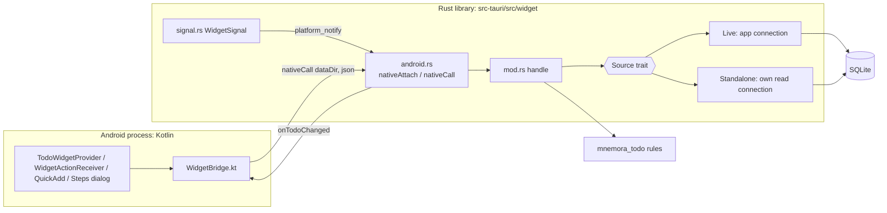
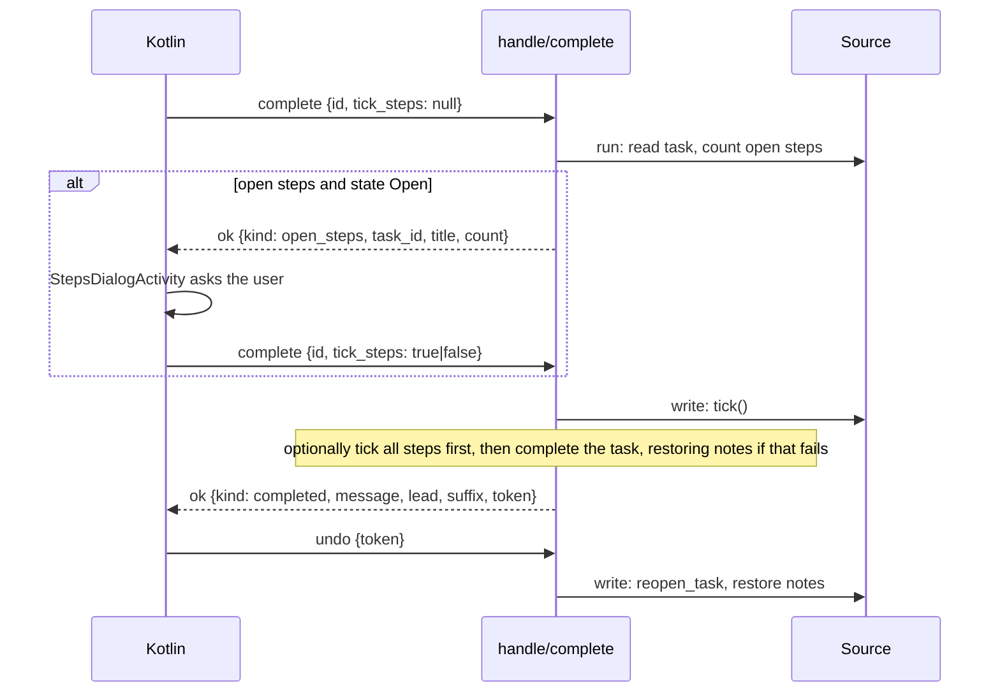
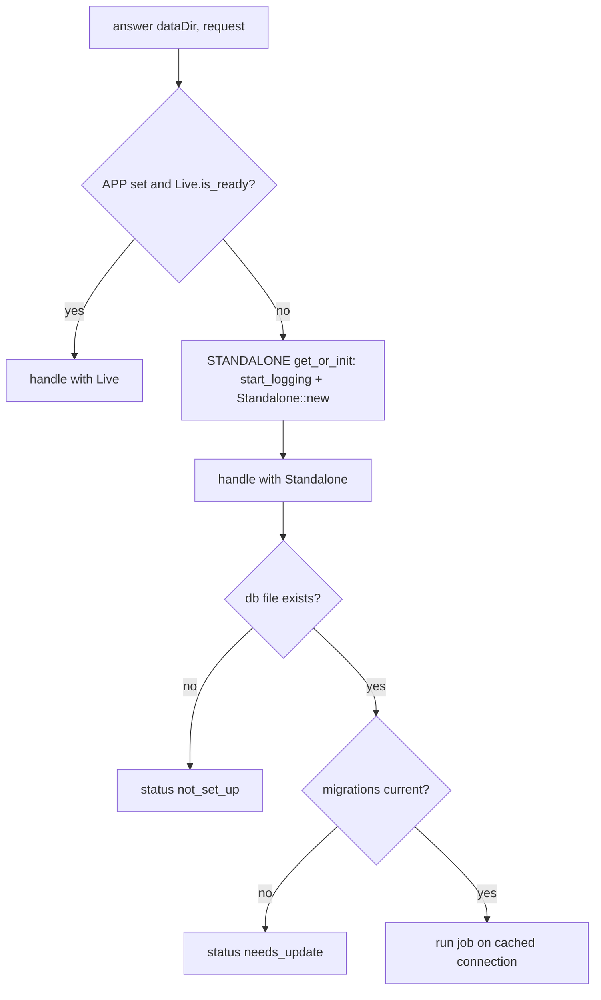

# widget_bridge

The `widget_bridge` module is the Rust side of the Android Todo home-screen widget (ADR 0014). It exposes one JSON-in, JSON-out function over the same Todo rules the Tauri commands use. Kotlin reaches it through JNI. Tests call it directly. It also sends the opposite signal: Rust tells Android to redraw the widgets when Todo data changes.

Source files (all under `src-tauri/src/widget/`):

| File | Role |
|---|---|
| `mod.rs` | Request protocol (`Request`), reply envelope (`Outcome`, `Status`), `handle`, tick/undo logic |
| `source.rs` | `Source` trait with `Live` (running app) and `Standalone` (no app in the process) implementations |
| `signal.rs` | `WidgetSignal`, `platform_notify`, `follow_settings` |
| `android.rs` | JNI entry points (`nativeAttach`, `nativeCall`), `register_app`, `notify_todo_changed` (Android only) |

The Kotlin counterparts (`TodoWidgetProvider`, `WidgetActionReceiver`, `WidgetJobService` and others) are described in [Android_Integration](Android_Integration.md). The behaviour is exercised by [widget_tests](widget_tests.md). The Todo rules the bridge calls (`WidgetView`, snapshots, quick add) live in [Todo_Widget](../Domain_Modules_(Todo_and_Journal)/Todo_Widget.md) and [Todo_Tasks_and_Lists](../Domain_Modules_(Todo_and_Journal)/Todo_Tasks_and_Lists.md).

## Architecture

A broadcast receiver can load the native library without Tauri starting. Every function in the bridge therefore works with or without the app in the process. Release builds abort on panic, so nothing in the module may panic, unwrap or index. Every failure becomes an `err` reply or a null string.

## Protocol (`mod.rs`)

`Request` is a tagged enum (`"method"`, snake_case):

| Method | Purpose | Writes? |
|---|---|---|
| `snapshot {view, local}` | A view as the widget draws it, as of the device clock (`LocalNow`) | no |
| `lists` | Lists for the setup screen, plus app theme | no |
| `complete {id, tick_steps?, local}` | Tick a task through the app's `complete_task` | yes |
| `undo {token}` | Reverse a tick | yes |
| `capture_context {view, local}` | What the Quick add sheet needs on opening | no |
| `parse(QuickRequest)` | Read typed text as the Capture box does; writes nothing | no |
| `add(QuickRequest)` | Create the described task | yes |

Replies are one of:

- `{"ok": payload}`
- `{"status": "not_set_up" | "needs_update"}`
- `{"err": {"code", "message"}}`

`Outcome` carries these three cases (`Ok`, `Status`, `Err`). `Status` is `NotSetUp` when the app has never run and there is no database. It is `NeedsUpdate` when the app was updated and its migrations have not run. Only the app can fix either. Errors are logged by code only, because messages and details can contain the user's own text. Malformed requests are a `Validation` error whose details are the parser's message, never the request text.

### Complete and Undo

- A task with open steps is answered with `open_steps` and left unchanged until `tick_steps` says what to do. `true` ticks every step first. `false` completes it as it is.
- `tick` follows the app: steps are ticked in their own save, then the task is completed. If completion fails after the notes changed, the original notes are written back.
- For a repeating task, the `suffix` says where it went (the part of `completed_repeat_message` after the lead). The widget keeps the suffix whole and truncates the title.
- `UndoToken` is opaque to Kotlin. It holds `reopen` (the task id, or the recorded occurrence id for a repeating task) and optionally the `notes` to put back. Undo reopens and restores the notes only if they differ.

## Sources (`source.rs`)

`Source` abstracts which database connection a job runs on:

- `run(job)` runs a job on the connection, or says why there is none.
- `write(job)` is `run` for jobs that change Todo data. The default only delegates.
- `app_theme()` returns Settings ▸ Theme from the device file (`system`, `light`, `dark` or `oled`). Anything else becomes `system`. Snapshots and lists carry it as `app_theme`.

| Implementation | When | Behaviour |
|---|---|---|
| `Live<R>` | The app's `AppState` exists in this process | Locks the app's own connection (`state.db`), shared with the commands. A successful `write` emits `TodoChangedEvent` so open screens update at once. `is_ready()` checks that `AppState` is managed. Before then, `run` returns `NotSetUp`. |
| `Standalone` | The widget started the process before the app | Resolves paths like app start-up (device file first, since it can move the data directory). The `env_guard` check runs first, and a sandbox build refuses a production data dir. It opens the database only if it exists (`db::open_existing`) and uses it only if every module's migrations are current (`is_current`). It never creates or migrates a database. A verified connection is cached. A `Database` or `Io` error drops the cache, so the next call reopens. |

## Redraw signal (`signal.rs`)

`WidgetSignal` is held in app state, and every Todo write command goes through `todo_changed()`. Reads and comments never do. It counts calls (read by tests) and invokes a platform function pointer:

- `platform_notify` on Android calls `android::notify_todo_changed`, a package-scoped redraw request to the widgets.
- On other platforms it does nothing.
- `WidgetSignal::silent()` (tests only) counts without notifying.

`follow_settings` subscribes to the core `EventBus` for `SettingsChanged`. It fires the signal only when `mnemora_todo::settings_affect_widget(module, keys)` says the setting changes what the widget draws: the theme, time format, week start, and Todo grouping and sorting.

## JNI layer (`android.rs`, Android only)

| Item | Role |
|---|---|
| `register_app(AppHandle)` | Called from app setup. Stores the handle in `APP` so bridge calls use the app's connection instead of opening their own. |
| `nativeAttach()` | Called by `WidgetBridge.kt`. Stores the `JavaVM` and a global ref to the class in `NOTIFIER`, so Rust can call back from any thread. If a signal fired earlier (`MISSED`, e.g. setup finished first), it replays it. |
| `nativeCall(dataDir, request)` | One JSON request in, one JSON reply out. Returns null if the strings cannot be read or the reply cannot be made. The caller then shows its read-error state. |
| `notify_todo_changed()` | Attaches the current thread and calls static `WidgetBridge.onTodoChanged()`. It clears any pending Java exception, which would poison the thread's next JNI call. It stores `MISSED` if the notifier is not attached yet. |
| `answer` / `start_logging` | Chooses `Live` or `Standalone`. In standalone mode it starts logging into the same log directory as the app (kept alive in `LOG`) at `info` level. |

Process-wide state is held in `OnceLock`s (`APP`, `STANDALONE`, `LOG`, `NOTIFIER`) and an `AtomicBool` (`MISSED`).

## How it fits in the system

- **Inbound:** Kotlin widget components (see [Android_Integration](Android_Integration.md)) call `nativeCall` for snapshots, ticks, undo, and Quick add parsing and creation.
- **Outbound:** Todo write commands in the [Tauri host](../Tauri_Host_and_Command_Layer.md) fire `WidgetSignal`. Writes arriving from [sync](../Sync_Replication_Engine.md) also trigger a widget redraw (see `sync_cluster_tests`).
- **Shared rules:** the bridge adds no Todo logic of its own beyond JSON glue. Ticks, parsing and adds use `mnemora_todo` functions, so a task added or ticked on the widget is the same as one made in the app.
- **Build:** the JNI symbols are compiled only for `target_os = "android"`. Elsewhere only tests drive the bridge (`#![cfg_attr(not(any(target_os = "android", test)), allow(dead_code))]`). See [Build_and_Packaging](../Build,_Tooling_and_Packaging/Build_and_Packaging.md).
