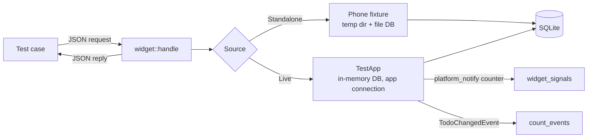
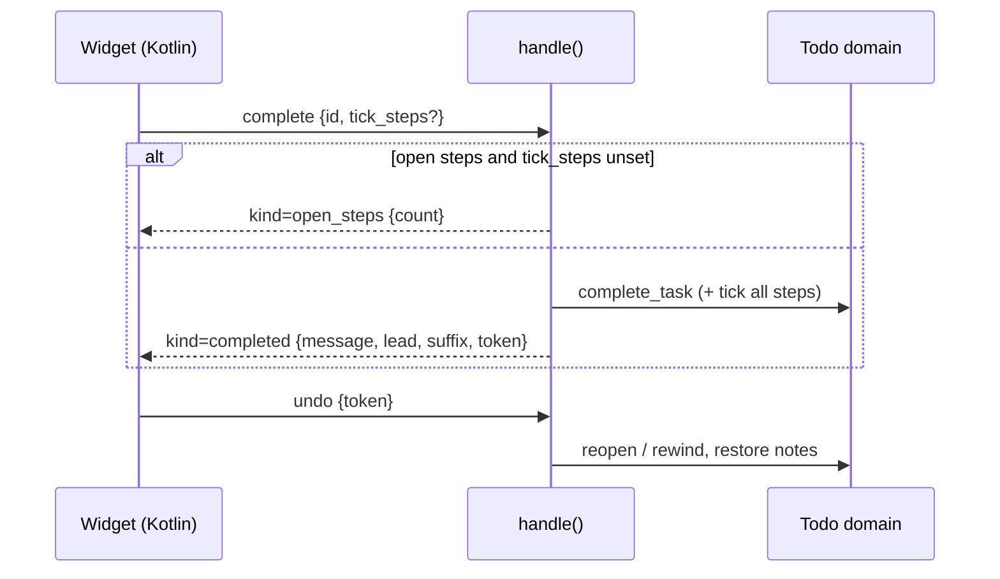

# widget_tests

`src-tauri/src/widget_tests.rs` is the Rust test suite for the Todo home-screen widget's bridge. It drives the bridge's single JSON entry point, `widget::handle`, exactly as the Kotlin side does (see ADR 0009 and ADR 0014). Each test runs against a temporary SQLite database or against an in-memory `TestApp`.

The code under test lives in [widget_bridge](widget_bridge.md): `widget/mod.rs` (`Request`, `Outcome`), `widget/source.rs` (`Live`, `Standalone`) and `widget/signal.rs` (`platform_notify`). The Kotlin callers are described in [Android_Integration](Android_Integration.md). The view-building logic is in [Todo_Widget](../Domain_Modules_(Todo_and_Journal)/Todo_Widget.md), which covers `WidgetView` and `widget_text`. The commands that the write-signal tests invoke belong to [Todo_Domain_Service](../Tauri_Host_and_Command_Layer/Todo_Domain_Service.md).

## Architecture of the test harness

### Fixtures and helpers

| Helper | Role |
|---|---|
| `Phone` | Fakes an Android data dir (`data/user/0/com.hemang.mnemora`) with `AppPaths` for Production. `fresh()` means the app has never run. `migrated()` returns a database with every Module migrated. `make_db(file, keep)` lets a test migrate only some Modules, and `set_theme` writes the device file. |
| `Standalone` | The `Source` used when the app is not running. It opens the database itself and never migrates it. |
| `Live` | The `Source` used when the app is alive. It uses the app's own connection and tells the app about writes. |
| `TestApp` | From `test_support`. It offers `invoke`, `with_db`, `set_pref`, `widget_signals` and `handle`. |
| `call`, `snapshot`, `view`, `context`, `read`, `added`, `tick`, `undo` | Thin wrappers over `handle` that build the request JSON and assert the shape of the reply. |
| `add`, `new_list`, `repeat_daily`, `with_notes` | Seed data through the `mnemora_todo` API. |

The tests fix `TODAY = "2026-10-21"` (a Wednesday) with a clock of 14:05. Every request carries a `local` object (`today`, `now`, `offset_min`), so the day rolls over with the clock the widget sends.

## Test groups

### 1. Opening the database (Standalone)
- `before_the_app_ever_ran_the_reply_is_not_set_up_and_nothing_is_created` and `lists_before_the_app_ran_is_not_set_up` expect `{status: "not_set_up"}`. They also check that no file or folder is created.
- `a_pending_migration_means_needs_update_and_nothing_is_migrated` expects `needs_update`, and the test checks that `todo_tasks` was not created.
- `the_database_is_found_where_the_device_setting_moved_it` covers a relocated `data_dir`.
- `a_sandbox_build_refuses_a_production_data_dir` expects an `internal` error.

### 2. Snapshots by view
The views are `today`, `upcoming`, `inbox`, `all` and `list:<id>`.
- **Today:** overdue first, then today. Done tasks are hidden and Markdown marks are stripped. The grouping preference `group_today` is honoured. Rows carry a priority ring, a list chip and an overdue flag. The header reads "N left" or, in the overdue tone, "N overdue".
- **Time and day labels:** the 12-hour setting applies. Rows not due today name their day in grey, except where a heading already does. The `day` and `time` fields are used differently for overdue rows.
- **Empty states:** `an_empty_today_says_what_comes_next`, the "Nothing coming up" case, "Inbox zero", "No open Tasks" and an empty list naming itself. The next-task line says "tomorrow HH:MM", a weekday, or a date, depending on distance.
- **Upcoming:** overdue plus the next 7 days, with a day heading such as "Tomorrow · Thu 22" or "Mon 2 Nov". It ignores the app's grouping preference.
- **Inbox:** has a second "No date, in a List" group and follows `inbox_sort`.
- **All:** grouped by list, with the Inbox first and then lists in sidebar order. Empty lists are left out, and `lists_sort` is followed.
- **A list view:** follows its own sort and grouping. A missing or deleted list returns `not_found` with "That List no longer exists".
- **Theme:** `every_snapshot_carries_the_apps_theme` and the `lists` method confirm the theme comes from the device file.

### 3. Robustness
`bad_requests_get_an_err_and_never_a_panic`, `bad_ticks_and_undos_are_errors_not_panics` and `bad_quick_add_requests_are_errors_and_create_nothing` feed malformed JSON, unknown methods, unknown views, bad dates, over-long or multi-line text and unknown list ids. Every case must return `err.code` and `err.message`, and no task may be created.

### 4. Write signals
Using `TestApp::widget_signals`, these tests check that every list or task write signals the widget exactly once (`ok_once`):
- `every_list_write_signals_the_widget_once`
- `every_task_write_signals_the_widget_once`

Other cases that must stay silent or fire only once:
- Reads, comments and parse stay silent (`todo_reads_comments_and_settings_never_signal_the_widget`).
- Only settings that change the drawing signal, and a batch counts as one signal (`settings_that_change_the_drawing_signal_once_and_others_do_not`).
- A refused write stays silent.

### 5. Ticking and Undo

- Plain tasks complete, and undo reopens them.
- Repeating tasks report "· next Thu 22 Oct". Undo rewinds the due date and removes the occurrence record.
- Open steps: the widget asks first (`open_steps`) and changes nothing until answered. `tick_steps=false` leaves the notes alone. `tick_steps=true` ticks nested steps, and undo restores the original notes.
- `ticking_on_the_widget_is_the_same_as_the_apps_complete_command` and `undoing_on_the_widget_is_the_same_as_reopening_in_the_app` compare task rows, change-log shape and History lines between the app command and the widget path, for both plain and repeating tasks.

### 6. Telling a running app
`a_live_app_answers_from_its_own_connection` shows that `Live` reads the in-memory database that a `Standalone` source could not see. `a_widget_write_while_the_app_is_alive_emits_todo_changed_once_per_write` and `adding_tells_a_running_app_once_and_a_refused_add_says_nothing` count `TodoChangedEvent`s. Reads emit none, and each successful write emits one.

### 7. Quick add
The methods are `capture_context`, `parse` and `add`.
- **Context:** `the_sheet_opens_in_the_place_each_view_stands_for` checks the placeholder and default date or list per view. A deleted list falls back to the Inbox. The context also carries lists, `parse_dates`, `week_start` and `time_format`.
- **Parse:** word recognition matches the app's. Spans have kinds `date`, `time`, `prio` and `list`, and offsets count UTF-16 units. A conflicting phrase gives `alternatives`. `prefer` swaps the winner and `ignored` keeps words as text. An unknown `#Name` offers a new list. The `parse_dates` preference turns reading off. Chips set by hand lose to typed words.
- **Add:** inherits the view's place, and typed words beat that place. A hash name that matches no list creates it, and the second use reuses it. A repeat word makes a repeating task, and the default priority is 4. `understood` JSON is stored.
- **Parity:** `a_task_added_by_the_widget_is_the_task_the_app_would_add` compares the task, change log and History produced by the app's `todo_task_create` and by the widget's `add`.
- **Change log:** `adding_writes_one_create_row_and_a_new_list_writes_its_own` checks one `create` row for the task, and one for the list when a new list is made.

## Design principles the tests enforce
1. **The widget never migrates and never creates files.** It reports `not_set_up` or `needs_update`.
2. **Single source of truth.** Widget actions use the same domain functions as the app, so change log, History and sync behave identically. See [Sync_Replication_Engine](../Sync_Replication_Engine.md) for why that matters.
3. **Exactly one redraw signal per write**, and none for reads.
4. **Errors are data, not panics.** Every failure is a JSON `err` with `code` and `message`.
5. **Environment isolation.** Sandbox builds refuse Production data.

## Running
The suite runs with the Rust tests (`make test`; see [Build_and_Config](../Build,_Tooling_and_Packaging/Build_and_Config.md)). The widget tests use `tempfile` and need no emulator.
