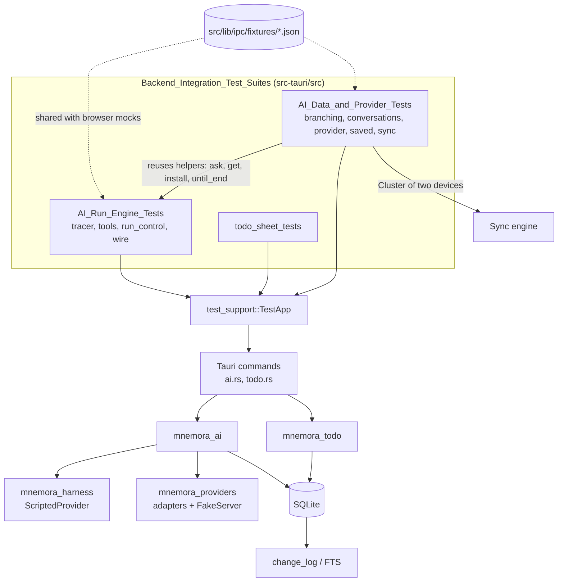
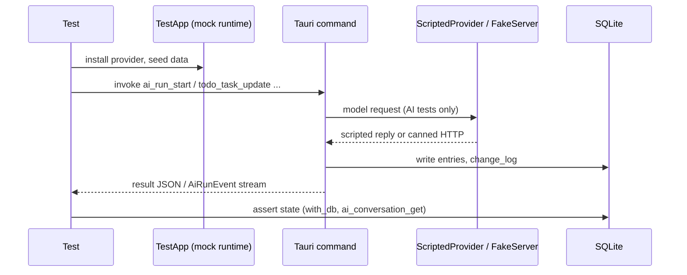

# Backend_Integration_Test_Suites

## Purpose

This module holds the command-layer integration tests for the Rust backend. The tests are in `src-tauri/src/`. They call the real Tauri commands (`ai_*`, `todo_*`) through the mock runtime (`TestApp`, ADR 0009). They don't call the internal crates directly.

Each test checks two things: what the command returns, and what ends up in SQLite, including `change_log` and the FTS index. No test uses the network or a real Model. AI tests use either a `ScriptedProvider` or the real wire adapters against a loopback `FakeServer`.

The module has three suites:

| Suite | Scope |
|---|---|
| [AI_Run_Engine_Tests](Backend_Integration_Test_Suites/AI_Run_Engine_Tests.md) | The AI Run loop: the tracer bullet, the six read-only Tools, run control (stop, steer, send-now, backgrounding), and the wire adapters (Wrapper, OpenAI-compatible, Anthropic, OpenRouter). |
| [AI_Data_and_Provider_Tests](Backend_Integration_Test_Suites/AI_Data_and_Provider_Tests.md) | The data around a Run: Branches, Conversations, Providers and keys, Saved questions, and AI sync across two devices. |
| [todo_sheet_tests](Backend_Integration_Test_Suites/todo_sheet_tests.md) | The Todo Task sheet rules: Priority, Won't do, open steps, editing sessions, delete/restore/purge, Comments and History. |

## Architecture

### Test strategy

Key conventions:
- **Shared helpers.** `ai_tracer_tests` owns `ask`, `get`, `install`, `until_end`, `label` and `local`. `AI_Data_and_Provider_Tests` reuses them, so changing their signatures affects that suite too.
- **Shared fixtures.** JSON files in `src/lib/ipc/fixtures/` (such as `ai-title.json` and `ai-history.json`) are run by both the Rust tests and the browser mocks. This keeps the two implementations consistent.
- **Refused commands write nothing.** Refusals use the error codes `validation` and `not_found`, and the tests check `change_log` is unchanged.
- **Frozen clock.** `TestApp` can freeze the clock, so ordering is tested against `change_log` sequence rather than wall time.

## Core component documentation

- [AI_Run_Engine_Tests](Backend_Integration_Test_Suites/AI_Run_Engine_Tests.md)
- [AI_Data_and_Provider_Tests](Backend_Integration_Test_Suites/AI_Data_and_Provider_Tests.md)
- [todo_sheet_tests](Backend_Integration_Test_Suites/todo_sheet_tests.md)

The code under test is covered in the AI_Assistant_Commands, Todo_Domain_Service, AI_Module, Agent_Harness, LLM_Providers, Todo_Tasks_and_Lists and Sync_Replication_Engine documentation.