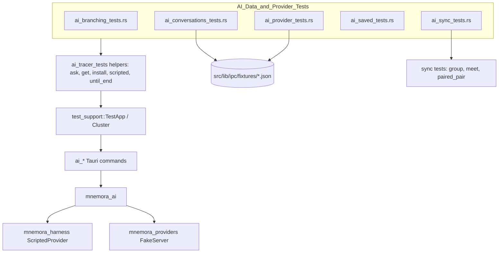
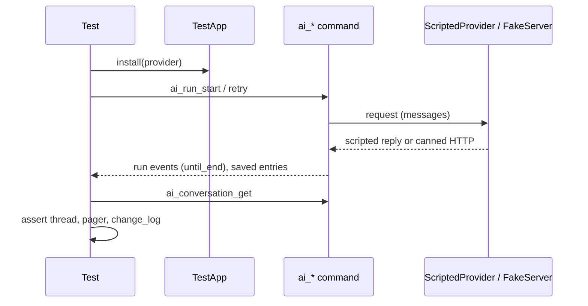

# AI_Data_and_Provider_Tests

Command-layer integration tests for the AI Module's stored data and its Providers. They live in `src-tauri/src/` and drive the **real Tauri commands** (`ai_*`) through the mock runtime (`TestApp`, see ADR 0009), not the internal crates directly. A scripted Provider (`mnemora_harness::scripted::ScriptedProvider`) stands in for the Model where a test needs a fixed outcome. Other tests run the real Wrapper adapter against an in-process loopback `FakeServer` (`mnemora_providers::testing`), so there is no network and no real Model.

The sibling suite [AI_Run_Engine_Tests](AI_Run_Engine_Tests.md) covers the Run loop: tracer, tools, run control and wire format. This page covers the data around it: Branches, Conversations, Providers, Saved questions and sync. The commands under test are described in [AI_Assistant_Commands](../Tauri_Host_and_Command_Layer/AI_Assistant_Commands.md). The crates behind them are documented in [AI_Module](../AI_Assistant_Backend/AI_Module.md), [Agent_Harness](../AI_Assistant_Backend/Agent_Harness.md) and [LLM_Providers](../AI_Assistant_Backend/LLM_Providers.md).

## Architecture

Shared helpers come from [AI_Run_Engine_Tests](AI_Run_Engine_Tests.md) (`ask`, `get`, `install`, `scripted`, `until_end`, `ended_outcome`, `label`, `provider_id`, `local`). The sync tests also use the cluster helpers from the sync test files, described in [Sync_Replication_Engine](../Sync_Replication_Engine.md) and [Sync_Connectivity_and_Pairing](../Tauri_Host_and_Command_Layer/Sync_Connectivity_and_Pairing.md).

## Test files

### ai_branching_tests.rs
Branches are sibling questions in a Conversation.
- **Try again** (`ai_run_retry`) adds a sibling question and runs it. The Model is sent only what the original followed. The pager reports `sibling_index` and `sibling_count`.
- **Edit** (`ai_run_start` with `branch_of`) adds an edited sibling that sits beside the question it changed.
- **Branch from earlier** (`ai_conversation_set_leaf`) continues after a chosen answer. The Model sees only the context up to that answer. The original Branch stays reachable via `ai_conversation_show_branch`, and an out-of-range position is refused.
- Entries from another Conversation, unknown entries, and retrying a non-question are refused.
- A Conversation that is too long (budget exhausted, ADR 0018) fails with `Failure::TooLong`. The over-budget request is never sent. The two exits are branching from an earlier answer or starting a new Conversation.
- Copy as Markdown copies only the Branch that is shown.
- The shown Branch is device-local: setting it writes nothing to `change_log`.

### ai_conversations_tests.rs
Managing Conversations: history, rename, delete and restore, and Markdown copy.
- The history is newest first, 30 per page, with a `more` flag. Search matches titles only, not entry text, and a blank query lists everything.
- Shared JSON fixtures (`ai-rename.json`, `ai-history.json`, `ai-markdown.json`) are run through the Rust commands. The browser mock uses the same fixtures, which keeps the two implementations consistent.
- Rename trims and collapses whitespace. A refused rename saves nothing, and a missing Conversation gives `not_found`.
- Delete hides the Conversation and restore brings back every entry. Deleting a Conversation that is still answering gives a `validation` error.
- Markdown output has the form `# title`, `**You:** …`, then the answer. Citation markers `[uuid]` are stripped from a single answer.

### ai_provider_tests.rs
Providers, keys, connection tests, model search and usage, and Run failures.
- CRUD for a `wrapper` Provider. It needs no key (`key_state: not_needed`), and the address is normalised (trailing `/` removed).
- Address rules are enforced on create and update: plain `http` is allowed only for local or private hosts, and the scheme must be valid. Names are required and at most 40 characters. These checks match `ai-addresses.json` via `mnemora_providers::address::check`.
- A kind that takes no key refuses one, and the `ai-keys` folder stays empty.
- `ai_provider_test` reports `Connected · N models` or a one-sentence failure such as `key_rejected` or `unreachable`. Raw upstream text (the `SECRET` marker) never reaches the screen.
- `ai_models_search` queries the Provider only when called and filters by text. `ai_models_usage` lists recent and most-used models and drops deleted Providers.
- Failure mapping: HTTP 404, 429, 504, 502, 503 and 400 each map to a `Failure` kind with its fixed wording (`ai-failures.json`), and the question is kept. `Offline` and `Interrupted` appear after a partial text delta.
- A deleted Provider leaves its Conversations readable.
- The Android backup rules (`backup_rules.xml`, `data_extraction_rules.xml`) must exclude the key folder for both the Production and Sandbox identifiers.

### ai_saved_tests.rs
Saved questions: create, trimmed rename, reorder between two neighbours (`afterId`, `beforeId`), delete and restore in place, and refusal of blank text (`Type a question first.`). Editing or moving a deleted item gives `not_found`. Running a saved question is an ordinary Run that produces a Conversation titled with its text and leaves the list unchanged.

### ai_sync_tests.rs
Sync of the AI Module (ADR 0019) over the in-memory `Cluster` of two devices, each with its own scripted Provider.
- A Conversation and its entries read the same on both devices. The Provider name and Model id travel as text in a `model_change` entry.
- Continuations on two devices become two Branches on both devices, in the same order, and each device keeps showing its own Branch.
- History order, rename, delete and undo, and Saved question order and delete converge.
- Concurrent renames of one title raise one conflict that both devices show, and `keep_other` writes the title back and converges. The same holds for Saved question text.
- Only `ai_conversation`, `ai_entry` and `ai_saved_question` are ever logged. Providers, keys, usage and the visible Branch never leave the device, and no Provider address appears in the log.
- A device continuing a Conversation uses its own Provider.
- Pre-change-log rows are backfilled to the other device.
- Differing AI data versions pause sync until the older device updates (`pause.kind = "update"`). Rows received while the Module is off are stored and show once it is turned on.

## Typical flow

## Related config
Tests run with `make test`; see [Build_and_Config](../Build,_Tooling_and_Packaging/Build_and_Config.md).
