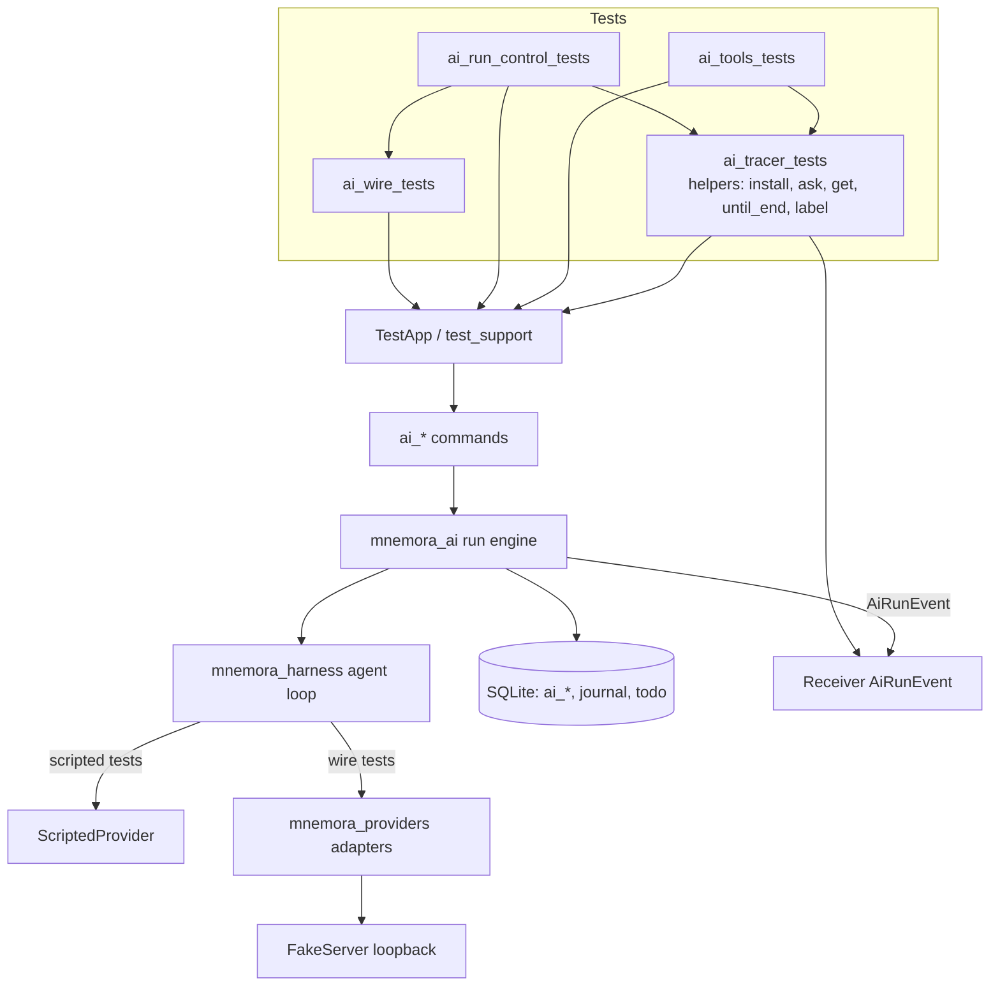
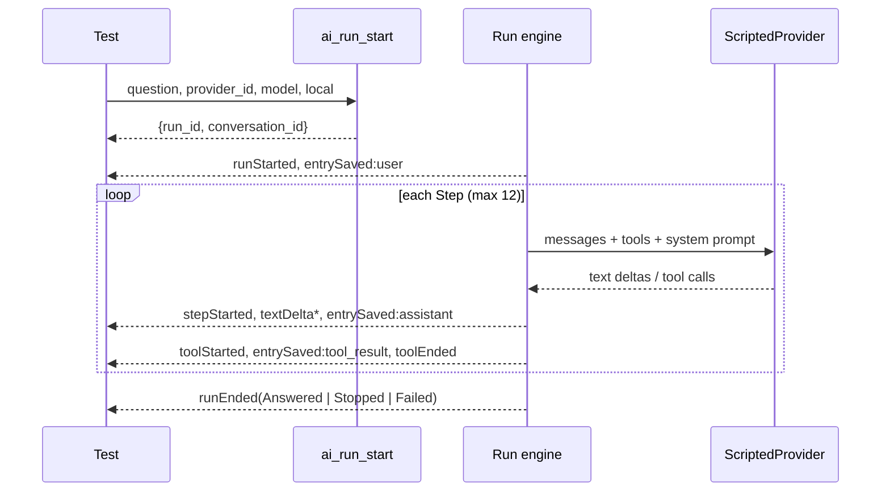
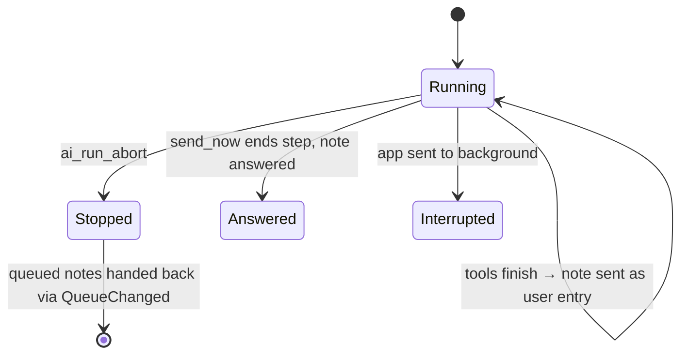

# AI_Run_Engine_Tests

Command-layer integration tests for the AI assistant's **Run engine**. They live in `src-tauri/src/` as four sibling test modules:

| File | Focus |
|---|---|
| `ai_tracer_tests.rs` | The "tracer bullet": ask a question, get one saved Conversation with ordered run events. Also owns the shared helpers. |
| `ai_tools_tests.rs` | The six read-only Tools (`journal_list`, `journal_search`, `journal_read`, `todo_list`, `todo_search`, `todo_read`), citation checks, step budget, repeat detection. |
| `ai_run_control_tests.rs` | Stop, queued notes ("steer"), send-now, Android backgrounding, concurrent Conversations. |
| `ai_wire_tests.rs` | Real wire adapters (Wrapper JSON envelope, OpenAI-compatible, Anthropic, OpenRouter) against a loopback fake server. |

None of them touch the network or a real Model. They drive the real Tauri commands (`ai_run_start`, `ai_conversation_get`, `ai_run_abort`, `ai_run_steer`, …) through the mock runtime (ADR 0009) via `TestApp`, and read results back from the saved Conversation entries and the typed `AiRunEvent` stream.

Related modules: [AI_Assistant_Commands](../Tauri_Host_and_Command_Layer/AI_Assistant_Commands.md) (the commands under test), [AI_Module](../AI_Assistant_Backend/AI_Module.md), [Agent_Harness](../AI_Assistant_Backend/Agent_Harness.md) (`ScriptedProvider`, run loop), [LLM_Providers](../AI_Assistant_Backend/LLM_Providers.md) (adapters, `FakeServer`). Sibling suites: [AI_Data_and_Provider_Tests](AI_Data_and_Provider_Tests.md) (reuses these helpers), [todo_sheet_tests](todo_sheet_tests.md).

## Architecture

Two provider strategies:

- **Scripted** (tracer, tools, run-control): `install()` calls `app.set_ai_provider(...)` to replace the adapter every Run uses, and still creates a `wrapper` Provider record (address `http://127.0.0.1:9/v1`, never contacted) because the command validates the record. Each `Reply` is one Step: `Reply::text(&[chunks])`, `Reply::calls(&[(tool, args)])`, `Reply::fail(Failure)`, `Reply::length_calls`. Gating modifiers `.held(gate)` / `.held_after_first(gate)` block on an `mpsc` channel so a test can act mid-Step. `provider.requests()` exposes what the Model was sent (messages, tools, system prompt).
- **Wire** (`ai_wire_tests`): the real adapter talks to `FakeServer` (`Canned::json`, `Canned::sse`, `.delayed`) so request bodies, headers and paths are asserted.

## Shared helpers (`ai_tracer_tests`)

| Helper | Role |
|---|---|
| `local()` | Client-local context: `today=2026-10-25`, `Sunday`, `Europe/London`, `week_start=mon`. |
| `scripted`, `install`, `provider_id` | Build/install the scripted Provider; fetch the first Provider id. |
| `ask(app, conversation?, text)` | Calls `ai_run_start`; returns `Result<Value, Value>` (error has `code`, `message`). |
| `get` | `ai_conversation_get`. |
| `until_end` | Collects `AiRunEvent`s (5 s timeout) through `RunEnded`. |
| `label` | Event type, plus entry kind: `entrySaved:user`. |
| `ended_outcome`, `conversation_count` | Final `RunOutcome`; row count of `ai_conversations`. |

## Run lifecycle verified

## Test groups

### Tracer (`ai_tracer_tests`)
- Event order for a plain answer: `runStarted, entrySaved:user, stepStarted, textDelta×n, entrySaved:assistant, runEnded`.
- Stored entries: `model_change` (parent null) → `user` → `assistant` (with `stop`, `provider`, `model`, `calls`, `sources`, `budget_note`).
- Title is the trimmed, capped first question, driven by the shared fixture `src/lib/ipc/fixtures/ai-title.json` (also used by the browser mock).
- A second question continues the branch and the Model is sent the whole history.
- The system prompt contains date, weekday, time zone and week start.
- Refusals save nothing: blank question (`validation`, "Type a question first."), no Provider or unknown Conversation (`not_found`), a Conversation still answering (`validation`).
- A failed Step (`Failure::Unreachable`) keeps the question and ends with `failure_message`.

### Tools (`ai_tools_tests`)
Seeds real data via `journal_entry_create` / `todo_task_create` and asserts through saved `tool_result` payloads.
- list → read → cite flow produces `Sources` (`id`, `module`); a cited id no Tool returned triggers a correction turn.
- Six Tools: defaults, paging (`next_offset`, `null` on last page), deleted rows skipped, `todo_list` `closed_from/closed_to` default to done tasks, explicit `state` wins, ordered by close time newest first.
- Errors are results (`is_error`) and the Run goes on: missing id, bad arguments, unknown fields; three invalid replies in a row → `Failure::BadResponse`.
- Limits: ≤8 calls per Step (ninth returns "at most eight"); 12th request has no Tools and the answer carries `budget_note` "Answered after 12 steps; there may be more to find"; 100 KB prompt budget → `Failure::TooLong`; exact repeats get the earlier observation, three in a row withdraw Tools; a `length` stop does not execute its calls ("cut off").
- Providers without native tools get no Tools and a prompt saying "cannot use Tools"; disabling a module (`core.disabled_modules`) removes its Tools and the prompt says "Todo is turned off".
- Two tests are `#[ignore]`d: IANA time-zone support (`closed_at_local`, client-zone days) is blocked on a time-zone crate.

### Run control (`ai_run_control_tests`)

- Stop keeps the partial answer (`stop: "aborted"`) and the next question sees it as the Model's own text; stop before any text leaves an empty assistant entry that is not sent to the Model; stop mid-calls records unrun calls as error results ("stopped before this call ran").
- Notes: trimmed, shown in `get().queued`, unqueue removes, queued notes are sent after the Step's Tools finish; leftover notes are handed back on end and further steering fails.
- Send-now ends the current Step (`stop: "stop"`, not shown as stopped) and sends the note next; on the budget-forced last answer it stops the Run with no 13th request and hands the note back.
- Android background → `Failure::Interrupted`.
- Two Conversations can run concurrently.
- Stop on a blocked HTTP reply (delayed `FakeServer`) ends in <1 s and the late reply is never written.

### Wire adapters (`ai_wire_tests`)
- **Wrapper**: JSON envelope (`action: tools|finish`), `response_format` strict schema, tools listed in the prompt, results returned as `Result of …:` turns; unseen sources corrected; repeats refused ("repeats call"); prose replies corrected, three → `BadResponse` after exactly 3 requests.
- **OpenAI-compatible**: native `tools`, SSE tool calls, `tool` role messages with `tool_call_id`; key is optional, write-only (`key_state`, never echoed), sent as `Bearer`.
- **Anthropic**: fixed address `https://api.anthropic.com/v1`, key required (run refused without), `/v1/messages`, `x-api-key`, `max_tokens: 8192`, `tool_result` blocks.
- **OpenRouter**: fixed address, `allow_paid` off by default; models listing flags `paid_models`; paid model refused while off (no chat request sent); free routes sent with `provider.max_price = {prompt:0, completion:0}`, paid routes carry no cap once enabled.

## Notes for maintainers
- Helpers are `pub(crate)` and reused by [AI_Data_and_Provider_Tests](AI_Data_and_Provider_Tests.md); changing signatures such as `ask`, `install`, `until_end` ripples there.
- Several tests sleep briefly or poll `provider.requests()` to synchronise with the engine thread; keep the 5 s event timeout in mind when adding gated tests.
- Run with `make test` (see [Build_and_Config](../Build,_Tooling_and_Packaging/Build_and_Config.md)); `cargo test -- --ignored` shows the time-zone tests failing until the crate is added.
