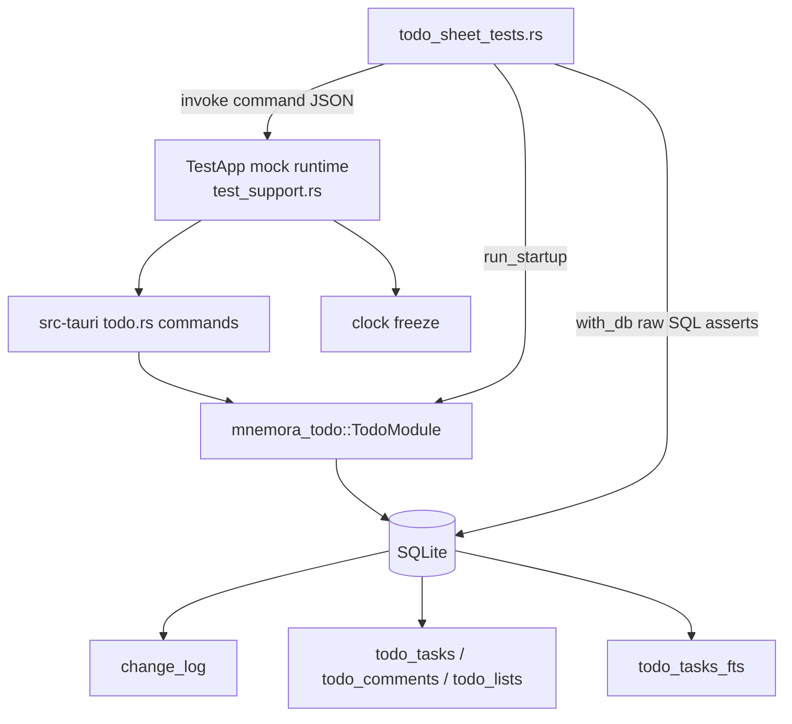
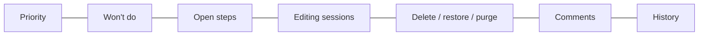
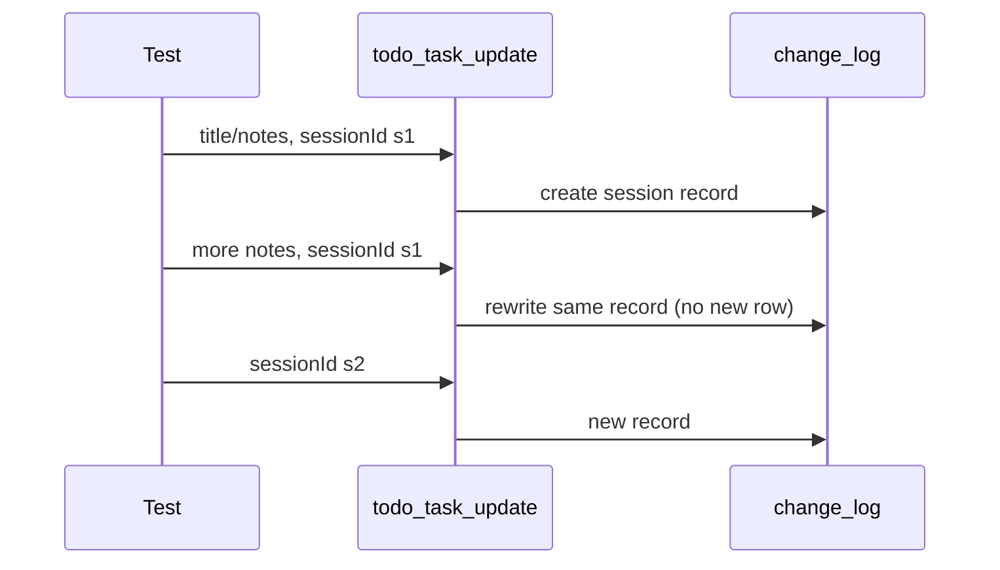

# todo_sheet_tests

`src-tauri/src/todo_sheet_tests.rs` is the command-layer integration suite for the Todo **Task sheet** rules. It covers Priority, Won't do, open steps, editing sessions, delete/restore/purge, Comments and History. The tests call the real Tauri commands (`todo_task_*`, `todo_comment_*`, `todo_list_*`, `todo_today`, `todo_upcoming`, `todo_inbox`, …) through the mock runtime described in ADR 0009. They then check both the command results and the underlying SQLite state (`change_log`, `todo_tasks`, `todo_comments`, `todo_tasks_fts`).

The suite tests behaviour implemented in [Todo_Domain_Service](../Tauri_Host_and_Command_Layer/Todo_Domain_Service.md) (the command layer) and [Todo_Tasks_and_Lists](../Domain_Modules_(Todo_and_Journal)/Todo_Tasks_and_Lists.md) and [Todo_Comments](../Domain_Modules_(Todo_and_Journal)/Todo_Comments.md) (the domain crate). Sibling suites live in [Backend_Integration_Test_Suites](../Backend_Integration_Test_Suites.md). Capture, ordering and search tests are covered alongside the Todo command service.

## Architecture

Helpers from `test_support` (see [Tauri_Host_and_IPC_Bridge](../Tauri_Host_and_Command_Layer/Tauri_Host_and_IPC_Bridge.md)): `TestApp` (`invoke`, `with_db`, `set_pref`, `clock`, `run_startup`), `close_all_on`, `inbox_tasks_of`, `tasks_of`.

### Local helpers

| Helper | Purpose |
|---|---|
| `local(today)` | Builds the `{today, now: "14:05", offset_min: 0}` device-time argument; `TODAY` is `2026-10-21`. |
| `create`, `dated`, `repeating` | Make a task, optionally with a due date/time or a daily fixed repeat. |
| `priority`, `complete`, `update`, `get`, `comment`, `bodies` | Thin wrappers over the commands. |
| `history`, `log`, `log_len`, `count` | Read History lines, `(op, entity)` change records, and raw SQL counts. |
| `inbox`, `titles` | Extract titles from views. |
| `age` | Backdates `deleted_at` to simulate time passing for purge tests. |

## Test groups

### Priority
- `a_task_starts_at_priority_four_and_takes_one_to_four`: default P4, valid 1–4, otherwise a `validation` error.
- `a_priority_change_is_one_update_and_the_same_priority_records_nothing`: one `update/todo_task` change record; a no-op writes none.
- `priority_needs_an_open_task_and_a_known_one`: closed task gives `validation`, unknown id gives `not_found`.
- `within_a_time_block_today_orders_by_priority_then_manual_order` and `upcoming_days_order_by_priority_inside_each_block_too`: priority orders only inside a time block; timed tasks keep their place before untimed ones.

### Won't do
- `wont_do_closes_the_task_into_done_without_counting_as_done`: state `wont`, with `closed_at` set. It appears in Done but is excluded from Today's progress total and from the sidebar counts.
- `wont_do_is_a_tick_that_reopening_undoes`: both directions are `tick` records.
- `wont_do_is_refused_for_a_closed_and_an_unknown_task`: `validation` and `not_found` errors.
- `wont_do_on_a_repeating_task_skips_it_in_rust`: acts as a skip, moves to the next date and writes a single `tick`. History reads `Skipped (Wed → Sat)`.

### Open steps
- `completing_with_open_steps_is_still_allowed_and_tick_all_is_a_notes_update_first`: plain Complete leaves notes unchanged. "Tick all and complete" is a notes update followed by a complete.

### Editing sessions
- `saves_of_one_session_make_one_record_and_a_new_session_makes_another`: the same `sessionId` coalesces into one record, and saving unchanged text writes nothing.
- `updates_refuse_bad_titles_missing_sessions_and_unknown_tasks`: empty, multi-line or over-500-character titles, a blank session id (`validation`), unknown task (`not_found`); nothing is logged.
- `notes_over_100000_characters_are_refused`: 100,000 characters is the limit.
- `notes_and_titles_are_searchable_after_an_update`: the FTS index follows edits.

### Delete, restore, purge
- `deleting_leaves_every_view_at_once_and_restore_puts_the_task_back_in_place`: records `delete` then `restore`; the delete snapshot carries `deleted_at`.
- `deleting_twice_restoring_a_live_task_and_unknown_ids_are_refused`.
- `a_task_restored_after_its_list_was_deleted_returns_to_the_inbox`.
- `what_was_deleted_over_thirty_days_ago_survives_a_restart_with_its_change_log`: after `run_startup(&TodoModule)` the purge removes the aged tasks, lists and comments from their tables. The `change_log` is untouched and the old delete can still be restored.

### Comments
- Add, edit, delete and restore: `comments_are_added_oldest_first_trimmed_and_counted_on_the_task`, `bad_comments_are_refused_and_record_nothing`, `a_comment_may_hold_line_breaks_and_up_to_5000_characters` (counted in characters), `an_edited_comment_says_so_and_the_same_text_is_no_edit`, `deleting_a_comment_is_undone_by_restoring_it_without_marking_it_edited`, `a_done_task_can_still_be_commented`.
- Repeating tasks: `comments_move_with_the_occurrence_and_the_counts_follow`, `completing_the_same_occurrence_again_after_a_reopen_reuses_its_row` (one occurrence has one id) and `deleting_a_comment_and_completing_with_comments_record_and_stamp_them`. Comments, including deleted ones, are re-parented to the occurrence as `move` records carrying the full snapshot, and their `updated_at` is stamped. These records matter to [Sync_Replication_Engine](../Sync_Replication_Engine.md).

### History
History lines are derived from `change_log` with newest first and never contain the task's own text.
- `history_reads_the_change_log_as_lines_newest_first`: for example `Priority P4 → P1`, `Due date Thu 22 Oct → Fri 23 Oct`, `Moved 📥 Inbox → 💼 Work`.
- `history_lines_never_hold_the_tasks_own_text`
- `title_and_notes_edits_make_one_line_per_opening_of_the_sheet` and `one_opening_is_one_line_per_field_even_when_other_changes_happen_in_between`.
- `repeats_and_removals_read_naturally`: for example `Repeat set: Every 2 weeks on Mon, Sat` and `Time removed`.
- `completing_a_repeating_task_reads_as_an_occurrence_and_so_does_its_copy` and `a_skip_reads_as_skipped_and_not_as_an_occurrence_or_a_date_edit`: `Done (occurrence of 21 Oct)`, `Reopened (occurrence of …)`, `Skipped (Thu → Sat)`.
- `history_shows_deleted_and_restored_and_names_a_deleted_list`
- `history_of_an_unknown_task_is_not_found`
- `history_stays_in_the_order_things_happened_when_the_wall_clock_stands_still_or_goes_back`: the test freezes the app clock, so ordering relies on the `change_log` rowid/sequence rather than the wall clock.

## Key invariants

- Refused commands change and log nothing (`log_len` unchanged).
- Equal-value writes are no-ops.
- State changes (done, won't do, reopen, skip) are `tick` records; deletes are `delete`/`restore` records and never erase the log.
- Error codes are `validation` and `not_found`.

## Running

`make test` runs the Rust and frontend tests (see [Build_and_Config](../Build,_Tooling_and_Packaging/Build_and_Config.md)). To run only this suite, use `CARGO_BUILD_JOBS=2 cargo test -p mnemora-app todo_sheet_tests`. The crate name `mnemora-app` is an assumption; check `src-tauri/Cargo.toml`.
