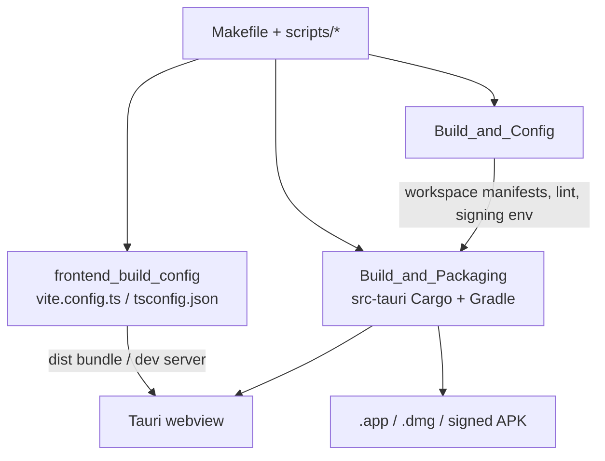
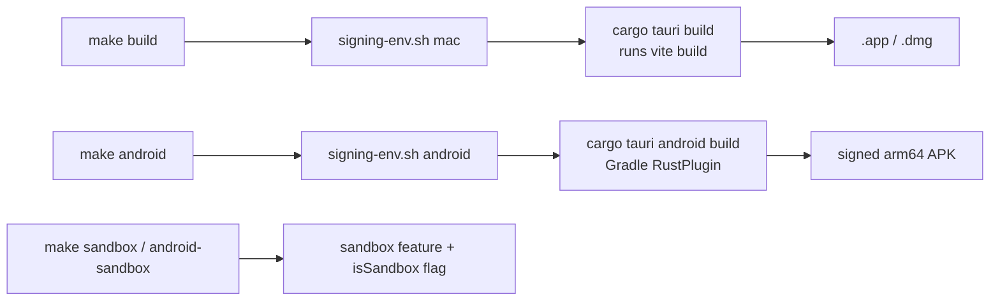

# Build, Tooling and Packaging

## Purpose

This module covers how Mnemora is built, checked and packaged. It has three parts:

- **Developer entry points and workspace policy.** A single `make <target>` interface, the Cargo and pnpm workspaces with exact version pins, the lint and format rules, and the helper scripts, including local macOS and Android signing. All of it is tuned for an 8 GB dev machine (`CARGO_BUILD_JOBS=2`, no incremental builds, arm64-only Android).
- **Shell crate and Android packaging.** The `mnemora-app` crate manifest, its Tauri `build.rs`, and the generated Android Gradle project. The Gradle project includes a Rust plugin that calls `cargo tauri`, plus the Sandbox and Production variants and release signing.
- **Frontend toolchain.** The Vite config (plugins, dev port 47821, HMR, build target `safari15`) and the strict TypeScript config for the Svelte 5 frontend.

## Architecture

The root `Makefile` goes through `scripts/with-env.sh`, which sets the build environment and kills child processes on exit. It starts the frontend and Rust builds, and `cargo tauri` ties them together. The Vite dev server port (47821) must match `devUrl` in `tauri.conf.json` and `scripts/dev/config.mjs`.

For a Sandbox Android build, both the Rust `sandbox` feature and Gradle's `isSandbox` flag must be set. This lets the Sandbox install alongside Production.

## Core components

| Component | Scope | Documentation |
|---|---|---|
| Build_and_Config | `Makefile`, `scripts/`, workspace `Cargo.toml`, `package.json`, `biome.json`, `rustfmt.toml`, `clippy.toml`, signing and setup | [Build_and_Config](Build,_Tooling_and_Packaging/Build_and_Config.md) |
| Build_and_Packaging | `src-tauri/Cargo.toml`, `build.rs`, Android Gradle project, `buildSrc` Rust plugin | [Build_and_Packaging](Build,_Tooling_and_Packaging/Build_and_Packaging.md) |
| frontend_build_config | `vite.config.ts`, `tsconfig.json` | [frontend_build_config](Build,_Tooling_and_Packaging/frontend_build_config.md) |