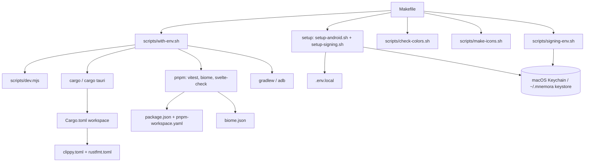
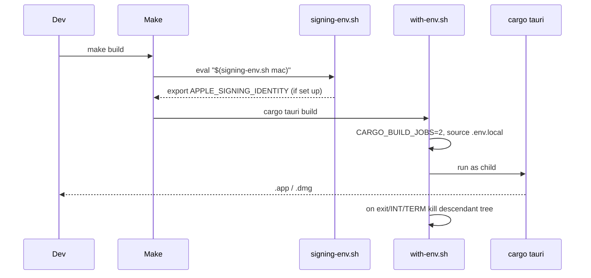

# Build_and_Config

Repo-root build orchestration, lint/format configuration and helper scripts for Mnemora. It covers the `Makefile`, the Cargo and pnpm workspace manifests, style/lint configs and the shell scripts under `scripts/`. It does not cover the Tauri crate build (`src-tauri/Cargo.toml`, `build.rs`, Gradle files); see [Build_and_Packaging](Build_and_Packaging.md). It also does not cover Vite and TypeScript configuration; see [frontend_build_config](frontend_build_config.md). The parent page is [Build, Tooling and Packaging](../Build,_Tooling_and_Packaging.md).

## Purpose

- Give developers one entry point (`make <target>`) for dev, build, test, lint, format, icons and bindings.
- Keep builds inside the limits of an 8 GB dev machine. `CARGO_BUILD_JOBS=2` is set, incremental compilation is off, and Gradle runs without a daemon and with a capped heap.
- Pin every dependency exactly, and enforce one lint/format policy across Rust and TypeScript.
- Provide local signing for macOS and Android without paid developer accounts.

## Architecture

## Makefile targets (`Makefile`)

Long-running commands go through `$(RUN)`, which is `./scripts/with-env.sh`. The default goal is `help`, which lists every target that has a `##` comment.

| Target | Action |
|---|---|
| `dev` | `node scripts/dev.mjs $(ARGS)`: Vite plus a key menu, using Production data. |
| `sandbox` | The same with `--sandbox`: separate Sandbox data and the SANDBOX badge. |
| `build` | Evaluates `signing-env.sh mac`, then `cargo tauri build` (`.app`/`.dmg`). |
| `android-dev` | `dev.mjs --sandbox --android`: runs on a USB phone with Sandbox data. |
| `android` | Unsets `MNEMORA_ANDROID_SANDBOX`, loads Android signing env, builds a signed arm64 release APK, finds the newest non-unsigned release APK and runs `adb install -r`. |
| `android-sandbox` | Debug Sandbox APK (`--features sandbox`, `MNEMORA_ANDROID_SANDBOX=1`), installed with `adb`. |
| `android-test` | Gradle `:app:testDebugUnitTest` with `--max-workers=2`, then `gradlew --stop`. It is kept out of `make test` because Gradle is heavy. |
| `test` | `cargo test --workspace` plus `pnpm vitest run --passWithNoTests`. |
| `lint` | `clippy -D warnings`, `cargo fmt --check`, `check-colors.sh`, `biome check`, `svelte-check`. |
| `fmt` | `cargo fmt --all` and `biome check --write`. |
| `icons` | Runs `scripts/make-icons.sh`. |
| `bindings` | `cargo test -p mnemora-app regenerate_bindings -- --ignored` regenerates `src/lib/ipc/bindings.ts` without launching the app. |
| `trim` | Deletes incremental dirs, docs and Gradle outputs but keeps compiled deps. |
| `clean-heavy` | Asks first, then deletes `target`, `node_modules`, `dist` and the Android build dirs. |
| `setup` | Runs `setup-android.sh` and `setup-signing.sh`. It modifies the system, so read the scripts first. |

The dev port, 47821, is shared by `vite.config.ts` and `src-tauri/tauri.conf.json`. See [frontend_build_config](frontend_build_config.md).

### Typical flow

## Scripts

- **`scripts/with-env.sh`**: changes to the repo root and exports `CARGO_BUILD_JOBS=2`. It sources the git-ignored `.env.local` with `set -a`, runs the command in the background with stdin kept attached (needed for the Android device prompt) and waits for it. A trap on EXIT, INT and TERM runs `kill_tree`, a recursive `pgrep -P` walk, then a `KILL` after 1 s. This stops stray vite, cargo or gradle processes from lingering.
- **`scripts/signing-env.sh mac|android`**: prints `export` lines for use with `eval`. For `mac` it unlocks the `mnemora-signing.keychain-db` and sets `APPLE_SIGNING_IDENTITY="Mnemora Dev"`. For `android` it sets `MNEMORA_KEYSTORE_PATH`, `MNEMORA_KEYSTORE_PASSWORD` and `MNEMORA_KEY_ALIAS`. Secrets come from the login Keychain and nothing is written to disk. It prints nothing if signing is not set up, which gives an unsigned build.
- **`scripts/setup-signing.sh`**: idempotent one-time setup.
  - On macOS it creates a dedicated keychain and a self-signed `Mnemora Dev` code-signing certificate. It uses Apple's LibreSSL because Homebrew OpenSSL 3 produces PKCS12 files that `security import` rejects.
  - It creates `~/.mnemora/release.keystore` (RSA 2048, 10000 days) and never overwrites an existing one, because losing or replacing it makes installed apps un-upgradeable.
  - It writes a password-free `src-tauri/gen/android/keystore.properties` for Gradle. Gradle takes the password from `MNEMORA_KEYSTORE_PASSWORD`.
- **`scripts/setup-android.sh`**: installs the latest NDK through the Homebrew `sdkmanager`.
  - It prunes the NDK to an arm64-only Rust toolchain, from roughly 2.9 GB to 0.5 GB.
  - It removes the emulator and build-tools 35.0.0.
  - It adds the `aarch64-linux-android` target and removes the other Android targets.
  - It writes a managed block into `.env.local` (`ANDROID_HOME`, `NDK_HOME`, `JAVA_HOME`, `GRADLE_OPTS`) and tunes `gradle.properties` for low memory (no daemon, no parallel, `-Xmx1536m`).
  - It needs `--yes` or an interactive confirmation.
- **`scripts/make-icons.sh`**: renders icons with `cargo tauri icon`. It does not use `qlmanage`, which paints an opaque white background.
  - From `app-icon.svg` it produces the desktop and iOS icons.
  - From `app-icon-sandbox.svg` it produces the Sandbox Mac icons.
  - From `app-icon-fullbleed.svg` it produces the Windows icons, the favicon and the apple-touch-icon.
  - It copies the Android adaptive-icon vector XML, including the Sandbox variant, into `gen/android/.../res`.
- **`scripts/check-colors.sh`**: greps `src/` for hex, `rgb(a)`, `hsl(a)` and `oklch` literals in `.svelte`, `.ts` and `.css` files. It excludes `tokens.css`, `AppMark.svelte`, tests and `bindings.ts`. It exits 1 on a hit. This enforces the "tokens only" rule from the UI system.

## Rust workspace (`Cargo.toml`)

- Workspace members: `core`, `journal`, `todo`, `sync`, `harness`, `providers`, `ai` and `src-tauri`. Edition 2024, resolver 3, rust-version 1.90, version 0.2.0, unpublished.
- Every dependency is pinned with `=` in `[workspace.dependencies]`. Tauri stays on 2.x (`=2.12.4`), and `tauri-specta` and `specta` must be the same rc. `rusqlite` is bundled, with backup, functions and hooks. TLS is rustls with the `ring` provider, which avoids cmake/NASM and cross-builds for Android. Other pinned crates cover pairing (spake2, mdns-sd), three-way text merge (`similar`), HTTP (`ureq` with rustls) and JNI (`jni`, Android only). Which crates use which is documented in their own module pages, for example [Sync_Replication_Engine](../Sync_Replication_Engine.md) and [AI_Assistant_Backend](../AI_Assistant_Backend.md).
- Lints:
  - `unsafe_code = deny` and `missing_docs = warn`.
  - clippy `all = deny`, `pedantic = warn`, and `unwrap_used` / `expect_used` set to `deny`.
  - A few noisy pedantic lints are allowed.
- `clippy.toml` allows `unwrap` and `expect` in tests.
- `rustfmt.toml`: edition 2024, width 100, Unix newlines, field-init and try shorthand. Import grouping is kept by hand because the grouping options are nightly-only.
- Profiles:
  - Dev uses line-tables-only debug info, no incremental compilation, and no debug info for dependencies.
  - Release uses `opt-level = "s"`, no LTO, `codegen-units = 16`, `strip` and `panic = "abort"`.
  - `release.build-override` keeps `strip = false`. Stripping proc-macros breaks macOS release builds with E0463.

## Frontend tooling

- `package.json` (pnpm 11.20.0, ESM, private) defines scripts `dev` (vite), `dev:menu` (`scripts/dev.mjs`), `build` (vite build), `check` (svelte-check), `lint` (biome) and `test` (vitest). All dependency versions are exact. The stack is Svelte 5, Vite 8, Tailwind 4, TanStack Query and Virtual, CodeMirror 6, bits-ui, sv-router and the Tauri API.
- `pnpm-workspace.yaml` exempts two CodeMirror/Lezer versions from the minimum release-age policy. It also overrides `@codemirror/view` and `@lezer/markdown` so only one copy of each is loaded, because CodeMirror breaks with duplicate view/state versions. See [Markdown_Editor](../Design_System_and_UI_Components/Markdown_Editor.md).
- `biome.json` (2.5.15) uses 2-space indent, line width 100, single quotes and the recommended rules (except `noImportantStyles`), and enables Tailwind directive parsing. It ignores `dist`, `node_modules`, `src-tauri`, `crates`, `docs`, `target`, `.claude`, generated `bindings.ts` and `*.svelte`. Svelte files are checked by `svelte-check`.
- `.editorconfig`: UTF-8, LF, final newline, trimmed whitespace, 2-space indent. Rust files use 4 spaces, the Makefile uses tabs, and Markdown keeps trailing whitespace.

## Relationships

- `make bindings` and `make test` depend on the Tauri host crate; see [Tauri_Host_and_Command_Layer](../Tauri_Host_and_Command_Layer.md) and [IPC_Bridge_and_Browser_Mocks](../IPC_Bridge_and_Browser_Mocks.md).
- The Android targets rely on the generated Gradle project described in [Build_and_Packaging](Build_and_Packaging.md) and on the app code in [Android_and_Home-Screen_Widget_Platform](../Android_and_Home-Screen_Widget_Platform.md).
- `check-colors.sh` guards [Design_System_and_UI_Components](../Design_System_and_UI_Components.md).

## Maintenance notes

- Adding a Rust crate means adding it to `members` and to `[workspace.dependencies]`, with exact pins.
- Adding a make target needs a `## description` comment and a name matching `[a-z-]+` for `help` to list it.
- Never re-create the Android keystore. Run `make setup` only after reading the scripts, since it modifies the NDK and the system keychains.
