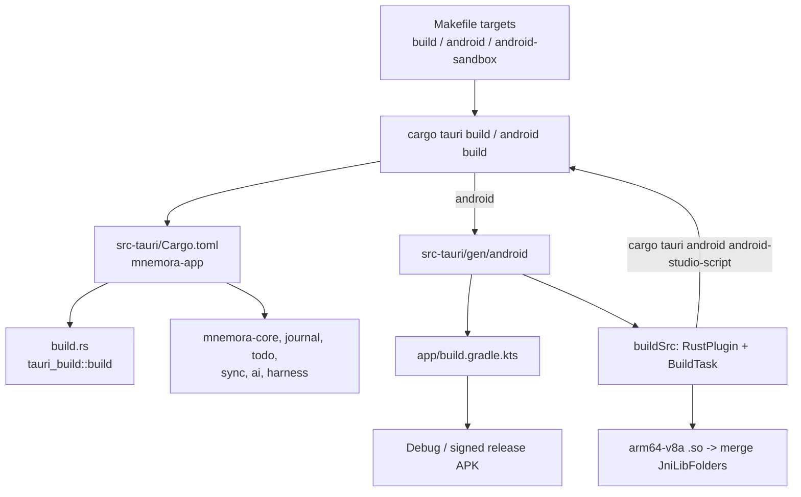
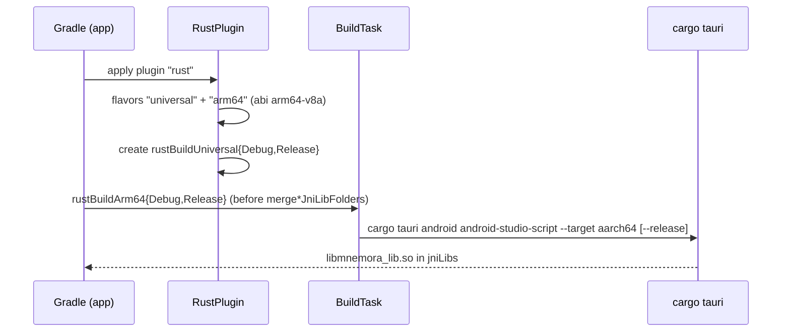
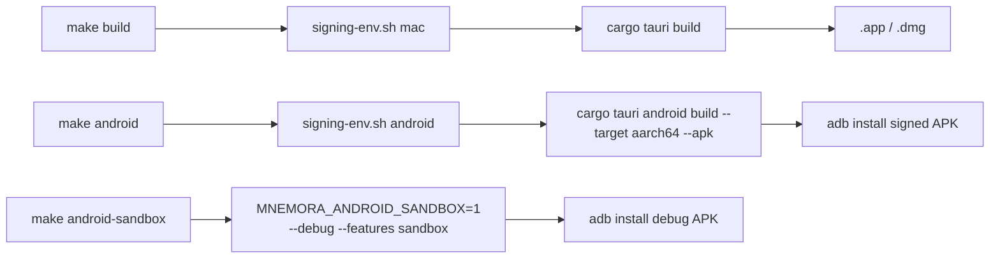

# Build and Packaging

This module covers how the Rust/Tauri shell crate (`src-tauri`) is built and packaged for desktop and Android. It consists of:

- the `mnemora-app` crate manifest (`src-tauri/Cargo.toml`) and its Tauri build script (`src-tauri/build.rs`);
- the generated Android Gradle project under `src-tauri/gen/android` (app module, root build, `buildSrc` Rust plugin, settings).

Workspace-level configuration (root `Cargo.toml`, `Makefile`, `package.json`, lint/format config, helper scripts) is documented in [Build_and_Config](Build_and_Config.md). The Vite and TypeScript setup is in [frontend_build_config](frontend_build_config.md). The code that is packaged is described in [Tauri_Host_and_Command_Layer](../Tauri_Host_and_Command_Layer.md) and [Android_and_Home-Screen_Widget_Platform](../Android_and_Home-Screen_Widget_Platform.md).

## Architecture

## The `mnemora-app` crate (`src-tauri/Cargo.toml`)

- **Thin shell**: its description states that it is wiring only; logic lives in the workspace crates (`mnemora-core`, `-journal`, `-todo`, `-sync`, `-ai`, `-harness`). Package metadata (version, edition, rust-version, license, publish) and lints are inherited from the workspace root.
- **Crate types**: the lib is named `mnemora_lib` with `staticlib`, `cdylib` and `rlib`. The `_lib` suffix avoids a Windows lib/bin name clash; `cdylib` is what Android loads as a JNI library; `staticlib` serves mobile targets.
- **Feature `sandbox`**: selects `Environment::Sandbox` (separate data, identifier and badge). It is passed by `make android-sandbox` (`--features sandbox`) and mirrors the Gradle `isSandbox` flag.
- **Tauri features**: `wry`, `compression`, `common-controls-v6`, `dynamic-acl`, `x11`. Plugins: `tauri-plugin-opener`; IPC typing through `tauri-specta`/`specta`/`specta-typescript` (used by `make bindings`).
- **Android-only dependency**: `jni` under `cfg(target_os = "android")` for the widget and sync-power bridges.
- **Dev-dependencies**: Tauri `test` feature (mock runtime), `mnemora-providers` with `testing` (fake wrapper), `tempfile`, and `tokio` for real loopback socket tests. None reach release builds.

## Build script (`src-tauri/build.rs`)

`main` calls `tauri_build::build()`, which generates the context and capability schemas. It first emits `cargo:rerun-if-changed=icons`, because `generate_context!()` embeds icons at compile time but tauri-build does not track them; without it `make icons` would leave the old icon in the binary.

## Android Gradle project (`src-tauri/gen/android`)

| File | Role |
|---|---|
| `settings.gradle` | Includes `:app` and applies the Tauri-generated `tauri.settings.gradle`. |
| `build.gradle.kts` (root) | Buildscript classpath: Android Gradle Plugin 8.13.0, Kotlin plugin 1.9.25; Google and Maven Central repos; a `clean` task. |
| `buildSrc/build.gradle.kts` | `kotlin-dsl` project registering the plugin id `rust` → `RustPlugin`. |
| `buildSrc/.../RustPlugin.kt` | Creates the `rust` extension (`rootDirRel`), product flavors, and per-profile Rust build tasks. |
| `buildSrc/.../BuildTask.kt` | Gradle task that runs `cargo tauri android android-studio-script` with `--target` (and `--release`, `-v`/`-vv` per log level); on Windows retries `cargo.exe/.cmd/.bat`. |
| `app/build.gradle.kts` | Application configuration, Sandbox variant, signing, dependencies. |

### Rust-to-Gradle wiring

`RustPlugin` defaults to arm64 only (`abiList=arm64-v8a`, `archList=arm64`, `targetList=aarch64`), overridable with Gradle properties `abiList`, `archList`, `targetList`. For each of `debug`/`release` it creates `rustBuildUniversal<Profile>` and a per-arch `rustBuild<Arch><Profile>` task, and makes the `merge…JniLibFolders` tasks depend on them. arm64-only keeps builds fast and the NDK pruned (see `scripts/setup-android.sh` in [Build_and_Config](Build_and_Config.md)).

### App module (`app/build.gradle.kts`)

- **Identity**: namespace and `applicationId` `com.hemang.mnemora`; `compileSdk`/`targetSdk` 36, `minSdk` 26. `versionCode`/`versionName` come from `tauri.properties`.
- **Sandbox vs Production**: `isSandbox` is true when env `MNEMORA_ANDROID_SANDBOX=1` or property `mnemora.sandbox=true`. Sandbox gets `applicationIdSuffix ".sandbox"`, label "Mnemora Sandbox", the `ic_launcher_sandbox` icon, a `BuildConfig.SANDBOX` flag, and widget resources (`todo_widget_label`, `todo_widget_tag_text`, `todo_widget_tag_fill`) so it installs beside Production and is visibly distinct.
- **Build types**: debug allows cleartext traffic (dev server), is debuggable with JNI debug and keeps arm64 debug symbols. Release disables R8 minification (heaviest Gradle step; app code is almost all Rust).
- **Signing**: `keystore.properties` (path/alias, no secrets) plus `MNEMORA_KEYSTORE_PASSWORD` from the environment, exported by `make android` via `scripts/signing-env.sh` from the macOS Keychain. A release build without them fails with a message pointing to `make setup` (`scripts/setup-signing.sh`).
- **Dependencies**: androidx webkit, appcompat, activity-ktx, lifecycle-process, Material; JUnit and `org.json` (real implementation for widget parsing in local tests) for `make android-test`.
- Applies Tauri-generated `tauri.build.gradle.kts` and sets `rust { rootDirRel = "../../../" }` (repo root).

## Build flows

Note the symmetry: Rust's `sandbox` Cargo feature and Gradle's `isSandbox` must both be set for a Sandbox Android build; `make android` explicitly unsets `MNEMORA_ANDROID_SANDBOX` so Production is never built as Sandbox.

## Source artifacts

`src-tauri/Cargo.toml`, `src-tauri/build.rs`, `src-tauri/gen/android/{settings.gradle, build.gradle.kts, app/build.gradle.kts, buildSrc/build.gradle.kts, buildSrc/src/main/java/com/hemang/mnemora/kotlin/{RustPlugin,BuildTask}.kt}`; orchestrated by the root `Makefile` and workspace `Cargo.toml` (see [Build_and_Config](Build_and_Config.md)).
