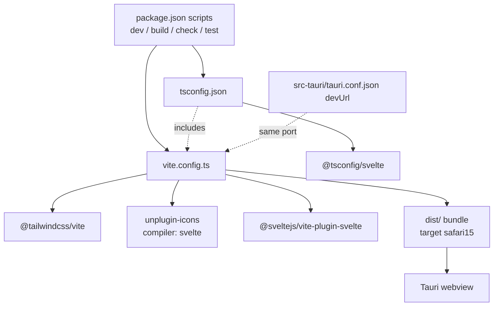
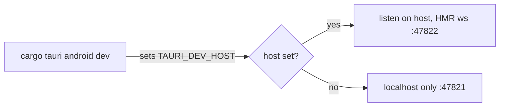

# frontend_build_config

The `frontend_build_config` module holds the two files that configure how the Svelte 5 + TypeScript frontend is compiled, type-checked and served: `vite.config.ts` (bundler and dev server) and `tsconfig.json` (TypeScript compiler options). Together they define the frontend toolchain that [Tauri](../Tauri_Host_and_Command_Layer.md) wraps on desktop and Android.

It is a child of [Build, Tooling and Packaging](../Build,_Tooling_and_Packaging.md). Sibling pages: [Build_and_Config](Build_and_Config.md) (Makefile, package.json, Biome, scripts) and [Build_and_Packaging](Build_and_Packaging.md) (Cargo/Gradle/Rust build).

## Components

| File | Role |
|---|---|
| `vite.config.ts` | Vite plugins, dev-server port and HMR, file watching, production build target |
| `tsconfig.json` | Strict TypeScript settings extending `@tsconfig/svelte`; used by `svelte-check` and editors |

## Architecture

## vite.config.ts

**Plugins** (order matters): `tailwindcss()` (Tailwind v4), `Icons({ compiler: 'svelte' })` (icons such as `@iconify-json/lucide` imported as Svelte components), then `svelte()`.

**Settings**
- `clearScreen: false` – keeps Rust compiler errors visible when Vite runs under `cargo tauri dev`.
- `envPrefix: ['VITE_', 'TAURI_']` – only these env vars are exposed to client code.
- `server.port: 47821` with `strictPort: true` – fails rather than choosing another port, because Tauri's `devUrl` must match. The comment in the file notes the value is duplicated in `scripts/dev/config.mjs` and `devUrl` in `src-tauri/tauri.conf.json`; **keep all three equal**.
- `server.host` – `TAURI_DEV_HOST` (set by `cargo tauri android dev`) or `false`. When set, HMR uses WebSocket on that host at port `47822`, so a phone can reach the dev server.
- `server.watch.ignored` – `src-tauri/`, `crates/` and `target/` are excluded so Rust rebuilds don't trigger frontend reloads.
- `build.target: 'safari15'` – the lowest webview engine targeted (macOS WKWebView / older system webviews); `sourcemap: false`.

## tsconfig.json

- Extends `@tsconfig/svelte/tsconfig.json`.
- `target: ES2022`, `module: ESNext`, `moduleResolution: bundler` (matches Vite).
- Strictness: `strict`, `noUncheckedIndexedAccess` (indexed reads include `undefined`), `noImplicitOverride`.
- `verbatimModuleSyntax` – type-only imports must use `import type`.
- `skipLibCheck: true`.
- `include`: `src/**/*.ts`, `src/**/*.svelte`, and `vite.config.ts`, so the config itself is type-checked.

## How it is used

Scripts in `package.json`: `dev` → `vite`, `build` → `vite build`, `check` → `svelte-check --tsconfig ./tsconfig.json`, `test` → `vitest run` (Vitest reads the Vite config). Makefile targets (`make dev`, `make build`, `make test`, `make lint`) in [Build_and_Config](Build_and_Config.md) call these. The built bundle is consumed by the Tauri host described in [Build_and_Packaging](Build_and_Packaging.md). Source it compiles lives in [Frontend_Platform_and_Shell](../Frontend_Platform_and_Shell.md) and [Design_System_and_UI_Components](../Design_System_and_UI_Components.md).

## Maintenance notes

- Changing the dev port requires editing three places (see above).
- Raising or lowering `build.target` affects which webviews can run the app, including Android System WebView.
- Add new top-level TS files outside `src/` to `tsconfig.json` `include` if they should be type-checked.
