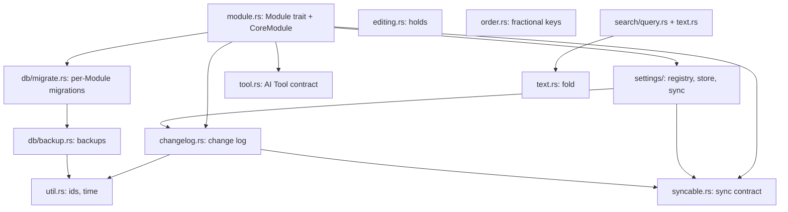
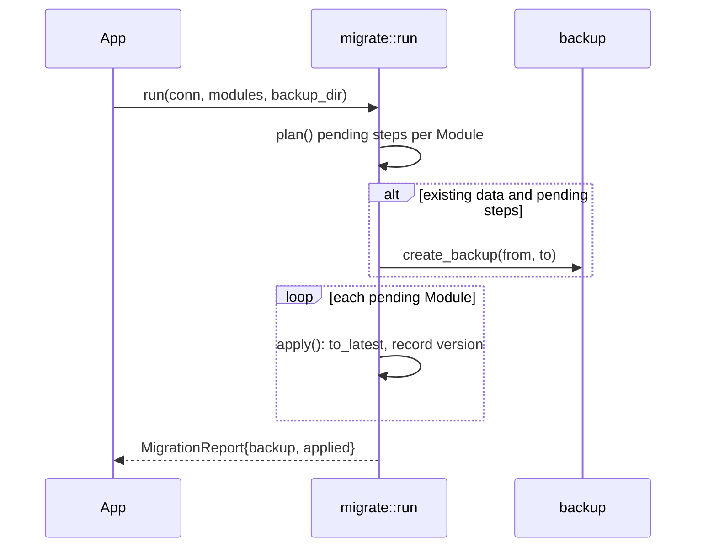
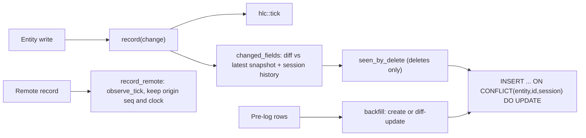
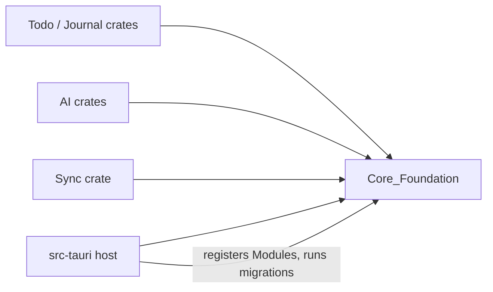

# Core_Foundation

`mnemora-core` (`crates/core`) is the dependency-free base of the Rust backend. It holds the contracts and shared infrastructure that every feature crate builds on: the `Module` trait, per-Module SQLite migrations and backups, typed Settings, the app-wide change log, the sync contract, editing holds, fractional ordering keys, search query parsing, text folding, the read-only AI `Tool` contract and small utilities.

The central rule: **Modules never import each other.** They share only what lives here, plus the event bus. The Sync crate likewise never imports a Module; it reads the contract in `syncable.rs`. See [Sync_Replication_Engine](Sync_Replication_Engine.md), [Domain_Modules_(Todo_and_Journal)](Domain_Modules_(Todo_and_Journal).md), [AI_Assistant_Backend](AI_Assistant_Backend.md) and [Tauri_Host_and_Command_Layer](Tauri_Host_and_Command_Layer.md) for the consumers.

Dependencies (`crates/core/Cargo.toml`): `rusqlite`, `rusqlite_migration`, `serde`/`serde_json`, `specta` (TypeScript binding generation), `thiserror`, `toml`, `tracing*`, `uuid`. Workspace lints apply.

> Only part of the crate is shown in the provided components. Files such as `hlc`, `device`, `events`, `error` and `db/mod` are referenced below but their source is not documented here.

## Architecture

## The Module contract (`module.rs`)

`Module` is the compile-time interface every feature implements. Only `id`, `migrations` and `register_settings` are required; the rest have defaults, so a Module opts in to each capability.

| Method | Purpose |
|---|---|
| `id` | Stable id: Settings key prefix and migration namespace |
| `default_enabled` | On until switched off (default) or off until opted in (Sync) |
| `migrations` | Independently versioned schema |
| `register_settings` | Declares keys, defaults, validators |
| `sync_entities` | Entities and field classes it syncs (none by default) |
| `apply_remote` | Applies winning remote field values through its own repository; not a new local change |
| `settle_remote` | Post-apply rules that record ordinary local changes (e.g. Todo List name clash) |
| `holdings` | Counts for the first-merge preview |
| `tools` | Read-only AI Tools |
| `backfill_log` | Brings pre-log rows into the change log, idempotently |
| `on_startup` | One-time work after all migrations |

`CoreModule` (id `core`) owns the `settings`, `change_log`, `device_clock` and `editing_sessions` tables via seven migrations. Its `on_startup` first sets the device id in the clock (so later writes are stamped), clears editing holds, and moves look-and-feel preferences into the device file. It registers the app-wide Preferences (theme, density, text size, reduce motion, display name, time/date format, week start, phone tabs, disabled/optional Modules). Theme, density, text size, reduce motion and phone tabs are **Device settings**.

## Migrations and backups

`db/migrate.rs` gives each Module its own version counter in `_module_migrations`. `rusqlite_migration` only has one counter (`PRAGMA user_version`), so it is lent to one Module at a time and always reset to 0, even when a step fails.

- `MigrationReport` lists the backup path (if any) and `(module, from, to)` per Module that moved. A fresh database is not backed up.
- A database newer than the app is refused with `ErrorCode::Database`.
- `is_current` answers "are all Modules current?" without writing, using a scratch in-memory connection; the Todo widget uses it because it must never migrate.
- `versions` exposes per-Module versions for the Sync handshake.

`db/backup.rs` uses the SQLite online-backup API (safe with open connections). Files are written as `.partial` then renamed, named `<compact_utc>-<from>-to-<to>.db`. `backup_now` is the user-requested backup; `backup_for_pairing` is taken before merging with another device. `rotate` keeps the newest `KEEP_BACKUPS` (5) of **each kind** (migration/manual and pairing), so frequent pairings never evict migration backups.

## Settings (`settings/`)

- **Registry** (`schema.rs`): `SettingsRegistry` maps `module.key` to `SettingDef` (default, validator, `device` flag). Duplicate registration is logged and the first wins. `validate` offers `boolean`, `one_of`, `text(max)` (counts characters, not bytes) and `string_list`. `JsonValue` exists only so specta can type arbitrary JSON.
- **Store** (`mod.rs`): `SettingsStore::save_batch` validates every change first, then writes shared rows in one transaction, each followed by a change-log record, then writes Device settings to `device.toml`, and finally publishes one `SettingsChanged` per Module. `get_all` overlays stored values on defaults, ignoring unknown or invalid rows. `SettingsChange` is the IPC request type. `save_if_unset` pins a value at upgrade time without validating or announcing.
- **Device settings** live in the device file, are never change-logged and never synced.
- **Sync** (`sync.rs`): entity `setting`, id `module.key`, one `value` field (newest write per key wins). `apply` accepts a remote value only for a registered, non-device key whose validator passes; `backfill` logs pre-existing shared Preferences stamped with their own `updated_at`.

## The change log (`changelog.rs`)

An append-mostly log of full JSON snapshots (ADR 0008) used for Task History and Sync. Each record carries origin device, hybrid logical clock (`hlc_ms`, `hlc_counter`), local `seq`, `origin_seq`, `fields` (only what changed), `prev` (the replaced values, for three-way text merge) and `seen` (for deletes). Snapshots hold user content and must never be logged.

Key behaviours:
- A **session id** collapses an editing session into one record per entity; a `create` stays a `create`. Every rewrite still ticks, since peers fetch by sequence.
- A session's rewrite keeps its earlier claimed fields only while the value is still the one it left, so it never re-stamps another device's later change as its own.
- `backfill` is deterministic and idempotent: no record means `create`; a differing record means an `update` of just the differing non-derived fields; matching rows write nothing. Stamps use the row's own time (never later than now) and are raised only to sort after the entity's newest record and after the first record of anything it refers to (a Task after its List).
- `read` returns an entity's records ordered by clock, then device and origin sequence, the same order on every device; unreadable snapshots are skipped so a screen never fails to load. `creator` returns the device holding the earliest `create`.

## The sync contract (`syncable.rs`)

Modules describe what syncs; Sync consumes only this.

- `FieldClass`: `Text` (three-way merge, clash raises a Conflict), `Value` (newest wins), `Order` (newest wins, reported apart), `Derived` (recomputed locally, never sent).
- `SyncField` constructors (`text`, `value`, `order`, `derived`, `in_group`). Fields in a **group** are never split: a change to one sends all, and a receiver takes the whole group or none.
- `SyncEntity` has `field`, `members`; `entity_of` looks one up by change-log name.
- `wire_fields` picks the travelling fields of a record, dropping derived ones and, for locally made records, completing groups from the snapshot.
- `RemoteChange`, `Applied`, `Settled`, `Holdings` and `SyncEvent` (TaskToInbox, TaskDeleted, EntryDeleted, ListsMerged, ConflictRaised, ConflictAutoResolved, SettingChanged, DeviceRenamed) carry data and reports between the engine and Modules.

## Editing holds (`editing.rs`)

While a person types, the editor takes a **hold** on an entity field (or `WHOLE`, `"*"`) and renews it. Sync stores remote changes for held fields apart and applies them on release. Holds are leases that lapse after `LEASE_MS` (120 s) so a vanished editor cannot block sync; `clear` runs at every start. The table is local and never synced. See [Sync_Replication_Engine](Sync_Replication_Engine.md) for the engine side.

## Ordering keys (`order.rs`)

Fractional-index keys (ADR 0012) are base-62 strings read as fractions in (0, 1) and compared bytewise. `key_between` finds a key strictly between two others; `key_after` appends compactly. Canonical keys never end in `0` (`canonical` trims trailing zeros, so legacy keys still compare correctly). A move rewrites one row and never renumbers. Used by Todo Tasks and Lists and by AI Saved questions.

## Search and text helpers

- `search/query.rs`: `parse` turns user input into `Term::Word` (prefix match) and `Term::Phrase` (quoted), folded. `exact_match` / `expand_match` build an FTS5 `MATCH` string where every token is double-quoted, so no FTS syntax can be injected. `expand_match` adds whole-word "near" alternatives (typo or vocabulary suggestions) as `OR` groups.
- `text.rs`: `fold_char` / `fold` lowercase and strip accents and combining marks, matching the search tokenizer's diacritic removal. Also used for List-name clash detection.

## The Tool contract (`tool.rs`)

A read-only capability a Module offers the AI (ADR 0002 amendment, ADR 0018). A `Tool` has a `Spec` (name `module_verb`, parameters with `Kind` of Text, Integer, Date, Flag or Choice) and `run(conn, args, calendar) -> Output`. `check` validates raw model arguments (unknown keys, missing required, wrong kinds produce sentences the model reads). `json_schema` generates the native tool-call schema with `additionalProperties: false`. `Output` carries body, summary, cited `Item`s and an error flag. Results are capped by `RESULT_CAP` (16 KB) via `fit_rows`; `cut` truncates on a char boundary. `count` and `number` convert between `i64` arguments and `usize` counts safely; `is_enabled` derives Module enablement from the two Preference lists. Consumers: [AI_Assistant_Backend](AI_Assistant_Backend.md) and the Todo/Journal tools in [Domain_Modules_(Todo_and_Journal)](Domain_Modules_(Todo_and_Journal).md).

## Utilities (`util.rs`)

`new_id` (UUIDv7, time-ordered), `now_ms`, and `compact_utc` (sortable `YYYYMMDDTHHMMSSmmm`, hand-rolled civil-date conversion to avoid a date-time dependency), used for backup names.

## How it fits the system

The Tauri host registers all Modules, runs `migrate::run` then each `on_startup`, and exposes Settings and backup commands (see [Tauri_Host_and_Command_Layer](Tauri_Host_and_Command_Layer.md)). Build configuration is covered in [Build,_Tooling_and_Packaging](Build,_Tooling_and_Packaging.md).
