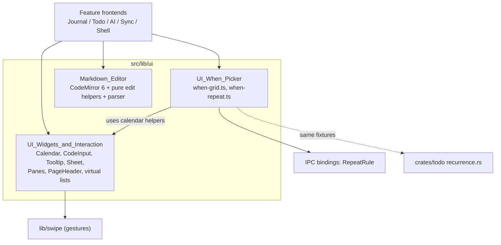
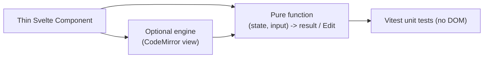

# Design_System_and_UI_Components

## Purpose

This module is the shared UI layer of Mnemora. It lives in `src/lib/ui/` and holds the Svelte Components and the logic behind them. The Journal, Todo, AI and Sync frontends all build on it. Feature code uses these Components and tokens and never imports `bits-ui` directly. The rules are in `docs/design/ui-system.md`.

The module follows one design principle. Behaviour lives in pure, DOM-free TypeScript functions, and the Svelte Components stay thin wrappers around them. This lets Vitest unit-test the behaviour without a browser. It has three parts:

- **Interaction widgets and helpers.** Calendar maths, pairing-code entry, tooltip and long-press gating, sheet swipe, pane sizing, sticky rows, scroll anchoring, word highlighting, emoji and the page-header store.
- **The When picker.** The Due-date grid and the repeat-rule engine for Tasks.
- **The Markdown editor.** A lazily loaded CodeMirror 6 editor, pure text-edit helpers, and a safe read-side Markdown parser.

## Architecture

Key points:

- **Dependencies run one way.** `when-repeat.ts` imports from `when-grid.ts`. Both build on `calendar.ts`.
- **Dates are zone-less `YYYY-MM-DD` strings.** Arithmetic goes through UTC, so DST never shifts a day.
- **The TypeScript recurrence engine mirrors the Rust one.** Both run the shared `recurrence-rules.json` fixtures. This keeps the picker and the browser mock consistent with the backend.
- **The editor is loaded on demand.** The `MarkdownEditor` Svelte component dynamic-imports `editor-core.ts`, so CodeMirror stays out of the main bundle. Editing helpers return an `Edit`, or `null` to fall back to default behaviour. The editor only dispatches them as transactions.
- **Output is never HTML.** The read-side parser and the paste converter produce data only, and unsafe link schemes stay as text.

## Child modules

| Module | Scope | Documentation |
|---|---|---|
| UI_Widgets_and_Interaction | Calendar and DatePicker maths, CodeInput rules, tooltip and pointer gating, sheet swipe, pane math, sticky rows, scroll anchor, mark-words, emoji, `PageHeaderState` | [UI_Widgets_and_Interaction](Design_System_and_UI_Components/UI_Widgets_and_Interaction.md) |
| UI_When_Picker | Rolling five-week date grid, quick days, repeat-rule validation, stepping, previews, presets and labels | [UI_When_Picker](Design_System_and_UI_Components/UI_When_Picker.md) |
| Markdown_Editor | `createEditor`, slash menu, auto-pairing, formatting, list keys, decorations, checklist boxes, rich paste, `parseMarkdown` and `parseInlineMarkdown` | [Markdown_Editor](Design_System_and_UI_Components/Markdown_Editor.md) |

## Related modules

- Consumers: Journal_Frontend, Todo_Frontend and Shell_and_Navigation.
- The `RepeatRule` type and mocks come from IPC_Bridge_and_Core_Mocks and IPC_Todo_Mocks.
- The backend recurrence engine is in Todo_Tasks_and_Lists.