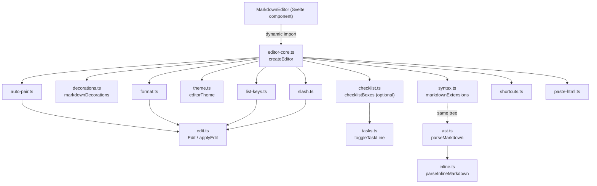
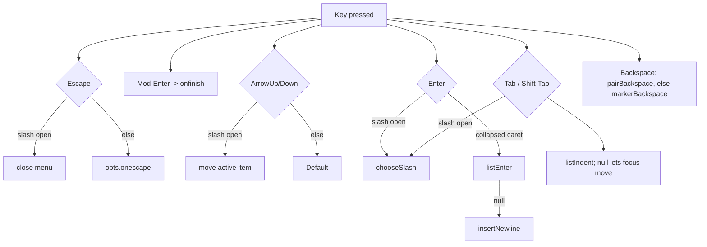
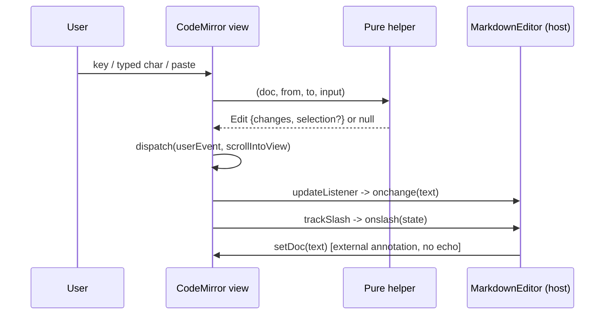

# Markdown_Editor

The Markdown editor is the writing surface behind the Journal's entries and Todo's task notes and comments. It lives in `src/lib/ui/markdown/` and has two halves:

1. **A CodeMirror 6 editor** (`editor-core.ts`) that edits plain Markdown text in place. Syntax marks stay visible but faded, and the text is styled so that writing and reading look alike.
2. **A set of pure text helpers**: `auto-pair`, `format`, `list-keys`, `slash`, `shortcuts`, `paste-html`, `edit` and `tasks`. Each takes a document string and a selection and returns an `Edit`. They have no CodeMirror dependency, so they are unit-tested directly.

A third piece, the read-side parser (`ast.ts`, `inline.ts`), turns Markdown into a safe, data-only tree for display.

The files this page covers directly are listed under *Component reference*. Helpers that appear here only as imports (`ast.ts`, `edit.ts`, `tasks.ts`, `theme.ts`, `format.ts`, `list-keys.ts`, `slash.ts`, `shortcuts.ts`, `auto-pair.ts`) are described from how they are used and tested. Their source was not part of the inputs for this page.

Sibling modules: [UI_Widgets_and_Interaction](UI_Widgets_and_Interaction.md) and [UI_When_Picker](UI_When_Picker.md). For consumers, see [Journal_Frontend](../Journal_Frontend.md) and [Todo_Frontend](../Todo_Frontend.md). The app-wide UI rules are in `docs/design/ui-system.md`.

## Architecture

**Lazy loading.** `editor-core.ts` states that it and all CodeMirror imports are loaded only through a dynamic import, so the editor stays out of the main bundle. The `MarkdownEditor` Svelte component is the host. It owns the toolbar and the slash-menu popup, and it supplies the callbacks in `EditorOptions`.

**Separation of logic and wiring.** Behaviour is in plain functions of the form `(doc, from, to, …) → Edit | null`. `editor-core.ts` only dispatches those edits as CodeMirror transactions. A `null` result means "do nothing special", and the default CodeMirror behaviour then runs.

## Core components

### `createEditor(opts): EditorController` (`editor-core.ts`)

Builds an `EditorView` with this extension stack:

| Extension | Role |
|---|---|
| `history()` + `historyKeymap`, `standardKeymap` | undo/redo and base keys |
| `markdown({ extensions: markdownExtensions, addKeymap: false, completeHTMLTags: false })` | Lezer Markdown parsing with the Journal dialect |
| `markdownDecorations` | faded marks and styled lines/spans |
| `checklistBoxes` (only if `opts.checklist`) | clickable checkbox widgets |
| `EditorView.lineWrapping`, `contentAttributes` | wrapping and `aria-label`, `spellcheck`, `autocapitalize`, and `data-bare` |
| `placeholder`, `editorTheme` | placeholder text and styling |
| `Prec.highest(keys)` | custom keymap, which overrides the defaults |
| `domEvents`, `input` | shortcuts, paste, ⌘-click links, focus/blur, typed-character auto-pairing |
| `updateListener` | change reporting and slash tracking |

`EditorOptions` is a callback contract: `onchange`, `onfinish` (⌘/Ctrl+Enter), `onescape`, `onfocuschange`, `onslash`, `slashValues` and `onopenlink`. `bare` hides the editor's own focus ring when the container draws it. `checklist` switches between box widgets (Todo notes) and faded `- [ ]` text (Journal).

`EditorController` exposes `setDoc`, `getDoc`, `focus`, `blur`, `run(command)`, `pickSlash`, `setSpellcheck`, `setPopup` (ARIA `aria-controls` / `aria-activedescendant` for the slash listbox) and `destroy`.

**Host vs. editor changes.** `setDoc` dispatches with an `external` annotation. The update listener skips `onchange` when every transaction carries it. This stops the `value` prop from echoing back to the host.

### Key handling

- **Backspace** first tries `pairBackspace` (deletes an empty `()`, `[]`, ` `` `, `****` pair), then `markerBackspace` (removes a list, quote or heading marker when the caret sits right after it).
- **Tab** returns `false` when `listIndent` gives `null`, so focus moves normally away from non-list text.
- **Formatting shortcuts** go through `resolveEditorShortcut(event, mac)`. It uses physical key codes (`KeyB`, `Digit8`). It never mixes Meta and Ctrl, and it leaves shell shortcuts such as ⌘1 or ⌘N alone. ⌘K with no selection returns `false`, so the app palette opens.
- **⌘⇧V (Ctrl+Shift+V off macOS)** sets a `plainPaste` flag for 500 ms. The next paste then skips HTML conversion.

### Slash menu

`trackSlash` runs after each document or selection change:

1. If the menu is closed and a single typed `/` was inserted (`input.type`) where `canOpenSlash` allows it, the menu opens at that position. `canOpenSlash` allows the start of the text, the start of a line, or after whitespace. It does not allow `and/or` or `https://`.
2. If the menu is open, its anchor position is mapped through the changes. `slashQuery` returns the text typed after the slash, or `null` (for example after a space) to close it. A changed query resets the active index to 0.
3. `emitSlash` computes `filterSlash(query)` and the caret's viewport rectangle, then calls `opts.onslash`. If there are no matches, the menu closes.

`applySlash` turns the chosen item into an `Edit`. A block item at the start of a line takes the line. Mid-line it starts a new line. A marker-only line (`- /h1`) is replaced, not nested. The divider and code block place the caret sensibly. Date and time items insert text from `slashValues()`. Items are listed in the order `h1 h2 h3 bullet numbered task quote divider code date time`. Filtering matches word prefixes of labels and keywords, ignoring case.

### Auto-pairing (`auto-pair.ts`, tested in `auto-pair.test.ts`)

Called from `EditorView.inputHandler`, and skipped during IME composition or for multi-character input.

- `(`, `[` and `` ` `` close with the caret between the pair. They do not close in front of a word, and a backtick does not close after a word.
- A second `*` turns `*|*` into `**|**`. A single `*` stays plain.
- Three backticks stay three, so a code fence can be typed.
- Quotes, `_` and `{` never pair.
- With a selection, `(`, `[`, `` ` `` and `*` wrap it and keep it selected. Typing `*` twice makes the text bold. Other characters replace the selection as usual.
- Typing `)`, `]`, a closing backtick or closing `**` steps over an existing closer. A `*` that would open a new span is not swallowed.

### Formatting (`format.ts`, tested in `format.test.ts`)

- `toggleInline(doc, from, to, mark)` handles `**`, `*`, `` ` ``, `~~` and `==`. It wraps and keeps the words selected, unwraps when the marks sit just outside the selection, keeps marks tight around words, and ignores whitespace-only selections. Italic and bold stack to `***x***` and can be removed independently.
- `toggleBlock(doc, from, to, kind)` handles `h1`–`h3`, `bullet`, `numbered`, `task` and `quote`. It replaces another block prefix, toggles off when every line already has the prefix, numbers lines while skipping blank ones, and keeps list indent but not for headings. A selection ending at a line start leaves that line alone. The caret lands after the marker on empty lines.
- `blockKind(line)` names a line's prefix. Headings beyond level 3 are `null`.
- `makeLink` needs a non-blank selection. It selects the `url` placeholder, or, when the selection looks like a URL, it makes `` with the caret in the label. `linkTemplate` inserts `[text](url)` and is used from the toolbar when nothing is selected.

### List keys (`list-keys.ts`, tested in `list-keys.test.ts`)

- `listEnter` continues bullets with the same marker character and indent, counts up numbered items (`9)` → `10)`), and continues checklists with a fresh `[ ]` even after a ticked item. It moves text after the caret into the new item. An empty item ends the list, and an empty nested item lifts one level first. On other lines, or with the caret inside the marker, it returns `null`.
- `listIndent` nests by the marker width and lifts with Shift+Tab, never past the margin. It affects only list lines in the selection and returns `null` away from lists.
- `markerBackspace` is described under *Key handling*.

### Syntax and decorations

**`syntax.ts`** defines the shared dialect: `Strikethrough`, `TaskList`, `Autolink` and a custom `Highlight` (`==text==`). The `Highlight` extension is written like `Strikethrough` and rejects `===` and spaced `==`. Tables are deliberately not enabled. `markdownParser` is the same configuration for non-editor use, so the editor and the read view see the same tree.

**`decorations.ts`** exports the `markdownDecorations` `StateField`. `build(state)` walks the syntax tree and produces a `DecorationSet`:

- Marks (`EmphasisMark`, `HeaderMark`, `QuoteMark`, `ListMark`, `TaskMarker`, `LinkMark`, `CodeMark`, …) get `cm-md-mark`, which stays visible but faded.
- Spans get styling classes: `cm-md-strong`, `cm-md-em`, `cm-md-del`, `md-mark` and `md-code`. Link labels and bare URLs get `md-link`. The address inside `[a](url)` is faded.
- Lines get classes. Headings 1–3 get `md-hd md-hN`, blockquote lines get `md-q cm-md-quote`, and fenced code gets `cm-md-code` with `-first` and `-last` markers.
- Read-view rhythm: `cm-md-gap` goes on the last line of a block that is directly followed by another block. `cm-md-blank` goes on blank lines between blocks, but not inside fences and not trailing ones.

Several classes (`md-hd`, `md-q`, `md-code`, `md-link`, `md-mark`) are shared with the read view. The state field rebuilds only when the document or the syntax tree changes. `ensureSyntaxTree(state, length, 100)` waits up to 100 ms and falls back to the current partial tree.

**`checklist.ts`** exports `checklistBoxes`, a second `StateField`. For each `TaskMarker` whose `ListMark` precedes it, `build` replaces the range from the list mark to the end of the marker with a `BoxWidget`.

- `BoxWidget.toDOM` creates a `span.md-cb.cm-md-cb` with `role="checkbox"` and `aria-checked`, and an inline tick SVG when checked.
- `BoxWidget.eq` compares the checked state, so unchanged boxes are not re-rendered.
- `BoxWidget.ignoreEvent` returns `true`, so CodeMirror leaves widget events to the widget.
- `mousedown` calls `preventDefault()`, so the editor keeps focus and its caret. It then calls `toggleAt`, which uses `toggleTaskLine` from `tasks.ts` to change one line with `userEvent: 'input.tick'`. The click is therefore an ordinary undoable edit.
- The field also provides `atomicRanges`, so the cursor and Backspace treat the box as one piece.

### Rich paste (`paste-html.ts`)

`isRichHtml(html)` is true only when the clipboard has semantic tags (`a`, `strong`, `b`, `em`, `code`, `pre`, `h1`–`h6`, lists, `blockquote`, `hr`, …). Plain wrappers like `span` and `div` paste as plain text. `htmlToMarkdown` then runs a small tolerant tokenizer. It has no DOM and no dependencies, and it never renders the HTML.

- It skips `script`, `style`, `head`, `svg` and similar elements, and decodes a small set of entities.
- It handles Google Docs' `<b style="font-weight:normal">` wrapper. Inline styles for bold, italic and line-through are honoured.
- It wraps marks tightly, keeping surrounding spaces outside them.
- Headings are capped at level 3. It converts lists (with nesting and `start`), quotes, `pre` blocks to fences, and `hr` to `---`.
- Links with unsafe schemes lose their href and keep the text. Only `http(s)`, `mailto` and `tel` are linked, and `)` in a href is escaped as `%29`.
- Images are dropped, and checkbox inputs become `[x]` or `[ ]`.

`inlineNode` is the per-node inline converter that the exported function uses.

### Read-side parsing (`ast.ts`, `inline.ts`)

`parseMarkdown(src): Block[]` returns data only, with block nodes `p`, `h` (1–3), `quote`, `list`, `code` and `hr`, and inline nodes `text`, `strong`, `em`, `del`, `mark`, `code` and `link`. The tests in `ast.test.ts` fix its behaviour:

- Single newlines stay inside one paragraph.
- Headings deeper than 3, tables, raw HTML and images stay as plain text.
- Spaced `==` is not a highlight.
- Links allow markdown, bare and angle forms, and unsafe schemes such as `javascript:` stay text.
- Lists carry `ordered`, `start` and, for checklist items, `task: { checked, line }`. The line number lets the view toggle the right source line.
- Nested list items keep their own list.
- No `html` field exists in the output, so there is nothing to inject.

`parseInlineMarkdown(src)` (`inline.ts`) is the single-line variant for Task titles and comments. `escapeLine` puts a backslash before anything that would start a block (`#`, `>`, `-`, `1.`, fences, `<`, rules, link references), so only inline syntax is read. It is applied to every line. Strikethrough and highlight are put back as plain text (`plainDeletions`), and neighbouring text nodes are merged. If the result still contains non-paragraph blocks, the whole source is returned as one text node.

## Data flow

`apply()` converts an `Edit` to a transaction. The edit's selection is already in post-change coordinates, which `EditorSelection.single` expects. Each transaction carries a `userEvent` label (`input.format`, `input.slash`, `input.type`, `delete.backward`, `input.paste`, `input.tick`) that the slash tracker and history can use.

## Safety and accessibility notes

- Links open only when ⌘-click (Ctrl off macOS) lands on a `Link`, `Autolink` or `URL` node whose address matches `^(https?:|mailto:|tel:)`. `opts.onopenlink` receives the href, and the host decides how to open it.
- Neither the read-side parser nor the paste converter ever produces HTML.
- The editor sets an `aria-label` and `aria-controls`/`aria-activedescendant` while the slash menu is open.
- Web fonts change line metrics, so the editor calls `requestMeasure()` once `document.fonts.ready` resolves.

## Testing

All tests are Vitest unit tests that sit beside their sources and need no browser. The pure helpers are tested as `(doc, selection) → doc`, with the `applyEdit` helper from `edit.ts` applying the result. `decorations.test.ts` builds a real `EditorState` with the markdown language and reads the decoration set back to assert classes per line and per span.

| Test file | Covers |
|---|---|
| `ast.test.ts` | block and inline parsing, link safety, no-HTML guarantee |
| `inline.test.ts` | single-line parsing and block-syntax escaping |
| `auto-pair.test.ts` | pairing, wrapping, step-over, pair-Backspace |
| `format.test.ts` | inline/block toggles, `blockKind`, links, caret placement |
| `list-keys.test.ts` | Enter, indent and marker-Backspace |
| `slash.test.ts` | menu opening, query, filtering, applying items |
| `shortcuts.test.ts` | mapping of key events to commands, plain-paste shortcut |
| `decorations.test.ts` | fade, span, line and rhythm classes |

## Component reference

| Component | File | Purpose |
|---|---|---|
| `createEditor` | `editor-core.ts` | builds the CodeMirror editor and its controller |
| `build` | `decorations.ts` | computes Markdown decorations |
| `build`, `BoxWidget.eq`, `BoxWidget.ignoreEvent`, `BoxWidget.toDOM` | `checklist.ts` | checklist box widgets |
| `parse` | `syntax.ts` | Journal Markdown dialect (`markdownExtensions`, `markdownParser`) |
| `escapeLine` | `inline.ts` | neutralises block syntax for single-line text |
| `inlineNode` | `paste-html.ts` | per-node HTML-to-Markdown conversion |
| `para`, `text`, `type`, `block`, `inline`, `enter`, `key`, `pick`, `decorate` | `*.test.ts` | test helpers |
