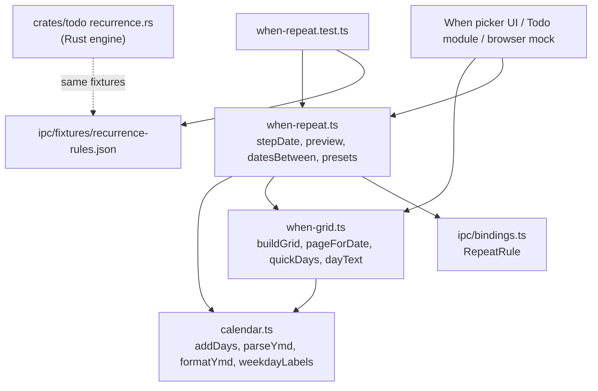
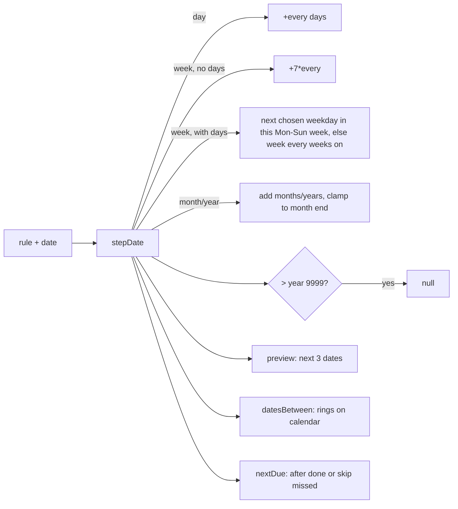

# UI_When_Picker

The When picker is the date-and-repeat chooser used to set a Task's Due date and repeat rule. This module holds its pure logic, with no DOM and no Svelte. There are two files:

- `src/lib/ui/when-grid.ts` is the calendar model: a rolling five-week grid, the quick days, and date labels.
- `src/lib/ui/when-repeat.ts` is the repeat-rule engine: validation, stepping, previews, presets and labels.

Because both files are pure, they are unit-tested directly. `when-repeat.test.ts` also runs the shared recurrence fixtures.

The widgets that render the picker belong to [UI_Widgets_and_Interaction](UI_Widgets_and_Interaction.md). The generic calendar helpers in `./calendar` (`addDays`, `parseYmd`, `formatYmd`, `weekdayLabels`, `WeekStart`) are documented there too. The rule type `RepeatRule` comes from the generated IPC bindings, covered in [IPC_Bridge_and_Core_Mocks](../IPC_Bridge_and_Browser_Mocks/IPC_Bridge_and_Core_Mocks.md).

## Architecture

`when-repeat.ts` imports `weekdayOf` and `monthShort` from `when-grid.ts`, so the dependency runs one way. A date is always a zoneless `YYYY-MM-DD` string. Comparison is lexicographic, and arithmetic goes through UTC `Date` objects to avoid DST problems.

## when-grid.ts: the calendar model

### Rolling grid

`buildGrid(today, weekStart, page)` returns a `GridModel`:

| Field | Meaning |
|---|---|
| `weekdays` | Seven single-letter headings, in the order set by the Week start Preference |
| `cells` | 35 `GridCell`s (`GRID_WEEKS = 5`), each with `date`, `day`, `past`, `today` and `monthLabel` |
| `start` / `end` | First and last day shown |
| `heading` | "October 2026", "Oct – Nov 2026" or "Dec 2026 – Jan 2027" |
| `canGoBack` | False on page 0, because nothing before this week is shown |

- **Page 0** starts at the first day of the current week, so the grid is a rolling window, not a month view. Each ‹ › press moves 35 days. Negative or fractional pages are clamped to `max(0, floor(page))`.
- **Past days** are flagged `past` and are not pickable.
- **Month changes** are shown by `monthLabel`, which is set only on the 1st of a month.
- `pageForDate(date, today, weekStart)` returns the page that contains a date. Today and anything earlier map to page 0.

### Quick days

`quickDays` returns four `QuickDay`s, each with a weekday `hint` such as "Wed":

- `today`
- `tomorrow`
- `weekend`: today if it is Saturday or Sunday, otherwise the coming Saturday.
- `next_week`: the first day of next week, which depends on the Week start Preference.

### Helpers

`daysBetween`, `weekdayOf` (0 is Sunday), `weekdayShort`, `monthShort` and `weekStartOf` are exported. `dayText(date, today)` gives "Fri 23 Oct", and adds the year when it differs from today's year. It is used in chips and sentences.

## when-repeat.ts: the repeat engine

This file is a TypeScript copy of the Rust engine in `crates/todo/src/recurrence.rs`. It exists for the picker and the browser mock. Both implementations are kept in step by the shared `recurrence-rules.json` fixtures. See [Todo_Tasks_and_Lists](../Domain_Modules_(Todo_and_Journal)/Todo_Tasks_and_Lists.md) for the backend side, and [IPC_Todo_Mocks](../IPC_Bridge_and_Browser_Mocks/IPC_Todo_Mocks.md) for the mock that relies on this copy.

### Rule shape

A `RepeatRule` is `{ freq: 'day'|'week'|'month'|'year', every, days, mode }`.

- `every` runs from 1 to 99 (`MAX_EVERY`).
- `mode` is `fixed`, which counts from the Due date, or `after`, which counts from the day the task is done.
- `days` is a weekday bitmask for week rules, with Sunday as bit 0 (`WEEKDAYS_MASK` is Monday to Friday). For month and year rules it is the day of the month.

### Validation and normalisation

- `ruleProblem(rule)` returns the same wording Rust uses, or `null`. Weekdays combined with `after` mode are rejected.
- `settleRule` keeps `days` only where it means something: week rules, and fixed month or year rules.
- `anchoredOn(rule, due)` pins a fixed month or year rule to the day of the month of its Due date.
- `afterAllowed(rule)` is false when specific weekdays are chosen. The UI uses it to hide "from the day it's done".

### Date computation

- `stepDate` returns the date one step after `date`, strictly later, or `null` past year 9999. Month-end overflow is clamped, so a rule on the 31st lands on the 28th, 29th or 30th in shorter months. Weeks run Monday to Sunday here, which only matters for "every N weeks" with chosen weekdays.
- `firstMatch(rule, today)` returns the first day on or after today that the rule lands on. Only weekday rules move it later.
- `nextDue(rule, due, today)` returns where a completed task goes. In `after` mode it steps from today. In `fixed` mode it steps from the Due date and skips any dates that are already past.
- `preview(rule, from, count = 3)` feeds the picker's "Next:" line.
- `datesBetween(rule, from, start, to)` feeds the rings on the calendar. It is capped at 4000 iterations.

### Labels and presets

- `repeatLabel` gives short text such as "Every 3 days after done", "Every weekday" or "Every 2 weeks on Mon, Thu".
- `ordinal(n)` gives "1st", "2nd", "11th" and so on.
- `repeatPresets(date)` returns eight presets worded for the date: every day, every 2/3/4 days, every weekday, "Weekly on Wednesday", "Monthly on the 21st", and "Yearly on 21 Oct".
- `presetKey(rule)` identifies which preset a rule is, ignoring `mode`, or returns `null` for a custom rule. `repeatPresets` and `presetKey` round-trip, and a test enforces that.

## Testing

`src/lib/ui/when-repeat.test.ts` has two parts:

1. **Shared fixtures.** Each case in `recurrence-rules.json` has an `op`: `first_match`, `next_due`, `preview` or `invalid`. Cases are converted to the wire shape with `wire()`: weekdays become a bitmask and `anchor` becomes the day of month. The same file runs against the Rust engine, which is how the two engines are kept honest.
2. **Unit tests** cover settling, anchoring, the year-9999 limit, `afterAllowed`, mask ordering, `datesBetween` windows, labels, ordinals, and preset wording and recognition.

## Usage in the system

The picker UI and the Todo frontend ([Todo_Views_Navigation_and_Interaction](../Todo_Frontend/Todo_Views_Navigation_and_Interaction.md), [Todo_Quick_Capture_and_Editing](../Todo_Frontend/Todo_Quick_Capture_and_Editing.md)) call these functions to render the grid, the quick choices, repeat chips and previews. Authoritative validation and scheduling happen in Rust. The TypeScript copy only mirrors them so the UI and the browser mock behave the same without a round trip.
