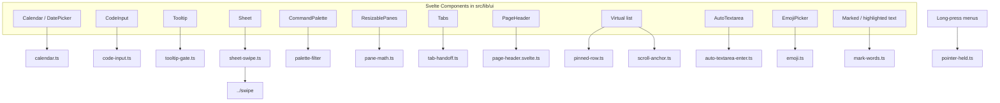
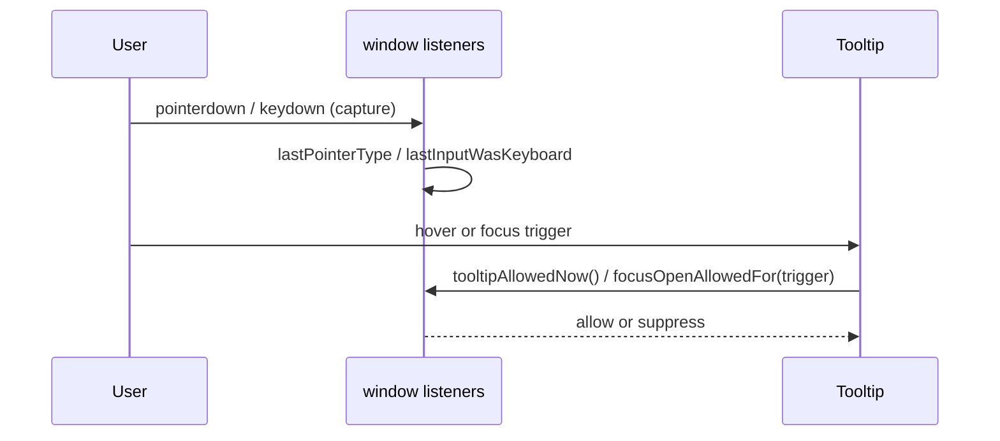

# UI Widgets and Interaction

`UI_Widgets_and_Interaction` is the set of small, framework-light helpers under `src/lib/ui/` that sit behind Mnemora's Svelte UI Components (Calendar, DatePicker, CodeInput, Tooltip, Sheet, CommandPalette, ResizablePanes, PageHeader, virtual lists, AutoTextarea). Almost all of it is **pure logic**: date maths, digit-box editing rules, scroll maths, hit-testing of words. The Svelte Components stay thin and call these functions, so the behaviour can be unit-tested with Vitest without a DOM.

Two files hold module-level state: `pointer-held.ts`, `tooltip-gate.ts` and `tab-handoff.ts` keep small singletons, and `page-header.svelte.ts` holds a Svelte 5 rune store.

Related pages: [Design_System_and_UI_Components](../Design_System_and_UI_Components.md), [UI_When_Picker](UI_When_Picker.md), [Markdown_Editor](Markdown_Editor.md). Gesture helpers imported from `../swipe` are documented in [App_Bootstrap_and_Platform_Utilities](../Frontend_Platform_and_Shell/App_Bootstrap_and_Platform_Utilities.md); the router/shell that consumes `PageHeaderState` is in [Shell_and_Navigation](../Frontend_Platform_and_Shell/Shell_and_Navigation.md).

## Architecture

## Components

### Calendar maths — `calendar.ts`
Dates are zone-less `YYYY-MM-DD` strings; all arithmetic goes through UTC `Date`s so DST never shifts a day.
- `monthGrid(month, weekStart)` returns exactly 42 `GridDay`s (six weeks) so the Calendar never changes height; `inMonth` flags neighbouring-month days.
- `moveFocus(date, key, weekStart)` implements the ARIA grid keys (arrows ±1/±7 days, Home/End to week edges, PageUp/PageDown by month with the day clamped to the month's last day). It returns `null` for other keys.
- `pickRange(range, date)` is the range state machine: first pick sets `from`; second completes (an earlier day swaps ends; the same day gives a one-day range); a third pick starts over. `inRange` is inclusive and treats a half-chosen range as `from` only.
- Helpers: `addDays`, `shiftMonth`, `shiftMonthKeepingDay`, `weekdayLabels`, `formatYmd`, `parseYmd`.

The task-specific "When" grid built on top of this lives in [UI_When_Picker](UI_When_Picker.md).

### Pairing code entry — `code-input.ts`
Pure rules for CodeInput, one box per digit, `CODE_LENGTH = 8` (the sync pairing code; see [Sync_Devices_and_Pairing](../Sync_Frontend/Sync_Devices_and_Pairing.md)).
- `typeInto` — digits land from the box index (never after a gap) and focus moves past them; non-digits are dropped.
- `backspaceAt` — clears the box, or the previous one if empty.
- `pasteInto` — fills from the first box; `null` when the paste has no digits.
- `newlyTyped` — resolves the browser appending/prepending a character into an already filled box.
- `boxes` — the per-box display strings.
Each edit returns a `CodeEdit { value, focus }`.

### Words in text — `mark-words.ts`
- `markPieces(texts, marks)` cuts marked words (e.g. the recognised date/repeat/`#List` words of a task title) out of several text nodes. Only the **last whole-word, case-insensitive** occurrence is marked; overlapping marks are dropped; joining pieces reproduces the text. Used by the quick-capture UI ([Todo_Quick_Capture_and_Editing](../Todo_Frontend/Todo_Quick_Capture_and_Editing.md)) and conflict views.
- `litPieces(text, lit)` tints whole words whose accent-folded, lower-cased form (`foldWord`) is in a set of search-matched words; used by search results ([Journal_Search](../Journal_Frontend/Journal_Search.md), [Todo_Views_Navigation_and_Interaction](../Todo_Frontend/Todo_Views_Navigation_and_Interaction.md)).

### Emoji — `emoji.ts`
`CURATED_EMOJI` (48 area-of-life emoji, eight per row) and `firstEmoji(text)`, which uses `Intl.Segmenter` (falling back to code points) to extract the first whole grapheme (skin tones, ZWJ sequences, flags) matching `Extended_Pictographic`/`Regional_Indicator`. Used for list emoji.

### Text input — `auto-textarea-enter.ts`
`enterBreaksLine({shiftKey, multiline, enterBreaks})`: Enter inserts a line break if `enterBreaks` is set (AI composer on a phone, where a round button sends) or if the field is `multiline` and Shift is held.

### Layout and scrolling
- `pane-math.ts`: ResizablePanes works in px but paneforge in percent. `paneLimits` converts px bounds to percent; `draggedWidth` returns the user's dragged width, or `null` when the reported size is within `ECHO_TOLERANCE_PX` (1.5 px) of the width we asked for (our own echo). Used with [Shell sidebar layout](../Frontend_Platform_and_Shell/Shell_and_Navigation.md).
- `pinned-row.ts`: `pinnedRow(rows, scrollTop, isSticky, height)` chooses which sticky row (e.g. a Journal Page header) is pinned and the negative `offset` by which the next sticky row pushes it up.
- `scroll-anchor.ts`: `anchoredScrollTop(anchor, keys, startOf)` keeps the row being read in place when rows are added above it; `null` when the row is gone or did not move.
- `page-header.svelte.ts`: `PageHeaderState` (singleton `pageHeader`) holds the current header entry (`title`, `icon`, `hue`, `actions`, `heading`), the pinned `phoneBar` snippet and the build `env`. `set(entry)` and `setPhoneBar(bar)` return release functions that only clear if the caller is still the owner, so a newer page is never wiped by an older page's teardown.

### Touch and pointer behaviour
- `sheet-swipe.ts`: `sheetSwipe(panel, onclose, reduceMotion)` attaches touch listeners so a bottom sheet follows the finger (transform only) and closes on a long pull or flick via `sheetShouldClose`. A pull starts in the top 32 px grip, or anywhere when scrolled to top and not on inputs/`.cm-editor`/`[data-no-sheet-swipe]`. Touch (not pointer) events are used so `preventDefault` can stop page scroll. Returns a cleanup.
- `pointer-held.ts`: global capture-phase counter of pressed pointers. `afterRelease(fn, beatMs=120)` runs `fn` after all pointers lift (so a long-press-opened menu ignores the still-resting finger); returns a cancel.
- `tooltip-gate.ts`: `trackPointerType` records the last input kind. `tooltipAllowedNow` blocks tooltips after touch/pen; `focusOpenAllowedFor(trigger)` allows focus-opened tooltips only for `:focus-visible` after a key press; `shownShortcut` hides shortcut hints on phones.
- `tab-handoff.ts`: when each tab is a route, Tabs remounts and loses focus. `noteTabChange` increments a pending counter (valid for `HANDOFF_MS` = 1500 ms); each new mount calls `claimTabFocus` once to take focus. Counting supports fast arrow-key presses that outrun routing.

### Command palette filtering
`palette-filter.test.ts` specifies `visibleItems(items, typed)`: with empty input show plain items and no query items; otherwise keep plain items whose label contains every typed word (any case) and append `queryLabel(q)` items using the trimmed text.

## Data flow example: tooltip decision

## Testing
Co-located Vitest files (`mark-words.test.ts`, `pinned-row.test.ts`, `palette-filter.test.ts`) exercise the pure functions directly, e.g. "joining pieces gives the text back" and "the next Page header pushes the pinned one up". Design rules (tokens, `bits-ui` only imported inside `src/lib/ui`) are in `docs/design/ui-system.md`.
