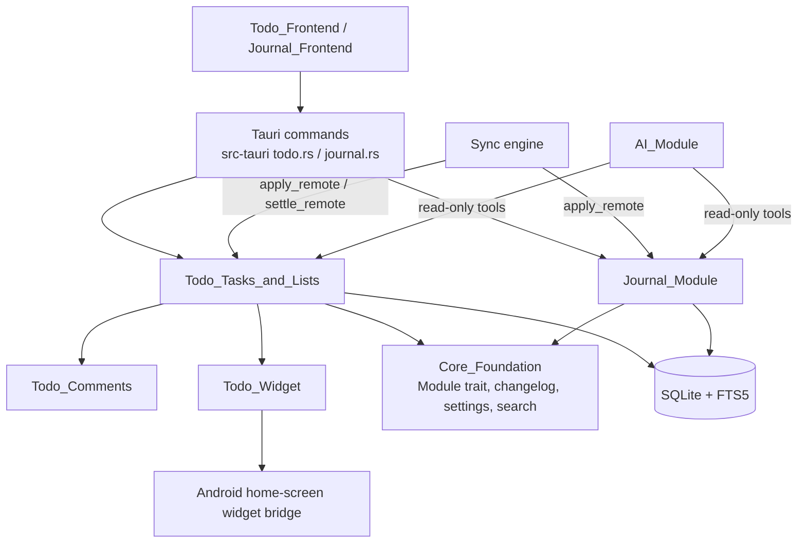
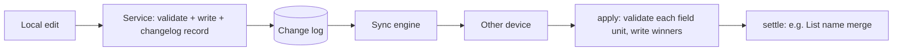

# Domain_Modules_(Todo_and_Journal)

## Purpose

This module group holds the two domain backends of Mnemora. They are the `mnemora-todo` crate (`crates/todo`) and the `mnemora-journal` crate (`crates/journal`). Each crate owns the rules, SQLite storage, full-text search, sync merge rules and read-only AI tools for its own records. The Tauri app crate only exposes them as commands.

| Crate | Records | Role |
|---|---|---|
| `mnemora-todo` | Tasks, Lists, Comments | A natural-language capture parser, date views, repeats, History, and a Home-Screen widget snapshot builder |
| `mnemora-journal` | Pages (one per date) and Entries (Markdown) | Diary storage, typo-tolerant search, and checklist toggling |

Both crates share the same design:
- Each implements the `Module` trait from `mnemora-core`.
- Each uses `#![forbid(unsafe_code)]`.
- Each uses append-only migrations, soft deletes (so Undo works) and FTS5 indexes.
- Each declares per-field merge rules for the [Sync_Replication_Engine](Sync_Replication_Engine.md).
- Each exposes three read-only AI tools.
- Neither logs user text.

## Architecture

Each crate is layered the same way:
1. Types and validation.
2. SQL-only repositories.
3. Services that combine rules, SQL and a change-log record in one transaction.
4. Read models: search, History, AI tools.
5. A sync adapter.

## Sub-modules

- **[Todo_Tasks_and_Lists](Domain_Modules_(Todo_and_Journal)/Todo_Tasks_and_Lists.md)** is the core of `mnemora-todo`.
  - Task lifecycle: open, done, won't do, deleted, and repeating Tasks.
  - The Lists model and the natural-language parser.
  - Schedule views, History, search and AI tools.
  - The sync contract, including deterministic List-name merging.
- **[Todo_Comments](Domain_Modules_(Todo_and_Journal)/Todo_Comments.md)** covers `comment_repo.rs` and `comment_sync.rs`. It holds Comment SQL, the sync rules for Comments, the orphan guard, and hidden insertion of new remote Comments.
- **[Todo_Widget](Domain_Modules_(Todo_and_Journal)/Todo_Widget.md)** covers `widget.rs` and `widget_text.rs`. It builds display-ready `WidgetSnapshot` data for the Android widget, and ports the frontend wording rules to Rust. A shared fixture keeps the Rust and TypeScript versions in step.
- **[Journal_Module](Domain_Modules_(Todo_and_Journal)/Journal_Module.md)** is the whole `mnemora-journal` crate. It covers Entries and Pages, the append-only migrations and the FTS5 index. It also covers exact and "similar" search, field-level sync merge with an atomic `written` group, and the `journal_list`, `journal_read` and `journal_search` tools.

## Related documentation

- [Core_Foundation](Core_Foundation.md): the `Module` trait, change log, settings and search primitives.
- [Sync_Replication_Engine](Sync_Replication_Engine.md): replication.
- [AI_Assistant_Backend](AI_Assistant_Backend.md): consumer of the read-only tools.
- [Todo_Frontend](Todo_Frontend.md) and [Journal_Frontend](Journal_Frontend.md): the UI.
- [Tauri_Host_and_Command_Layer](Tauri_Host_and_Command_Layer.md): the command layer.
- [Android_and_Home-Screen_Widget_Platform](Android_and_Home-Screen_Widget_Platform.md): the widget host.