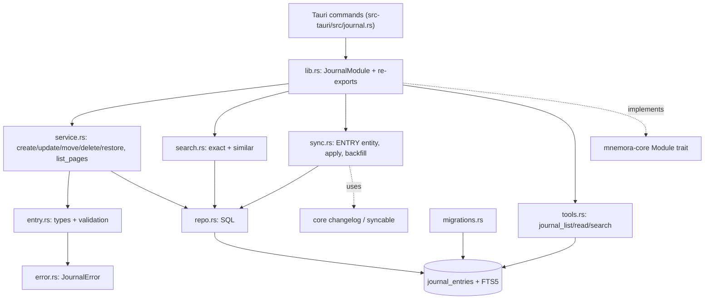
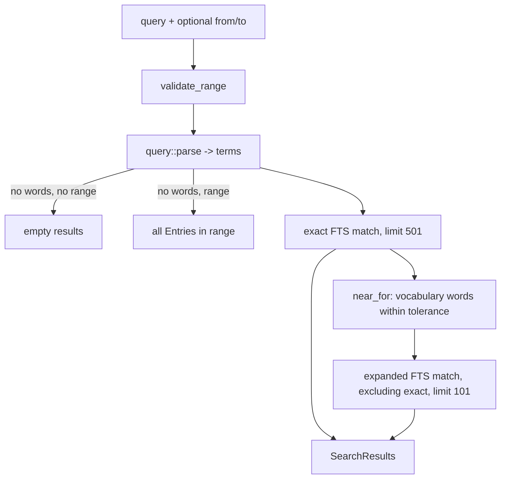
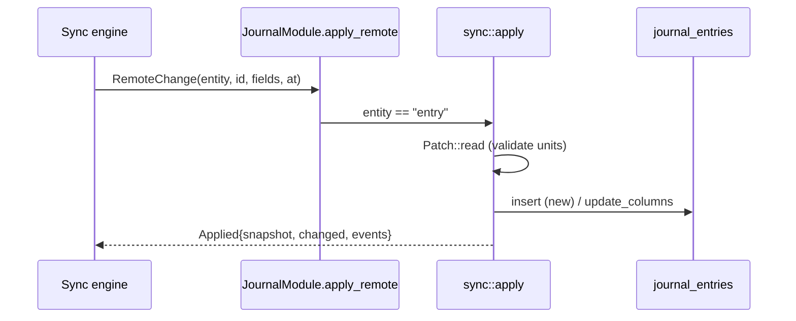

# Journal Module

The Journal Module (`crates/journal`, crate `mnemora-journal`) is the backend for the diary feature. A **Page** is one calendar date. An **Entry** is one untitled piece of Markdown writing on a Page. The crate owns the rules, SQLite storage, full-text search, sync merge rules and read-only AI tools for Entries. The Tauri app crate only exposes these as commands; see [Journal_Domain_Service](../Tauri_Host_and_Command_Layer/Journal_Domain_Service.md). The UI side is in [Journal_Frontend](../Journal_Frontend.md).

The crate is `#![forbid(unsafe_code)]`. It depends on `mnemora-core`, `rusqlite`, `rusqlite_migration`, `serde`, `serde_json`, `thiserror`, `tracing` and `specta` (`crates/journal/Cargo.toml`).

Only some source files were provided for this page: `entry.rs`, `error.rs`, `lib.rs`, `migrations.rs`, `repo.rs`, `search.rs`, `sync.rs` and `tools.rs`. `lib.rs` also declares `service.rs`, `snippet.rs`, `today.rs` and `upgrade.rs`. This page describes those four only through how the provided code uses them.

## Architecture

The layering is deliberate. `entry.rs` holds types and validation, `repo.rs` holds SQL with no rules ("No rules here"), and `service.rs` combines the two.

## Module registration (`lib.rs`)

`JournalModule` implements the `Module` trait from `mnemora-core` (see [Core_Foundation](../Core_Foundation.md)). `MODULE_ID` is `"journal"`. It is the migration namespace and the change-log module name.

| Hook | What Journal does |
|---|---|
| `migrations` | Returns `migrations::all()`. |
| `register_settings` | Registers `font` (`serif` or `sans`, default `serif`), `width` (`narrow`, `default` or `wide`, default `default`) and `page_summary` (boolean, default `true`). |
| `sync_entities` | Returns `sync::ENTITIES`. |
| `holdings` | Counts live Entries (`deleted_at IS NULL`). |
| `backfill_log` | Calls `sync::backfill`. |
| `tools` | Returns `tools::all()`. |
| `apply_remote` | Routes the Entry entity to `sync::apply`. Any other entity is a validation error. |
| `on_startup` | Calls `upgrade::keep_existing_phone_tabs(device, report)`. |

The public API re-exports `Entry`, `NewEntry`, `Page`, `PageDirection`, `JournalError`, `Span`, `Hit`, `SearchResults` and `search`. It also re-exports the service functions `create_entry`, `delete_entry`, `list_pages`, `month_days`, `move_entry`, `restore_entry`, `toggle_task_line` and `update_entry`, plus `today`, `TodaySummary` and `TodayLatest`.

## Data model and rules (`entry.rs`)

An `Entry` has the following fields:

- `id`: a UUIDv7.
- `page_date`: `YYYY-MM-DD`.
- `body`: Markdown text.
- `written_at`, `written_offset_min`, `written_tz`: the moment and place of writing. They never change after creation.
- `edited_at`: set only on a meaningful edit.
- `word_count`, `created_at`, `updated_at`.

Millisecond instants are `i64` in Rust. They are typed `u32` for specta so the generated TypeScript sees a plain `number`.

Other types:
- **`NewEntry`** is the UI input: page date, text, writer's zone and offset, and the composer `session_id`. The session id groups autosaves in the change log.
- **`Page`** is one date with its entry count, word count and Entries, oldest first.
- **`PageDirection`** is `Older`, `From` or `Newer` relative to a cursor date. Results are always newest first.

Validation functions:
- `validate_text` rejects blank text.
- `validate_page_date` accepts only real calendar dates. It checks leap years and month lengths by hand.
- `validate_written_zone` checks that the zone name is non-empty and at most 64 characters, and that the offset is within ±14h.
- `toggle_task(body, line)` flips `[ ]` or `[x]` on one 0-based line and leaves every other byte alone. It accepts the same task syntax the Markdown parser does: optional quote and indent, a bullet or `1.` / `1)`, then the box. Anything else is a validation error.

## Errors (`error.rs`)

`JournalError` has three variants. They map to the IPC `AppError` as follows:

| Variant | `ErrorCode` |
|---|---|
| `Validation(&'static str)` (message shown to the user) | `Validation` |
| `EntryNotFound` | `NotFound` |
| `Snapshot(serde_json::Error)` | `Internal` (source kept in `details`) |

## Storage (`migrations.rs`, `repo.rs`)

Migrations are append-only:
1. Creates the `journal_entries` table (STRICT) and a partial index on `(page_date, written_at)` for live rows. Deletion is soft, through `deleted_at`.
2. Creates the `journal_fts` FTS5 table. It uses external content, `unicode61 remove_diacritics 2`, and prefix indexes of 2 and 3 characters. It also creates an `fts5vocab` table and insert, delete and update triggers, then runs a rebuild so older Entries are indexed. Deleted Entries stay indexed so Undo works. Queries filter on `deleted_at`.

The FTS index is keyed on the implicit `rowid`. A `VACUUM` may renumber it, so never `VACUUM` without rebuilding `journal_fts`.

`repo.rs` provides:
- Basic access: `insert`, `get` (live only), `get_any` (with `deleted_at`), `every`, `get_deleted`.
- Updates: `update_columns` (column names come from code, never from input), `update_body`, `update_page_date`, `set_deleted_at`.
- Reads: `dates_between`, `day_summary` (count plus the latest Entry), `vocabulary`.
- `pages(conn, Window, limit)`. `Window` is `Newest`, `Before`, `AtOrBefore` or `After`. It first picks the dates, then loads their Entries in one range query and groups them. Order is newest date first and oldest Entry first within a date. The `After` window picks the nearest dates ascending and then reverses them.
- `search`, which builds the SQL dynamically. `matching` adds `rowid IN (FTS MATCH ?1)`. `excluding` adds `rowid NOT IN (FTS MATCH ?2)`. It also applies the date range and a limit.

## Search (`search.rs`)

- **Exact results** come first and are capped at 500. Every word is required and matches by prefix. Quoted text is a phrase.
- **Similar results** allow typos. They are capped at 100 and never repeat an exact hit. The vocabulary is read only for words whose length is within 2 characters of a query word, since 2 is the widest typo tolerance.
- The result sets `truncated` or `similar_truncated` when a cap is hit. The code fetches one extra row to detect this.
- Each `Hit` carries a `snippet: Vec` built by `snippet.rs` with a `Matcher`. Query text never reaches a log line.
- A range with no words lists every Entry in that range.

Query parsing, tolerance and matching live in `mnemora_core::search` ([Core_Foundation](../Core_Foundation.md)). The Todo module has its own equivalent, see [Todo_Tasks_and_Lists](Todo_Tasks_and_Lists.md).

## Sync (`sync.rs`)

The Journal declares one sync entity, the Entry, according to ADR 0017. Merge strategy by field:

| Field(s) | Kind |
|---|---|
| `body` | Text (newest wins for now; the engine decides) |
| `page_date`, `created_at`, `deleted_at` | Independent values |
| `written_at`, `written_offset_min`, `written_tz` | Atomic group `written` |
| `edited_at`, `word_count`, `updated_at` | Derived; never sent and recomputed on receipt |

Moving an Entry on one device and editing it on another both stand. The `written` group travels whole, so a creation always arrives complete.

**`apply`** writes the winning fields received from another device:
1. `Patch::read` validates each unit separately. A bad unit (a blank body, an impossible date or zone) is dropped whole and the good ones still apply.
2. If the Entry is unknown here, it can only be created from a record carrying body, page date, written group and `created_at`. Otherwise the record is kept for relay only, with `changed: false`.
3. `write` updates the columns and recomputes `word_count` and `edited_at` when the body actually changed.
4. `edited_by` sets the edited time to the time of the origin's change. It leaves the value alone for a checklist tick, or for a change within `EDIT_GRACE_MS` of writing (a typo fix). Devices that took the same text therefore show the same edited time.
5. `changed` is computed by comparing snapshots without `updated_at`. `updated_at` is set to this device's time only if something changed.
6. If a live Entry became deleted, the result carries `SyncEvent::EntryDeleted`, so an open editor can react.

**`backfill`** logs every Entry that has no change-log state yet, deleted ones included. It uses an `Unlogged` change stamped with the row's `updated_at` and calls `changelog::backfill`.

See [Sync_Replication_Engine](../Sync_Replication_Engine.md) for the engine, and [Journal_Frontend](../Journal_Frontend.md) for how editors handle remote deletes. Entry text must never reach a log line.

## AI tools (`tools.rs`)

`tools::all()` offers three read-only tools to the AI assistant (ADR 0002 amendment, ADR 0018). They never write, skip deleted Entries, and return refusals as data via `Output::error`. See [AI_Module](../AI_Assistant_Backend/AI_Module.md).

| Tool | Behaviour |
|---|---|
| `journal_list` | Lists Entries by Page date, newest first. Params: `from`, `to`, `offset`, `limit` (default 30, max 100). Rows hold id, date, written time, word count and a 120-character preview. Output is trimmed by `fit_rows`, with `next_offset` for continuation. |
| `journal_read` | Reads one Entry in 8 KiB pages of body text. `offset` is a byte offset and is advanced to a UTF-8 boundary. It returns `next_offset` if more remains. |
| `journal_search` | Calls the app's own `search`. Exact hits come first, then similar ones, tagged `match`. It uses snippets of up to 200 characters, a default limit of 10 and a max of 25. |

Each tool returns `Item`s (id, module, title, date) so the AI can cite what it read.

## Related pages

- [Domain_Modules_(Todo_and_Journal)](../Domain_Modules_(Todo_and_Journal).md): parent overview.
- [Journal_Domain_Service](../Tauri_Host_and_Command_Layer/Journal_Domain_Service.md): command layer.
- [Journal_Frontend](../Journal_Frontend.md): UI.
- [Core_Foundation](../Core_Foundation.md): `Module`, change log, settings, search primitives.
- [Sync_Replication_Engine](../Sync_Replication_Engine.md): replication.
