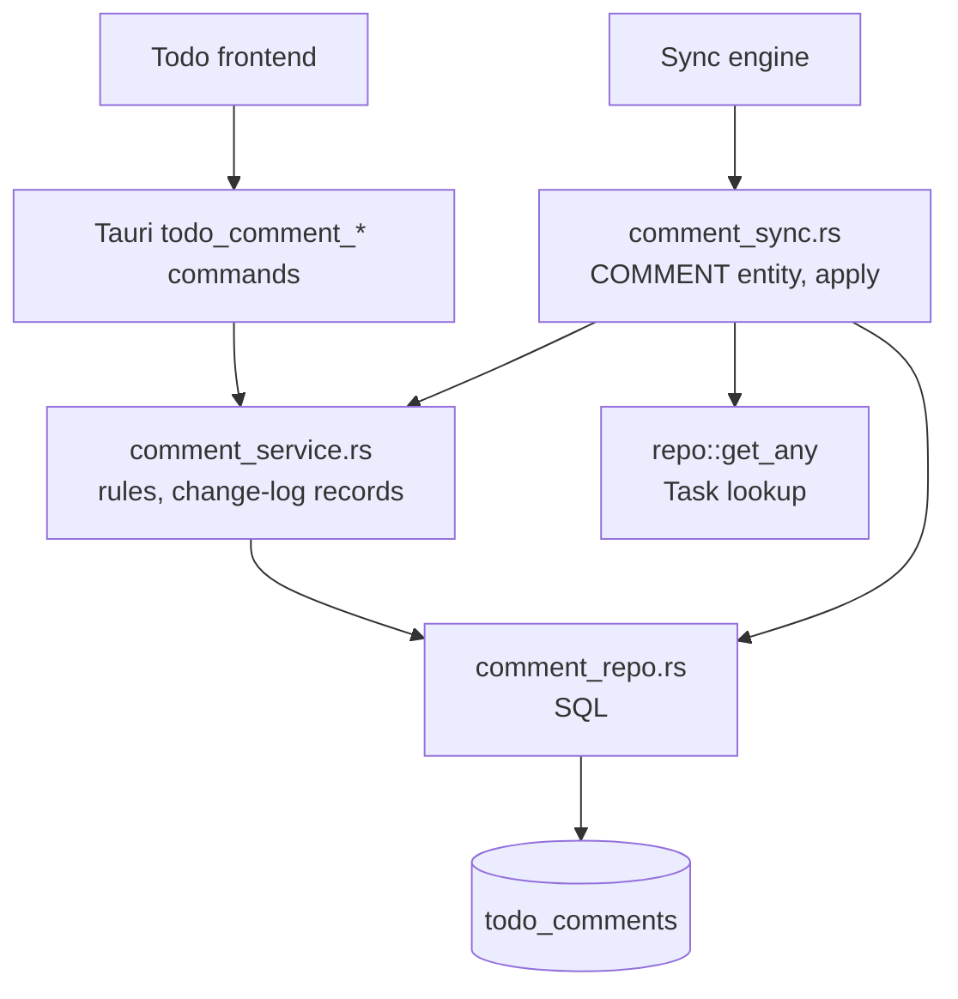
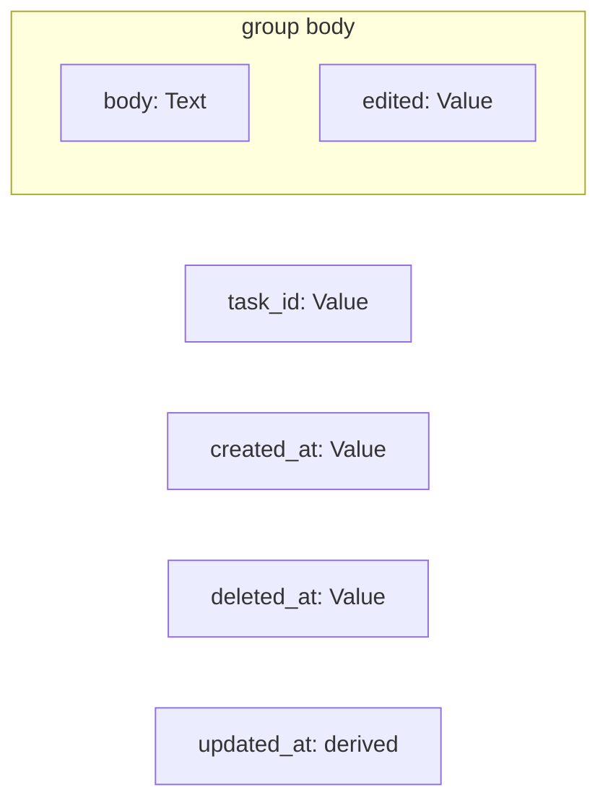
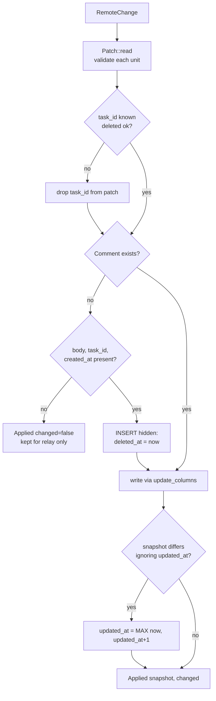

# Todo_Comments

Todo_Comments is the part of the `todo` crate that stores and synchronises **Comments**: short notes (up to 5,000 characters, line breaks allowed) attached to a Task. It has two files:

| File | Role |
|---|---|
| `crates/todo/src/comment_repo.rs` | Pure SQL over the `todo_comments` table. It holds no rules. |
| `crates/todo/src/comment_sync.rs` | Todo's side of the sync contract for Comments (ADR 0017). It declares the merge rules and applies the winning field values received from other devices. |

The rules (validation, change-log records, undo) live in `comment_service.rs`, which exposes `comments`, `add_comment`, `edit_comment`, `delete_comment` and `restore_comment`. That file is not one of this module's core components. The Tauri commands that call it (`todo_comment_add`, `todo_comment_edit`, `todo_comment_delete`, `todo_comment_restore`, `todo_comments`) are in [Todo_Domain_Service](../Tauri_Host_and_Command_Layer/Todo_Domain_Service.md). For the parent task and list logic see [Todo_Tasks_and_Lists](Todo_Tasks_and_Lists.md). For the engine that calls `apply` see [Sync_Replication_Engine](../Sync_Replication_Engine.md).

## Architecture

## Data model

`COLUMNS = id, task_id, body, edited, created_at, updated_at`. `deleted_at` is a separate column read only by `get_any` and `every`.

- **Soft delete**: a deleted Comment has a non-null `deleted_at`. This supports Undo and sync.
- **`edited`** is its own flag. Only `update_body` sets it. Deleting and restoring never make a Comment look edited.
- The Comment count on a Task is never stored. It is recomputed.

## comment_repo.rs

| Function | Behaviour |
|---|---|
| `insert` | Inserts a full `Comment` row. |
| `get` | Returns a live Comment only (`deleted_at IS NULL`). |
| `get_any` | Returns `(Comment, Option<deleted_at>)` whether or not the Comment is deleted. |
| `every` | Returns every Comment with its `deleted_at`, ordered by id. Used for snapshots and backfill. |
| `for_task` | A Task's live Comments, oldest first (`created_at, id`). |
| `update_body` | Sets `body`, forces `edited = 1`, and stamps `updated_at`. |
| `set_deleted` | Sets or clears `deleted_at` and stamps `updated_at`, so a sync sees the newer state. |
| `update_columns` | Writes arbitrary named columns of a Comment, deleted or not. Used to apply remote values. Column names come from the caller's constants, never from user input. An empty set does nothing. |

## comment_sync.rs

### Merge rules (`COMMENT: SyncEntity`)

- `body` is Text. Newest wins for now, and a three-way merge is planned (see the conflict tests in [Sync_Conflicts_and_Activity](../Tauri_Host_and_Command_Layer/Sync_Conflicts_and_Activity.md)). `edited` is in the same group, so the "edited" flag always comes from the same device as the text.
- `task_id`, `created_at` and `deleted_at` are plain Values.
- `updated_at` is derived and recomputed locally.

### `apply` flow

Key behaviours:

1. **Validation**: `Patch::read` accepts a body only if `validate_body` passes. The body is applied only together with a boolean `edited`. Invalid units are skipped rather than failing the batch.
2. **Orphan guard**: if the referenced Task has never been heard of (`repo::get_any` returns none), `task_id` is dropped. A deleted Task is fine. A Comment stays on its Task in every state, and returns with the Task when it is restored.
3. **Creation**: a new Comment needs `body`, `edited`, `task_id` and `created_at`, all of which the first record carries. Otherwise the record is kept for relay only and nothing is applied. The row is inserted hidden, with `deleted_at` set to now, until the winning `deleted_at` is written. This stops a half-applied Comment from flashing into view.
4. **Change detection**: the before and after snapshots (`snapshot_of`, with `strip_updated`) are compared without `updated_at`. Only a real change moves `updated_at`, to `MAX(now, updated_at + 1)`, so it only moves forward.
5. **Events**: `apply` returns no events. Refreshing the UI is handled by the Todo-level apply in `sync.rs`.

### Privacy

Comment text must never reach a log line. The only log is a `debug` line on the `sync` target that carries the Comment id and no text.

## Integration points

- `crate::sync::{Set, number, strip_updated}` are the shared helpers for the Todo sync glue.
- `core::syncable` supplies `SyncEntity`, `SyncField`, `RemoteChange` and `Applied`. See [Core_Foundation](../Core_Foundation.md).
- The sync scenarios `comments_sync_edits_deletes_and_the_count_is_recomputed` and `a_comment_added_to_a_task_deleted_elsewhere_stays_attached_and_returns_with_it` are in the [Sync_Replication_Engine](../Sync_Replication_Engine.md) tests. The user-facing behaviour tests are in [todo_sheet_tests](../Backend_Integration_Test_Suites/todo_sheet_tests.md).
