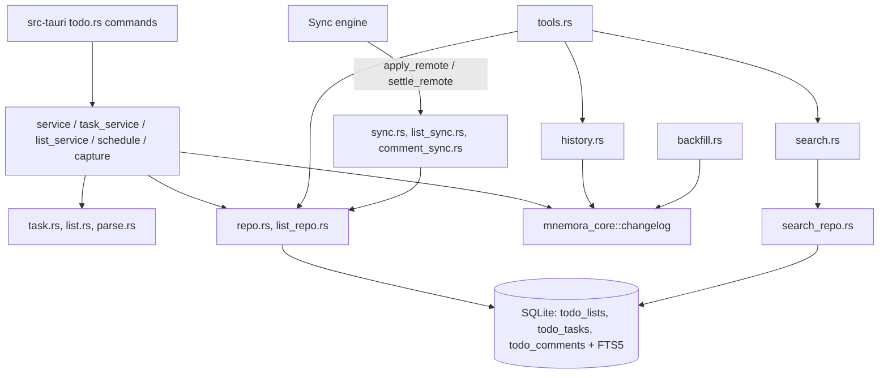
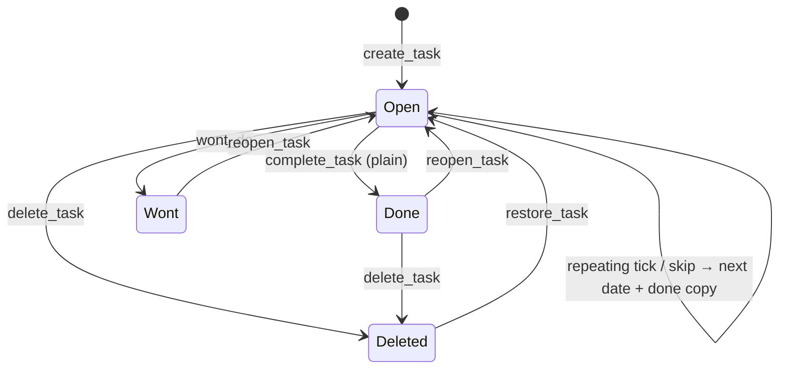
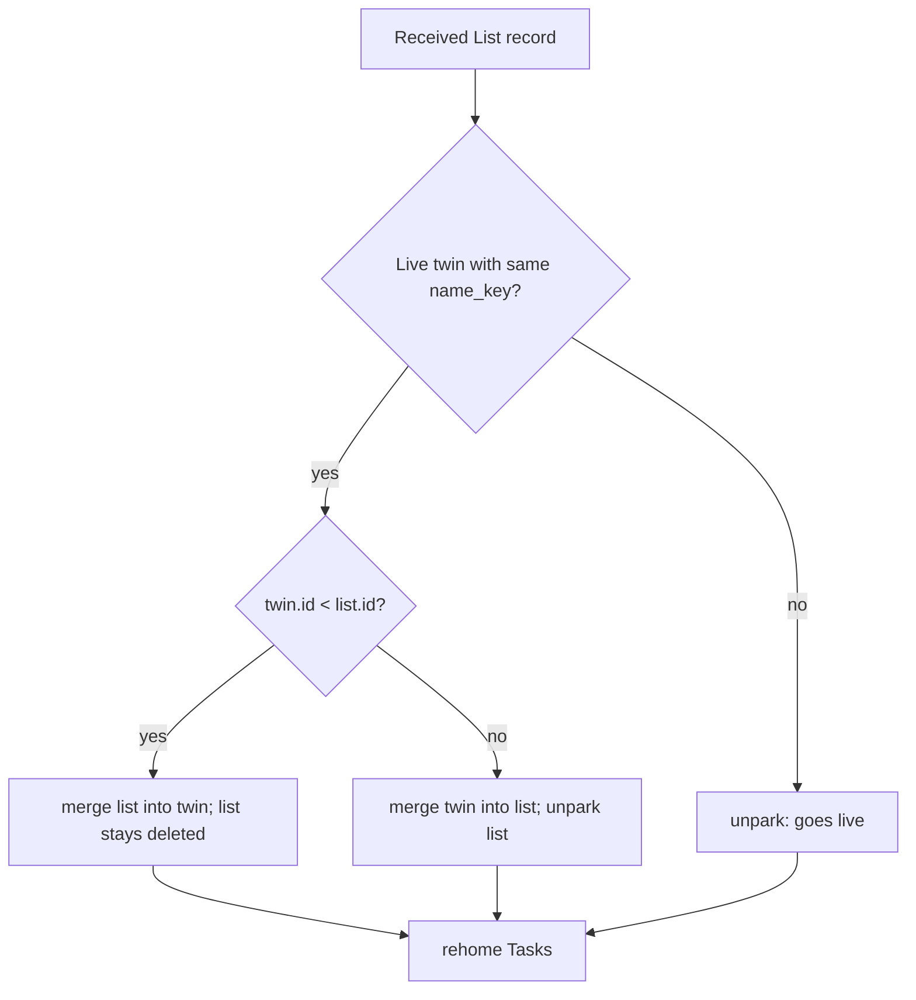

# Todo Tasks and Lists

The `mnemora-todo` crate (`crates/todo`) holds the rules and storage for **Tasks** and **Lists**. It also holds the capture parser, the date views, History, search, AI tools and the sync contract for these records. The Tauri app crate only exposes it as commands; see [Todo_Domain_Service](../Tauri_Host_and_Command_Layer/Todo_Domain_Service.md).

This page covers the core of the crate. Two parts have their own pages:

- [Todo_Comments](Todo_Comments.md): `comment_repo.rs` and `comment_sync.rs`.
- [Todo_Widget](Todo_Widget.md): `widget.rs` and `widget_text.rs`.

Related pages:

- [Core_Foundation](../Core_Foundation.md): change log, `Module` trait, settings, text folding, ordering keys.
- [Sync_Replication_Engine](../Sync_Replication_Engine.md): the engine that applies the merge rules declared here.
- [Todo_Frontend](../Todo_Frontend.md): the UI over these commands.
- [AI_Assistant_Backend](../AI_Assistant_Backend.md): the consumer of the read-only tools.
- [Journal_Module](Journal_Module.md): the sibling domain crate, built on the same `Module` trait.

## Architecture

`TodoModule` (`lib.rs`) implements `mnemora_core::module::Module`. Its `MODULE_ID` is `"todo"`, and it also serves as the migration namespace and the change-log module name. Code is split into layers:

- Pure rules and types: `task.rs`, `list.rs`, `parse.rs`.
- SQL only: `repo.rs`, `list_repo.rs`, `search_repo.rs`. The comment repo is in [Todo_Comments](Todo_Comments.md).
- Operations that combine rules, SQL and a change-log record in one transaction: `service.rs` and the sibling services re-exported from `lib.rs`. These are `task_service`, `list_service`, `schedule.rs`, `repeat`, `reorder`, `quick_add` and `capture.rs`.
- Read models: `history.rs`, `search.rs`, `tools.rs`.
- Sync: `sync.rs` (Tasks), `list_sync.rs` (Lists), `backfill.rs`.

## Module contract (`TodoModule`)

| `Module` method | What Todo does |
|---|---|
| `migrations` | `migrations::all()` (see below). |
| `register_settings` | Registers `parse_dates` (boolean, default true). Also registers the grouping, sort and done-in-lists preferences from `arrange`; the first allowed value of each is its default. |
| `sync_entities` | `sync::ENTITIES`: Task, List and Comment. |
| `tools` | `tools::all()`: three AI tools. |
| `holdings` | Counts live Tasks and lists live List names, for the merge preview shown when pairing. |
| `backfill_log` | `backfill::run`. |
| `apply_remote` | Dispatches by entity to `sync::apply`, `list_sync::apply` or `comment_sync::apply`. Any other entity is a validation error. |
| `settle_remote` | `sync::settle` or `list_sync::settle`. Comments settle to the default. |
| `on_startup` | `upgrade::append_todo_tab`. |

## Data model and storage

`migrations.rs` is append-only. It creates the full shape in the first migrations, then adds FTS indexes, a key-trimming fix, a search vocabulary and a Comment `edited` flag.

- `todo_lists`: `name_key` is the name folded for case and accents. A unique partial index on `name_key` where `deleted_at IS NULL` makes live names unique. `task_sort` defaults to `manual`, and `group_by` NULL means none.
- `todo_tasks`: `list_id` NULL is the Inbox. Dates are `YYYY-MM-DD` and times `HH:MM`, both floating local. `repeat_*` columns hold the Repeat. `state` is `open`, `done` or `wont`, with `closed_at` set exactly when the state is not open. `repeat_of` points an occurrence copy at its Task. `understood` is parser JSON. `sort_key` is a fractional-index key.
- Deletes are soft (`deleted_at`), which is what makes Undo possible.
- `todo_tasks_fts` and `todo_comments_fts` are external-content FTS5 tables kept in step by triggers. The `*_fts_vocab` tables feed typo tolerance. The code comments warn never to `VACUUM` without rebuilding both indexes, because the indexes are keyed on implicit rowids.
- Sort keys never end in `0`, and `TRIM_KEY_ZEROS` repaired older data. Keys are never reused: `last_sort_key`, `key_before` and `key_following` include deleted rows.

## Types and validation

`task.rs` defines `Task`, `TaskState`, `NewTaskDetails`, `InboxView` and the validators:

| Validator | Rule |
|---|---|
| `validate_title` | Trimmed, one line, 1–500 characters. |
| `validate_priority` | 1–4; 4 means none. |
| `validate_notes` | At most 100,000 characters. |
| `validate_understood` | A JSON array of at most 4,000 characters. |

`list.rs` defines `TodoList`, `ListEntry`, `SidebarView`, `ListView`, `AllView`, `ListDone` and `ListDeletion`. `DeleteChoice` says what happens to a deleted List's Tasks: `DeleteTasks`, `MoveToInbox` or `MoveToList`. Validators:

- `validate_list_name`: at most 60 characters, one line.
- `validate_emoji`: at most 16 characters, no letters or spaces.
- `name_key`: `mnemora_core::text::fold`.

`TodoError` (`error.rs`) has `Validation`, `NameTaken`, `TaskNotFound`, `ListNotFound`, `CommentNotFound` and `Snapshot`. It converts into `AppError` with `Validation`, `NotFound` or `Internal` codes. `NameTaken` shows the user's text but is never logged, following the "no user text in logs" rule (ADR 0008). Every file in the crate repeats this rule for Task, List and Comment text.

## Core operations

Each operation runs in one transaction. It writes the row and a change-log record via `record`, `record_at`, `record_session` or `record_skip`.

- `create_task`: validates, resolves the When through `settle_when`, places the Task last with `key_after`, and logs a `Create`.
- `complete_task`: a plain Task becomes `Done` with `closed_at`. A repeating Task is not closed. `repeat::complete` records a done occurrence copy and moves the Task to its next date.
- `reopen_task`: reopens a closed Task. For the latest occurrence of a repeating Task it rewinds the parent instead.
- `move_task`: moves a Task between Lists or to the Inbox. It does nothing and logs nothing if the List is unchanged.
- `inbox`: groups the open List-less Tasks per preference, then adds a "No date, in a List" group.
- `schedule.rs`:
  - `set_when`, `restore_when` (Undo), `move_overdue`.
  - `today`, `upcoming`, `counts` and `day_counts` build the date views.
  - `assign_when` enforces "no date means no Repeat". A month or year Repeat is anchored on its date.
- `capture.rs`: `parse_text` matches `#Name` against live Lists. `quick_edit` saves title, List, When, Repeat and Priority in one update.
  - It refuses a past date, but an Overdue Task may keep its own date.
  - With `restoring` (Undo) it puts old values back, past dates included.
  - If nothing changed, it records nothing.

The history of a change is stored as `ChangeOp` values: `Create`, `Update`, `Tick`, `Move`, `Delete`. A Skip is a `Tick` whose snapshot carries `skipped: true`.

### Task lifecycle

## Natural-language parser (`parse.rs`)

`parse(&ParseRequest, &[ListRef]) -> Parsed` is pure. The caller supplies today, now and the week start. It reads dates, times, Repeats, `#List` and `p1`–`p4`.

1. Tokenise. Text in quotes or backticks is masked, and numeric dates and bare numbers are never read.
2. Collect every candidate of every kind: `repeat`, `date`, `time`, `prio`, `list`.
3. Drop candidates inside `frozen` ranges (Quick edit's old title) and split off `ignored` keys.
4. Pick one winner per kind: the user's `prefer` pick, else the last. Losers become `alternatives` with reason `conflict`.
5. A time alone means today if still ahead, else tomorrow. With a Repeat, the Repeat's first day is used instead.

Offsets are UTF-16 code units, because the text lives in a JavaScript string. The browser mock has a TypeScript copy; both run `src/lib/ipc/fixtures/parse-cases.json`. See [IPC_Todo_Mocks](../IPC_Bridge_and_Browser_Mocks/IPC_Todo_Mocks.md).

## History (`history.rs`)

`task_history` builds readable lines (for example "Due date Thu 22 Oct → Fri 23 Oct") from the change log. History is a function of the records alone, so every device shows the same lines.

- `advance` replays each record's `fields`, never its snapshot. A received record's snapshot is this device's merged state and may differ between devices. Own records are completed as they are sent.
- `state_lines`, `schedule_lines` and `edit_lines` emit lines for delete or restore and state, List, date, time and Repeat, and Priority and text.
- A tick that changes the Due date on a repeating Task reads as "Done (occurrence of …)", "Reopened (occurrence of …)", or "Skipped (Thu → Sat)" when the record is marked skipped.
- Title and notes edits are compared with a `Baseline` from before the editing session. One opening of the sheet therefore gives one "Title edited" and one "Notes edited" line.
- Lines name dates, Lists and Priorities, never the Task's own text.

## Search (`search.rs`, `search_repo.rs`)

Search uses the shared matcher from `mnemora_core::search`: word prefixes, case and accent folding, and quoted phrases. It reads Task titles, notes and live Comments.

- `search_repo::search` runs an FTS5 expression over both indexes. Open Tasks come first in manual order, then closed ones, latest closed first.
- `search` returns up to 500 exact hits and up to 100 "similar" hits that tolerate typos. Similar hits come from a second expanded query that excludes the exact one, using `vocabulary()` from the fts5vocab tables.
- Each `TaskHit` carries highlighted title spans and a snippet from the notes or a Comment.
- Known v1 limit: all words must match in the title and notes together, or all in one Comment.

## AI tools (`tools.rs`)

Three read-only tools, `todo_list`, `todo_read` and `todo_search`, are registered through `Module::tools`. They never write, skip deleted rows, and return refusals as data. See [AI_Module](../AI_Assistant_Backend/AI_Module.md) for how the assistant uses them.

- `todo_list` filters by state, List (`ListPick`: any, Inbox or one List), due range, priority and closing day. It defaults to done when a closing range is given. Rows page via `next_offset`.
- `todo_read` returns one Task. Notes come in 8 KiB pages, with optional steps, Comments and History.
- `todo_search` wraps `crate::search` and filters by state and List.

## Sync contract

Declared in `sync.rs` and `list_sync.rs`, applied by the [Sync_Replication_Engine](../Sync_Replication_Engine.md). `Comment` is documented in [Todo_Comments](Todo_Comments.md).

**Task fields** (`TASK`):

- `title` and `notes` are Text fields. `understood` is in the `title` group, so the recognised words come from the same device as the newest title.
- The **When** group is atomic: due date, time and every `repeat_*` field.
- The **state** group is atomic: `state` and `closed_at`.
- `sort_key` merges as an order. `deleted_at` is an ordinary value, so a delete and an edit on different devices both stand.
- `skipped` is a log marker, not a column. `updated_at` is derived.

**List fields** (`LIST`): `name`, `emoji`, `task_sort`, `group_by` and `deleted_at` are values, and `sort_key` is an order.

**Applying a received change** (`apply`):

1. `Patch::read` validates each unit, using the same validators as local edits. A unit that fails (a bug or a hostile peer) is dropped whole.
2. A Task or List unknown here is only created from its first record, which carries title, `sort_key` and `created_at`. Otherwise it is kept for relay only.
3. `insert_remote` creates the row hidden (a Task starts deleted, a List starts parked), then `update_columns` writes the winners.
4. A Task never points at a missing List. It goes to the surviving List or the Inbox, and a `TaskToInbox` event is emitted.
5. Events (`TaskDeleted`, `ListsMerged`, `TaskToInbox`) feed the Activity log.

### List name clash and merge

Two devices may each create a List with the same folded name. A List that would go live under a taken name is first written with `deleted_at = PARKED` (0). Then `settle` decides:

- The older List by id survives with all its properties. The decision depends only on the two ids, so every device reaches the same result in any arrival order.
- `merge` moves the loser's Tasks to the end of the survivor's manual order and soft-deletes the loser. These are recorded as ordinary `Move` and `Delete` changes, stamped later so they win everywhere.
- `list_repo::home` says where a gone List's Tasks belong: the List itself, the older live List with its name, or the Inbox.
- `rehome` re-places live Tasks from the change log (`repo::chosen_list_is`). It writes only the column and records nothing.
- `sync::settle` handles a Task whose chosen List was merged away. It moves the Task to the end of the survivor's order and records a `Move`.

### Backfill (`backfill.rs`)

`backfill::run` logs rows the change log does not describe. It runs before Sync reads the log: Lists first, then Tasks (repeating Tasks before their occurrences), then Comments. `Unlogged.after` encodes dependencies, so what a row refers to is met first.

## Error and storage helpers

`repo::corrupt_or_db` maps an unreadable stored value to `ErrorCode::Internal` ("Stored Task data is unreadable") instead of a user error. `list_repo::get_any` and `repo::get_any` return rows whether or not they are deleted. `every` skips parked Lists.

## Dependencies

`crates/todo/Cargo.toml` depends on `mnemora-core`, `rusqlite`, `rusqlite_migration`, `serde`, `serde_json`, `uuid`, `thiserror`, `tracing` and `specta` (derive). The crate uses `#![forbid(unsafe_code)]`. Specta derives the TypeScript bindings. Millisecond instants are typed `u32` for the bindings only, so TypeScript sees a plain `number`.

## Tests elsewhere

Integration behaviour is tested in the app crate. See [todo_sheet_tests](../Backend_Integration_Test_Suites/todo_sheet_tests.md). Other test files that cover Todo:

- `todo_capture_tests.rs`, `todo_order_tests.rs` and `todo_search_tests.rs`.
- `sync_lists_tests.rs` and `sync_cluster_tests.rs`, in [Sync_Replication_Engine](../Sync_Replication_Engine.md).
