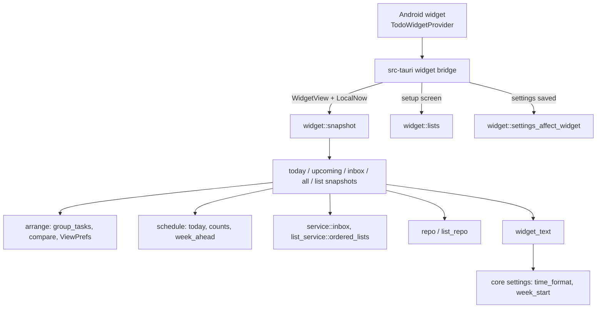
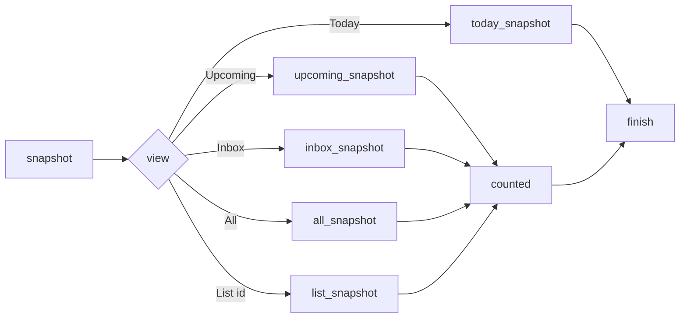
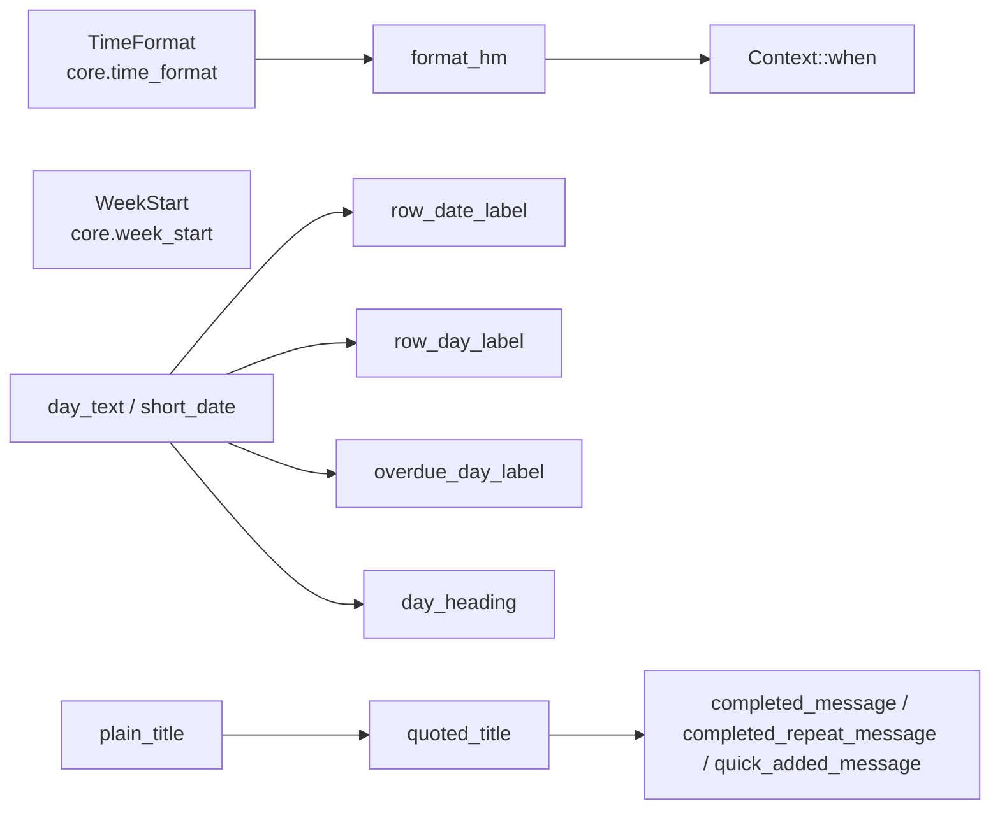

# Todo_Widget

The Todo_Widget module turns a Todo view into **display-ready data** for the Android home-screen widget. It lives in two files of the `todo` crate:

- `crates/todo/src/widget.rs` builds a `WidgetSnapshot` (title, count, groups, rows, empty state) for a `WidgetView`, and lists the Lists offered by the widget setup screen.
- `crates/todo/src/widget_text.rs` holds the wording rules (dates, times, titles, toast messages) as Rust ports of the app's TypeScript text rules.

The guiding rule: **every word in a snapshot is final**. The Kotlin side does no date or wording logic. Grouping, ordering and hiding of done tasks are the app's own (`today`, `inbox`, `group_tasks`); this module only picks and words them.

For the surrounding platform (Kotlin widget provider, JNI bridge, tests) see [Android and Home-Screen Widget Platform](../Android_and_Home-Screen_Widget_Platform.md), especially [widget_bridge](../Android_and_Home-Screen_Widget_Platform/widget_bridge.md) and [widget_tests](../Android_and_Home-Screen_Widget_Platform/widget_tests.md). Task and List data come from [Todo Tasks and Lists](Todo_Tasks_and_Lists.md).

## Architecture

## Core types (`widget.rs`)

| Type | Role |
|---|---|
| `WidgetView` | `Today`, `Upcoming`, `Inbox`, `All`, `List(id)`. `parse` reads the stored name (`today`, `upcoming`, `inbox`, `all`, `list:<id>`); anything else, or an empty id, is `TodoError::Validation`. |
| `WidgetSnapshot` | The full drawing: `view`, `app_theme`, `title`, optional `count`, `groups`, optional `empty`. Serialised for the bridge. |
| `WidgetGroup` | A heading (optional), a `Tone`, and `WidgetRow`s in the app's order. |
| `WidgetRow` | `id`, plain `title`, priority `ring` (`p1`/`p2`/`p3`/`none`), `overdue` flag, grey `time`, red `day` for overdue rows, and a List `list` chip. |
| `HeaderCount` / `Tone` | Count text such as `3 left` or red `2 overdue`; `Tone` is `Normal` or `Overdue`. |
| `EmptyState` | Title and helpful line when nothing is listed. |
| `WidgetLists` / `WidgetList` | The Lists for the setup screen, in the sidebar's order, each with a `label` of emoji and name. |

`app_theme` is a Device setting, so it is left empty here; the app's bridge fills it in.

## Building a snapshot

`snapshot(conn, view, local)` checks the clock (`local.check()`), reads the time format, builds a `Context` (local time, `TimeFormat`, map of List id to chip text), dispatches to a per-view builder, then stamps `view` with the requested name.

Per view:

- **Today**: asks the app's `today`; Overdue-keyed groups become the red "Overdue" run, every other group is merged into one "Today" run (so the app's Priority/List splits are flattened, order kept). Header is `N overdue` (red) if anything is late, else `N left`. If empty, the line is `Next: <title>, <when>` from `counts(...).next`, or "Nothing coming up".
- **Upcoming**: `week_ahead` for 7 days (`UPCOMING_DAYS`): Overdue, then one group per day headed by `day_heading`. Always by day, ignoring the app's grouping preference.
- **Inbox**: the app's `inbox` groups; the list chip shows only in the `NoDateInList` group.
- **All**: Inbox tasks plus open tasks in Lists, grouped `GroupBy::List` with manual sort, Lists in the sidebar's order.
- **List**: `list_repo::get` (missing list → `TodoError::ListNotFound`), grouped and sorted by that List's own `group_by` and `task_sort`. The title is the List chip.

`counted` drops empty groups, counts remaining rows for the header (hidden at zero) and sets the empty state only when nothing remains. `Context::heading` maps `GroupKey` values to the app's words (`No priority`, `P1`, `Tomorrow`, `Next 7 days`, `No date, in a List`, and so on).

### Row rules

`Context::row` computes overdue as `due_date < today`. The grey time (`Context::when`) is suppressed for overdue rows; for other days it prefixes the day (`Tomorrow 11:00`, `Wed 4 Nov`) unless the heading already says it (`show_day` is false in Today/Upcoming, true elsewhere). Overdue rows instead carry `day` from `overdue_day_label`. Titles pass through `plain_title`.

## Settings that redraw the widget

`settings_affect_widget(module, keys)` returns true when saving touches `core` keys `theme`, `time_format`, `week_start`, or Todo's `arrange::PREF_KEYS`. The host uses it to decide whether to signal the widget (see [Tauri Host and Command Layer](../Tauri_Host_and_Command_Layer.md)).

## Wording rules (`widget_text.rs`)

- `TimeFormat` (`H24`/`H12`) and `WeekStart` (`Mon`/`Sun`) read the `core` Settings; defaults are 24-hour and Monday for any other value.
- Date helpers rely on `epoch_day` and return the input unchanged when malformed, so bad data never panics: `row_date_label` (Today/Tomorrow/Yesterday/weekday/`28 Oct`), `row_day_label`, `overdue_day_label` (Yesterday, weekday within six days back, then date), `day_heading` (`Tomorrow · Thu 22`, `Mon 2 Nov`), `day_text`, `short_date` (adds the year only when it differs), and `month_short`.
- `plain_title` strips Markdown emphasis, code and link marks via a small hand-written scanner (`strip`, `closing`, `find`); block syntax and `~~`/`==` remain as text, matching the app's `plainTitle`.
- `quoted_title` wraps a plain title in curly quotes, cut at 34 characters with an ellipsis. It backs the toast builders `completed_message`, `completed_repeat_message`, and `quick_added_message`; `landed_in` says where a quick-added task went.
- Quick-add chips: `meaning_text`, `when_chip_label`, `repeat_text` (via `history::repeat_label`).

### Parity with the frontend

These are ports of TypeScript functions (`quotedTitle`, `landedIn`, `rowDateLabel`, `dayText`, `repeatLabel`, `meaningText`, `whenChipLabel`, `plainTitle`). The shared fixture `src/lib/ipc/fixtures/widget-text.json` is run by the Rust unit tests in `widget_text.rs` and by Vitest, so the two implementations cannot drift. See [Todo Frontend](../Todo_Frontend.md) and [IPC Todo Mocks](../IPC_Bridge_and_Browser_Mocks/IPC_Todo_Mocks.md).

## Dependencies

- Reads: `arrange`, `schedule`, `service`, `list_service`, `repo`, `list_repo`, `when` (`LocalNow`, `epoch_day`), `recurrence`, `history`, and `mnemora_core::settings` ([Core Foundation](../Core_Foundation.md)).
- Used by: the widget bridge in `src-tauri` ([widget_bridge](../Android_and_Home-Screen_Widget_Platform/widget_bridge.md)); behaviour is covered end to end by [widget_tests](../Android_and_Home-Screen_Widget_Platform/widget_tests.md).
- Sync: remote changes make the host redraw the widget (see [Sync Replication Engine](../Sync_Replication_Engine.md)).

## Design notes

- The module is read-only: it builds snapshots and never writes. Writes (tick, undo, quick add) go through the same app commands.
- Errors flow as `AppResult`; an unknown view name or missing List is a typed `TodoError`, never a panic.
- The caller supplies `LocalNow`, so day rollover follows the clock the widget sends.
