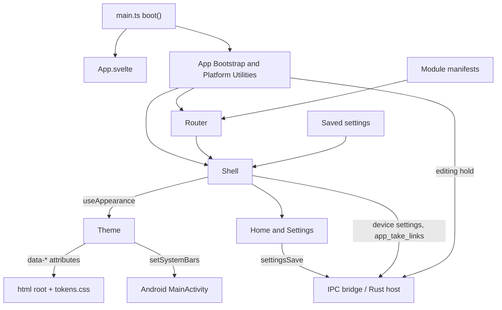
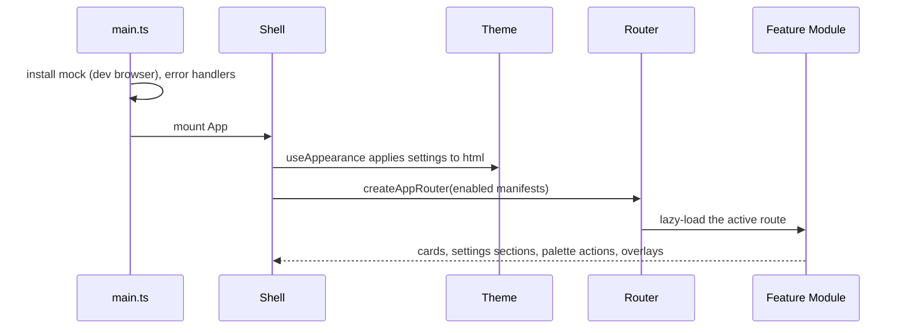

# Frontend_Platform_and_Shell

## Purpose

This module is the frame of the Mnemora Svelte frontend. Feature modules (Todo, Journal, Sync, AI) run inside it. It has five parts:

- **Boot and platform utilities.** Starts the app, detects the OS, and supplies shared helpers for keyboard, viewport, gestures, editing holds, unsaved-work guards and the settings draft.
- **Theme.** Resolves the saved theme preference into a concrete theme and applies it to the root element. It also restyles the Android system bars and has tests that guard the design tokens.
- **Router.** Builds the route table from Module manifests. It also handles Android Back, view transitions, query-string state and dynamic palette actions.
- **Shell.** Decides which Modules are enabled and owns the sidebar, phone tabs, shortcuts, ⌘K palette and `mnemora://` deep links. It holds no domain logic.
- **Home and Settings.** Pure logic behind the Home greeting, the Settings save/discard flow and the bug-report diagnostics.

Modules and the shell never import each other. They meet through the `ModuleManifest` contract defined in the Router.

## Architecture

## Core component documentation

| Sub-module | Covers | Docs |
|---|---|---|
| App Bootstrap and Platform Utilities | `main.ts` boot, `platform.ts`, viewport and keyboard singletons, bare-key, long-press, swipe, editing holds, leave guard, settings draft, time helpers | [App_Bootstrap_and_Platform_Utilities](Frontend_Platform_and_Shell/App_Bootstrap_and_Platform_Utilities.md) |
| Theme | `resolveTheme`, `applyAppearance`, Android system bars, contrast and first-paint token tests | [Theme](Frontend_Platform_and_Shell/Theme.md) |
| Router | `ModuleManifest` contract, `buildRoutes`, `createAppRouter`, view transitions, Android Back, `urlParam`, `dynamicActions` | [Router](Frontend_Platform_and_Shell/Router.md) |
| Shell and Navigation | Module enablement, phone tabs, appearance hook, sidebar layout and persistence, tree fold, shortcuts, palette, deep links | [Shell_and_Navigation](Frontend_Platform_and_Shell/Shell_and_Navigation.md) |
| Home and Settings Modules | `homeName`, `buildDiagnostics`, `SaveState` | [Home_and_Settings_Modules](Frontend_Platform_and_Shell/Home_and_Settings_Modules.md) |

## Related modules

- IPC and dev mocks: IPC_Bridge_and_Browser_Mocks.
- Design tokens and UI components: Design_System_and_UI_Components.
- Rust command host: Tauri_Host_and_IPC_Bridge.
- Native bridge: Android_Integration.