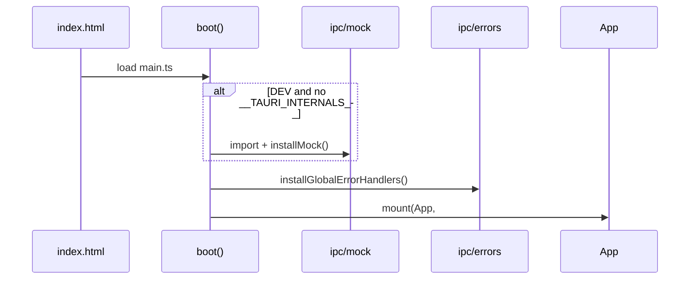
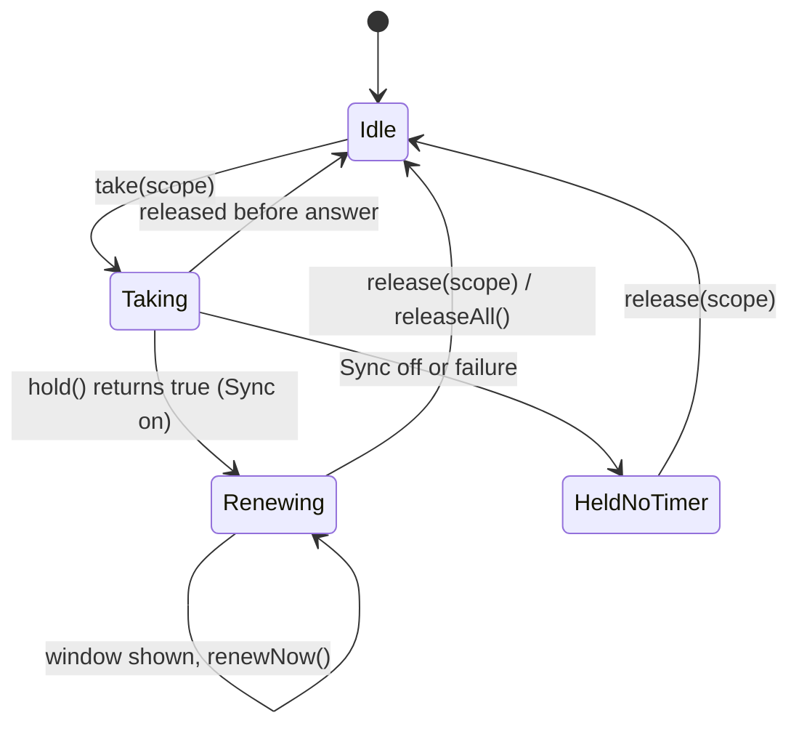

# App Bootstrap and Platform Utilities

This module is the foundation of the Svelte frontend. It starts the app (`src/main.ts`), detects the platform, and provides small framework-light helpers that the shell, router and feature modules share. They cover keyboard, viewport, gestures, editing leases, unsaved-work guards, a settings draft, and time greetings.

Related pages:
- [Frontend_Platform_and_Shell](../Frontend_Platform_and_Shell.md): parent module
- [Theme](Theme.md), [Router](Router.md), [Shell_and_Navigation](Shell_and_Navigation.md), [Home_and_Settings_Modules](Home_and_Settings_Modules.md): sibling modules
- [IPC_Bridge_and_Browser_Mocks](../IPC_Bridge_and_Browser_Mocks.md): the `ipc` layer (`bindings`, `errors`, `mock`) used here
- [Sync_Replication_Engine](../Sync_Replication_Engine.md): the Rust side of editing holds
- [Tauri_Host_and_IPC_Bridge](../Tauri_Host_and_Command_Layer/Tauri_Host_and_IPC_Bridge.md): hosts the `editing_hold` / `editing_release` commands

## Architecture

```mermaid
graph TD
    main["main.ts boot()"] --> mock["ipc/mock installMock (dev browser only)"]
    main --> errs["ipc/errors installGlobalErrorHandlers"]
    main --> App["App.svelte (mount)"]

    platform["platform.ts"] --> keyboard["keyboard.svelte.ts"]
    platform --> viewport["viewport.svelte.ts"]
    platform --> openext["open-external.ts"]
    platform --> shortcuts["shell shortcuts (hasMod)"]

    hold["editing-hold.ts"] --> bindings["ipc/bindings (commands)"]
    draft["settings/draft.svelte.ts"] --> bindingsT["ipc/bindings (SettingsChange type)"]
    longpress["long-press.ts"] --> timing["timing.ts setTimer"]

    bare["bare-key.ts"] --> shell["shell and Todo quick add (Q)"]
    swipe["swipe.ts"] --> views["Todo views, rows, sheets"]
    leave["leave-guard.svelte.ts"] --> forms["editors and settings"]
    greeting["time/greeting.ts"] --> home["Home module"]
```

## Bootstrap (`src/main.ts`)

`boot()` runs once at load:

1. **Dev-only mock.** If `import.meta.env.DEV` is set and `__TAURI_INTERNALS__` is absent from `window` (a plain browser with no Rust side), it dynamically imports `./lib/ipc/mock` and awaits `installMock()`. The dynamic import keeps the mock out of production bundles.
2. **Error handlers.** `installGlobalErrorHandlers()` hooks global errors. These are reported to Rust via `log_ui_error`.
3. **Mount.** It finds `#app` and throws `'#app not found'` if it is missing. Otherwise it mounts `App` with Svelte's `mount`.

`app.css` is imported here, so global styles load before mount. Vite configuration is in `vite.config.ts` (see [Build_and_Config](../Build,_Tooling_and_Packaging/frontend_build_config.md)).

## Platform detection (`platform.ts`)

- `detectOs(ua)` maps a user-agent to `'android' | 'ios' | 'macos' | 'windows' | 'linux' | 'web'`. The checks run in that order, so Android is matched before Linux.
- Module constants: `os`, `isMac`, `isMobileOs`, and `inTauriWindow()`. `inTauriWindow()` wraps Tauri's `isTauri()`, so it is false in a browser and in the dev mock.
- `modLabel`, `shortcutLabel(key)` and `hasMod(e)` implement the "Cmd on macOS, Ctrl elsewhere" rule. `hasMod` rejects events with Alt held.

`open-external.ts` → `openExternal(url)` uses `window.open(..., 'noopener,noreferrer')` outside Tauri. Inside Tauri it lazy-loads `@tauri-apps/plugin-opener`.

## Viewport and keyboard

| Component | Role |
|---|---|
| `Viewport` (`viewport.svelte.ts`) | Singleton. `narrow` follows the media query `(max-width: 719.98px)`. `isPhone = narrow || isMobileOs`. It toggles `data-phone` on `<html>` synchronously at module load, so the first paint matches the layout and the `phone:` CSS variant works. |
| `Keyboard` (`keyboard.svelte.ts`) | Singleton. On mobile OSes it listens to `visualViewport` `resize` and `scroll`. It computes `inset` with `keyboardInset` and derives `open` with `isKeyboardOpen` (helpers in `keyboard-inset`). The shell pads its bottom by `inset`. It stays 0 off mobile. |

## Input helpers

### Bare keys (`bare-key.ts`)
A bare single-key shortcut (Q for Todo quick add, per ADR 0011) must never steal typing. `bareKeyFires(e, key, scene)` returns true only when all of these hold:
- No Meta, Ctrl or Alt is held.
- Shift is not held, unless the key is `?`.
- The event is not a repeat, not composing, and not already `defaultPrevented`.
- The key matches case-insensitively.
- No overlay is open, and the target is not a text field.

`isTypingTarget` uses `closest()` against `input, textarea, select, [contenteditable], [role="textbox"]`. `overlayOpenIn(doc)` detects `dialog`, `alertdialog`, `menu` or `listbox` roles. Because it takes plain structural types, it can be tested without a DOM (`bare-key.test.ts`, helper `press`).

### Long press (`long-press.ts`)
`LongPress` fires `onpress(x, y)` once after `LONG_PRESS_MS` (500 ms) if the pointer stays within `LONG_PRESS_SLOP_PX` (10 px). `start` arms the timer. `move` cancels it when the pointer drifts past the slop. `cancel` clears it. `fired` stays true until the next `start`, so callers can swallow the click that follows. The timer is injectable (`setTimer`) for tests.

### Swipe (`swipe.ts`)
Pure geometry helpers with named thresholds: `lockAxis`, `rowOffset` (resistance beyond `ROW_COMMIT_PX`), `rowSwipeOutcome` (distance or flick), `sheetShouldClose` and `viewSwipeStep`. `viewSwipeStep(dx, dy)` returns `-1`, `0` or `1`. It needs at least 60 px of travel and no more than 45 px of vertical drift. It is used by Todo's segment bar. See [Todo_Frontend](../Todo_Frontend.md).

## Editing holds (`editing-hold.ts`)

When a person edits a record (a Journal entry, or one field of a Todo task), changes arriving from other devices must wait, so text does not move under the cursor. Rust keeps them apart and merges them when the hold ends. See [Sync_Replication_Engine](../Sync_Replication_Engine.md).

`EditingHold` manages leases per scope string. `WHOLE = '*'` holds the entire record.

Key behaviours:
- `take` is idempotent per scope, so it is safe to call on every keystroke.
- `HOLD_RENEW_MS` is 30 s. Rust lets a hold lapse after about two minutes, so a vanished editor can never block sync permanently.
- Nothing is renewed while the document is hidden. `visibilitychange` triggers `renewNow`.
- Failures of `hold` or `release` are swallowed. The worst case is that a change lands without waiting.
- `releaseAll` releases every held scope in parallel.
- The factory `editingHold(entity, entityId)` wires `commands.editingHold` and `commands.editingRelease` from `ipc/bindings`, plus `setInterval` and the document visibility APIs. Tests inject fakes through `EditingHoldDeps` (see `editing-hold.test.ts`).

## Leave guard (`leave-guard.svelte.ts`)
`LeaveGuard.ask()` sets the reactive `open` flag and returns a Promise. `answer(leave)` closes the dialog and resolves that Promise. A confirmation dialog is bound to `open`, so navigation can `await guard.ask()` before leaving unsaved work. One caveat: calling `ask()` twice replaces the pending resolver, so the first Promise never settles.

## Settings draft (`settings/draft.svelte.ts`)
`SettingsDraft` holds unsaved Settings edits (N9-B) on top of a saved snapshot, using Svelte runes.
- `get`, `set`: `set` stores an edit only if it differs from the saved value (compared via JSON). Setting a value back to the saved one removes the edit.
- `dirty`, `changes()` (as `SettingsChange[]` for `settings_save`), `merged()` (for previews), `discard()`.
- `commit()` makes the edits the new saved values after a successful save.
- `rebase(saved)` takes a new snapshot, for example one pushed by sync, and keeps only edits that still differ from it.

The save flow itself lives in [Home_and_Settings_Modules](Home_and_Settings_Modules.md) (`SaveState`).

## Time helpers (`time/`)
- `greetingFor(date)` returns `morning` (05–12), `afternoon` (12–17), `evening` (17–22) or `night`.
- `greetingText(date, name)` returns "Good morning, Name", or just "Good night" when the name is blank. It feeds the Home module's `homeName`.
- `relativeTime` is covered by `relative.test.ts` (N15-A): "just now", "N min ago", "N h ago", "yesterday", "N days ago", then an absolute date from 7 days on, with the year shown only if it is not the current one. Future times read "just now".

## Testing
Vitest suites sit beside the sources: `bare-key.test.ts`, `editing-hold.test.ts`, `long-press.test.ts`, `time/greeting.test.ts` and `time/relative.test.ts`. They inject timers, visibility and Rust calls, so no DOM or Tauri runtime is needed. Run them with `make test` (the `test` script in `package.json`).
