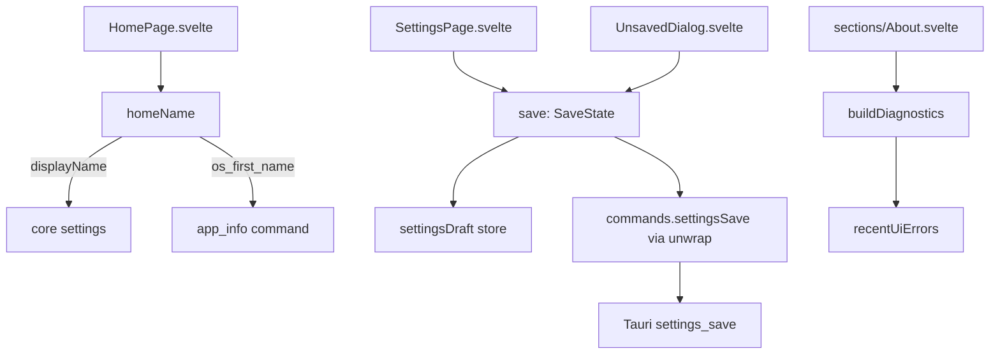
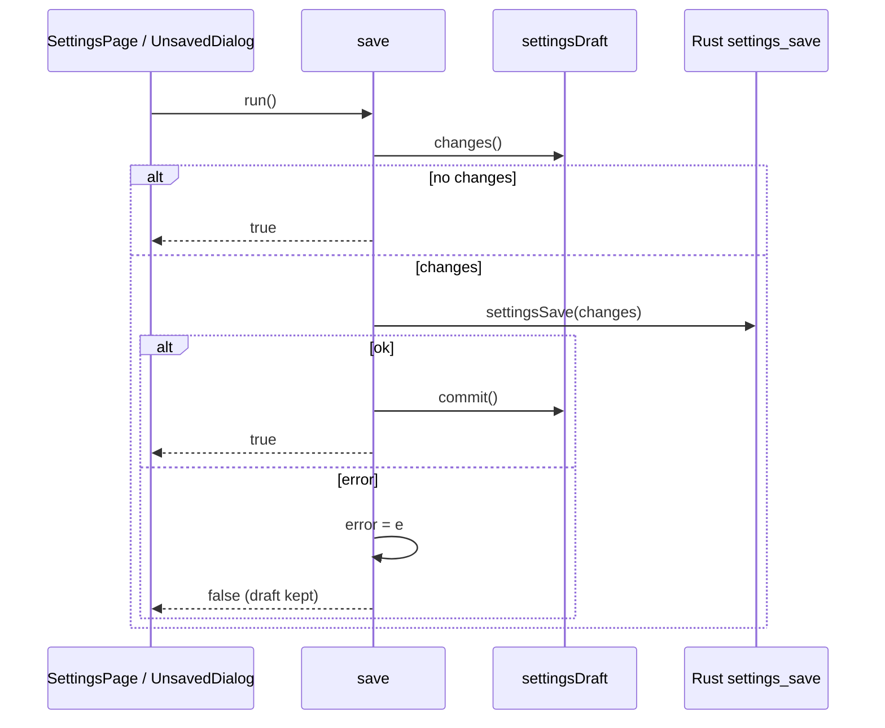

# Home_and_Settings_Modules

Small, pure-logic helpers behind the **Home** and **Settings** pages of the Mnemora frontend. The Svelte pages (`HomePage.svelte`, `SettingsPage.svelte`, `UnsavedDialog.svelte`, `sections/About.svelte`) hold the markup. The three files documented here hold the testable logic.

| Component | File | Purpose |
|---|---|---|
| `homeName` | `src/modules/home/greeting-name.ts` | Chooses the name shown in the Home greeting |
| `buildDiagnostics` | `src/modules/settings/diagnostics.ts` | Builds the bug-report text in Settings → About |
| `SaveState` (`save`) | `src/modules/settings/save.svelte.ts` | Saves or discards the Settings draft |

## Architecture



## Components

### `homeName(displayName, osFirstName)`
Picks the greeting name in this order:
1. The user's display name, trimmed, if it is non-empty.
2. The OS first name, trimmed. The comment in the source says Rust has already sanitised it.
3. An empty string, so the greeting shows no name.

`HomePage.svelte` calls it as `homeName(core.displayName, info.data?.os_first_name)`. Time-of-day wording comes from `greetingText` (see [App_Bootstrap_and_Platform_Utilities](App_Bootstrap_and_Platform_Utilities.md)). The function is pure and has a unit test.

### `buildDiagnostics(input)`
Takes a `DiagnosticsInput`: `version`, `environment`, `os`, `userAgent`, and `errors` (a list of `{at, message}`). It returns plain text:

```
Mnemora <version> (<environment>)
OS: <os>
User agent: <ua>
Recent UI errors:
  <at> <message>      (or "  none")
```

By design it contains no Settings values or file paths, so a user can paste it into a bug report. `About.svelte` builds the input. The recent UI errors come from the IPC layer (`recentUiErrors`, see [IPC_Bridge_and_Core_Mocks](../IPC_Bridge_and_Browser_Mocks/IPC_Bridge_and_Core_Mocks.md)).

### `SaveState` / `save`
`SaveState` is a Svelte 5 rune class with a single exported instance, `save`. Its reactive fields are `saving` (boolean) and `error` (unknown).

- `run(): Promise<boolean>`
  - Reads `settingsDraft.changes()`. If there are none, it returns `true` without calling Rust.
  - Otherwise it sets `saving`, clears `error`, and calls `commands.settingsSave(changes)` through `unwrap`.
  - On success it calls `settingsDraft.commit()` and returns `true`.
  - On failure it stores the error and returns `false`. The draft is left untouched, so the user can retry and no edits are lost (the "N9-B" rule from the source comment).
  - `saving` is reset in a `finally` block.
- `discard()`: calls `settingsDraft.discard()` and clears `error`.



Both `SettingsPage.svelte` and `UnsavedDialog.svelte` use `save`. The dialog is what appears when the user leaves Settings with unsaved edits, the same pattern as `LeaveGuard` in [App_Bootstrap_and_Platform_Utilities](App_Bootstrap_and_Platform_Utilities.md).

## Related modules
- The backend command and validation: [Tauri_Host_and_IPC_Bridge](../Tauri_Host_and_Command_Layer/Tauri_Host_and_IPC_Bridge.md) (`settings_save`, `app_info`) and [Core_Foundation](../Core_Foundation.md) (settings schema and sync).
- Where the module settings sections and Home cards are registered: [Shell_and_Navigation](Shell_and_Navigation.md) (`homeCards`, `moduleSettingsSections`).
