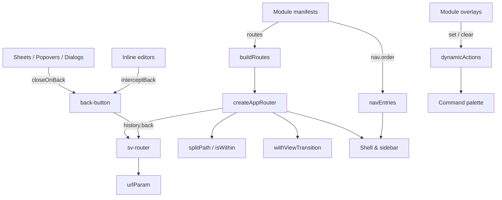
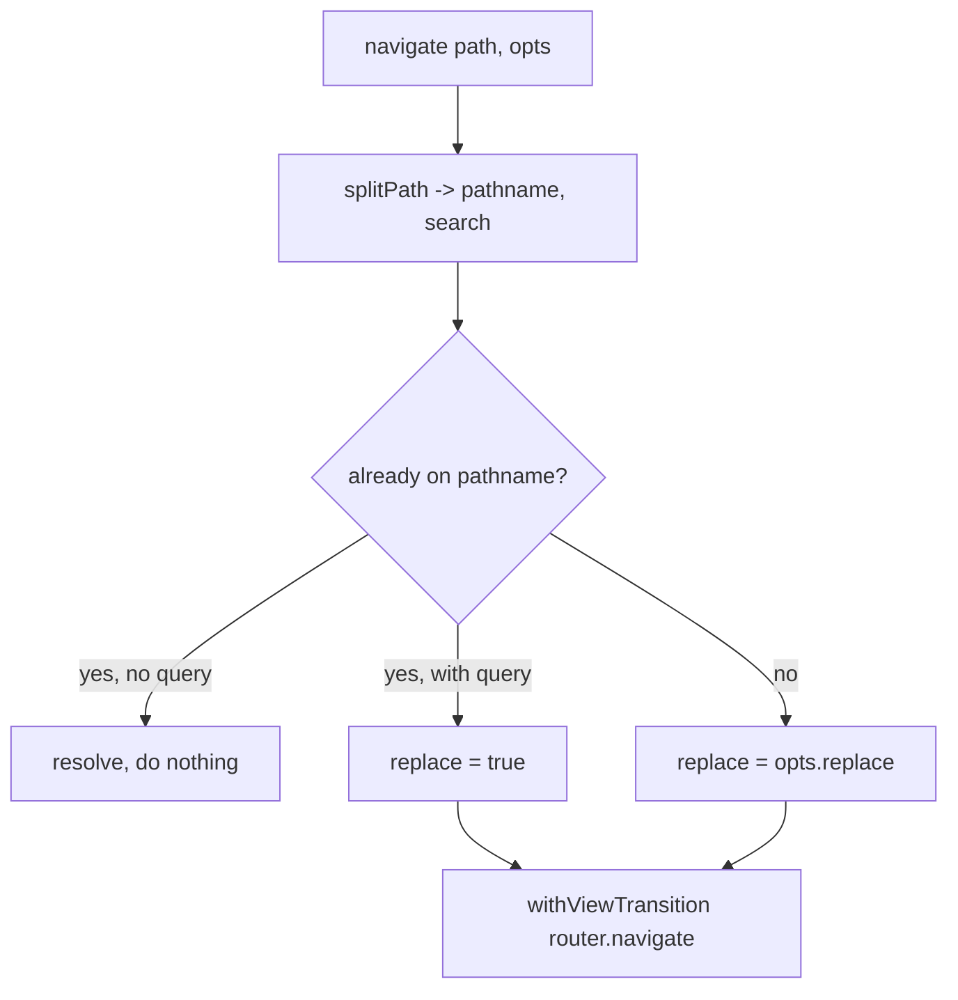
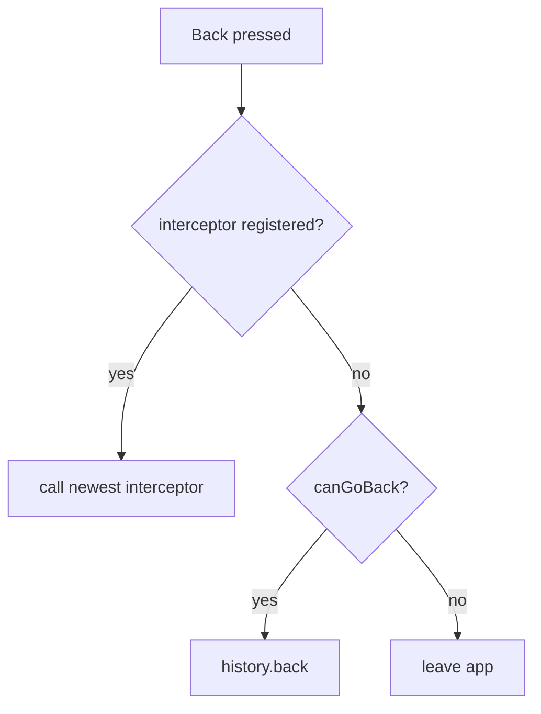

# Router

The Router (`src/lib/router/`) is the navigation layer of the Mnemora frontend. It wraps [sv-router](https://www.npmjs.com/package/sv-router) in history mode and builds the route table from **Module manifests**, so each feature Module declares its own pages. It also holds the pieces that make navigation feel native: Android Back handling, animated route changes, query-string state, and the dynamic ⌘K actions Modules contribute.

The shell that consumes the router is described in [Shell_and_Navigation](Shell_and_Navigation.md). Boot and platform helpers (`os`, etc.) are in [App_Bootstrap_and_Platform_Utilities](App_Bootstrap_and_Platform_Utilities.md).

## Files and responsibilities

| File | Role |
|---|---|
| `manifest.ts` | Types: `ModuleManifest`, `RoutePath`, `ModuleContext`, `ModuleAction`, `BareKey`, `NavTree`, `ModuleBadge`, `DeviceSwitch`, … The contract between Modules and the shell. |
| `routes.ts` | `buildRoutes` (flatten manifests into one path→loader map, rejecting duplicates) and `navEntries` (sorted nav list). |
| `create.ts` | `createAppRouter`: wraps sv-router and exposes `navigate`, `href`, `isActive`, `isWithin`, `pathname`. |
| `path.ts` | `splitPath` (path + query) and `isWithin` (sub-page test). |
| `view-transition.ts` | `withViewTransition`: runs a route change inside a View Transition. |
| `back-button.svelte.ts` | Android hardware Back: `interceptBack`, `closeOnBack`, `handleBack`, `installBackButton`. |
| `url-param.ts` | `urlParam`: reactive single query-parameter state. |
| `dynamic-actions.svelte.ts` | `dynamicActions`: data-dependent palette actions per Module. |

## Architecture

## Route table and navigation

`buildRoutes(manifests)` iterates every `routes` entry of every manifest. Two Modules claiming the same path throw `Route <path> is registered twice (<id>)` at registration, so conflicts surface at start-up rather than as silent shadowing. `navEntries` sorts manifests by `nav.order` and links each to its first route (manifests without routes are skipped).

`createAppRouter(manifests)` casts sv-router's generated typings to a plain string form, since the table is runtime-built; paths are validated as `RoutePath` (`` `/${string}` ``) instead.

### `navigate` behaviour

- Landing on the open page with a query (`/todo?task=<id>`) **replaces** the history entry, so Back doesn't step through a no-op.
- Navigating to the current page with no query is a no-op.
- `isActive` is exact; `isWithin` also matches sub-pages (`/sync` while `/sync/activity` is open). `href` returns the base-aware URL.

## View transitions

`withViewTransition(update)` uses `document.startViewTransition` when available and motion is not reduced (`data-reduce-motion="true"` or `prefers-reduced-motion`); otherwise it just runs `update`. While it runs, `<html data-view-transition>` is set so the CSS keyframe fade is disabled and the page never fades twice. After `update` the code awaits `tick()` so the new route is in the DOM before the snapshot.

Edge cases (covered by `view-transition.test.ts`):
- A transition **superseded** by a newer one rejects with `AbortError`; this is swallowed because the update already ran, and the result is still returned.
- Real errors propagate to the caller.
- A monotonically increasing `latestTurn` ensures only the newest transition clears the marker.

## Android Back handling

- `interceptBack(handler)` pushes onto a stack and returns an unregister function; the newest handler wins.
- `closeOnBack(isOpen, close)` is for overlays: it must be called during component init, as it registers a `$effect` that intercepts Back only while `isOpen()` is true.
- `installBackButton()` is a no-op unless `os === 'android'` and running inside Tauri. It lazily imports `@tauri-apps/api/app` and subscribes to `onBackButtonPress`. "Leave" prefers the native `window.MnemoraAndroid.moveTaskToBack` bridge (see [Android_Integration](../Android_and_Home-Screen_Widget_Platform/Android_Integration.md)); `exit(0)` is only a fallback because it aborts while the render thread is still drawing (#51).

## Query-string state: `urlParam`

`urlParam.get/set/delete` wrap sv-router's `searchParams`. Reads are reactive; writes push a history entry (so Back undoes them) unless `replace` is passed. Used for state that should survive reload and answer Back, e.g. an open Todo task sheet at `/todo?task=<id>` (see [Todo_Frontend](../Todo_Frontend.md)).

## Dynamic palette actions

`dynamicActions` (`DynamicActions`) keeps a `$state.raw` map of Module id → `ModuleAction[]`, for ⌘K actions that depend on loaded data (Todo's "Go to ‹List›"). `set` and `clear` read the previous map with `untrack`, so an effect that sets actions does not depend on them and loop. A Module's always-on overlay sets them on mount and clears them when it unmounts (i.e. when the Module is switched off); `of(moduleId)` returns them for the palette alongside the manifest's static `paletteActions`. See [Shell_and_Navigation](Shell_and_Navigation.md) for palette assembly.

## The manifest contract

`ModuleManifest` is how a Module describes itself to the shell without the shell or the Module importing each other: routes, nav order/placement, nav tree and rail flyout, badge hooks, Home card, Settings section, palette actions, bare keys, phone-tab behaviour, an always-mounted overlay, default-enabled flag/device switch, and `openLink` for `mnemora://` deep links. Modules receive a `ModuleContext` (`navigate`, `isActive`) rather than the shell itself. Enabled-state logic lives in the shell (`enabled-modules.ts`, see [Shell_and_Navigation](Shell_and_Navigation.md)).

## Tests

- `routes.test.ts`: flattening, duplicate rejection, nav ordering.
- `back-button.test.ts`: interceptor → history → leave precedence.
- `view-transition.test.ts`: superseded transitions, error propagation, marker ownership.
- `path.test.ts`: path splitting and sub-page matching.
