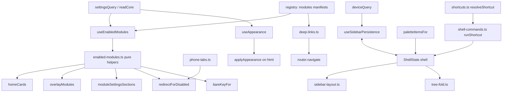
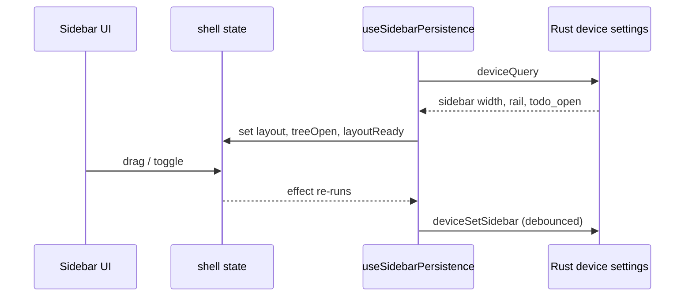
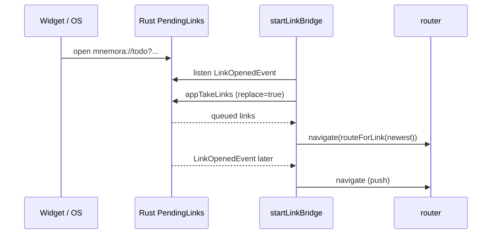

# Shell and Navigation

The shell (`src/shell/`) is the frame around every Module screen. It decides which Modules are on, applies the appearance to `<html>`, owns the sidebar layout and its tree fold, resolves keyboard shortcuts, builds the ⌘K palette, and turns `mnemora://` links into routes. It holds no domain logic. Modules plug in through a `ModuleManifest` (see [Router](Router.md)), and the shell reads those manifests.

Related pages: [App Bootstrap and Platform Utilities](App_Bootstrap_and_Platform_Utilities.md) (boot, viewport, keyboard), [Router](Router.md) (manifest types, router creation), [Theme](Theme.md) (`applyAppearance`), [Home and Settings Modules](Home_and_Settings_Modules.md), and [Tauri Host and IPC Bridge](../Tauri_Host_and_Command_Layer/Tauri_Host_and_IPC_Bridge.md) (the `device_*`, `settings_save` and `app_take_links` commands).

## Architecture

Most files are pure functions (testable without Svelte). Files ending in `.svelte.ts` hold reactive state or effects, and must be called during component setup.

## Components

### Module enablement: `enabled-modules.ts` and `enabled.svelte.ts`

`enabledModules(manifests, disabled, optedIn)` is the single rule:

- `required` Modules (Home, Settings) are always on.
- Default-on Modules are on unless their id is in `disabled`.
- Modules with `defaultEnabled === false` (Sync) are on only if listed in `optedIn`. The `disabled` list is ignored for them.

Helpers built on that list:

| Helper | Purpose |
|---|---|
| `setModuleEnabled(disabled, id, on)` | New disabled list, without duplicates. |
| `setOptedIn(optedIn, id, on)` | New opted-in list, as a plain set of ids. |
| `bareKeyFor(enabled, key, ctx)` | First enabled Module, by `nav.order`, whose `bareKeys` claim the key (case-insensitive) and whose `when(ctx)` holds. |
| `overlayModules` | Enabled Modules that mount an always-on overlay, in nav order. |
| `homeCards` | `{ id, load }` for each enabled Module with a home card. |
| `moduleSettingsSections` | Settings sections added by enabled Modules after the core ones. |
| `redirectForDisabled(pathname, all, enabled)` | Returns `'/'` when the path belongs to a disabled Module, else `null`. Owner lookup uses `activeModuleId` from `phone-tabs.ts` (longest matching path prefix). |

`useEnabledModules()` wraps this for the UI. It combines the saved Settings (`core.disabledModules`, `core.enabledOptionalModules`, never a pending draft) with Modules whose switch is a Device setting (`m.deviceSwitch(moduleContext)`). It exposes `list` and `ready`. `ready` stays false until every device switch has been read, so a default-off Module's URL is not redirected Home during startup.

### Phone tabs: `phone-tabs.ts`

Pure logic for the phone bottom bar. The bar holds at most `MAX_TABS = 4`.

- `toggleTab` adds or removes a tab. Adding past the maximum returns the same array.
- `moveTab` reorders by one step and ignores out-of-range moves.
- `visibleTabs(stored, known)` drops ids of Modules that no longer exist and caps at 4.
- `activeModuleId` maps a pathname to its owning Module.
- `isMoreActive` lights "More" when the current Module is not pinned to a tab.

### Appearance: `appearance.svelte.ts`

`useAppearance()` rebases `settingsDraft` onto fetched settings and applies the theme to `document.documentElement`. Theme and other draft edits preview live. **Reduce motion** always comes from the saved values, so it waits for Save. With `theme === 'system'` it subscribes with `watchSystemTheme`. Until settings arrive, the pre-paint attributes stay.

### Shell state and sidebar: `shell-state.svelte.ts`, `sidebar-layout.ts`, `sidebar-persist.svelte.ts`

`ShellState` (singleton `shell`) holds `paletteOpen`, `layout`, `treeOpen`, `treeUnset` and `layoutReady`. It offers `toggleSidebar()` and `resetSidebar()`.

`sidebar-layout.ts` defines the geometry: min 200, max 360, default 248, rail 60, and a snap threshold of 150. `settleDrag(px, current)` collapses to the rail below 150 px, remembering the expanded width. Otherwise it expands with the width clamped. `shownWidth` returns the rail or expanded width.

`useSidebarPersistence()` has three effects:

1. Once the device query settles (success or error), restore `layout`, `treeOpen` and `treeUnset`, then set `layoutReady`.
2. Persist `treeOpen` through `commands.deviceSetTodoOpen`, debounced, only when a fold choice exists (`!treeUnset`).
3. Persist the layout through `commands.deviceSetSidebar`, debounced.

`layoutReady` guards against overwriting the saved layout with defaults before it loads.

### Tree fold: `tree-fold.ts`

The rule for a Module's nested sidebar tree (Todo's views and Lists):

- `onNavigate(fold, inside)`: entering unfolds, leaving folds, staying keeps the user's choice.
- `toggle`: the chevron flips the tree wherever you are.
- `rowClick`: inside the Module a click toggles, outside it navigates there.
- `initialOpen(saved, inside)`: a saved choice wins, otherwise open when inside.

A manual flip lasts only until the next enter or leave.

### Shortcuts and commands: `shortcuts.ts`, `shell-commands.ts`

`resolveShortcut(event, mac)` returns `{type:'palette'}` for ⌘/Ctrl+K and `{type:'sidebar'}` for ⌘/Ctrl+`\`. It matches the physical `code` as well as `key`, so non-US layouts work. `\` also accepts Alt/Shift. All other navigation uses bare keys (ADR 0011), resolved by `bareKeyFor`. `SHORTCUT_LIST` is the data behind the Keyboard shortcuts help in Settings.

`runShortcut` toggles the palette, or the sidebar when not on a phone. `paletteItemsFor(enabled)` builds ⌘K items through `buildPaletteItems`. Its theme commands save at once through `commands.settingsSave` with the key `core.theme`, with no draft, and report failures with `notifyError`.

### Deep links: `deep-links.ts`

`routeForLink` parses `mnemora://‹module›?...`. The host names the Module, and its `openLink` hook sets state and returns a path. A bad URL, unknown host or missing hook goes to `/`. `startLinkBridge(deps)` first listens for `linkOpenedEvent`, then drains the queue from `appTakeLinks`. Only the newest link matters. The first drain uses `replace`, so a cold start has no Home entry behind it. `startAppLinkBridge` wires it to the real commands, events, router and registry.

## Tests

`enabled-modules.test.ts`, `tree-fold.test.ts` and `shortcuts.test.ts` cover the pure logic. They check required Modules, default-off opt-in, redirects, bare-key ownership by nav order, fold transitions and layout-independent key matching.
