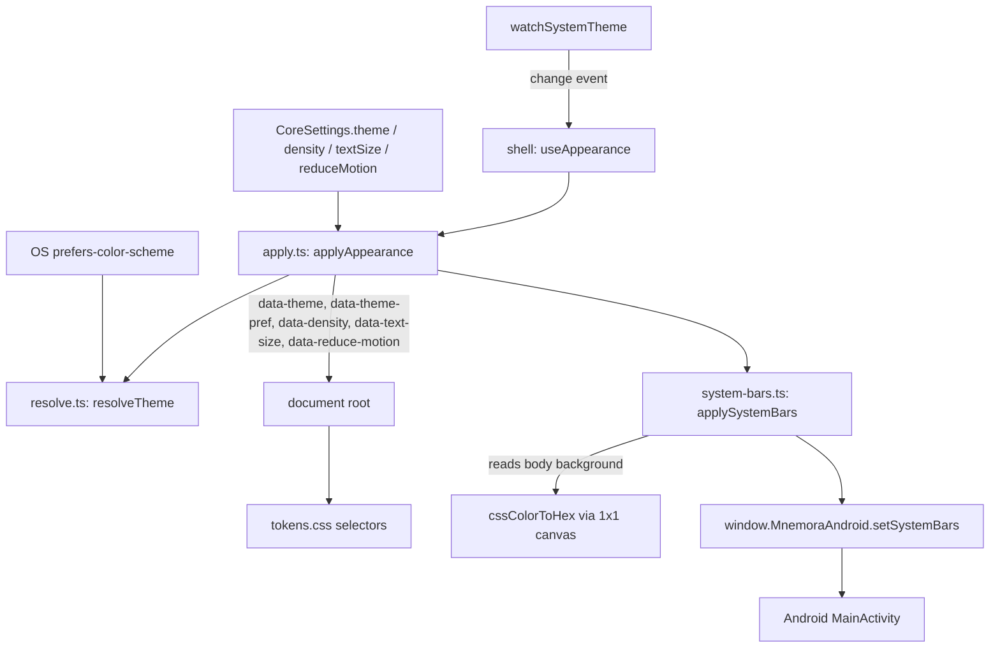
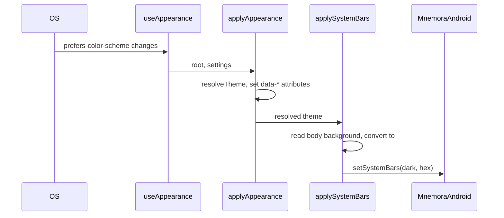

# Theme

The Theme module (`src/lib/theme/`) decides how Mnemora looks at runtime. It turns the saved theme preference (`system`, `light`, `dark` or `oled`) into a concrete theme, writes it onto the root element as `data-*` attributes, and tells the Android shell to restyle the status and navigation bars. Its tests also guard the design tokens in `tokens.css`: WCAG contrast, and agreement between those tokens and the first-paint style in `index.html`.

The app shell calls this module through `useAppearance`, which is documented in [Shell_and_Navigation](Shell_and_Navigation.md). Settings storage is outside this module. See [Home_and_Settings_Modules](Home_and_Settings_Modules.md) and [Core_Foundation](../Core_Foundation.md) for settings. The token and component rules are in [Design_System_and_UI_Components](../Design_System_and_UI_Components.md).

## Files

| File | Role |
|---|---|
| `resolve.ts` | `ThemePref`, `ResolvedTheme`, and `resolveTheme(pref, matchMedia)`. |
| `apply.ts` | `applyAppearance` writes the root attributes. `watchSystemTheme` follows OS changes. |
| `system-bars.ts` | `AndroidBridge`, `cssColorToHex`, `syncSystemBars`, `applySystemBars`. `toHexByte` is a helper. |
| `tokens.css` | The colour tokens for the light, dark and OLED themes. The tests read this file. |
| `contrast.test.ts` | Checks WCAG contrast of token pairs in each theme. |
| `first-paint.test.ts` | Checks that `index.html` repeats `--bg` and `color-scheme` from `tokens.css`. |
| `resolve.test.ts` | Checks `resolveTheme`. |

`apply.ts`, `resolve.ts` and `tokens.css` are not among the core components provided. I read `apply.ts` and `resolve.ts` directly. I did not read `tokens.css`, so its contents are described only through what the tests assume.

## Architecture

The comment in `apply.ts` says it "mirrors what Rust's pre-paint script sets". The Rust host sets the attributes before first paint, and `applyAppearance` applies later changes with the same attributes. Live updates and first paint therefore agree.

## Resolving the theme

`ThemePref` is `'system' | 'light' | 'dark' | 'oled'`. `ResolvedTheme` drops `'system'`.

`resolveTheme(pref, matchMedia)` returns an explicit choice unchanged, including `oled`. For `system` it evaluates `(prefers-color-scheme: dark)` and returns `dark` or `light`. System never resolves to `oled`. `matchMedia` is passed in so the function can be tested without a DOM. `resolve.test.ts` covers both branches with a fake `matchMedia`.

## Applying the appearance

`applyAppearance(root, appearance, resolved?)` takes the `theme`, `density`, `textSize` and `reduceMotion` fields of `CoreSettings`.

- Sets `data-theme` to the resolved theme and `data-theme-pref` to the raw preference.
- Sets `data-density`, `data-text-size` and `data-reduce-motion` (the last as a string).
- Calls `applySystemBars(theme)` last, so the body background already reflects the new attributes.

`watchSystemTheme(onChange)` listens for `change` on the dark media query and returns an unsubscribe function. It is how `system` re-resolves when the OS flips between light and dark.

## System bars (Android)

`system-bars.ts` also declares `AndroidBridge`, the interface that `MainActivity` exposes to the WebView as `window.MnemoraAndroid`. Every method is optional, because the object is absent on every other platform. The interface also carries the non-theme calls `moveTaskToBack`, `holdMulticastLock`, and the local-network permission calls (`localNetworkState`, `requestLocalNetwork`, `requestLocalNetworkOnce`, `openAppSettings`). Those are used by the router and Sync. See [Android_Integration](../Android_and_Home-Screen_Widget_Platform/Android_Integration.md), [Router](Router.md) and [Sync_Devices_and_Pairing](../Sync_Frontend/Sync_Devices_and_Pairing.md).

- `isDarkTheme(theme)` is true for every theme except `light`. Icons are light-on-dark for `dark` and `oled`.
- `cssColorToHex(css)` converts any CSS colour, including `oklch`, to `#rrggbb`. It paints one pixel on a canvas and reads it back. It returns `null` if no 2D context is available. `toHexByte` pads each channel to two hex digits.
- `syncSystemBars(bridge, theme, readBackground)` returns `false` and does nothing if the bridge or its `setSystemBars` is missing, or if the background cannot be read. Otherwise it calls `bridge.setSystemBars(isDarkTheme(theme), color)` and returns `true`.
- `applySystemBars(theme)` wires the browser side: it reads the computed `backgroundColor` of `document.body` and passes it to `syncSystemBars` along with `window.MnemoraAndroid`.

Using the body background means the bars always match the surface the CSS tokens actually paint.

## Token guard tests

The tokens are CSS custom properties, and two tests parse `tokens.css` and fail when it drifts.

### Contrast (`contrast.test.ts`)

The test strips comments from `tokens.css` and parses each `selector { --name: value; }` block into a `Rule`. `tokensFor(theme)` rebuilds the cascade:

1. `:root` for light.
2. `:root[data-theme="dark"]` is added on top for dark.
3. `:root[data-theme="oled"]` is added on top of that for OLED.

`linearRgb` resolves `var(--x)` references inside the same theme and converts opaque `oklch()` values to clamped linear sRGB. Anything else throws, so a token must be an opaque `oklch` colour or a `var()` pointing to one. `contrast(theme, fg, bg)` computes the WCAG ratio from the luminance of the two tokens.

The asserted thresholds, in all three themes:

| Pair | Minimum |
|---|---|
| `warning-ink` and `success` on `surface-2` (Provider status chips) | 4.5:1 |
| `muted` (used for placeholders) on `pop`, `surface`, `surface-2`, `bg` | 4.5:1 |
| `warning-ink` (icon) on each of those four surfaces | 3:1 |
| `switch-off` (Switch off track) on each of those four surfaces | 3:1 |

`scripts/check-colors.sh` is a related build-time check. See [Build_and_Config](../Build,_Tooling_and_Packaging/Build_and_Config.md).

### First paint (`first-paint.test.ts`)

`index.html` paints the background before `app.css` loads, so it repeats `--bg` and `color-scheme`. The test reads both files from disk with `readFileSync`, because Vitest turns CSS imports into empty strings. It checks that for each theme:

- The `background` in the matching `html` / `html[data-theme=…]` rule in `index.html` equals `--bg` in `tokens.css`.
- `color-scheme` is `light` for the default, and `dark` for both `dark` and `oled`, in `index.html` and in the shared dark and OLED token rule.

The helper `block` returns the last matching rule, mirroring CSS where the last declaration wins. This matters because `oled` also appears in the shared dark-and-OLED rule. `prop` extracts a property value from a block.

## Maintenance notes

- Changing a token in `tokens.css` can fail the contrast test, or the first-paint test if it touches `--bg` or `color-scheme`. Fix `index.html` or the token. Do not edit the tests to match.
- A new theme needs changes in `ThemePref` / `ResolvedTheme`, a selector in `tokens.css`, a case in `tokensFor`, and an entry in the first-paint `THEMES` table. `isDarkTheme` also has to classify it.
- Features that need native bar styling should go through `AndroidBridge`, with every member optional so the browser and desktop builds keep working.
