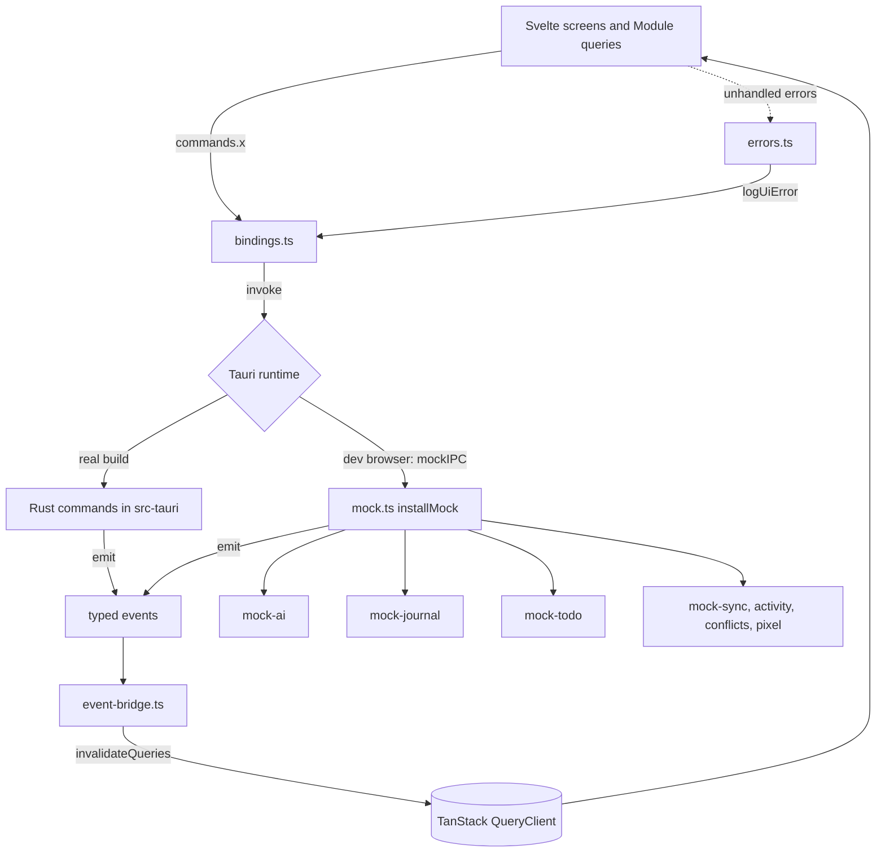
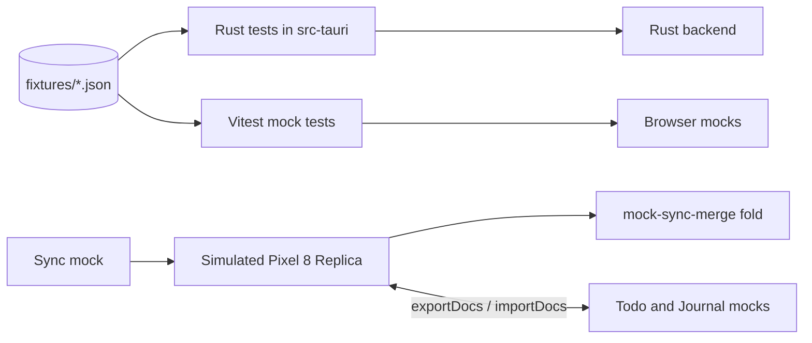

# IPC Bridge and Browser Mocks

## Purpose

`src/lib/ipc` is the frontend's only door to the Rust backend. It has two halves:

1. **The real IPC bridge.** `bindings.ts` is generated by Tauri Specta and holds the typed commands, events and payload types. `errors.ts` forwards unhandled UI errors to the Rust log. `event-bridge.ts` turns backend events into TanStack Query cache invalidations.
2. **Browser mocks.** `mock.ts` and the `mock-*` files replace the Rust side by installing `mockIPC` underneath the same `bindings.ts`. The whole UI can then run in a plain browser, in Vitest and in prototypes, with no Tauri. The mocks are loaded only in dev builds (`import.meta.env.DEV`).

The mocks stay close to the real backend in three ways. Shared JSON fixtures in `fixtures/*.json` run against both the Rust tests and the Vitest tests (ADR 0009). Validators and defaults copy the Rust ones. The mocks use the generated types, so a changed command shape fails type checking.

## Architecture

`mock.ts` handles settings, device and app commands itself. It passes every other command to the first mock that claims it through `handles`: activity, conflicts, sync, todo, ai, then journal. `editing_hold` and `editing_release` are shared between the Todo and Journal mocks.

The Sync mock simulates a second device, the Pixel 8. That device keeps a log of records and merges it with the app's Todo and Journal data. Conflicts, Activity lines and sync events come out of that merge, as they would from the real sync engine.

## Sub-modules and core components

| Sub-module | Scope | Key components |
|---|---|---|
| [IPC Bridge and Core Mocks](IPC_Bridge_and_Browser_Mocks/IPC_Bridge_and_Core_Mocks.md) | The generated bindings, `typedError`, `makeEvent`, global error reporting, the event-to-query bridge, `installMock`, the Settings and Device mock, the command dispatcher, and the AI and Journal mocks with their tests. | `bindings.ts`, `errors.ts`, `event-bridge.ts`, `mock.ts` |
| [IPC Todo Mocks](IPC_Bridge_and_Browser_Mocks/IPC_Todo_Mocks.md) | An in-memory copy of the Todo backend. It covers validation, ordering, grouping, repeats, History, Comments, search, and the editing hold with its three-way merge. | `createTodoMock`, `mock-todo-*`, `mock-occurrence` |
| [IPC Sync Mocks](IPC_Bridge_and_Browser_Mocks/IPC_Sync_Mocks.md) | The browser simulation of Sync: the merge rules, a simulated device, the Activity log, pairing flows and the simulated Pixel 8. | `mock-sync-merge.ts`, `mock-sync-replica.ts`, `mock-sync-activity.ts` |

## Typical workflow for a new command

1. Add the Rust command and run `make bindings`.
2. Handle the command in the matching mock. An unhandled command returns `undefined`.
3. If the command encodes a rule that exists on both sides, add a shared fixture case that Rust and Vitest both run.

## Related documentation

- [Tauri Host and IPC Bridge](Tauri_Host_and_Command_Layer/Tauri_Host_and_IPC_Bridge.md): the Rust side of the commands and events.
- [Frontend Platform and Shell](Frontend_Platform_and_Shell.md): the app bootstrap that installs the bridge and the mock.