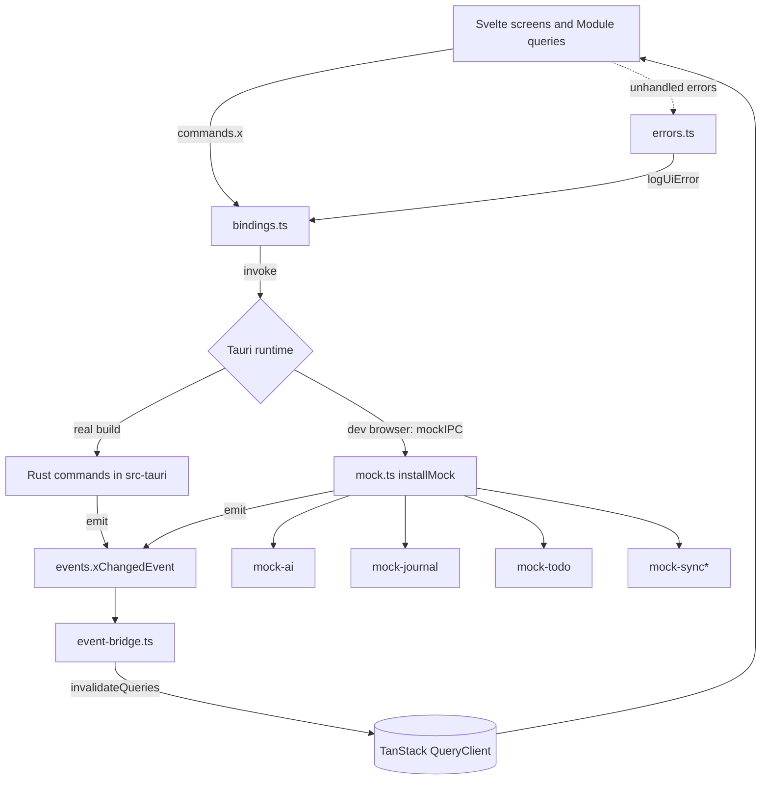
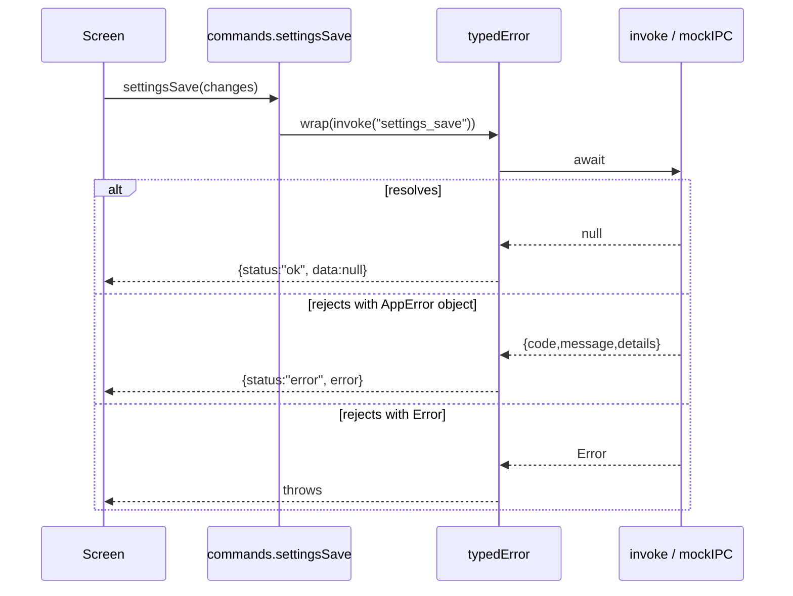
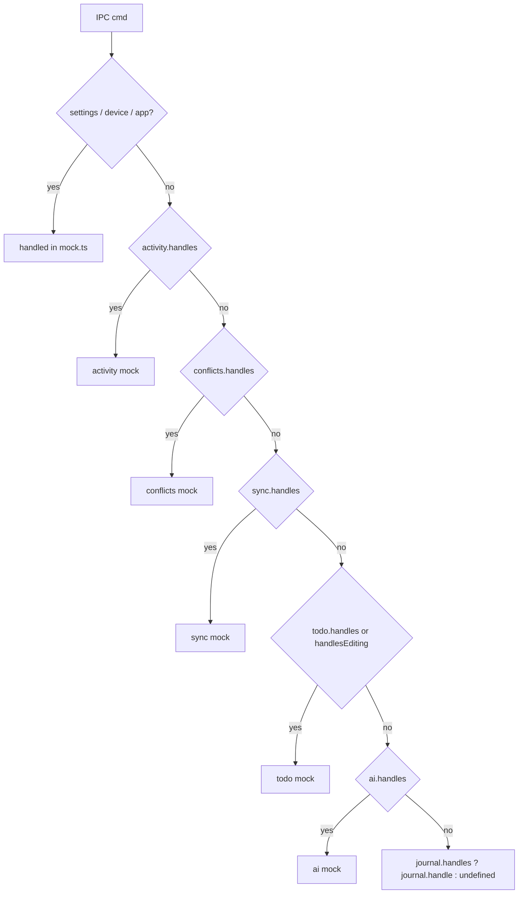
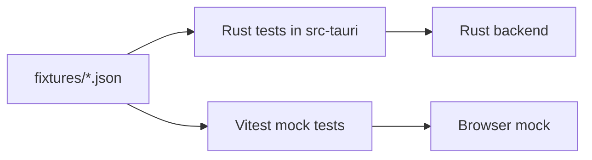

# IPC Bridge and Core Mocks

This module is the frontend's only door to the Rust backend, plus the browser-only stand-in for that backend. It has two halves:

1. **The real IPC bridge** (`bindings.ts`, `errors.ts`, `event-bridge.ts`). It holds the typed Tauri command and event surface, global UI error reporting, and the translation of backend events into TanStack Query cache invalidations.
2. **The core browser mock** (`mock.ts` and its tests). It replaces the Rust side with `mockIPC` so the whole UI can run at `http://localhost:47821` without Tauri. It is loaded only in dev builds (`import.meta.env.DEV`) and never reaches a production build.

The mock's Todo, Sync and other domain parts live in sibling pages: [IPC Todo Mocks](IPC_Todo_Mocks.md) and [IPC Sync Mocks](IPC_Sync_Mocks.md). This page covers the bridge, the settings and device layer of the mock, the AI and Journal mocks and their tests, and how the mock dispatches to all of them.

## Components

| File | Role |
|---|---|
| `src/lib/ipc/bindings.ts` | Generated by Tauri Specta. Exports `commands`, `events` and all payload types. Contains the runtime helpers `typedError` and `makeEvent`. |
| `src/lib/ipc/errors.ts` | `installGlobalErrorHandlers`, `recentUiErrors`. Forwards UI errors to the Rust log. |
| `src/lib/ipc/event-bridge.ts` | `startEventBridge`: Rust events become query invalidations. |
| `src/lib/ipc/mock.ts` | `installMock`, plus the setting validators `oneOf`, `bool`, `text`, `list`. |
| `*.test.ts` | Tests for the bridge, the AI mock, and the Journal mock (rules, remote edits, search). |

## Architecture

The same `bindings.ts` is used in both worlds. The mock does not replace the module. It replaces the Tauri transport underneath it with `mockIPC(handler, { shouldMockEvents: true })`. The screens therefore cannot tell the difference.

## bindings.ts (generated)

The file is produced by Tauri Specta (`make bindings`) and must not be edited by hand. It has three parts.

- **`commands`**: one function per Rust command, grouped by area:
  - Settings and Device: `settingsGetAll`, `settingsSave`, `deviceGet`, `deviceSet*`, `appInfo`, `backupNow`
  - Editing holds: `editingHold`, `editingRelease`
  - Journal: `journalEntry*`, `journalPages`, `journalSearch`, `journalToday`
  - Todo: `todo*`
  - AI: `ai*`
  - Sync: `sync*`
- **`events`**: typed event handles (`settingsChangedEvent`, `todoChangedEvent`, `journalChangedEvent`, `aiChangedEvent`, `aiRunEvent`, `sync*Event`, `todoListsMergedEvent`, `todoTaskDeletedEvent`, `journalEntryDeletedEvent`, `linkOpenedEvent`).
- **Types**: the wire shapes (`AppError`, `Task`, `Entry`, `ConversationView`, `PairingView`, and so on), with the Rust doc comments carried over.

### `typedError`

Commands that return `Result<_, AppError>` on the Rust side are wrapped in `typedError`. It turns a rejected invoke into `{ status: "error", error }` and a resolved one into `{ status: "ok", data }`. A real `Error` instance (a crash, not an `AppError`) is rethrown. Commands without a `Result` (such as `deviceGet`, `appInfo`, `aiRunAbort`, `syncNow`) return the plain value and reject on failure.

This is why the mock **throws plain `AppError` objects** (`{code, message, details}`) and not `Error` instances: `typedError` only turns non-`Error` rejections into typed results. `AppError.code` is one of `validation | unknown_key | not_found | io | database | internal`.

### `makeEvent`

`makeEvent<T>(name)` builds an event handle with `listen`, `once` and `emit`. Calling the handle with a `Webview` or `Window` gives the same API scoped to that target. Events with a `null` payload have an `emit()` that takes no argument. This is what the mocks use to simulate backend pushes, for example `events.todoChangedEvent.emit()`.

## errors.ts

- `installGlobalErrorHandlers()` listens to `window` `error` and `unhandledrejection`.
- Each error goes to an internal `report`, which keeps the last 5 in memory and calls `commands.logUiError(message, stack)`. The Rust side writes it to the log file. The call's own failure is swallowed so reporting cannot raise another unhandled error.
- `recentUiErrors()` returns a copy of the kept errors for "Copy diagnostics" (see [Home and Settings Modules](../Frontend_Platform_and_Shell/Home_and_Settings_Modules.md)).

## event-bridge.ts

`startEventBridge(client)` is the one place where Rust events turn into cache invalidations. It returns an unlisten function.

| Event | Effect |
|---|---|
| `settingsChangedEvent` | `invalidateQueries()` on everything. A Preference can change any view. Only on-screen queries refetch now. |
| `todoChangedEvent` (widget wrote) | invalidate `['todo']` |
| `journalChangedEvent` (Sync changed data) | invalidate `['journal']` |
| `aiChangedEvent` (Sync changed data) | invalidate `['ai']` |
| `document` `visibilitychange` (becoming visible) | invalidate `['todo']`. The widget can write while the app is stopped, and then no event arrives. |

Listeners are registered one after another. If a later registration throws, the earlier ones are removed before the error is rethrown, so nothing leaks. `event-bridge.test.ts` checks exactly this. It mocks `./bindings` with an event factory whose `listen` can be made to fail, and a fake `document` that can be hidden and shown. `setup()` builds a `QueryClient` with active Todo and Journal queries and records which refetch. `setHidden()` toggles the fake document.

Other events are consumed elsewhere. Sync events feed the Sync queries ([Sync Activity, Conflicts and Status](../Sync_Frontend/Sync_Activity_Conflicts_and_Status.md)). `todoListsMergedEvent` and `todoTaskDeletedEvent` are handled in [Todo Tasks and Data](../Todo_Frontend/Todo_Tasks_and_Data.md). `journalEntryDeletedEvent` is handled in [Journal Composer and Entry Editing](../Journal_Frontend/Journal_Composer_and_Entry_Editing.md).

## mock.ts: the browser backend

`installMock()` builds the in-memory world and installs `mockIPC`.

### Settings

`DEFS` maps each key to a default and a validator. The validators `oneOf`, `bool`, `text(max)` and `list(max)` mirror `crates/core/src/module.rs`. Todo's allowed values come from `PREF_VALUES` in the Todo mock.

- `settings_get_all` returns a JSON copy of `values` and the schema. The copy is deliberate: real IPC serialises, and handing out the live object would hide later saves from the query cache.
- `settings_save` validates the whole batch first. An unknown key gives `unknown_key` and an invalid value gives `validation`. Only then does it apply the batch.
  - Saving `core.phone_tabs` also sets `core.phone_tabs_edited`.
  - Keys in `LOOK_KEYS` (theme, density, text size, reduce motion, phone tabs) are also written into `device.look`. Rust keeps them in `device.toml`, not in the database.
  - It emits one `settingsChangedEvent` per module, with keys stripped of the module prefix.

### Device and app commands

- `device_get`
- `device_set_sidebar`: the width is clamped to 200–360.
- `device_set_todo_open`
- `device_set_log_level`: validated against `error|warn|info|debug|trace`.
- `device_set_spellcheck`
- `app_info`: sandbox environment, fake paths, `os_first_name: "Alex"`.
- `app_take_links`
- `log_ui_error`: written to `console.warn`.
- `backup_now`
- `open_log_dir`

`applyPrePaintAttributes` reproduces what Rust's window-init script sets before first paint: `data-theme`, `data-theme-pref`, `data-density`, `data-text-size`, `data-reduce-motion` and `data-env`. See [Theme](../Frontend_Platform_and_Shell/Theme.md).

### Command dispatch

`editing_hold` and `editing_release` are shared. `todo.handlesEditing(cmd, args)` claims them for Todo entities, and the Journal mock handles the rest (the entity `journal_entry`).

### Wiring of the simulated second device

`installMock` also wires the Sync simulation. Details are in [IPC Sync Mocks](IPC_Sync_Mocks.md); the points that touch this module are:

- Mock `onRemoteChange` hooks emit `todoChangedEvent` and `journalChangedEvent`, as the Rust side does after a sync.
- `onHeldClash` hooks (Todo and Journal) raise a Conflict and log an Activity line. This mirrors a change that waited while an editor was open and then clashed with what was typed (Rust `held.rs`, `texts.rs`).
- `createPixelMock` receives Todo, Journal and a Preferences adapter. A Preference takes part in sync once it differs from its default, or did before (`touchedPrefs`). Look-and-feel keys never sync.
- Dev-console hooks installed on `window`: `__journalMock`, `__journalRemoteMock`, `__listMergeMock`, `__syncMock`, `__pixel`.

### URL switches

| Switch | Effect |
|---|---|
| `?sync=on` | Sync on, nobody paired |
| `?paired=N` | Sync on with N paired devices |
| `&paused=update\|me\|both\|clock\|clock_me` | Pixel 8 starts paused for that reason |
| `&activity=N` | N Activity lines (default 4000) |
| `&paircode=SECONDS` | shorter pairing-code life |
| `&localnet=blocked[-phone]` | simulate the Local Network permission being refused |
| `?seed=journal` | seed Journal data |
| `?fail=journal_update` / `journal_pages` | make that Journal command fail |

The header comment of `mock.ts` lists every Sync scenario of `docs/design/sync-prototype.html` and the URL that reaches it.

## The AI and Journal mocks and their tests

`mock-ai.ts` and `mock-journal.ts` are not in the provided source, so this section describes only what their tests show.

### AI mock (`mock-ai.test.ts`)

`createAiMock({ emit })` returns `{ handle, handles }`. It streams `AiRunEvent`s in the order the Rust Run does: `runStarted`, `entrySaved(user)`, `stepStarted`, `textDelta`…, `entrySaved(assistant)`, `runEnded`. The tests cover:

- **Trigger words.** A question containing "fail", "offline", "timeout" and similar ends with that failure. Words such as "walk", "overdue" and "week" make the answer cite sources. "Twelve steps" hits the step budget note, and "repeat" produces a repeated-call refusal.
- **Run control.** Abort (words so far kept, marked `aborted`), steering notes, unqueueing, and Send now.
- **Branches.** Try again, Edit (`branch_of`), the pager (`ai_conversation_show_branch`), Branch from earlier (`ai_conversation_set_leaf`), with the same refusals as Rust.
- **Provider kinds.** `wrapper`, `openai_compatible`, `anthropic` and `openrouter`, with key states (`not_needed`, `saved`, `missing`) that never expose the key, paid-model gating, and the key being dropped when an address changes.
- **History.** 34 demo Conversations (30 per page plus 4), 3 Saved questions, and delete/restore.

**Shared fixtures.** Pure helpers (`titleOf`, `addressProblem`, `failureSentence`, `validateTitle`, `titleMatches`, `markdownOf`) run against `fixtures/ai-*.json`. The Rust tests (`ai_provider_tests.rs`, `ai_conversations_tests.rs`) read the same files, so the mock cannot drift from the backend. The helpers in the test file are `request()` (builds a `RunRequest`) and `caught()` (returns what a handler threw).

### Journal mock (`mock-journal*.test.ts`)

- `mock-journal.test.ts` runs `fixtures/journal-rules.json`. It seeds Entries, calls the matching `journal_*` command, normalises the result (`run`) and compares it with the expectation. `src-tauri/src/journal.rs` runs the same file (ADR 0009).
- `mock-journal-remote.test.ts` covers `simulateRemoteEdit`. The edit applies at once, unless an `editing_hold` is active. Then it waits, and on `editing_release` it is merged three-way with what was typed. Different lines are both kept. A clash keeps the typed text and calls `onHeldClash` with `base`, `showing` and `other`.
- `mock-journal-search.test.ts` covers `searchEntries` and `plainText`: case and accent folding, prefix matches, phrases, a typo-tolerant `similar` group, range-only listing, and snippets as plain text.

## Keeping the mock honest

Three mechanisms keep the mock from drifting:

- Shared JSON fixtures that both Rust and Vitest run.
- Validators and defaults that copy Rust's, with comments pointing at the Rust file.
- Using the generated `bindings.ts` types in the mocks, so a changed command shape fails type checking.

When you add a command:

1. Run `make bindings`.
2. Handle the command in the right mock. An unhandled command returns `undefined` from `mockIPC`.
3. Add a shared fixture case if it encodes a rule.

## Related modules

- [IPC Todo Mocks](IPC_Todo_Mocks.md)
- [IPC Sync Mocks](IPC_Sync_Mocks.md)
- [Tauri Host and IPC Bridge](../Tauri_Host_and_Command_Layer/Tauri_Host_and_IPC_Bridge.md): the Rust side of the commands and events.
- [Frontend Platform and Shell](../Frontend_Platform_and_Shell.md)
