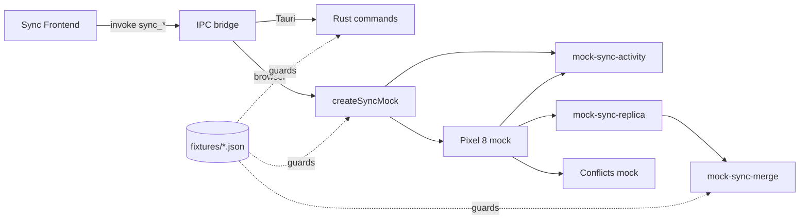
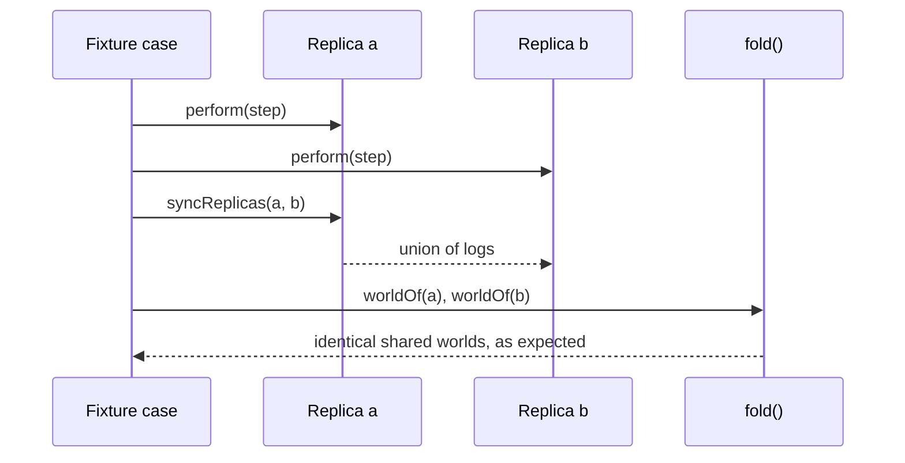
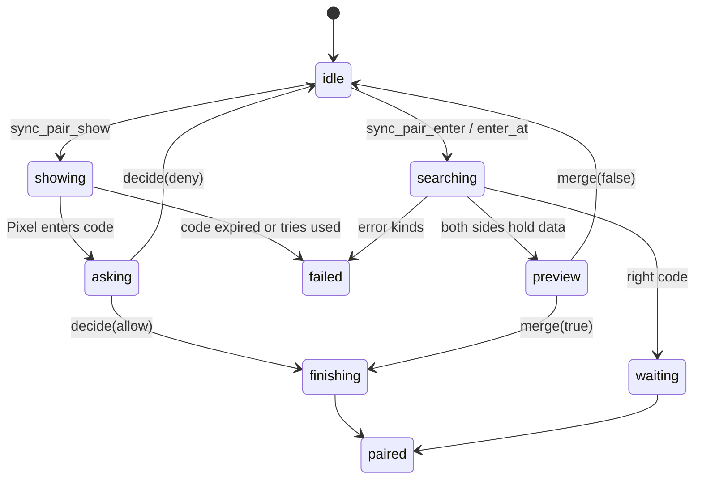

# IPC_Sync_Mocks

The browser-side simulation of the Sync module. When Mnemora runs in a plain browser (`make dev` in a browser, tests, prototypes), there is no Rust backend. The IPC layer then routes `sync_*` commands to TypeScript mocks that behave like the Rust commands in `src-tauri/src/sync*.rs` and `crates/sync`. This lets the Sync pages (Devices, Activity, Conflicts, Pairing) be built and judged without real devices.

The module lives in `src/lib/ipc/`. Its core files are:

| File | Role |
|---|---|
| `mock-sync-activity.ts` | Activity log mock: a seeded, long log, paged newest first, worded like Rust. |
| `mock-sync-merge.ts` | TypeScript copy of Sync's merge rules: a pure fold over a log of records. |
| `mock-sync-replica.ts` | One simulated device: a log, the edits a person makes, and syncing two devices. |
| `mock-sync*.test.ts` | Tests for the device settings, pairing, devices sheet, live status, Local Network permission, merge fixture and the simulated Pixel 8. |

The mock factories used by the tests (`createSyncMock`, `createPixelMock`, `createConflictsMock`, `defaultPairingFlags`) are defined in sibling files that are not core components of this page. They are documented here only through how the tests use them.

For the bridge, the shared command and event plumbing and the other mocks, see [IPC Bridge and Core Mocks](IPC_Bridge_and_Core_Mocks.md) and [IPC Todo Mocks](IPC_Todo_Mocks.md). The real implementations that these mocks mirror are in [Sync Replication Engine](../Sync_Replication_Engine.md), [Sync Conflicts and Resolutions](../Sync_Replication_Engine/Sync_Conflicts_and_Resolutions.md), [Sync Activity and Devices](../Sync_Replication_Engine/Sync_Activity_and_Devices.md) and [Sync Pairing](../Sync_Replication_Engine/Sync_Pairing.md). The commands are exposed by [Sync Connectivity and Pairing](../Tauri_Host_and_Command_Layer/Sync_Connectivity_and_Pairing.md) and [Sync Conflicts and Activity](../Tauri_Host_and_Command_Layer/Sync_Conflicts_and_Activity.md). The UI that consumes them is the [Sync Frontend](../Sync_Frontend.md).

## Why mocks, and how they stay honest

Per ADR 0009, every rule that exists on both sides has a shared fixture, and both implementations run it:

- `fixtures/sync-rules.json` (device-name, unique-name, code-normalisation cases). It is run by `mock-sync.test.ts` and `mock-sync-pairing.test.ts` in TypeScript and by the Rust tests in `src-tauri/src/sync.rs`.
- `fixtures/sync-merge-rules.json` (merge cases). It is run by `mock-sync-merge.test.ts` through this copy and by `src-tauri/src/sync_merge_fixture_tests.rs` through two real devices. See [Backend Integration Test Suites](../Backend_Integration_Test_Suites.md) and [Sync Replication Engine](../Sync_Replication_Engine/Sync_Replication_Engine_Sync_Replication_Engine.md).

If a rule changes in Rust, a fixture case fails on the TypeScript side until the copy follows.

## Merge model (`mock-sync-merge.ts`)

A device's data is its **log of records** (the counterpart of Rust's `change_log`). The state is a pure function of the union of two logs, so both devices always agree.

### Records and schema

- `Rec` is one change of one record: `entity`, `id`, a `stamp` (`ms`, `counter`, `device`), a per-device `seq`, the author's `fields`, and `prev` (what those fields held on the author's device before). A delete also carries `seen`, the highest `seq` of each other device's records that the author held.
- `SCHEMA` mirrors the entities in `crates/todo`, `crates/journal` and `crates/core`. Each field is a class: `value`, `text` or `order`. The helpers `v(group)`, `t(group)` and `o` build these definitions. A `group` makes fields travel as one atomic unit (a Task's When, its state and closed time, title with understood words, a comment's body with its edited mark).
- `LOOK_KEYS` lists the look-and-feel preferences that stay on each device and never sync.
- Entities are `task`, `list`, `comment`, `entry` and `setting`.

### `fold(log)`

`fold` returns an `Outcome`. The steps are:

1. Sort by stamp (`ms`, `counter`, `device`, `seq`) and group records by `entity/id`.
2. For each unit of a document:
   - **Value or Order unit**: taken whole from the newest record that touched it. If the newest author had not seen the previous value (its `prev` differs from what stood), and the value really changed, a `ValueClash` is recorded. `essence` decides what counts as a change: any non-null `deleted_at` is equal to another, and `closed_at` is ignored inside the `state` unit.
   - **Text unit**: `foldText` replays records in clock order. A record whose author had not seen the text before it is merged three-way against `prev`. Companion members of the group (the `edited` mark) are combined too.
3. Detect a **delete met by an edit** (`deleteEdits`): an edit from another device that is later by the clock, or above the deleter's `seen` mark.
4. Split text clashes into live ones (`conflicts`, which wait for a person) and those on deleted records (`deletedConflicts`, resolved at once and only logged).
5. Apply `rules`:
   - Lists with the same normalised name merge into the older one (the lower id, as in Rust `list_sync::settle`). The loser is deleted and recorded in `mergedLists`. Names are normalised by `nameKey` (accents, case and spacing removed).
   - A Task whose List is gone goes to the Inbox and is recorded in `inbox`. A Task moved into a merged List is re-keyed after the survivor's own Tasks with `keyAfter`.

### Text merge

`textMerge(base, ours, theirs)` returns `Piece[]`, each either `{ agreed }` or `{ clash }`. It works in two passes. The first compares lines (`linesOf`) with an LCS diff (`hunksOf`). Where both sides changed the same line, it recurses on word tokens (`tokensOf`: words, runs of spaces, single line breaks), and `settle` trims text the sides share at both ends of a clash. A clash shows `theirs`, the newer side, via `textOf`. The tokenisation mirrors `crates/sync/src/textmerge.rs`.

## Replica (`mock-sync-replica.ts`)

`Replica` is one simulated device: `device`, `log`, `seq`, `look` and a hybrid clock (`lastMs`, `lastCounter`).

- `createReplica(device)` makes one. `syncReplicas(a, b)` gives both the union of their logs, deduplicated by `device/seq`.
- `perform(replica, step, ids, now)` is one person's edit. It implements the fixture's ops: `list_*`, `task_*` (create, edit, priority, title, when, skip, done, move, delete, place), `comment_*`, `entry_*` and `pref`.
  - A repeating Task being completed writes a done copy under the deterministic `occurrenceId`, so completing the same occurrence on two devices is one record.
  - `task_place` uses `keyBetween` and `keyAfter` from `mock-todo-order` for manual order (compare [IPC Todo Mocks](IPC_Todo_Mocks.md)).
- `append` writes only values that differ from what the device shows. A touched group is written complete, but `prev` holds only what the edit changed, which matches Rust's `change_log.prev`. A delete also records `seen`.
- `capture(replica, docs, now)` turns changes made elsewhere in the mock app (the Todo and Journal mocks' `exportDocs`) into records.
- `worldOf(replica, ids, defaults)` projects the folded data into the shape the fixture's `expect` uses (lists, tasks, arrange, order, comments, entries, settings, conflict count, resolved kinds). `byKey` is its ordering helper: by sort key, then id.
- `resolvedKinds(outcome)` gives the sorted kinds of "Resolved automatically" lines: `value`, `delete_edit`, `task_inbox` and `conflict_deleted`.

## Activity mock (`mock-sync-activity.ts`)

`createActivityMock(count = 4000, now, isOpen)` handles only `sync_activity`. It mirrors `crates/sync/src/activity_view.rs`.

- **Data**: `makeEvents` builds a long log from a fixed seed (`seeded`), so the same log appears every time. The size can be changed with `?activity=N`. Events are sessions, raised and resolved conflicts, list merges, pauses, resumes, failures and renames. The oldest event is the first pairing. Two sample open conflicts exist, `mock-conflict-notes` and `mock-conflict-entry`.
- **Order**: `newestFirst` sorts by time, with ties broken by id descending, which is the Rust order.
- **Paging**: the cursor is `at:id`. Pages are clamped to 1–200 rows, and `next` is set only if more rows match. An unreadable cursor throws a `validation` error.
- **Filters**: `all`, `this_device` and `device` (by id). A device filter matches events where it is the device or the peer.
- **Wording**: `describe(event, viewer, isOpen)` is the viewer's view of an event. When the viewer is the peer, session counts are flipped (in and out swap). `left` is worded plainly on the leaving device and by name elsewhere. A `Review` link (`'conflicts'`) is offered only while the conflict still waits, whatever the line said when written.
- `breakdownOf` makes the "Todo: 9 Tasks, 1 List · Journal: 2 Entries · Settings: 1" breakdown, and its counts always add up to in plus out. `subjectWords` words the text a conflict is about. `lineNow` creates a line the mock writes now. `add(...)` lets other mocks append lines and ignores duplicate ids.

## Test suites

| Test file | What it pins down |
|---|---|
| `mock-sync.test.ts` (`fresh`) | Shared name rules, rename uniqueness within a group, Device settings defaults (off, automatic, no mobile data, visible), naming once on enable, options saved, leave forgets peers, `attentionOf` (mirrors `crates/sync/src/attention.rs`), the new-conflicts toast choice. |
| `mock-sync-activity.test.ts` (`everything`, `mock`) | Paging without gaps or repeats, filters, session breakdown arithmetic, Review links only on open conflicts, `left` wording, the cursor error. |
| `mock-sync-devices.test.ts` (`setup`) | Device sheet detail, Rename, the typed Address, Check results, Forget, Sync now for one device, the activity lines Forget, Rename and Leave write, and the mobile-data pause with pairing refused. |
| `mock-sync-live.test.ts` (`setup`) | The simulated Pixel 8's status changes: progress during Sync now, console helper `setPeer`, paused reasons (update, clock). |
| `mock-sync-local-network.test.ts` (`setup`) | The `flags.localNetwork` hook simulates a refused Local Network permission in devices, sheet and attention. It logs one Activity line per blocked episode (not again while it flickers, but again after about 10 minutes), and mobile data is the stronger reason. |
| `mock-sync-merge.test.ts` (`run`, `shared`) | Runs every `sync-merge-rules.json` case on two replicas, checks that the devices agree once look-and-feel keys are removed, and checks `textMerge`. |
| `mock-sync-pairing.test.ts` (`setup`) | Shared fixtures (`uniqueName`, `normaliseCode`), showing a code, typing one, pairing by address, merge preview and every failure kind. |
| `mock-sync-pixel.test.ts` (`setup`) | End-to-end behaviour of the simulated Pixel 8 wired to the Todo, Journal, Conflicts and Activity mocks. |

### Pairing flow in the mock

The magic codes in typed pairing (`00000000` nothing nearby, `20000000` expired, `30000000` declined, `50000000` version mismatch, `92000000` merge preview, and so on) and the `flags.pixel` values (`wrong`, `joins`, `merge`, `merge_cancel`, `never`) are what QA and the tests use to reach every state. The tries lockout stays until `sync_pair_cancel`. These states match the Rust pair protocol in [Sync Pairing](../Sync_Replication_Engine/Sync_Pairing.md).

### The simulated Pixel 8

`createPixelMock` (from `mock-sync-pixel`) owns a `Replica` and syncs it against the mock apps' data. Its `sync()` captures local changes, unions the logs, folds them, imports the result into the Todo, Journal and settings mocks, writes Activity lines, and announces events (`todoChanged`, `journalChanged`, `listsMerged`, `taskDeleted`, `entryDeleted`, `activityChanged`, `settingsChanged`, `newConflicts`). The `scenario` helper stages conflicts, resolved-automatically cases, list merges and remote edits or deletes. Conflicts raised by a sync go through the Conflicts mock. Resolving one with "keep other" writes the chosen text back. A conflict whose record is deleted afterwards is closed without asking and logged once.

## Extending

1. Change the rule in Rust and add a case to the matching fixture in `fixtures/`.
2. Update `SCHEMA`, `fold` or `perform` here until `mock-sync-merge.test.ts` passes.
3. If wording changes, update `describe` in `mock-sync-activity.ts` and `activity_view.rs` together.
