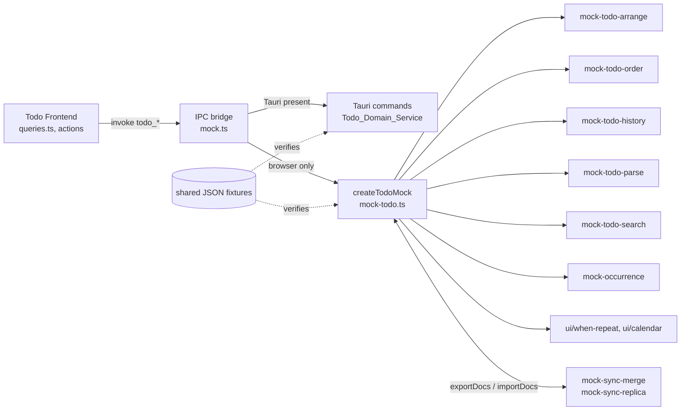
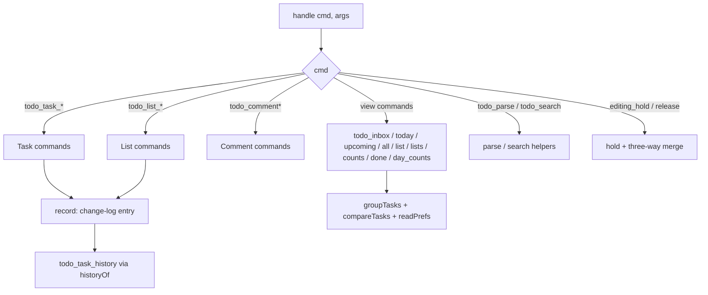
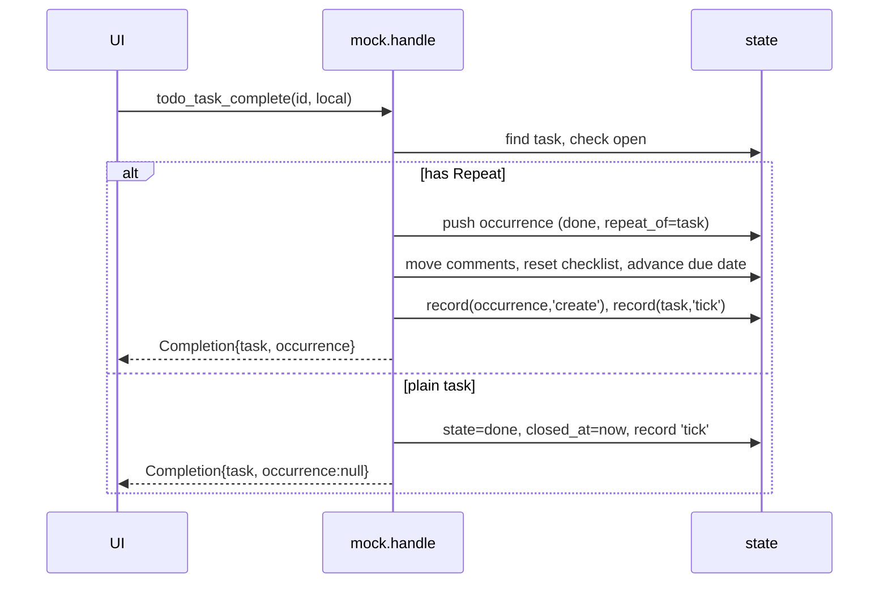
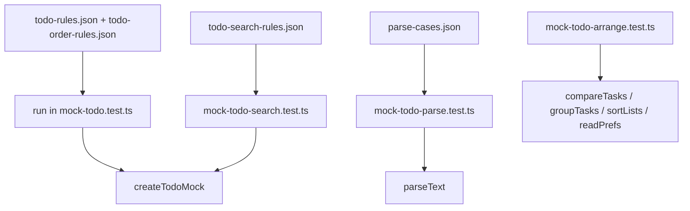

# IPC Todo Mocks

`IPC_Todo_Mocks` is the in-memory, browser-only stand-in for the Rust `crates/todo` backend. When the frontend runs without Tauri (for example under `pnpm dev` in a browser or in Vitest), the IPC layer routes every `todo_*` command to `createTodoMock()` in `src/lib/ipc/mock-todo.ts`. The mock re-implements the Todo rules (validation, ordering, grouping, repeats, change-log history, comments, search, sync hooks) so the UI behaves as it would against the real backend.

The mock is kept honest by **shared rule fixtures** (`fixtures/todo-rules.json`, `todo-order-rules.json`, `parse-cases.json`, `todo-search-rules.json`). The same JSON runs against the Rust commands (`src-tauri/src/todo.rs`, `todo_capture_tests.rs`, `todo_search_tests.rs`, `todo_order_tests.rs`) and against the mock (see ADR 0009), so the two cannot drift.

## Where it fits

- The bridge and general mock plumbing live in [IPC Bridge and Core Mocks](IPC_Bridge_and_Core_Mocks.md); the sync-side mock that consumes `exportDocs`/`importDocs` is in [IPC Sync Mocks](IPC_Sync_Mocks.md).
- The real behaviour being mirrored is documented in [Todo Tasks and Lists](../Domain_Modules_(Todo_and_Journal)/Todo_Tasks_and_Lists.md), [Todo Comments](../Domain_Modules_(Todo_and_Journal)/Todo_Comments.md) and [Todo Domain Service](../Tauri_Host_and_Command_Layer/Todo_Domain_Service.md).
- Consumers are described in [Todo Frontend](../Todo_Frontend.md). Repeat/calendar helpers come from [UI When Picker](../Design_System_and_UI_Components/UI_When_Picker.md).

## Core components

| Component | File | Role |
|---|---|---|
| `createTodoMock(prefs)` | `mock-todo.ts` | Factory returning the mock: `handle(cmd, args)`, `handles`, `handlesEditing`, `ops`, `simulateMerge`, `exportDocs`, `importDocs`, plus `onRemoteChange` / `onHeldClash` callbacks |
| `byDateThenDay` | `mock-todo.ts` | Comparator: due date, then `inDay` (timed tasks first by time, then Priority, then manual key) |
| `byListKey` | `mock-todo.ts` | Comparator for Lists by `sort_key`, tie-broken by id (byte order, like SQLite's default collation) |
| `run` | `mock-todo.test.ts` | Executes one fixture case step by step and returns observable state; mirrors `run_rule_case` in Rust |
| `task`, `titles` | `mock-todo-arrange.test.ts` | Task builder and title projection for grouping/sorting tests |
| `Case`, `brief` | `mock-todo-parse.test.ts` | Fixture shape and span summariser for the natural-language parser |
| `build`, `titles` | `mock-todo-search.test.ts` | Seeds a mock from fixture tasks and returns a search function |

Exported validators mirror Rust: `validateTitle`, `validateBody`, `validateListName`, `validateEmoji`, `foldName` (case/accent folding plus `đ ø ł ı`, as `fold_char` in core), `epochDay`, `isTime`, `resolveWhen`, `resetChecklist`.

## Architecture of the mock

State is closure-local: arrays of `Stored` tasks, lists and comments (soft deletes use `deleted` / `deleted_at`), a per-task change log `logs: Map<taskId, LogRecord[]>`, a list of recorded `ops`, and the editing-hold maps `held` and `waiting`. Every return value is passed through `copy()` (JSON clone) and `wire()` strips mock-only flags and adds `comment_count`, so the UI cannot mutate the "database" (a test asserts this).

### Command groups

- **Tasks**: create (with `NewWhen`, `NewTaskDetails`: notes ≤ 100,000 chars, priority 1–4, repeat, understood words ≤ 4000 chars JSON array), complete, reopen, skip, won't-do, move, set priority, set when, update (session-scoped), delete/restore, quick edit and its undo, reorder, move overdue and its restore.
- **Lists**: create, rename (fold-unique names), emoji, sort, group, reorder, delete with a `DeleteChoice` (`delete_tasks`, `move_to_inbox`, `move_to_list`) and restore from the returned `ListDeletion`.
- **Comments**: add, edit (sets `edited` only when the body changes), delete, restore, list oldest first (≤ 5000 chars).
- **Views**: Inbox, Today (Overdue group + today's groups + tasks done in the device day), Upcoming, All, a single List (with the `done_in_lists` modes), sidebar counts, badge/Home counts (`todo_counts`, card limited to five), paged Done by day, and day counts for the When picker.
- **Parse/Search**: delegated to `parseText` and `searchTasks`.

### Rules worth knowing

- **When resolution** (`resolveWhen`, `settleWhen`): a past date is refused; a time without a date means today if still ahead, otherwise tomorrow; a Repeat without a date lands on `firstMatch`; no date means no time and no Repeat. `assignWhen` re-anchors month/year repeats on a new date unless `keepDay`.
- **Repeating tasks**: completing creates a done occurrence copy with a deterministic `occurrenceId(task.id, due)`, moves comments to it, unticks the Checklist (`resetChecklist`) and advances the due date. Reopening an occurrence rewinds the parent, but only for the latest occurrence while the parent is open. Skip is a `tick` flagged `skipped` so History can tell it apart.
- **Ordering**: `keyAfter` / `placeKey` produce sort keys; `keysAround` considers deleted rows too, as Rust does.
- **Quick edit undo** (`todo_task_quick_edit_undo`) skips the past-date check and keeps the Repeat's day.

## Sync and editing seams (browser-only)

These are not commands; they let the mock sync/devtools simulate a second device.

- `exportDocs()` / `importDocs(docs)` expose every List, Task and Comment (deleted ones too) as `Doc`s for the merge in `mock-sync-merge.ts`. Imports write only differing fields, create unknown rows and log `create`/`update`/`delete`. Repeat fields and `understood` are included so a sync keeps Repeat.
- `simulateMerge(name, device)` mimics Sync merging same-named Lists: a survivor List takes the loser's Tasks and a `TodoListsMergedEvent` is returned.
- **Editing hold** (`editing_hold` / `editing_release`, routed when `handlesEditing` sees entity `todo_task`): while a field (`title` or `notes`) is held, remote values for it wait in `waiting` and other fields refresh immediately. On release, if the typed text is unchanged the waiting text is applied; otherwise `textMerge` performs the three-way merge. `onRemoteChange` fires if the merged text differs; `onHeldClash` fires when the merge contains a real clash (the typing shows and the other text becomes a Conflict). See [IPC Sync Mocks](IPC_Sync_Mocks.md).

## Tests

- `mock-todo.test.ts`: `run(c)` plays a case's steps (create, complete, reorder, list ops, comments, prefs…), records `ok` or the error code per step, then snapshots views (today, upcoming, inbox, all, per-list), History, comments, counts and Done. A case's `expect` keys select which parts to compare. Additional tests cover Done paging by device day (fake timers), day-count exclusion, badge counts, copy-on-return, name folding, taken-name messages, capture/quick edit, simulated list merge, sync docs and the editing hold.
- `mock-todo-arrange.test.ts`: due buckets (`overdue`, `today`, `tomorrow`, `week`, `later`, `no_date`), sort orders, grouping, list sorts, preference defaults (`readPrefs`, `PREF_VALUES`) and the four `done_in_lists` modes.
- `mock-todo-parse.test.ts`: shared parse fixtures; spans are reported in UTF-16 units, kept in order, and repeated words get numbered keys.
- `mock-todo-search.test.ts`: exact vs similar hits, marked title words, windowed snippets, and hostile queries never throwing.

## Maintenance notes

- When a Rust Todo rule changes, update the shared fixture first, then fix both the Rust command and the mock; keep `run` in step with `run_rule_case`.
- `prefs` is a callback taking the full settings key (e.g. `todo.group_today`), mirroring how Rust reads the `settings` table; unknown values fall back to defaults.
- Keep `wire()`/`copy()` on every return path to preserve real-IPC semantics.
