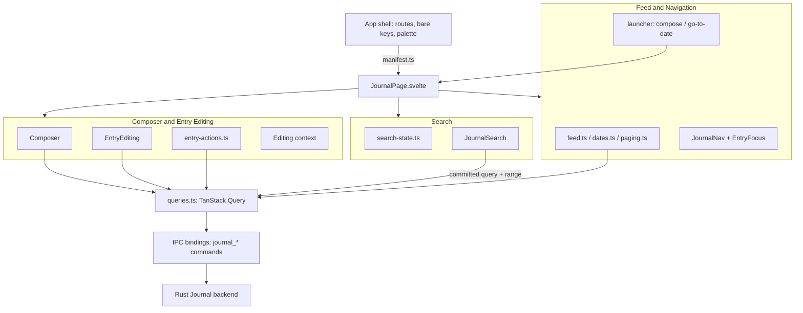
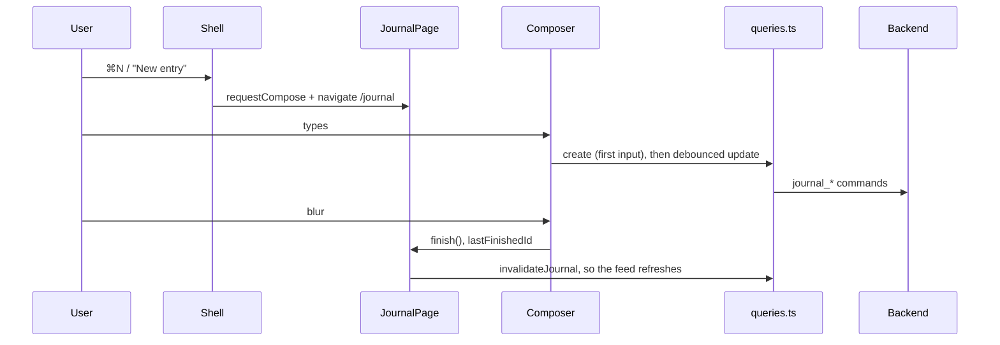

# Journal_Frontend

## Purpose

Journal_Frontend (`src/modules/journal/`) is the client-side UI logic for the Journal. The Journal is a dated feed of Pages, and each Page holds Entries written in Markdown. The module lets a user:

- **Write** new Entries, with autosave and a per-session change record.
- **Edit** existing Entries inline.
- **Browse** the infinite, virtualised feed by date.
- **Search** by words and date range.

It sits between the generated IPC bindings and the app shell. Most rules are pure, DOM-free functions that can be unit tested. Thin Svelte 5 rune classes hold the state and expose it through context. The backend is the [Journal_Module](Domain_Modules_(Todo_and_Journal)/Journal_Module.md), reached through the [Journal_Domain_Service](Tauri_Host_and_Command_Layer/Journal_Domain_Service.md).

## Architecture

`queries.ts` is the shared data layer. It is documented under the composer sub-module but used by all three. `JournalPage.svelte` creates the navigation, focus and editing objects, provides them through context, and renders the feed.

### Sub-modules

| Sub-module | Role |
|---|---|
| Journal_Feed_and_Navigation | Builds the feed rows (Today injection, month dividers) and formats dates. It holds the keyboard-focus reducer and the cross-module launcher mailbox, and it registers the Journal with the shell (route, keys, palette actions, Home card). |
| Journal_Composer_and_Entry_Editing | Holds the `Composer` state machine (create once, then debounced autosave) and per-Entry `EntryEditing` sessions. It also holds the shared `Editing` context, entry actions (delete with undo, move, copy, task tick), remote-delete recovery and the `queries.ts` cache layer. |
| Journal_Search | Holds the pure search session lifecycle (open, park, back, escape), date-range presets, hit grouping and keyboard highlight. It also holds the `JournalSearch` controller with its 150 ms debounce. |

### Typical flow

## Key design points

- **Dependency injection.** `Composer` and `EntryEditing` take their `create`, `update` and timer dependencies through a constructor, so tests drive them with fakes.
- **No lost text.** Failed saves keep the text. Blank text never deletes an Entry. Leaving is guarded while text is unsaved. A remotely deleted Entry can be restored with the person's draft on top.
- **Zone-free dates.** Pages use `YYYY-MM-DD` strings, and Entry times display in the zone they were written in.
- **Optimistic cache edits.** `patchEntry` and `removeCachedEntry` update the cache in place, so the feed does not jump.
- **Search keeps context.** Opening a hit parks the search, and Back restores the same query, range and scroll position.

## Core component documentation

- [Journal_Composer_and_Entry_Editing](Journal_Frontend/Journal_Composer_and_Entry_Editing.md): writing, editing, entry actions and the query layer.
- [Journal_Feed_and_Navigation](Journal_Frontend/Journal_Feed_and_Navigation.md): the feed model, dates, focus, navigation state and the shell manifest.
- [Journal_Search](Journal_Frontend/Journal_Search.md): search sessions, ranges, results and the debounced controller.