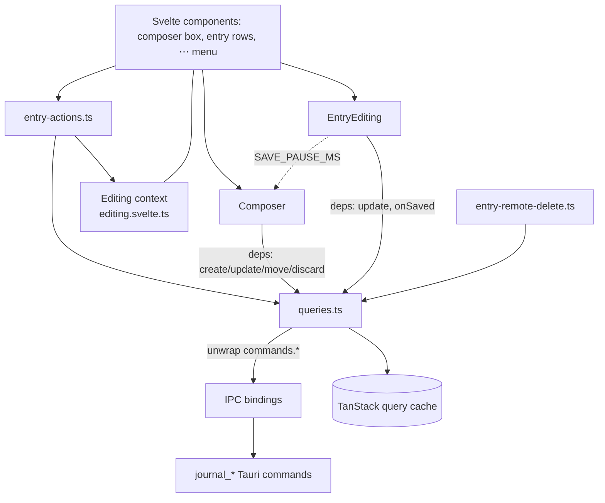
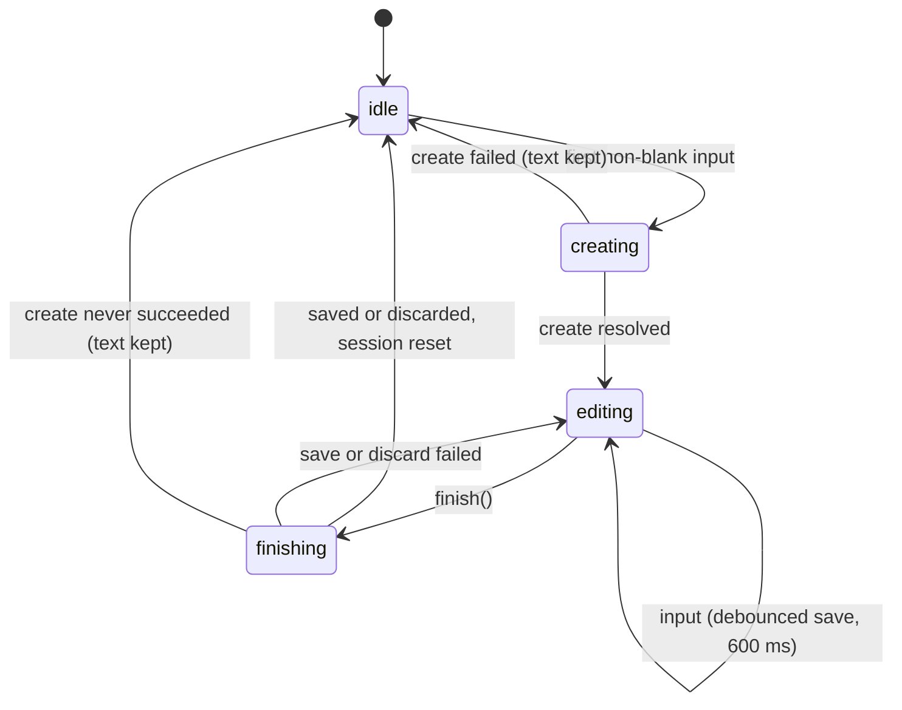
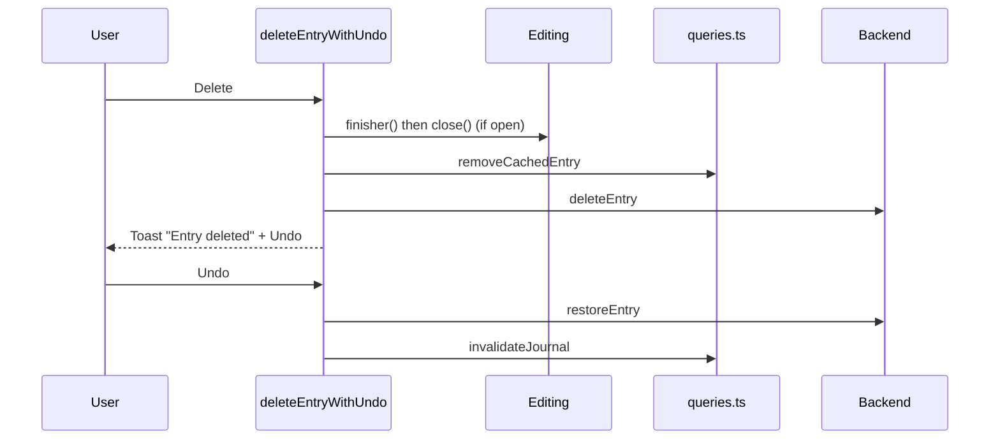

# Journal Composer and Entry Editing

This module is the writing side of the Journal frontend (`src/modules/journal/`). It covers three things:

- **Creating entries**: the `Composer`, which turns typing into one created Entry and later autosaved updates.
- **Editing existing entries**: `EntryEditing`, which runs one inline editing session per Entry. `Editing` is the shared state that says which Entry is open.
- **Acting on entries**: delete with undo, move, copy, task ticking, remote-delete recovery, and the TanStack Query layer that talks to the backend.

The browsing side is in [Journal_Feed_and_Navigation](Journal_Feed_and_Navigation.md) and [Journal_Search](Journal_Search.md). The parent page is [Journal_Frontend](../Journal_Frontend.md). The Rust side is in [Journal_Module](../Domain_Modules_(Todo_and_Journal)/Journal_Module.md) and [Journal_Domain_Service](../Tauri_Host_and_Command_Layer/Journal_Domain_Service.md).

## Architecture

`Composer` and `EntryEditing` do not call IPC directly. Both receive their dependencies (`create`, `update`, `setTimer`, `onError` and so on) through a constructor interface, so the unit tests drive them with fakes and a manual timer. The Svelte components wire them to `queries.ts`.

## Composer (`composer.ts`)

The composer is a small state machine: `idle → creating → editing → finishing → idle`.

Behaviour:

- **A blank composer never creates anything.** The first visible character calls `deps.create(text, sessionId, pageDate)`. `pageDate` is the date chip's choice, and `null` means Today.
- **Autosave.** Later typing restarts a `SAVE_PAUSE_MS` (600 ms) timer through `deps.setTimer`. When it fires, `deps.update(id, text, sessionId)` runs. `EntryEditing` imports the same constant, so both paths pause for the same time.
- **Serialised saves.** Every job is chained onto a private promise queue (`#enqueue`), so create, move and update never overlap. Typing during `creating` is saved after the create resolves, because `#create` re-schedules when `text` changed.
- **Session id.** One id is generated per composer session (`newSessionId`) and reset after each finish. The backend change log keeps one record per session, so a burst of autosaves reads as one edit (see [Sync_Conflicts_and_Resolutions](../Sync_Replication_Engine/Sync_Conflicts_and_Resolutions.md) for how sessions are merged).
- **`finish()`** runs on blur or when leaving:
  - It cancels the timer, flushes pending text and waits for the queue.
  - It returns `false`, keeping the text, if any save failed, so nothing is lost.
  - If the text is blank and an Entry was created, it calls `deps.discard(id)`. If the discard fails, the phase goes back to `editing`.
  - On success it sets `lastFinishedId`, which the feed uses to play the arrival animation, and then resets.
  - A second call while `finishing` is refused with `false`.
- **Blank while focused.** The Entry is not discarded. Retyping reuses the same Entry, because `update` is skipped for blank text. The `cleared` getter exposes this state: an Entry exists and its text is blank.
- **`setPageDate(date)`** stores the chip value. If an Entry already exists and `date` is not `null`, it queues `deps.move`. Choosing `null` only affects the next Entry. A failed move is reported and the text is kept.
- **`unsaved`** is true for text that failed to store (a failed create, or edits left behind by a failed update). `saveNow()` retries immediately and is used by Retry, blur and leaving.

## EntryEditing (`entry-editing.ts`)

`EntryEditing<E>` is one editing session of an existing Entry. It is constructed with `(deps, id, initialText, sessionId)`.

- `input(text)` restarts the debounce timer only if the text is `unsaved`. Typing back to the saved text cancels the pending save.
- `unsaved` means the text is non-blank and differs from the last saved text.
- **Blank text is never saved.** `blankKept` flags blank text over a stored Entry. Clearing everything and leaving keeps the previous text, because clearing never deletes an Entry here. Deletion is an explicit action.
- `flush()` saves now and resolves `true` when nothing unsaved remains. After a failure it returns `false`, and calling it again is a retry. The next edit also retries.
- Each success calls `deps.onSaved(entry)`. The component uses this to call `patchEntry` so the cache updates in place.
- `abandon()` is used when the Entry is deleted elsewhere. It stops all further saves and returns `{ text, saved }`, which `restoreWithDraft` uses.

## Editing context (`editing.svelte.ts`)

`Editing` is a Svelte 5 rune class provided through context with `provideEditing` and read with `useEditing`. It holds journal-wide editing state:

| Field | Purpose |
|---|---|
| `id` | The Entry open for inline editing. The other rows dim. |
| `active` (`ActiveEditor`) | The focused editor. The phone KeyboardBar calls `run(command)` on it. |
| `arrived` | The Entry the composer just finished, so its row plays the arrival once. |
| `slashValues`, `font`, `spellcheck` | Editor settings fed from General Settings, the Journal preference and the device setting. |
| `finisher` | Set by the open editor. It saves and closes, and returns `false` if text is still unsaved. |
| `abandon` | Set by the open editor. It drops the session and returns the held and saved text. |

`open(id)` finishes any other open Entry first. If that Entry can't be saved, it stays put, so unsaved text is never dropped. `close()` clears `id`, `finisher` and `abandon`.

`journalLeaveGuard` is a [`LeaveGuard`](../Frontend_Platform_and_Shell/App_Bootstrap_and_Platform_Utilities.md) that asks before leaving the Journal with text that failed to save. The editor itself is the [Markdown_Editor](../Design_System_and_UI_Components/Markdown_Editor.md).

## Entry actions (`entry-actions.ts`)

| Function | Behaviour |
|---|---|
| `tickTask(entry, line)` | Optimistic. It computes the new body with `toggleTaskLine`, patches the cache, then calls `toggleTask`. On failure it invalidates the journal queries and shows an error toast. |
| `copyEntryText(entry)` | Writes the Markdown body to the clipboard and shows a toast. |
| `deleteEntryWithUndo(entry, editing, onrestored?)` | If the Entry is open, it finishes it first, so the last keystrokes are saved and the restore brings them back, and then closes the editor. It removes the Entry from the cache, calls `deleteEntry`, and shows an Undo toast. Undo calls `restoreEntry`, invalidates the queries and runs `onrestored`. |
| `moveEntryToDate(entry, date, editing, nav)` | Used by the ⋯ menu. It finishes the open editor first and aborts if that fails. It moves the Entry, invalidates the queries, and shows a "Moved to …" toast. The toast's Show action scrolls to the Entry through `nav.scrollTo`. |
| `moveEditedEntry(entry, date, flush, nav)` | Used by the editor's own date chip. It flushes without closing, moves the Entry, then scrolls to it. The row reopens in edit mode because the session is keyed by Entry id. There is no toast. |

## Remote deletes (`entry-remote-delete.ts`)

When another device deletes the Entry being edited, a `JournalEntryDeletedEvent` arrives. The event comes from the host and the event bridge (see [IPC_Bridge_and_Core_Mocks](../IPC_Bridge_and_Browser_Mocks/IPC_Bridge_and_Core_Mocks.md)).

- `followEntryDelete(openId, event, today)` returns a toast message only if the deleted Entry is the open one. An Entry has no title, so the message names its Page: "‘Wed 21 Oct’ was deleted on Pixel 8".
- `restoreWithDraft(deps, id, draft)` restores the Entry, then saves the person's unsaved text on top. It never overwrites remote edits:
  - If the restored body equals the saved text, the draft replaces it.
  - If the restored body was also edited elsewhere and the draft extends the saved text, only the new tail is appended.
  - Otherwise the whole draft is appended after a blank line.
  - Blank drafts are never saved.

This ties into the backend editing holds described in [Sync_Replication_Engine](../Sync_Replication_Engine.md) (`editing_hold` in [Tauri_Host_and_IPC_Bridge](../Tauri_Host_and_Command_Layer/Tauri_Host_and_IPC_Bridge.md)).

## Queries (`queries.ts`)

TanStack Query options and mutation helpers over the generated `commands.*` bindings, with errors raised by `unwrap`.

- **Keys** (`journalKeys`): `all`, `pages`, `window(anchor)`, `search(query, from, to)`, `today(date)`, `monthDays(year, month)`.
- **Reads**:
  - `todayQuery`: the Home card's count and latest snippet.
  - `monthDaysQuery`: the Calendar's dots.
  - `searchQuery`: uses `keepPreviousData`, so typing never flashes empty.
  - `pagesQuery(anchor)`: an infinite query over a window of Pages, newest first. An anchor date starts the window at that date, so only the Pages around it load. Older Pages load downward and newer ones are prepended upward, using the helpers in `paging`.
- **Writes**: `createEntry` (with `deviceWrittenWhere`, the device time zone and offset), `updateEntry`, `moveEntry`, `toggleTask`, `deleteEntry` and `restoreEntry`.
- **Cache edits**:
  - `patchEntry` replaces an Entry in place.
  - `removeCachedEntry` removes an Entry, and a Page left empty goes with it.
  - Both go through `editCachedPages` and recompute `entry_count` and `word_count`.
  - They exist so the feed neither jumps nor flashes old text while an Entry is edited.
- `invalidateJournal()` refetches everything. The feed does not refresh while the composer is open and refreshes once it finishes.

`queries.test.ts` mocks `journalPages` with the real paging rules from `mock-journal-pages`. It checks that:
- the window opens at the anchor;
- newer Pages are prepended in order until the top;
- refetching keeps group order without repeats;
- an empty newer group at the exact top is survived.

## Tests

- `composer.test.ts` and `entry-editing.test.ts` use a `setup()` helper with fake deps, a manual timer and a recorded call log. They cover the create/update ordering, failures, retry, the chip move ordering, discard behaviour and the double-finish guard.
- `queries.test.ts` covers feed window paging.

## Related modules

- [Journal_Feed_and_Navigation](Journal_Feed_and_Navigation.md): the feed, `JournalNav.scrollTo`, dates and focus.
- [Journal_Search](Journal_Search.md): the search UI that reuses `searchQuery`.
- [Journal_Module](../Domain_Modules_(Todo_and_Journal)/Journal_Module.md): the Rust repository and sync behind these commands.
- [IPC_Bridge_and_Core_Mocks](../IPC_Bridge_and_Browser_Mocks/IPC_Bridge_and_Core_Mocks.md): the bindings and browser mocks for the journal commands.
- [Todo_Quick_Capture_and_Editing](../Todo_Frontend/Todo_Quick_Capture_and_Editing.md): the analogous `TaskEditing` session for tasks.
