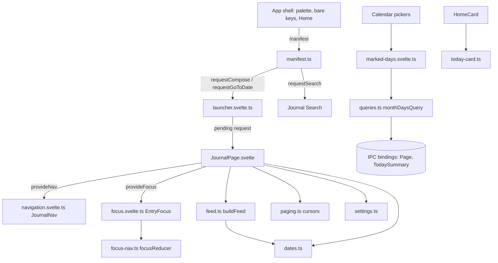
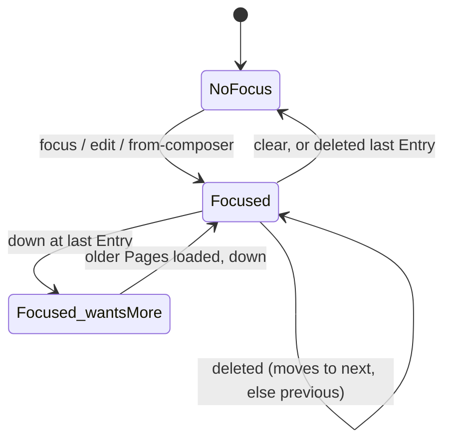
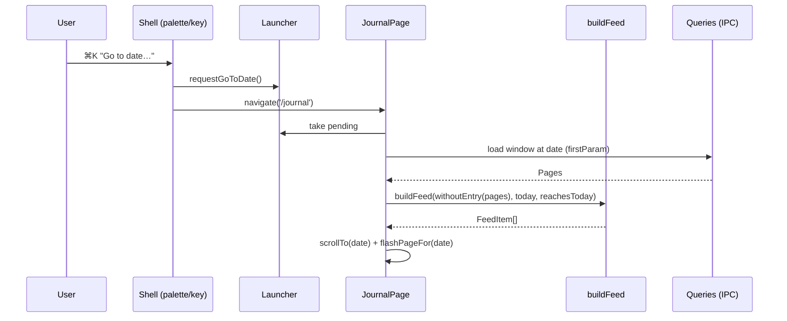

# Journal Feed and Navigation

The **Journal Feed and Navigation** module is the part of the Journal frontend (`src/modules/journal/`) that decides *what the Journal shows* and *where the user is pointing*. It turns the loaded Pages into a flat list of virtual-feed rows, formats dates and times for display, tracks keyboard focus across Entries, carries cross-module requests ("compose", "go to date") into the Journal, and registers the Journal with the app shell.

It contains almost no I/O. Most logic is pure functions (`feed.ts`, `dates.ts`, `focus-nav.ts`, `paging.ts`, `settings.ts`, `today-card.ts`) with thin Svelte 5 rune wrappers (`focus.svelte.ts`, `navigation.svelte.ts`, `launcher.svelte.ts`, `marked-days.svelte.ts`) that wire them to the UI via context.

Sibling modules: [Journal Composer and Entry Editing](Journal_Composer_and_Entry_Editing.md) (writing and editing Entries, and the `queries.ts` data layer) and [Journal Search](Journal_Search.md). Backend data comes from the [Journal Module](../Domain_Modules_(Todo_and_Journal)/Journal_Module.md) via the [Journal Domain Service](../Tauri_Host_and_Command_Layer/Journal_Domain_Service.md). Shell integration (routes, bare keys, palette) is described in [Shell and Navigation](../Frontend_Platform_and_Shell/Shell_and_Navigation.md) and [Router](../Frontend_Platform_and_Shell/Router.md).

## Architecture

`JournalPage.svelte` (not in this module's core set) is the orchestrator: it creates `JournalNav` and `EntryFocus`, provides them through context, registers callbacks on them, and renders the feed.

## Components

### Feed model — `feed.ts`
- **`FeedItem`**: either `{kind:'page'}` or `{kind:'month'}` (a faint month divider).
- **`buildFeed(pages, today, reachesToday = true)`**: input is Pages newest-first. Returns `[]` for a Journal with no Pages (first-run empty state). Otherwise ensures Today's Page exists (empty if needed) when the window reaches Today; a window opened on a far date (`reachesToday=false`) does not get Today injected. Future Pages sit above Today. A month divider is inserted wherever the month changes, never above the first row. Keys are `page-<date>` / `month-<yyyy-mm>`.
- **`upcomingCount(pages, today)`**: number of loaded Pages after Today (never counts the synthetic empty Today).
- **`withoutEntry(pages, id)`**: hides the Entry the composer is still writing, adjusting `entry_count`/`word_count` and dropping a Page left empty by it; returns the same array reference when nothing changes.
- **`openIndex(feed, today)`**: opens on Today's row when future Pages exist above it, else row 0.
- **`pageIndex`** / **`pageAt(feed, index)`**: find a Page row by date, or the nearest Page row at or above an index (skipping dividers) — used to know which date is being read.
- **`calendarStart(inView, today)`**: month and selected day the Calendar opens on.

### Dates and labels — `dates.ts`
All calendar dates are `YYYY-MM-DD` strings with no zone; formatting uses UTC on both ends so the viewer's zone never shifts a date. Entry times are shown in the zone they were *written* in (`writtenAt + offsetMin`).

| Function | Purpose |
|---|---|
| `localDateString(now)` | Device-calendar date: default Page for a new Entry and Today |
| `pageHeading(date, today)` | Title ("Tuesday, 20 October"), year (other years only), Today/Yesterday badge |
| `pageSummary(entries, words)` | "2 entries · 40 words" |
| `chipLabel` / `dayLabel` | Composer/editor chip: Today, Yesterday or short date |
| `dayHue` | Colour token: `--day-today`, `--day-yesterday`, else `--hue-journal` |
| `writtenDateLabel` | Date shown beside an Entry time only when written on a different day than its Page |
| `fullWritten`, `editedLabel` | Tooltip texts for written time and the "edited" mark |
| `monthLabel` | Month divider text |
| `showTodayPill` / `showUpcomingPill` | Scroll-position rules for the "↑ Today" and "↑ Upcoming (n)" pills |

The two pills are mutually exclusive: Upcoming shows from Today's top (within a 24 px slack) down to one viewport below; beyond that the Today pill takes over. If the loaded window is `away` from Today (a far-date jump), only the Today pill shows.

### Keyboard focus — `focus-nav.ts` and `focus.svelte.ts`
`focus-nav.ts` is a pure reducer over the loaded Entries in feed order (`feedEntries(pages)`: newest Page first, oldest Entry first within a Page).

Events: `up`, `down`, `focus`, `clear`, `from-composer`, `edit`, `stop-edit`, `deleted`. ↓ at the end sets `wantsMore` so the wrapper can load older Pages. `newestEntryId` picks the target for ↑ from an empty composer: the last Entry of Today, else of the newest earlier Page; never a future Page.

`EntryFocus` (Svelte class) holds the state in `$state.raw`, and exposes callbacks `reveal`, `loadOlder`, `toToday` that `JournalPage` registers. `move()` sends the event, loads older Pages if `wantsMore`, re-sends `down`, then reveals the Entry. `fromComposer()` first returns the feed to Today. `dispose()` nulls the callbacks. Access via `provideFocus` / `useFocus` context.

### Navigation state — `navigation.svelte.ts`
`JournalNav` is shared via context between feed, composer and Entry actions:
- `flashEntry` / `flashPage` with `flashEntryFor(id)` / `flashPageFor(date)`: tint for 1550 ms, restarting if already active (clear, then set in a microtask so the animation retriggers).
- `weekStart`, `today` (moved at midnight by `JournalPage`), `composerDate` (null = Today), `composingId` (the Entry hidden from the feed via `withoutEntry`).
- Registered callbacks: `scrollTo(date, entryId?)`, `focusComposer`, `compose`.
- `writeOn(date)`: moves the composer chip and focuses it. `dispose()` clears timers and callbacks.

### Launcher — `launcher.svelte.ts`
A one-slot mailbox (`launcher.pending`: `'compose' | 'go-to-date' | null`). `requestCompose()` and `requestGoToDate()` set it; the Journal consumes it once showing. This lets ⌘N/⌘K/Home card requests work even when the Journal is not yet mounted.

### Manifest — `manifest.ts`
`journalManifest` registers the module with the shell: id `journal`, route `/journal` (lazy `JournalPage.svelte`), nav order 20, a Home card, a settings section, bare keys (`n` compose, `j` open, `/` search while on `/journal`) and palette actions (New entry, Search Journal, Go to date…, and a query-aware "Search Journal for…"). `compose(ctx)` calls `requestCompose()` then navigates to `/journal`.

### Other pieces
- **`marked-days.svelte.ts` → `useMarkedDays`**: for a date picker, runs three `monthDaysQuery` queries (previous, current, next month) only while the picker is open, merging them into a `Set` of days having Entries (the coral dots).
- **`settings.ts`**: `readJournal(values)` narrows `journal.font` (`serif|sans`), `journal.width` (`narrow|default|wide`) and `journal.page_summary` with fallbacks; Rust validates. `columnWidth` maps width to rem (35.5 / 42.5 / 53) so it scales with text size.
- **`today-card.ts`**: `todayCardText(summary)` produces the Home card quote (curly-quoted latest snippet) and meta ("Today · 3 entries" or "Nothing written today").
- **`paging.ts`** (tested by `paging.test.ts`): cursor helpers `firstParam`, `olderParam`, `newerParam`, `PAGE_SIZE` for infinite queries. A full group means more may follow; a short group ends that direction; a window anchored on a date (`direction: 'from'`) tries once upward.

## Data flow

## Testing
Unit tests accompany each pure module: `feed.test.ts` (feed building, month dividers, Today injection, midnight rollover), `focus-nav.test.ts` (reducer transitions), `paging.test.ts` (cursor logic) and `today-card.test.ts`. Run with `make test` (see [Build and Config](../Build,_Tooling_and_Packaging/Build_and_Config.md)).

## Design notes
- Pure-function cores keep date, feed and focus rules testable without the DOM; Svelte classes only hold state and callbacks.
- Callbacks are registered by `JournalPage` instead of imported, avoiding circular dependencies between rows/actions and the page.
- Dates are zone-free strings; instants carry their own offset so Entries always display in the zone they were written in.
