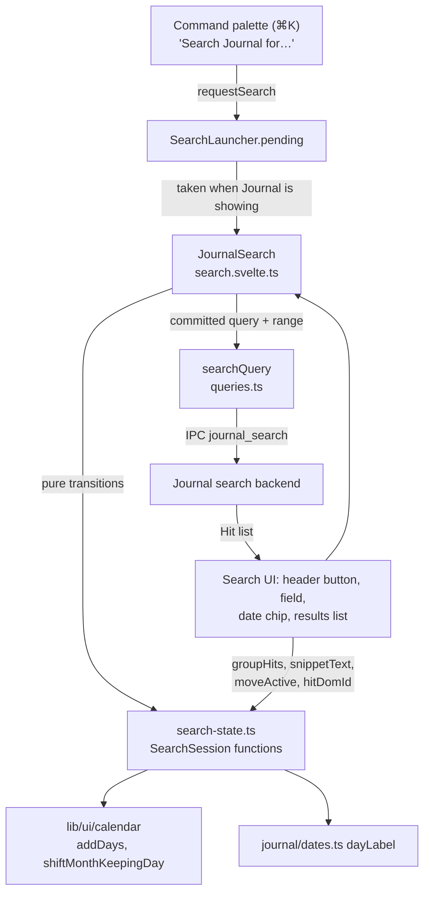
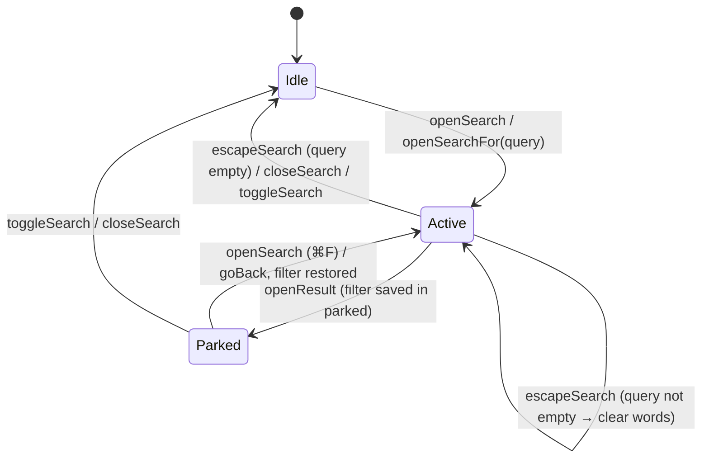
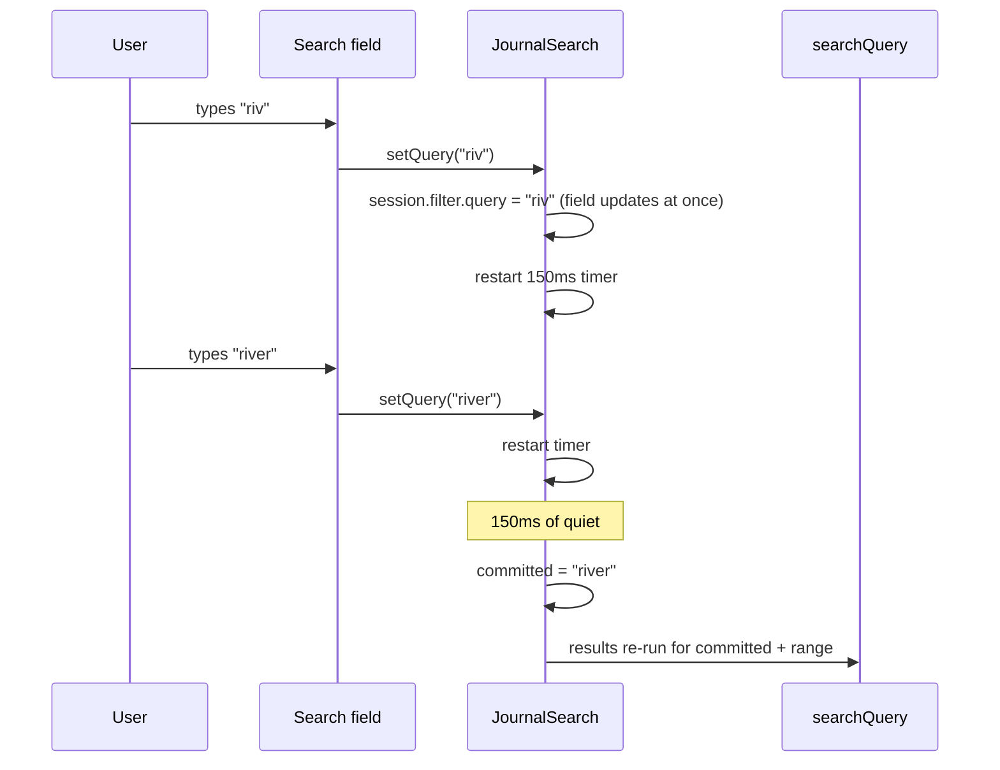

# Journal_Search

The Journal_Search module is the frontend logic behind searching the Journal. It lives in `src/modules/journal/` and has two parts:

- `search-state.ts` holds pure functions and types. It covers the search session lifecycle, date-range presets and labels, grouping of hits by Page, and keyboard-highlight helpers.
- `search.svelte.ts` wraps those functions in a Svelte 5 reactive class, `JournalSearch`. The class adds the 150 ms debounce and a small launcher that lets code outside the Journal (the command palette) request a search.

The module calls no IPC itself. It only decides what the user is searching for. The query layer (`searchQuery` in `queries.ts`, see [Journal_Composer_and_Entry_Editing](Journal_Composer_and_Entry_Editing.md)) sends that filter to the backend `journal_search` command. The Rust search is described in [Journal_Module](../Domain_Modules_(Todo_and_Journal)/Journal_Module.md) and [Journal_Domain_Service](../Tauri_Host_and_Command_Layer/Journal_Domain_Service.md). The `Hit` and `Span` types come from the generated IPC bindings (see [IPC_Bridge_and_Core_Mocks](../IPC_Bridge_and_Browser_Mocks/IPC_Bridge_and_Core_Mocks.md)).

## Architecture

The split is deliberate. All decisions live in `search-state.ts` as pure functions that are unit tested without a DOM (`search-state.test.ts`). `JournalSearch` only stores the result and manages the timer.

## The search session (`search-state.ts`)

### Data types

| Type | Meaning |
|---|---|
| `SearchRange` | `{from, to, preset}`: Page dates, ends included. `preset` is set when the range came from the menu, otherwise `null`. |
| `SearchFilter` | `{query, range}`: what the user is looking for. |
| `SearchSession` | `{active, filter, parked}`: the view's lifecycle. `parked` holds the filter of a search left by opening a result. |
| `HitGroup` | `{date, label, start, hits}`: consecutive hits sharing a Page. |

`IDLE` is the closed, empty session. `SEARCH_DEBOUNCE_MS` is 150.

### Session transitions

- **`openSearch`** does nothing if search is already active. Otherwise it resumes the `parked` filter if there is one, and falls back to a blank filter.
- **`openSearchFor(query)`** always opens a fresh search holding the query, with no range. The palette uses this.
- **`openResult`** closes search and moves the current filter into `parked`. If search is not active, it returns the same session unchanged.
- **`goBack`** is the Back action. With a parked search it resumes it, otherwise it closes search.
- **`toggleSearch`** is the header button. From idle it opens a blank search. If search is active or parked, it closes for good and clears the filter.
- **`escapeSearch`** clears the words first. Pressing it again closes search, and the range is cleared then too.
- **`wantsBack`** is true when search is active or parked, so the router's back handling can ask whether search should take the press (see [Router](../Frontend_Platform_and_Shell/Router.md)).

### Date range

- **`presetRange(id, today)`** gives the same calendar day a week, a month or a year earlier, up to `today`. A week is `addDays(today, -7)`, a month is `shiftMonthKeepingDay(today, -1)`, and a year is `shiftMonthKeepingDay(today, -12)`. The shift helpers come from [UI_Widgets_and_Interaction](../Design_System_and_UI_Components/UI_Widgets_and_Interaction.md) (`calendar.ts`). Tests confirm the clamp to a shorter month (31 Mar → 28 Feb) and the leap-day case.
- **`rangeLabel(range, today)`** is the text on the date chip:
  - `null` gives "Any date".
  - A preset gives its label ("Past week", "Past month" or "Past year").
  - A single day gives "5 Oct".
  - A span gives "5 Oct – 12 Oct".
  - The year is appended to a date outside `today`'s year.
- **`canSearch(filter)`** is true when the trimmed query is non-empty or a range is set. A range alone lets the user browse a period.

### Results helpers

- **`groupHits(hits, today, first = 0)`** groups consecutive hits by `page_date`. The Rust side sorts the hits, and the function does not re-sort. Each group's `start` is its first hit's position in the whole list (`first` + preceding hits). That position matches the keyboard highlight index, and `first` lets a paged list continue the numbering. The label comes from `dayLabel` in `dates.ts`, see [Journal_Feed_and_Navigation](Journal_Feed_and_Navigation.md).
- **`hitDomId(listId, hit)`** gives `${listId}-${hit.id}` for `aria-activedescendant`.
- **`moveActive(index, key, count)`** moves the highlight with ArrowDown or ArrowUp. `-1` means no result is highlighted, with focus in the field. It stops at the last result and at `-1`, and returns `-1` when `count` is 0.
- **`entriesLabel(n)`** gives "1 entry" or "n entries".
- **`snippetText(spans)`** joins the snippet spans without marks, for screen readers.

## The reactive controller (`search.svelte.ts`)

`JournalSearch` holds:

- `session` (`$state.raw`): the current `SearchSession`.
- `committed` (`$state`): the query the results follow.
- `savedScroll`: the results list's scroll position when it was left through a result.
- A private debounce timer.

Getters: `active`, `parked` (whether `session.parked !== null`), `query` and `range`.

Every method applies a pure transition through the private `#set`. `#set` clears the pending timer, stores the new session, sets `committed` to the new query immediately, and resets `savedScroll` to 0 once there is nothing left to return to (not active and nothing parked).

Methods: `open`, `openFor`, `toggle`, `close`, `park(scrollTop)`, `back`, `escape`, `setRange` and `dispose`. `park` records the scroll position and then calls `openResult`.

### Debounce

Typing in `setQuery` updates the visible field at once but moves `committed` only after 150 ms of quiet. Every other change (opening, closing, changing the range, Escape, Back) goes through `#set`, which commits immediately and cancels any pending timer. Consumers should drive the results from `committed` and `range`, not from `query`.

`dispose()` clears the timer when the owning component is torn down.

### External launching

`requestSearch(query)` writes `searchLauncher.pending`, a reactive `SearchLauncher` singleton. The Journal view takes the pending value when it is showing and calls `openFor(query)`. An empty string opens a blank search. This is how the "Search Journal for…" palette action reaches the Journal. See [Shell_and_Navigation](../Frontend_Platform_and_Shell/Shell_and_Navigation.md) for the palette side.

## Behaviour to remember

1. **Back preserves context.** Opening a hit parks the filter, and Back or ⌘F restores the same query and range. `JournalSearch` also keeps the scroll offset in `savedScroll`. Any other exit (header toggle, Escape on an empty query, `close`) discards the parked filter for good.
2. **Escape is two-step.** The first press clears the words, and the second closes search.
3. **Ranges are inclusive Page dates.** They are the `YYYY-MM-DD` strings used across the Journal, not timestamps.
4. **Searching needs a reason.** A blank query with no range does not search (`canSearch`).

## Testing

`search-state.test.ts` (Vitest) covers:

- preset arithmetic and month clamping
- range labels
- `canSearch`
- the full session lifecycle: open, close, park, Back, ⌘F, Escape, palette open, toggle
- hit grouping and `first` offsets
- the small helpers

`search.svelte.ts` has no test file of its own.
