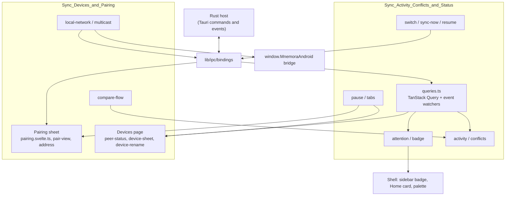
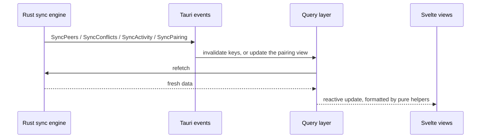

# Sync_Frontend

## Purpose

`Sync_Frontend` (`src/modules/sync/`) is the UI side of Mnemora's device sync. It lets people see what sync is doing, pair and manage devices, and resolve what needs them.

The code is mostly small, pure formatters and light state holders. **Rust owns the truth.** It decides pairing phases, what counts as a conflict, how activity rows are phrased and what pauses sync. This module fetches that data, stores only transient UI state (open sheets, typed digits, drafts) and turns it into plain wording for the views.

It has two parts:

| Sub-module | Responsibility |
|---|---|
| [Sync_Activity_Conflicts_and_Status](Sync_Frontend/Sync_Activity_Conflicts_and_Status.md) | The Activity log, the Conflicts list and Compare rows, attention surfaces (sidebar badge, Home card, palette hint, toast), pause banners, the on/off switch, "Sync now", resume handling, tab routing, and the TanStack Query layer. |
| [Sync_Devices_and_Pairing](Sync_Frontend/Sync_Devices_and_Pairing.md) | The Devices page, the per-device sheet and rename, the pairing sheet (show code, enter code, pair by address, merge preview), local-network and multicast platform glue, and device-status wording. |

## Architecture

### Data flow

Rust events invalidate query keys. Queries refetch with `staleTime: Infinity`, except Activity, which uses 0. Pure formatters then turn the fresh data into text and groups for the views.

### Design points

- **Events, not timers.** Freshness comes from Tauri events. The only timer is `refreshWhileVisible`, which re-reads this device's addresses every 10 s because networks can change without a Sync event.
- **URL as sheet state.** The pairing sheet (`?pair=`) and the device sheet (`?device=`) both use `urlParam`. Back closes them and reload restores them. A stale `?pair=` is dropped.
- **Three tabs, three addresses.** Devices is `/sync`, Conflicts is `/sync/conflicts` and Activity is `/sync/activity`. Compare (`/sync/conflicts/<id>`) belongs to the Conflicts tab.
- **Shared fixtures.** The address rules and error wording are checked against the same fixtures as the Rust code. The browser mocks use them too.
- **Cleanup.** Listeners and watchers return stop functions that are called on unmount, so nothing runs while Sync is off.
- **Attention precedence.** A pause or a local-network block outranks the conflict count in the sidebar badge, because nothing will arrive until it is dealt with.

## Core component documentation

- [Sync_Activity_Conflicts_and_Status](Sync_Frontend/Sync_Activity_Conflicts_and_Status.md): queries, activity, conflicts, attention, pause, switch and tabs.
- [Sync_Devices_and_Pairing](Sync_Frontend/Sync_Devices_and_Pairing.md): pairing state machine, device sheet and rename, local-network glue.

## Related documentation

- Engine: [Sync_Replication_Engine](Sync_Replication_Engine.md)
- Tauri commands: [Sync_Connectivity_and_Pairing](Tauri_Host_and_Command_Layer/Sync_Connectivity_and_Pairing.md) and [Sync_Conflicts_and_Activity](Tauri_Host_and_Command_Layer/Sync_Conflicts_and_Activity.md)
- Browser mocks: [IPC_Sync_Mocks](IPC_Bridge_and_Browser_Mocks/IPC_Sync_Mocks.md)
- Shell hooks: [Shell_and_Navigation](Frontend_Platform_and_Shell/Shell_and_Navigation.md)