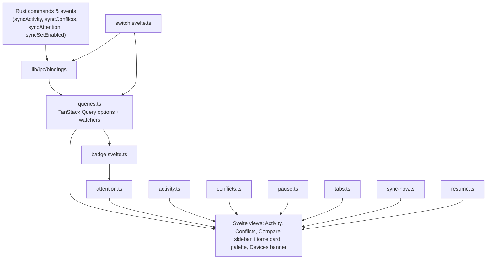
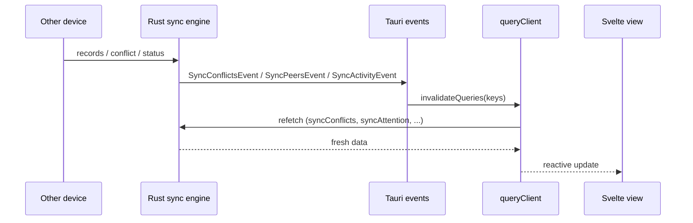
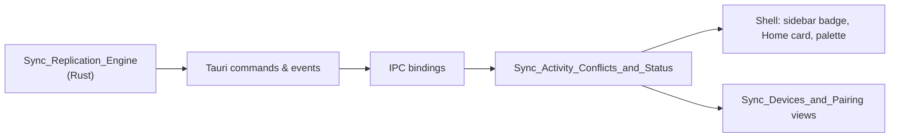

# Sync_Activity_Conflicts_and_Status

This module is the part of the Sync frontend (`src/modules/sync/`) that shows people what sync is doing and what needs them. It covers four things:

- the **Activity** log, with its filters, day grouping and virtual-list helpers;
- the **Conflicts** list and the rows used by Compare;
- **attention**: the sidebar badge, the Home card line, the palette hint and the toast;
- **status plumbing**: the on/off switch, the paused banner, the "Sync now" action, resume handling and the tab routing.

The code is small, mostly pure functions that are easy to test. It formats data that Rust produces and does not decide anything about sync itself. The decisions (what counts as a conflict, how activity rows are phrased, what pauses sync) are made in the Rust engine. See [Sync_Conflicts_and_Resolutions](../Sync_Replication_Engine/Sync_Conflicts_and_Resolutions.md) and [Sync_Activity_and_Devices](../Sync_Replication_Engine/Sync_Activity_and_Devices.md) for that side. The Tauri commands that carry the data are in [Sync_Conflicts_and_Activity](../Tauri_Host_and_Command_Layer/Sync_Conflicts_and_Activity.md) and [Sync_Connectivity_and_Pairing](../Tauri_Host_and_Command_Layer/Sync_Connectivity_and_Pairing.md). Device lists, pairing and device sheets live in the sibling [Sync_Devices_and_Pairing](Sync_Devices_and_Pairing.md). The parent is [Sync_Frontend](../Sync_Frontend.md).

## Architecture

Rust events invalidate query keys. The queries refetch, and pure formatters turn the fresh data into text and groups for the views.

## Data fetching: `queries.ts`

All reads go through TanStack Query with `staleTime: Infinity`, except Activity, which uses `staleTime: 0`. Freshness comes from events, not from timers.

| Export | Query key | Source command | Refreshed by |
|---|---|---|---|
| `syncQuery`, `refreshSync()` | `['sync']` | `syncGet` | `refreshSync` (also invalidates the device file query) |
| `devicesQuery` | `['sync','devices']` | `syncDevices` | `syncPeersEvent` via `watchDevices` |
| `deviceDetailQuery(id)` | `['sync','device',id]` | `syncDevice` | `syncPeersEvent` (all `['sync','device']`) |
| `conflictsQuery` | `['sync','conflicts']` | `syncConflicts` | `syncConflictsEvent` via `watchConflicts` |
| `conflictQuery(id)` | `['sync','conflict',id]` | `syncConflict` | `syncConflictsEvent` |
| `attentionQuery` | `['sync','attention']` | `syncAttention` | `syncConflictsEvent` and `syncPeersEvent` via `watchAttention` |
| `activityQuery(filter)` | `['sync','activity',filter]` | `syncActivity(filter, cursor, 100)` | `syncActivityEvent` via `watchActivity` |

- `activityQuery` is an infinite query. The first page param is `null`, and each page's `next` cursor is the next param. `ACTIVITY_PAGE` is 100 rows.
- `watchDevices` also invalidates `['sync']`, because another device may have renamed this one.
- `whileMounted(listen)` starts an async event listener and returns a synchronous cleanup. If cleanup runs before `listen()` resolves, the listener is stopped as soon as it arrives. This avoids leaking listeners when a view unmounts quickly.

## Activity: `activity.ts`

The Activity tab is a virtual list of log rows, newest first. These helpers prepare its data:

- **Filters.** `CHIP_ALL = 'all'` and `CHIP_THIS = 'this'` are the fixed chips. `chipsOf(peers)` returns All, This device, then one chip per paired device in Devices-tab order. `filterOf(chip)` maps a chip to the Rust `ActivityFilter` (`all`, `this_device`, or `device` with an id). `chipStillThere(chip, peers)` falls back to All when the chosen device has been forgotten.
- **Grouping.** `itemsOf(rows, now)` sorts rows newest first and groups them by local day. It emits a flat `ActivityItem[]` of `day` headings and `row` items for the virtual list. Headings come from `doneHeading` in `lib/time/day-heading`, the same function the Todo Done view uses, so the screens read alike. The first heading is flagged `first`. Keys are `day:<date>` for headings and the row id for rows, so they are unique.
- **Sizing.** `estimate(item, open)` gives a first height guess in px: 36 for the first heading, 58 for later headings, 52 for a row, and 78 for an expanded row with a breakdown. Real heights are measured once the rows are shown.
- **Row text.** `lineText(row)` joins the row's text pieces into one sentence and appends ` · on <device>` when `row.on` is set. `expandable(row)` is true when the row has a `breakdown`.
- `TOP_PX = 400`: when the list is scrolled within this many px of the top, it takes in new lines at once instead of waiting.

## Conflicts: `conflicts.ts`

Conflicts are rows in the "Needs you" list and the subject of the Compare screen.

- `rowTitle(subject, format)` says what clashed and where. A journal entry reads like `Wed 21 Oct · 09:12 Entry`. The time is the time of day in the zone where the entry was written, not the viewer's zone. A task reads `‘title’ · field`. The other subjects are a comment, a conversation title and a saved question.
- `shownIn(subject)` names the screen that shows the text (Journal, Task, Conversation, Saved question). Compare uses it in its sentence.
- `sidesText(row, format)` gives `Mac 09:40 · Pixel 8 09:31`, with the showing version first.
- `groupByDay(rows, now, when)` is generic. By default it groups by `raised_at`. The "Resolved automatically" list passes its own timestamp selector. Day headings are the same ones Done and Activity use.
- `conflictIdOf(pathname)` extracts the id from `/sync/conflicts/<id>`.
- `usePossessive(device)` makes the "Use Mac’s" button label.
- `timeText(ms, format)` and `pageLabel(pageDate)` are the formatters behind these. `timeText` follows the Time format preference (`24h` or `12h`).

## Attention: `attention.ts` and `badge.svelte.ts`

`Attention` comes from Rust's `syncAttention`. It has `conflicts`, `paused`, `unseen`, `local_network_blocked`, `last_synced` and `needed`. Several surfaces read the same query.

| Function | Surface | Behaviour |
|---|---|---|
| `badgeOf(a)` | Desktop sidebar badge | `null` when `a` is undefined or there is nothing to show. An amber `!` when sync is paused. An amber `!` when the Local Network setting blocks sync. Otherwise a count of conflicts in the sync tone. |
| `homeCardLine(a, now)` | Home card | One clause per issue joined with ` · `: conflicts to review, `Paused with A and B`, the local-network block, and `X not seen for N days`. Then `<device> synced <relative time>`, unless that device is already named above. |
| `reviewPath(a)` | Review button | `/sync/conflicts` if any conflicts wait, otherwise `/sync`. |
| `paletteHint(a)` | ⌘K "Open Sync conflicts" | `"N waiting"`, or `null` at zero. |
| `newConflictsText(count, device)` | Toast for new conflicts | `1 sync conflict from Pixel 8`. |

A pause or a local-network block outranks the conflict count in the badge, because nothing will arrive until it is dealt with. The phone tab bar never shows the badge. The manifest test asserts `phoneBadge === false` and that `useBadge`, `homeCard` and the three palette actions (Sync now, Pair a device, Open Sync conflicts) exist.

`useSyncBadge()` in `badge.svelte.ts` wraps `attentionQuery` in `createQuery` and exposes a `$derived` `badge` getter. It must be called during component setup. The Sync overlay keeps the query fresh while Sync is on.

## Pause banners: `pause.ts`

`pauseBanner(peer)` turns a peer's `pause` into `{ title, text }`, or `null` when it is not paused. The title is `Paused with <name>`. There are three kinds of pause, matching the Rust side:

- `update`: the data versions of some Modules differ. The text asks to update this device, the other device or both, and names the older Modules.
- `clock`: a clock is more than five minutes ahead. The text says whose clock it is and by how much.
- `stamped`: the clock is fixed but records stamped ahead are still waiting. The text says when sync resumes by itself.

The helpers are `durationWords(ms)`, `moduleName(id)` and `nameList(ids)`.

- `durationWords` gives minutes under an hour, then hours (with minutes while under ten hours), then whole hours up to two days, then days.
- `moduleName` maps `todo`, `journal`, `core` (shown as Settings) and `sync` to display names, and capitalizes any other id.
- `nameList` joins names as "A, B and C".

## Switch, Sync now and resume

- **`switch.svelte.ts`.** `useSyncSwitch(ctx)` returns the Modules-page `DeviceSwitch` for Sync. Its `on` value is read from the device file (`deviceQuery`) and is never synced. Turning on calls `syncSetEnabled(true)`, refreshes the queries, asks for the Android Local Network permission, then navigates to `/sync`. A `turningOn` guard makes repeated clicks the same click, so they never open "Turn off Sync?" over the page that is opening. Turning off only opens the `turnOffDialog`. `confirmTurnOff()` closes it and calls `syncSetEnabled(false)`. Data and paired devices are kept. On failure it shows `notifyError`, and in all cases it awaits `refreshSync()`, because the shell routes by those values.
- **`sync-now.ts`.** `runSyncNow(pairedCount, syncNow, say)` is the palette action. With no paired devices it says `NO_DEVICES`. Otherwise it fires `syncNow` without waiting and says "Syncing with your devices".
- **`resume.ts`.** `resumeWhenBack(resume, {doc, win})` calls `resume` when the document becomes visible or the window fires `online`. Unreachable devices are then retried from the start of the backoff schedule (5 s, 15 s, 60 s, ...). It returns an unsubscribe function. The sources can be injected, which the tests use.
- **`bar-gate.ts`.** `bar-gate.test.ts` is listed with this module and tests `BarGate`, the 600 ms rule. The progress bar stays hidden for a sync shorter than `PROGRESS_BAR_DELAY_MS` (600). It appears after 600 ms, progress updates do not restart the wait, a new sync waits its own 600 ms, and `stop()` cancels a pending reveal. The source file `bar-gate.ts` was not among the provided components, so only the test's behaviour is documented here.

## Tabs: `tabs.ts`

Sync has three tabs: Devices (`/sync`), Conflicts (`/sync/conflicts`) and Activity (`/sync/activity`). Each has its own address, so a link lands on a tab and Back returns to the previous one.

- `tabForPath` treats `/sync/conflicts/<id>` (Compare) as the Conflicts tab. Any unknown path under `/sync` is Devices.
- `pathForTab` is the reverse mapping.
- `tabsWithCounts(n)` adds the pending-conflicts count to the Conflicts tab as its pill.

## Testing

Each file has a Vitest suite next to it. They pin the exact wording shown to people and cover edge cases: falling back to All when a device is forgotten, a delete-then-open breakdown, UTC-offset entry times, the cases where badge precedence matters, and the triple-click guard on the Sync switch. The tests mock the router's `urlParam` and the TanStack, bindings and toast modules where needed, so none of them needs Tauri. For the browser mock versions of these commands see [IPC_Sync_Mocks](../IPC_Bridge_and_Browser_Mocks/IPC_Sync_Mocks.md).

## How it fits in

The Shell consumes `useSyncBadge`, `homeCardLine`, `paletteHint` and `runSyncNow` through the Sync manifest. See [Shell_and_Navigation](../Frontend_Platform_and_Shell/Shell_and_Navigation.md) for how modules register those hooks.
