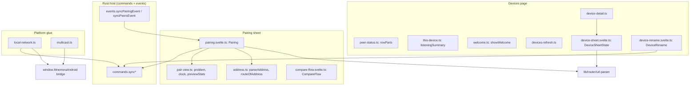
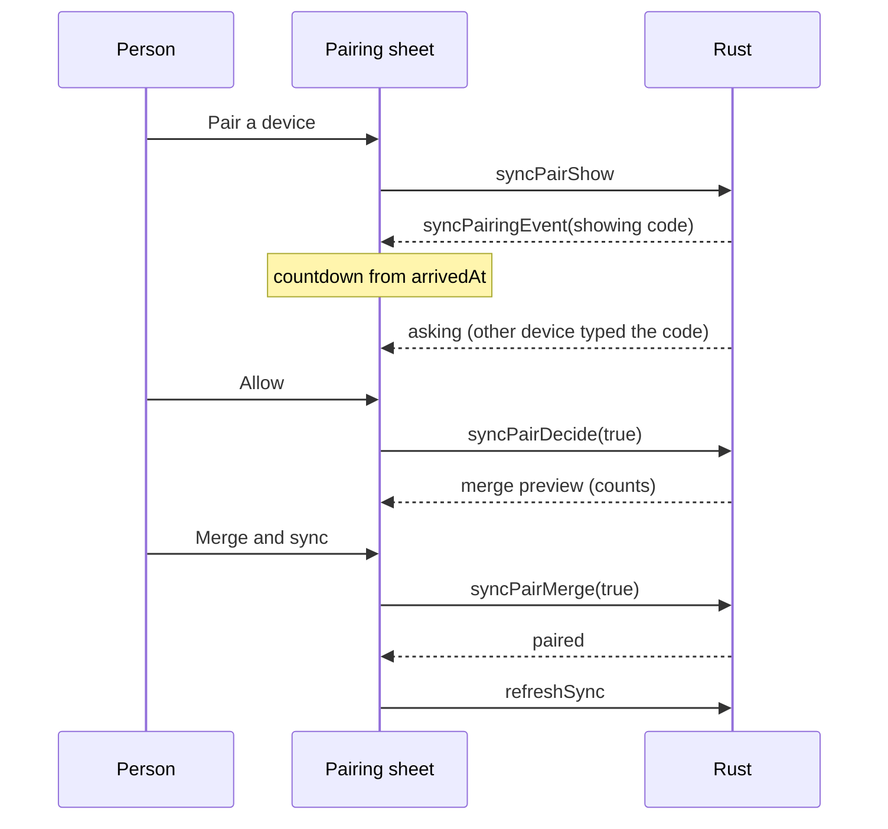
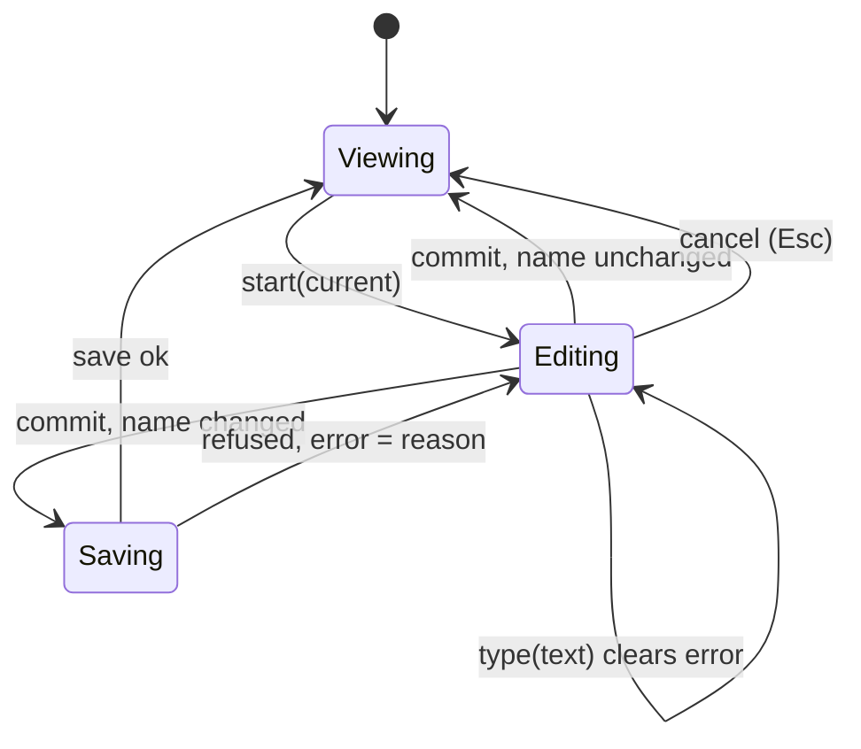

# Sync Devices and Pairing

This module is the frontend half of Sync's **device management and pairing** experience, in `src/modules/sync/`. It covers the Devices page, the per-device sheet, the pairing sheet (show a code, enter a code, pair by address, merge preview), the local-network permission banners, and the helpers that word device status for the user.

The Rust side owns all pairing phases and device state. This module holds only what the UI itself must remember (sheet open or closed, typed digits, drafts) and turns Rust's views into plain words. For the engine see [Sync_Pairing](../Sync_Replication_Engine/Sync_Pairing.md), [Sync_Activity_and_Devices](../Sync_Replication_Engine/Sync_Activity_and_Devices.md) and [Sync_Networking_and_Live](../Sync_Replication_Engine/Sync_Networking_and_Live.md). For the Tauri commands see [Sync_Connectivity_and_Pairing](../Tauri_Host_and_Command_Layer/Sync_Connectivity_and_Pairing.md). For the sibling frontend (activity, conflicts, on/off switch, queries) see [Sync_Activity_Conflicts_and_Status](Sync_Activity_Conflicts_and_Status.md). For the browser mocks that stand in for Rust see [IPC_Sync_Mocks](../IPC_Bridge_and_Browser_Mocks/IPC_Sync_Mocks.md).

## Architecture

## Pairing sheet

### `Pairing` (`pairing.svelte.ts`)
A singleton (`pairing`) state machine facade. Rust's `PairingView` (`idle`, `showing`, `asking`, `failed`, `paired`, and the merge-preview phases) is stored in `view`; the class adds `open`, `mode` (`show` | `enter` | `address`), the typed `code` and `address`, `addressError`, `commandError`, `pausedOnMobile`, and `arrivedAt` (the countdown counts from there).

Key behaviours:
- **`listen()`** subscribes to `syncPairingEvent` and `syncPeersEvent` and reads `syncPairState()`. A peers event triggers `refreshPause()` since the phone may have changed network.
- **`start(mode)`** opens the sheet, pushes a history entry `?pair=<mode>` through `urlParam`, resets state, checks mobile-data pause, and in `show` mode calls `syncPairShow`.
- **`submit()`** (8 digits, `syncPairEnter`) and **`submitAddress()`** (`syncPairEnterAt`); the address is validated first via `parseAddress`, so a bad address is reported and nothing is dialled.
- **`decide(allow)`** answers the "ask" step; Deny closes the sheet immediately. **`merge(merge)`** answers the merge preview; Cancel closes it and leaves both databases untouched.
- **`newCode()`**, **`switchTo(mode)`** (cancel then start again), **`close()`** (cancel and refresh the device list).
- **History handling**: `#pushed` remembers whether opening pushed an entry so closing can `history.back()`. `backed()` handles the Back button; `dropStale()` removes a leftover `?pair=` after reload or Forward. `#stepping` stops `dropStale` from racing our own `history.back()`.
- Editing the code or address (`editCode`, `editAddress`) clears an earlier failure. A dead code (per `problem(...).deadCode`) empties the digit boxes. A `paired` view triggers `refreshSync()`.

### `pair-view.ts`
Pure wording and arithmetic:
- **`problem(error, typing, address)`** maps every `PairingError` kind (`wrong_code`, `code_expired`, `tries_used`, `declined`, `cancelled`, `different_environment`, `version_mismatch`, `different_groups`, `nothing_nearby`, `connection_lost`, `address_not_found`, `address_unreachable`, `backup_failed`, `busy`, `not_ready`) to a title, a fix, and a `deadCode` flag. `version_mismatch` names the older Modules via `nameList` from `pause.ts` (see [Sync_Activity_Conflicts_and_Status](Sync_Activity_Conflicts_and_Status.md)). Tailscale is mentioned only when `usesTailscale(address)`.
- **`PAIRING_PAUSED`** text for mobile data.
- **`previewStats(there, here)`** gives the six merge-preview numbers (entries, tasks, lists; other device first, singular/plural aware).
- **`clock(ms)`** formats `m:ss`, rounding up so ring and text reach zero together; **`fractionLeft`** gives the ring fraction; **`remaining(view, elapsed)`** the time left for `showing`/`asking`; **`isBusy(view)`** is true when leaving the sheet needs a cancel.

### `address.ts` and `address.test.ts`
`address.ts` (not in this module's component list, but imported by it) provides `parseAddress`, `ADDRESS_MESSAGES`, `routeOfAddress`, `usesTailscale`. `address.test.ts` runs the shared fixture `lib/ipc/fixtures/sync-rules.json` (`address_cases`) so the TypeScript parser and the Rust parser agree, checks the four message strings equal Rust's, accepts a full-length IPv6 address and refuses nine groups, and checks the route: `100.64.0.0/10`, `fd7a:115c:a1e0::/48` and `.ts.net` names mean Tailscale, everything else Wi‑Fi.

### `compare-flow.svelte.ts`
State for the "Edit merged" conflict flow (it lives here in the sources, though it concerns conflicts, see [Sync_Activity_Conflicts_and_Status](Sync_Activity_Conflicts_and_Status.md)). `CompareFlow` holds `step` (`compare` → `choose` → `polish`), `choices`, `draft`, `showOriginal`, `draftFor`. It is kept in a module-level map keyed by conflict id because the shell remounts the page across the phone breakpoint, and a resize must not lose the person's work.
- `compareFlow(id)` / `forgetCompareFlow(id)` create and drop a flow.
- `draftIsCurrent(flow)`: the draft is only regenerated when the choices change.
- `stepBack(step)`: polish→choose→compare, `null` from compare (leave the page); nothing typed is lost.
- `escapeCancels(flow, event, overlayOpen, editorPopupOpen)`: Esc in choose or polish discards the edit, unless an open dialog/sheet or the editor's slash menu owns that Esc. `dialogOpen` detects an open `[role=dialog]`.

## Devices page

| File | Role |
|---|---|
| `peer-status.ts` | `rowParts(peer)` builds the line under a device name: status word, "synced 2 min ago", "12 in · 3 out" (only when up to date), route (Wi‑Fi/Tailscale). A syncing device reads "Syncing… 120 of 340 changes". `absoluteTime` gives the hover text honoring the 12h/24h preference. A paused, mobile-data or blocked device reads "last synced". |
| `this-device.ts` | `listeningSummary(device)`: "Paused on mobile data", "Not listening yet", or "Listening on Wi‑Fi and Tailscale" with a detail line of addresses (IPv6 bracketed) and port. |
| `welcome.ts` | `showWelcome(paired, listed)`: the welcome card shows when either the Sync state count or the devices list is 0 (either may notice first after Leave or Forget). |
| `devices-refresh.ts` | `refreshWhileVisible(refresh, ms=10s)` re-reads this device's addresses on a timer while visible and on focus/visibility, since networks can change without a Sync event. Returns a stop function. |
| `device-sheet.svelte.ts` | `deviceSheet` singleton: the open device id lives in the URL (`/sync?device=<id>`). `open` pushes an entry, `close` steps back (debounced 400 ms) or drops the parameter, `dismiss` drops it without stepping back (device forgotten). |
| `device-detail.ts` | `versionsText` ("Mnemora 0.9.2 · Journal 3 · Todo 9 · Core 4", content Modules first), `addressLines` ("worked 2 min ago" / "not tried yet"), `pairedText` ("Wed 14 Oct, by Hemang's MacBook Pro"), `deviceGone(error)` true for an `IpcError` with code `not_found`. |
| `device-rename.svelte.ts` | `DeviceRename`: Enter or blur saves, Esc cancels. `commit` ignores an unchanged name and is guarded so Enter plus blur save once. A refusal keeps the field open with the reason; typing or a new try clears the old message. |

`device-rename.test.ts` (`refuse` helper) covers a good save, refusal with the reason, Esc after refusal, message replacement, and the single-save guarantee.

## Local network and platform glue

`local-network.ts` words and acts on the OS blocking local-network access (macOS 15+ Local Network privacy, Android 17 permission). Rust decides `local_network_blocked`; this file supplies:
- `welcomeLine(mac, device)` the Mac-only "will ask" line, hidden when already blocked.
- `localNetworkBanner(device)` phone or Mac wording with an "Open Settings" button, or `null`.
- `pairByAddressHint(device)` the Mac's "Or on your phone: Pair by address… <ip>" line.
- `openLocalNetworkSettings(platform, bridge)` asks via `window.MnemoraAndroid` on phones, otherwise calls `syncOpenLocalNetworkSettings`.
- `askLocalNetworkOnEnable` (Android 17+, only when Sync is turned on).
- `reportLocalNetworkPermission(bridge, report, sources)` while Sync is on: asks once if never requested, then reports `denied` now, on visibility change and on the `mnemora-local-network` window event. On stop it reports `false`.

`multicast.ts` `holdMulticastWhileVisible(bridge, doc)` holds Android's Wi‑Fi multicast lock (needed for mDNS discovery) while the page is visible and releases it on hide or stop; a no-op without the bridge. `multicast.test.ts` uses `fakeDocument` to verify the hold/release sequence `[true, false, true, false]`. Both rely on the `AndroidBridge` type from the [Theme](../Frontend_Platform_and_Shell/Theme.md) system-bars module and on the Android side in [Android_Integration](../Android_and_Home-Screen_Widget_Platform/Android_Integration.md).

## Design notes

- **Rust owns truth.** The UI never derives pairing phase transitions; it stores the last view and words it.
- **URL as sheet state.** Both the pairing and device sheets use `urlParam`, so Back closes them and reload restores them (pairing intentionally drops a stale `?pair=` since nothing is pairing).
- **Shared fixtures keep TS and Rust identical** (address rules, error wording), the same approach the mocks use.
- **Cleanup functions.** `listen`, `refreshWhileVisible`, `holdMulticastWhileVisible` and `reportLocalNetworkPermission` all return stop functions meant to be called on unmount, so nothing runs while Sync is off.
