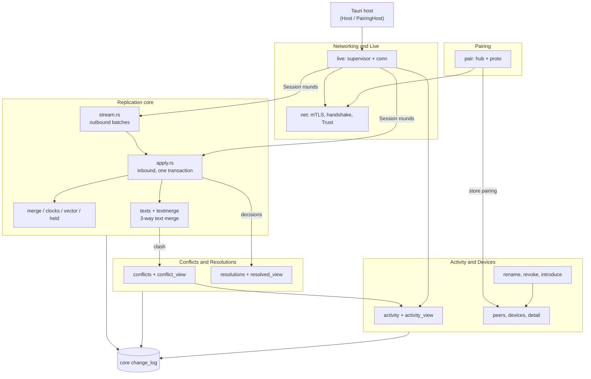
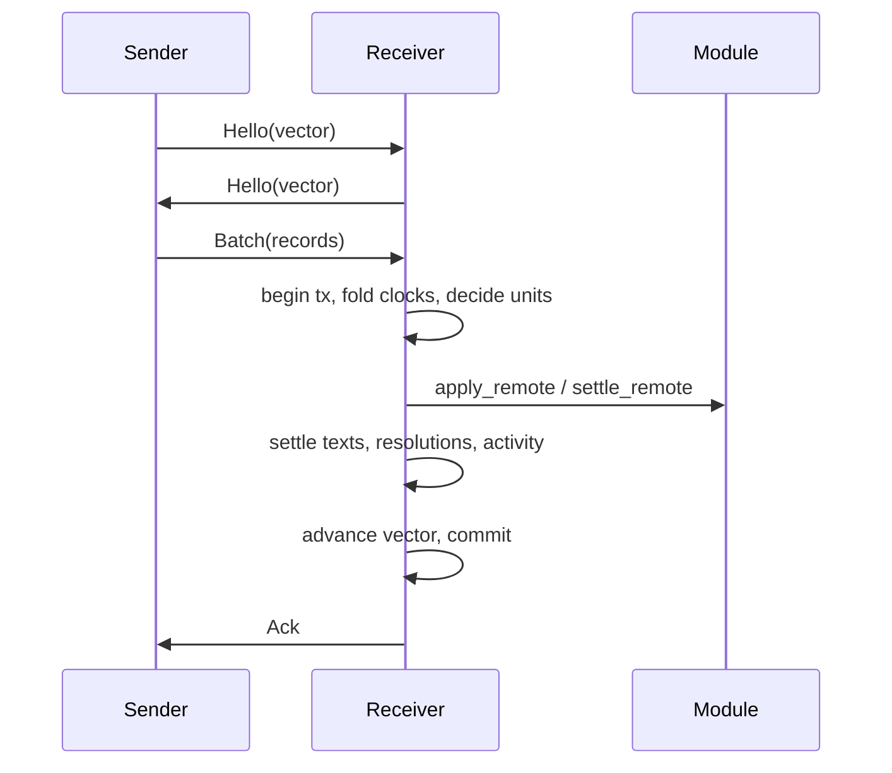

# Sync Replication Engine

## Purpose

The Sync Replication Engine is the `mnemora-sync` crate (`crates/sync`). It keeps a person's own devices in step by syncing them directly with each other, with no server. Sync is off by default and does nothing while off. The crate never imports the Journal or Todo crates. Those modules plug in through the `mnemora_core::syncable` traits (`SyncEntity`, `RemoteChange`, `apply_remote`, `settle_remote`).

- Every local change is a record in the core `change_log`. Each record carries an origin device, an origin sequence and a hybrid logical clock (HLC).
- Two devices exchange the records the other lacks. A device can also relay records it holds from a third device.
- Every device converges to the same state, whatever order the records arrive in.
- Pairing and trust use an 8-digit code with SPAKE2. Transport is mutual TLS 1.3 with pinned Ed25519 keys.
- Conflicts and automatic decisions are surfaced to the person as Conflicts, Resolutions and Activity.

## Architecture

### How the parts fit together

1. **Pairing.** `Pairing` shows or enters a code. The devices prove the code and each other's TLS keys. Both back up their databases, record the pairing in one group and pin each other's keys. See [Sync Pairing](Sync_Replication_Engine/Sync_Pairing.md).
2. **Connecting.** The `live` supervisor keeps one connection per reachable paired device. It dials from discovery, remembered addresses and typed addresses. It breaks ties between duplicate connections, backs off after failures and pauses a device on a version or clock mismatch. See [Sync Networking and Live](Sync_Replication_Engine/Sync_Networking_and_Live.md).
3. **Replicating.** Each round is a `Session`. Both sides send `Hello` with their version vectors, then `Batch` records oldest clock first, then `Ack`. The receiver applies a whole batch in one transaction. Fields are resolved per unit: newest HLC wins for values and order, and text is replayed with a three-way merge. See [Sync Replication Engine core](Sync_Replication_Engine/Sync_Replication_Engine_Sync_Replication_Engine.md).
4. **Disagreement.** A text clash becomes a Conflict that every device derives identically. Values changed side by side, delete against edit, and Tasks moved to the Inbox are written as Resolutions. See [Sync Conflicts and Resolutions](Sync_Replication_Engine/Sync_Conflicts_and_Resolutions.md).
5. **History and roster.** Activity is an append-only synced log that appears once on every device. The peer roster, renames, typed addresses, signed Forget decisions and signed introductions travel through the same change log. See [Sync Activity and Devices](Sync_Replication_Engine/Sync_Activity_and_Devices.md).

### Batch application

## Design guarantees

- **Idempotent and order-independent.** Duplicates are counted once, and an interrupted exchange resumes exactly.
- **Deterministic ids.** Conflicts, Resolutions and named Activity rows use UUIDv5 ids derived from their content. Every device that notices the same thing creates the same row.
- **Clock safety.** A record more than 5 minutes ahead rolls the batch back and pauses sync.
- **Editing holds.** Remote changes to a record being edited are held until the editor closes. A delete is never held.
- **Privacy.** Field values and text are never logged.
- **Environment isolation.** Production and Sandbox devices never sync or pair with each other.

## Core component documentation

| Area | Contents | Documentation |
|---|---|---|
| Replication core | Wire protocol, streaming, apply, clocks, merge, holds, text merge, device settings, and the cluster test suites | [Sync Replication Engine core](Sync_Replication_Engine/Sync_Replication_Engine_Sync_Replication_Engine.md) |
| Conflicts and Resolutions | Text-clash Conflicts, automatic Resolutions, their views, and "Use other instead" | [Sync Conflicts and Resolutions](Sync_Replication_Engine/Sync_Conflicts_and_Resolutions.md) |
| Activity and Devices | Activity log and view, peer roster, Devices tab, device sheet, renames, Forget and introductions | [Sync Activity and Devices](Sync_Replication_Engine/Sync_Activity_and_Devices.md) |
| Networking and Live | mTLS transport, handshake rules, typed addresses, local-network detection, the live supervisor and connections | [Sync Networking and Live](Sync_Replication_Engine/Sync_Networking_and_Live.md) |
| Pairing | Code-based pairing protocol, the `Pairing` hub state machine and the `PairingHost` trait | [Sync Pairing](Sync_Replication_Engine/Sync_Pairing.md) |