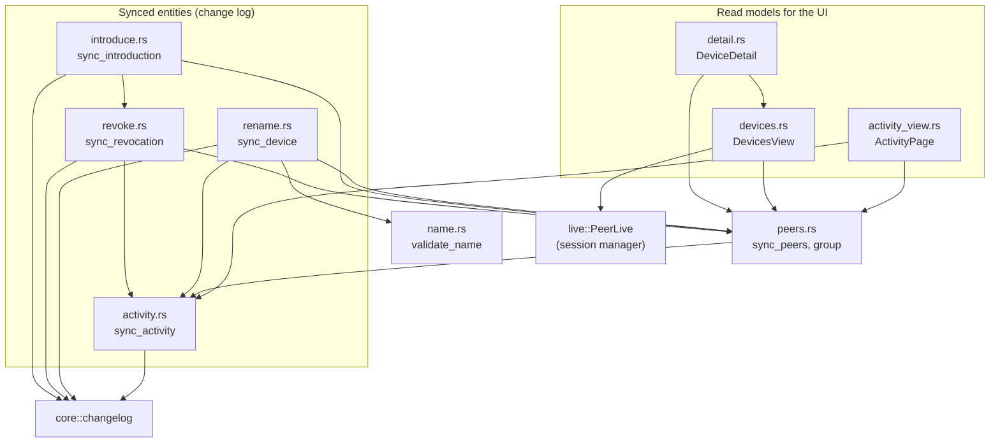
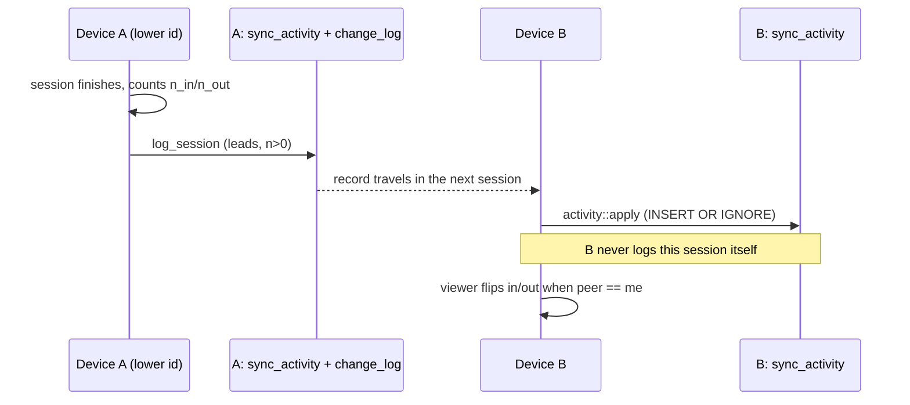
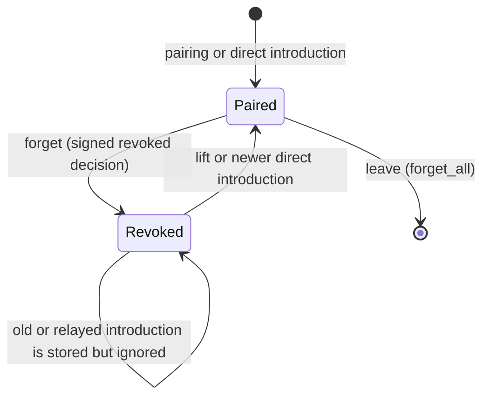
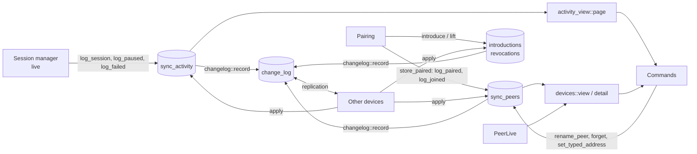

# Sync_Activity_and_Devices

This module is the "what happened and who is in the group" half of the sync crate (`crates/sync`). It covers:

- **Activity**: an append-only, synced log of what Sync did (sessions, pairing, pauses, renames, conflicts, list merges). It is rendered as sentences for the Activity tab.
- **Devices**: the paired-device roster, the Devices tab view, and the per-device sheet.
- **Group membership records**: renames and typed addresses (`sync_device`), signed Forget decisions (`sync_revocation`), and signed introductions (`sync_introduction`). All three travel through the change log like any other record.

The replication machinery that carries these records is described in [Sync_Replication_Engine](../Sync_Replication_Engine.md) and [Sync_Replication_Engine_Sync_Replication_Engine](Sync_Replication_Engine_Sync_Replication_Engine.md). Related pages:

- Pairing flow: [Sync_Pairing](Sync_Pairing.md)
- Connections and sessions: [Sync_Networking_and_Live](Sync_Networking_and_Live.md)
- Conflicts and resolutions: [Sync_Conflicts_and_Resolutions](Sync_Conflicts_and_Resolutions.md)
- Tauri commands that expose this module: [Sync_Connectivity_and_Pairing](../Tauri_Host_and_Command_Layer/Sync_Connectivity_and_Pairing.md) and [Sync_Conflicts_and_Activity](../Tauri_Host_and_Command_Layer/Sync_Conflicts_and_Activity.md)
- The UI that draws the results: [Sync_Activity_Conflicts_and_Status](../Sync_Frontend/Sync_Activity_Conflicts_and_Status.md) and [Sync_Devices_and_Pairing](../Sync_Frontend/Sync_Devices_and_Pairing.md)
- Change log, `SyncEntity` and `Applied` contracts: [Core_Foundation](../Core_Foundation.md)

## Architecture

Each synced entity is declared as a `SyncEntity` (a name plus its fields). Each has an `apply` function, which is Sync's side of the Module contract for records that arrive from another device. Each also has a local writer that calls `changelog::record`.

## Activity (`activity.rs`)

### Row model

A row of `sync_activity` is written once and never changes. All ten fields of the `ACTIVITY` entity are plain values fixed at creation: `kind`, `at`, `device`, `device_name`, `peer`, `peer_name`, `n_in`, `n_out`, `detail` and `extra`. A session's breakdown is `detail`, a JSON list of `Part { m, e, n }` (Module, entity, count). It holds counts only, never content. `extra` is kind-specific JSON, such as a reason, old and new names, or the conflict id.

`Kind` has 13 variants: `Session`, `Paired`, `Joined`, `Left`, `Forgot`, `Renamed`, `Paused`, `Resumed`, `Failed`, `ConflictRaised`, `ConflictResolved`, `ListsMerged` and `Blocked`. `Why` gives the reason for a pause or failure: `Update`, `Clock`, `Environment`, `Revoked` or `Lost`. Both enums round-trip through `as_str` and `parse`.

### "Appears once on every device"

Each event must be one line on every device even though every device could notice it. Three rules ensure this:

| Class of event | Who logs it | Example kinds |
|---|---|---|
| Lived through by two devices | The device with the lower id (`leads(me, peer)`) | `Session`, `Paired`, `Paused`, `Resumed`, `Failed` |
| Concerns one device | That device | `Renamed`, `Forgot`, `Left` |
| Has a name of its own | Any device, using a deterministic id | `ConflictRaised`, `ConflictResolved`, `ListsMerged`, `Joined` |

Named ids come from `named_id`, a `UUIDv5` over the parts joined with NUL in a fixed namespace. Devices that notice the same thing therefore derive the same id, and the `INSERT OR IGNORE` dedupes the copies. `log_conflict_deleted` deliberately reuses the id a person's resolution would have. It sets `extra.auto = true` so the line names no device.

### Writing

`log()` inserts the row, and if it was new it records a `ChangeOp::Create` in the change log so the row replicates. Throttling is read from the log itself, so a restart does not repeat a line:

- `log_paused` and `log_resumed` consult `paused_now`, the newest pause or resume row for that device and peer. A pause is logged once, and a resume only follows a pause.
- `log_failed` and `log_local_network_blocked` stay quiet for 10 minutes (`QUIET_MS = 600_000`) after the last such line, so a flaky link is one line.
- `log_session` writes nothing when `n_in + n_out == 0`.
- `note_events` turns `SyncEvent::ListsMerged` reported by Modules during a batch into activity, in the same transaction.

### Receiving

`apply` rebuilds a `Row` only if every field is present and `kind` parses. A partial record is returned `changed: false` and kept only for relay. Otherwise it does an `INSERT OR IGNORE`. Activity records never count as "moved" in a session. A sync that only passes activity on is therefore quiet, and this ends the chain: logging a session would otherwise make new records to pass on.

## Activity view (`activity_view.rs`)

`page(conn, viewer, filter, cursor, limit)` returns an `ActivityPage` of `ActivityRow` values, newest first. The screen only draws them.

- **Filter**: `ActivityFilter::All`, `ThisDevice` or `Device { id }` select rows where `device = ?1 OR peer = ?1`.
- **Paging**: the cursor is `at:id`, parsed by `parse_cursor` and produced by `cursor_of`. The query orders by `at DESC, id DESC` and fetches `limit + 1` rows to decide whether `next` exists. `limit` is clamped to `1..=MAX_PAGE` (200).
- **Sentences**: `describe` builds `Piece` runs, where `strong` marks names. It resolves names live through `peers::name_of`, falling back to the stored name and then to "another device". For a session about the viewer (`peer == viewer.device`), in and out are swapped so it reads from the viewer's side.
- **`on` attribution**: "· on Pixel 8" is added only when someone else logged it and the sentence does not already name them. `Renamed` never gets it, and auto-closed conflicts belong to no device.
- **Breakdown**: `breakdown_text` produces "Todo: 9 Tasks, 1 List · Journal: 2 Entries · Settings: 1" in a fixed Module order (todo, journal, core, sync, others). Entities with no noun add up as a bare number.
- **Links**: a `ConflictRaised` line carries `ActivityLink::Conflicts` only while `conflict_waits` finds the conflict still open.
- **Reasons**: `why_words` maps a `Why` to words such as "one of you needs an update" and "the clocks are too far apart".

## Devices

### Peer roster (`peers.rs`)

`sync_peers` holds paired devices, and `sync_group` holds the single group id.

- `list` returns `PeerRow` values with state defaulting to `NotNearby`. `devices::enrich` fills in live and remembered data later.
- `name_of`, `is_paired`, `pinned` (the keys to pin at startup), `members` (what a newcomer is introduced to) and `group` are the read helpers.
- `unique_name(wanted, taken)` makes names unique ignoring case, accents and whitespace, by suffixing " (2)", " (3)" and so on. It trims the base so the result stays within 40 characters. A shared JSON fixture (`src/lib/ipc/fixtures/sync-rules.json`) pins the rule for both Rust and the browser mock, see [IPC_Sync_Mocks](../IPC_Bridge_and_Browser_Mocks/IPC_Sync_Mocks.md).
- `store_paired` records a pairing in one transaction. It creates or checks the group, stores the peer under a unique name, logs `Paired`, and takes in the other group members the peer brought. Revoked members are skipped, and each one that is taken in gets a `Joined` line. It returns `Stored`, which carries the keys to pin.
- `forget_all` implements leaving. It logs `Left` unless the members were already told, then clears peers, the group, `peer_state`, revocations and introductions. Synced data stays.

`PeerState` has seven values: `UpToDate`, `Syncing`, `NotNearby`, `PausedOnMobileData`, `BlockedByLocalNetwork`, `Paused` and `Removed`.

### Devices tab (`devices.rs`)

`view` builds `DevicesView { this_device, peers }`. `ThisDevice` carries the name, platform, listening port, shareable addresses, route kinds (Wi-Fi before Tailscale, told by IP range through `routes_of`), and the two blocking flags.

State is derived by `state_of(live)` with this precedence: paused, then syncing, then reachable (`UpToDate`), then `NotNearby`. `enrich` merges remembered per-peer data from `peer_state::all`. Reachable devices sort first, then by most recent `last_seen_at`, `paired_at` and name. If this device has been forgotten (`revoke::removed_here`), every row reads `Removed`.

Two overlays then replace `NotNearby` only. `with_mobile_pause` is applied first, followed by `with_local_network_block`. Mobile data therefore wins over a blocked local network, and a connected device is never overridden.

### Device sheet (`detail.rs`)

`detail` joins `sync_peers` with `sync_peer_status` and returns `DeviceDetail`. It carries `paired_by` (resolved to this device's own name when it did the pairing), `last_seen_at`, `last_synced_at`, route, remembered `addresses` (from `peer_state::known_addresses`), the app version, and per-Module data versions. It also carries the typed address. `typed_address` reads the stored typed address, `set_typed_address` validates it through `Address::parse` and persists and syncs it through `rename::set_address`, and `typed_for_dial` supplies the third list of dial candidates to [Sync_Networking_and_Live](Sync_Networking_and_Live.md).

## Naming and addresses (`name.rs`, `rename.rs`)

`validate_name` trims the name and requires 1 to 40 characters, counted as characters and not bytes. `default_device_name` uses `whoami::devicename`. On Android it reads `ro.product.model` through `getprop`.

Renames and typed addresses share the `sync_device` entity (id: the device, value fields `name` and `address`). The newest write wins for each field, and a null address means it was cleared.

- `rename_peer` validates the name, rejects clashes with `Another of your devices already has that name`, settles the name, records the change and logs `Renamed`, all in one transaction. `check_own_name` does the same check for this device's own name, and `record_own` publishes it.
- **Deterministic numbering** (`settle` and `settle_family`): a device stores `wanted_name` and displays `name`. All devices wanting the same name are numbered by device id, with the lowest id keeping the plain name. The result is a function of the wishes alone, so devices that heard renames in different orders still agree. Tests cover this for two and three devices in several delivery orders.
- `apply` emits `SyncEvent::DeviceRenamed` when the record names this device, so the host can update the device file. It ignores a typed address aimed at this device itself.
- `set_address`, `refresh_address` (used by `store_paired`, `take_in` and `take_effect`) and `adopt_local_addresses` (run at start) keep the `typed_address` cache in step with the log.

## Trust records

Both trust records are signed with the member's device key, travel as all-or-nothing field groups (`in_group`), and are kept for relay even when they change nothing locally. Both are applied only if the signer's key is held for a paired device that does not itself stand forgotten, and only if the record is newer than what is held. Both reject records dated more than 24 hours ahead.

### Forget (`revoke.rs`)

`sync_revocation` records are keyed by the forgotten device. A `Row` holds the public key, name, platform, `state` (`revoked` or `lifted`), `at`, `by` and the signature. The signature covers the message `mnemora-revocation-v1` plus every field joined by NUL, so none can be swapped.

- `forget` signs a revocation, stores and records it, logs `Forgot`, and removes the peer's rows (`sync_peers`, `sync_peer_status`, `sync_peer_addresses`) in one transaction. It returns `Forgotten { name, key }` so the caller can close connections and unpin the key.
- `leave` signs a revocation of this device itself and logs `Left`. It is called only when a member is connected to hear it, and it is not stored locally. The caller then runs `peers::forget_all`.
- `lift` writes a newer `lifted` decision when pairing takes a revoked device back, so the other members take it back too. `at` is strictly increasing (`next_at`), so an old `revoked` replayed later cannot undo the `lifted`.
- `apply` rejects, with a debug log, any record that is incomplete, made here, signed by a non-member, badly signed, future-dated, signed by a forgotten device, not newer, or contradicted by a newer pairing (`paired_since`). `take_effect` removes the peer, but only if the stored key matches the revoked key. On `lifted` it re-adds the peer under a unique name.
- `removed_here` and `is_revoked` feed `devices.rs` and `detail.rs`. `revoked_keys` gives the transport the keys it must never trust. `clear` runs when the group is left.

No remote wipe exists: a forgotten device keeps its data.

### Introduce (`introduce.rs`)

When a newcomer pairs through one member, that member signs an introduction so the other members accept the newcomer and can connect directly. `sync_introduction` is keyed by the newcomer and signed over `mnemora-introduction-v2`, which includes the `direct` flag.

- `introduce` is a no-op when the paired devices are the only ones in the group. Otherwise, for each device with a usable key that is not itself, not revoked and paired here, it signs a row with a time that increases monotonically. `direct` is true only for the device this member really paired, and false for members merely passed on. It records the row as a Create or Update.
- `apply` runs these checks in order: the fields are complete, the record is not an echo of this device's own or about this device, the signer is not the newcomer itself, the signer is a paired device with a valid signature, the date is not too far ahead, the signer is not forgotten, the record is newer, a group exists here, and the key is not already held by another id.
- **Forget versus introduction race**: if the newcomer stands forgotten here, the introduction is stored but not acted on unless it is newer than the Forget **and** `direct`. Only a real pairing of that device is a decision to bring it back. Without the `direct` flag, any member that was behind on news could undo a Forget by relaying the device.
- `take_in` inserts the peer with `paired_at = row.at`, so earlier Forgets cannot remove it again. It settles the name and refreshes the address. For an already-paired device it replaces the key only when the introduction is direct and newer.

## Data flow summary

## Design notes for maintainers

- **Never log content.** Rows hold device names, counts and Module/entity kinds. The one exception is List names in a merge line.
- **Rows are immutable.** `INSERT OR IGNORE` plus deterministic ids give idempotence, and the `apply` path is safe to replay in any order.
- **State comes from the log, not memory**, for pause and failure throttling, so restarts do not repeat lines.
- **Every signed message is versioned** (`...-v1`, `...-v2`) and covers every field, which allows later format changes without ambiguity.
- **Integration coverage** lives in `src-tauri/src/sync_activity_tests.rs`, `sync_forget_tests.rs`, `sync_groups_tests.rs` and `sync_address_tests.rs`. These tests are described on [Sync_Connectivity_and_Pairing](../Tauri_Host_and_Command_Layer/Sync_Connectivity_and_Pairing.md) and [Sync_Conflicts_and_Activity](../Tauri_Host_and_Command_Layer/Sync_Conflicts_and_Activity.md).
