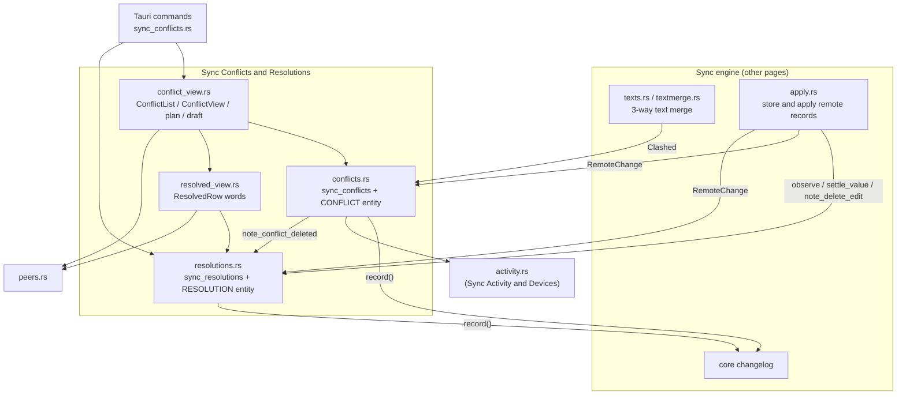
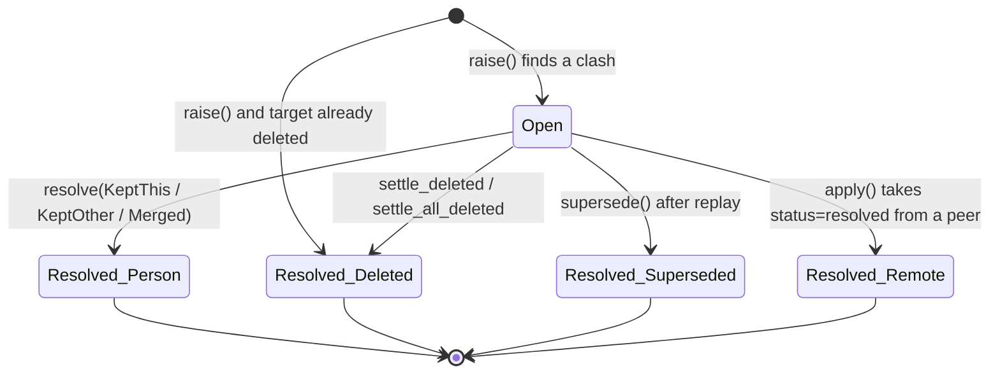
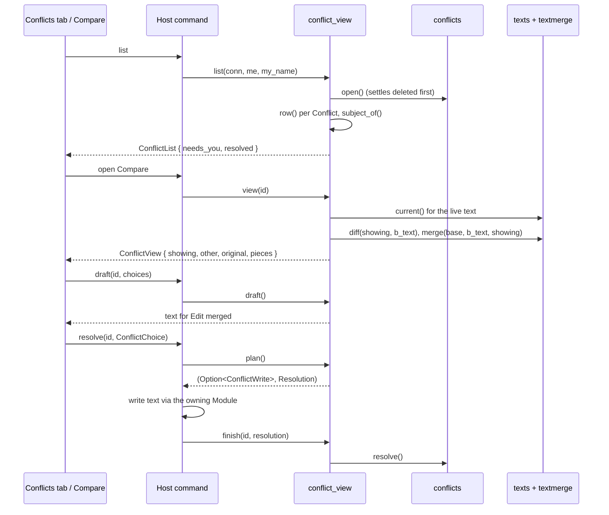
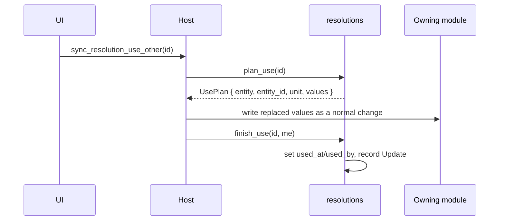

# Sync Conflicts and Resolutions

This module is the part of the [Sync Replication Engine](../Sync_Replication_Engine.md) that deals with disagreement between devices. It has two halves:

- **Conflicts** (`conflicts.rs`, `conflict_view.rs`): two devices rewrote the *same words* of a text. The merge has already put the newest version in the record, so every device shows the same text. The other version waits as a Conflict for the person to compare, keep, or merge.
- **Resolutions** (`resolutions.rs`, `resolved_view.rs`): a log of what Sync decided *without asking*. Examples are a value two devices changed beside each other (newest wins), a record deleted on one device and edited on another, a Task put in the Inbox because its List is gone, and a text clash on a deleted record.

The Rust code computes the labels and diffs. The window only lays them out (see [Sync Activity, Conflicts and Status (frontend)](../Sync_Frontend/Sync_Activity_Conflicts_and_Status.md)). The Tauri commands that expose this module are in [Sync Conflicts and Activity (host)](../Tauri_Host_and_Command_Layer/Sync_Conflicts_and_Activity.md).

Neither half ever logs text or values. Both log only structure, through `tracing` at debug level.

## Architecture

Both halves follow the same pattern:

1. A **stored table** (`sync_conflicts`, `sync_resolutions`) holds raw values.
2. A **`SyncEntity` schema** (`CONFLICT`, `RESOLUTION`) makes the rows travel as change-log entities, `sync_conflict` and `sync_resolution`. A decision made on one device reaches all of them.
3. A **view module** turns raw rows into display text on read. A renamed device or a changed date/time format therefore applies to the whole log at once.

## Conflicts (`conflicts.rs`)

### Identity and convergence

A Conflict id is a UUIDv5 over the record, field, hash of the base text, and the sorted hashes of the two versions (`conflict_id`). Two consequences follow:

- Every device that meets the same clash derives the same row, whichever side it calls "ours".
- A device that learns of the clash from another finds the row already there. `insert` uses `INSERT OR IGNORE`, and `raise` returns early if `get(id)` exists.

Everything except the outcome is fixed at creation. The `status`, `resolution`, `resolved_at` and `resolved_by` fields form one atomic group (`OUTCOME`). The outcome only ever moves from `open` to `resolved`.

### Stored shape

`Stored` holds:

- The target (entity, id, field).
- `base`, the text both sides started from.
- Side **a**, the newest version, which was applied (`a_text`, `a_device`, `a_at`).
- Side **b**, the other version.
- `raised_at`, equal to `a_at`.
- The outcome fields.

### `Resolution` outcomes

| Variant | Stored value | Meaning |
|---|---|---|
| `KeptThis` | `keep_this` | The showing version stays. |
| `KeptOther` | `keep_other` | The other version is written. |
| `Merged` | `merged` | An edited, clash-by-clash text is written. |
| `Deleted` | `deleted` | The record is deleted, so nothing was asked. |
| `Superseded` | `superseded` | A late record showed the clash was never one. |

Only the first three count as a person's choice and are logged as Activity (`log_conflict_resolved`). `Deleted` and `Superseded` are the engine closing the row on its own.

### Lifecycle

Key functions:

- **`raise`** is called by the text merge with a `Clashed` value. It is idempotent. It records the new row as a `Create` change and emits `SyncEvent::ConflictRaised`, or `ConflictAutoResolved` if the target is already deleted. An auto-resolved clash also writes a `ConflictDeleted` resolution via `resolutions::note_conflict_deleted`. Otherwise it logs "conflict raised" Activity against the device that authored the *other* version.
- **`resolve`** runs `UPDATE ... WHERE status='open'`. It does nothing, and returns `false`, if the Conflict is already resolved. Otherwise it records an `Update` change.
- **`settle_all_deleted` / `settle_deleted`** close open Conflicts whose record is deleted. They run before `open` and `open_count`, because a delete made on *this* device never passes through the receiving side.
- **`supersede`** closes open Conflicts for a field that a full replay of its records no longer produces (anything not in `keep`).
- **`apply`** is the receiving side of the Module contract. It creates the row only from a record carrying all the creation fields. Otherwise the record is "kept for relay only". Then it applies a `resolved` outcome and reports `changed` by comparing before and after.

## Conflict presentation (`conflict_view.rs`)

All view data is computed here: labels, diffs, the original text, and clash pieces.

### "Showing" is live

"Showing" is the record's *current* text (`showing_now`), not the text from when the Conflict was raised. An edit the person made after the Conflict stays, either as agreed text or inside the showing side of a clash.

"Other" is `b_text`, the version that lost the merge. In `textmerge` terms, the older version is "ours" and the showing text is "theirs". That is why `ClashPiece::Clash { showing: k.theirs, other: k.ours, original: k.base }`.

### Subjects

`subject_of` maps the target entity to a `ConflictSubject` and the owning module (used for the row icon):

| Entity | Subject | Module |
|---|---|---|
| `journal_entry` | `Entry { page_date, written_at, written_offset_min }` | journal |
| `ai_conversation` | `Conversation { title }` | ai |
| `ai_saved_question` | `SavedQuestion { text }` | ai |
| `todo_comment` | `Comment { task_title }` | todo |
| anything else | `Task { title, field: Title or Notes }` | todo |

`minute_of_day(written_at, offset_min)` gives the time of day in the zone the Entry was written in. `resolved_view` reuses it.

### Settling a Conflict

- **`draft(id, choices)`** builds the starting text for Edit merged. It takes agreed pieces as they are. Each clash takes its `ClashChoice` in order: `Showing`, `Other`, or `Both` (newer first). A missing choice defaults to `Showing`. `Both` inserts a space or newline unless whitespace is already there.
- **`plan(id, choice)`** returns what the app must write plus the `Resolution`. `KeepThis` writes nothing. `KeepOther` writes `b_text`. `Merged` writes the supplied text. It errors if the Conflict is gone or already resolved, for example when it was resolved on another device.
- **`finish`** marks the Conflict resolved, which syncs to the other devices.

The write itself goes through the owning Module, as an ordinary new change. This module only plans it.

## Resolutions (`resolutions.rs`)

A resolution row is a record of something Sync decided on its own.

| `Kind` | Meaning |
|---|---|
| `Value` | Two devices changed a value beside each other. The newest took. |
| `DeleteEdit` | A record was deleted on one device and edited on another by a device unaware of the delete. Both took effect. |
| `TaskInbox` | A Task moved into a List that is gone lands in the Inbox. |
| `ConflictDeleted` | A text clash on a deleted record, settled without asking. |
| `OrderPrefs` | A session's folded line, "Order & preferences · N changes". It is local and not recorded as a change. |

### Derived, not delivered

`Value` and `DeleteEdit` rows are **pure functions of the stored records**. Every device works them out itself, replayed in clock (HLC) order. The log is therefore the same whatever order records arrive in. A row made before a late record turned up is taken back.

- **`settle_value`** runs `replay_clashes` over one Value unit. A record made from a value other than the one the replay holds was made *beside* the earlier one, because its author had not seen it. A change that replaced exactly what stood is just a change. If both chose the same value (`essence` ignores the moment of a delete or `closed_at`), nothing is logged. It `note`s a row per clash and deletes unused `value` rows that are no longer live.
- **`settle_local`** covers this device's own records since the last mark (`sync_local_settled`). Sync doesn't "store" those, so a clash with an earlier received record would otherwise go unnoticed here.
- **`note_delete_edit`** finds the first edit (in clock order, before any restore) by a device other than the deleter that the deleter had not seen. The edit is later by clock, or above the delete's `seen` map. It makes the row, or updates its `at` and `replaced` if an earlier edit arrived late. `retract_delete_edits` removes stale rows, and `refresh_delete_edits` rejudges after local deletes.
- **`value_members`** decides which units are logged. A unit qualifies only if it is a pure Value field or group, none of it bookkeeping (`created_at`, `repeat_of`, `skipped`) and not Sync's own record. The exception is a device's typed `address`.
- **`observe`** is for Order keys and Preferences only. It reports a `Folded` item when the newest value moves something. `fold_add` accumulates these into the session's line, keeping at most `DETAIL_MAX` (100) names while the count stays exact.
- **`note_task_inbox`** and **`note_conflict_deleted`** write the other two kinds.

### Ids and sync

Row ids are UUIDv5 over the decision, such as the record, the unit and the two clocks (`make_id`). Devices that meet the same decision make the same id. `note` inserts the row and records a `Create`, but only if the row is new. It also calls `take_used_before_made`, which applies a "used" update that reached the device before the row existed.

**`apply`** (receiving side) never takes a `Value` or `DeleteEdit` creation as sent, because the sender's copy might rest on records this device lacks. The one exception is a row somebody has *used*, which must stay however the records later read. The kind lives only in the creation record, so `creation_fields` looks it up in the change log when only a "used" update arrives.

### "Use ‹other› instead"

`plan_use` fails if the row is gone, was already used, or is not a `Value` row. `finish_use` sets `used_at` and `used_by` only where `used_at IS NULL` and then syncs the update. Because the write goes through the owning Module, it is an ordinary new change that syncs and reads as a history line.

### Newness

`mark_visited` stores the moment of the person's last look (`sync_resolution_visit`). A row is `fresh` when its `learned_at` is later than that.

## Resolved view (`resolved_view.rs`)

`list(conn, me, my_name)` turns every stored `Row` into a `ResolvedRow` (title, detail, icon, module tint, `fresh`, optional `action`, `used`, and `changes` for folded lines). It reads the live records, so names and values are current. It reads the `core.date_format` (`long`/`short`/`iso`) and `core.time_format` (`24h`/`12h`) Preferences through `Formats`, and uses its own civil-date arithmetic.

Examples of the text it builds:

- Title: `‘Water plants’ · Priority`
- Detail: `P1 (Mac) kept · P2 (Pixel 8) replaced`
- Button: `Use P2 instead`
- After use: `Changed to P2`

`can_write_back` limits the button to:

- Task priority, when and list.
- Task status, unless the Task repeats, since closing a repeating Task is about its next date.
- List name, emoji, sort and grouping.
- A Journal Entry's page date.

Deletion is never written back. `list_deleter` finds the device whose delete of a List is newest, for the "was deleted on …" detail of `TaskInbox` rows.

Device names come from `peers::name_of`. This device uses `my_name`, and an unpaired device reads "Another device".

## Data model summary

| Table | Written by | Synced as | Key idea |
|---|---|---|---|
| `sync_conflicts` | `raise`, `resolve`, `apply` | `sync_conflict` | Id from clash content. Outcome is open → resolved only. |
| `sync_resolutions` | `note`, `settle_*`, `fold_add`, `finish_use`, `apply` | `sync_resolution` | Derived from records. Outcome is "used" only. |
| `sync_resolution_visit` | `mark_visited` | not synced | Last look at the log. |
| `sync_local_settled` | `settle_local` | not synced | High-water mark of own changes judged. |

## Relationships to other modules

- [Sync Replication Engine](../Sync_Replication_Engine.md): `texts`, `textmerge` and `apply` call into this module. The table migrations live there.
- [Sync Activity and Devices](Sync_Activity_and_Devices.md): `activity::log_conflict_raised`, `log_conflict_resolved` and `log_conflict_deleted` write the matching history lines, and `activity_view` uses `conflict_subject`. `peers` provides device names.
- [Core Foundation](../Core_Foundation.md): `changelog`, `syncable` (`SyncEntity`, `RemoteChange`, `SyncEvent`), `hlc` and `settings` are used here.
- [Sync Conflicts and Activity (host)](../Tauri_Host_and_Command_Layer/Sync_Conflicts_and_Activity.md): the commands `sync_conflicts`, `sync_conflict`, `sync_conflict_draft`, `sync_conflict_resolve`, `sync_resolution_use_other` and `sync_resolutions_visited`. The tests `sync_conflicts_tests.rs` and `sync_resolutions_tests.rs` cover the behaviour end to end.
- [Sync Activity, Conflicts and Status (frontend)](../Sync_Frontend/Sync_Activity_Conflicts_and_Status.md): draws `ConflictList`, `ConflictView` and `ResolvedRow`.
